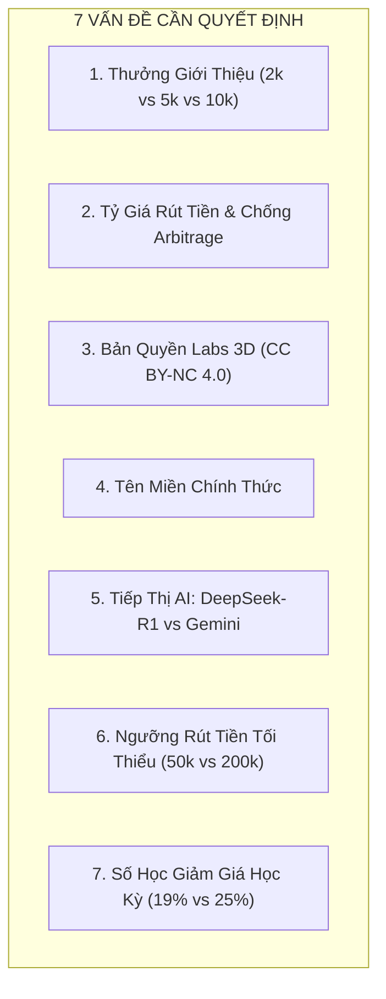
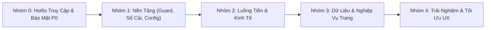
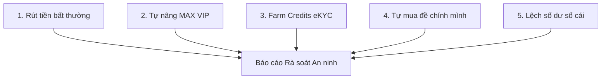

# BẢNG TỔNG HỢP NGUYÊN NHÂN GỐC, MÂU THUẪN & LỘ TRÌNH PR PHÁT HÀNH
## (MASTER BACKLOG & ARCHITECTURAL DECISIONS) - EDUTEST AI

**Ngày lập:** 01/11/2026  
**Phiên bản:** 1.0 - Production Readiness Review  
**Chuyên viên đánh giá:** Senior Full-stack Engineer & Security Reviewer  
**Phạm vi tổng hợp:** Toàn bộ 14 báo cáo audit chi tiết trong thư mục `audit/` (`affiliate.md`, `credits-economy.md`, `exams-create.md`, `exams-list.md`, `grading.md`, `labs.md`, `marketplace.md`, `pricing.md`, `settings.md`, `student-portal.md`, `student-portal-features-fe.md`, `student-portal-features-be.md`, `wallet.md`, `whiteboard.md`).  
**Chế độ thực thi:** READ-ONLY AUDIT (Không sửa đổi mã nguồn sản phẩm, không chạy query ghi dữ liệu thật).

---

## MỤC LỤC
1. [Phần 1: Bảng Gộp Lỗi Theo Nguyên Nhân Gốc (Root Cause Mapping)](#phần-1-bảng-gộp-lỗi-theo-nguyên-nhân-gốc-root-cause-mapping)
2. [Phần 2: Danh Sách Mâu Thuẫn Cần Ban Quản Trị Quyết Định ("Cần tôi quyết định")](#phần-2-danh-sách-mâu-thuẫn-cần-ban-quản-trị-quyết-định-cần-tôi-quyết-định)
3. [Phần 3: Lộ Trình Triển Khai PR Theo Phụ Thuộc (PR Execution Roadmap)](#phần-3-lộ-trình-triển-khai-pr-theo-phụ-thuộc-pr-execution-roadmap)
4. [Phần 4: Danh Sách Cờ Tính Năng Khẩn Cấp ("Kill-Switch Feature Flags")](#phần-4-danh-sách-cờ-tính-năng-khẩn-cấp-kill-switch-feature-flags)
5. [Phần 5: Danh Sách Lỗ Hổng Nguy Cơ Bị Lạm Dụng & Truy Vấn Đối Soát Chỉ Đọc](#phần-5-danh-sách-lỗ-hổng-nguy-cơ-bị-lạm-dụng--truy-vấn-đối-soát-chỉ-đọc)

---

## PHẦN 1: BẢNG GỘP LỖI THEO NGUYÊN NHÂN GỐC (ROOT CAUSE MAPPING)

Dưới đây là bảng chuẩn hóa toàn bộ các lỗi từ 14 báo cáo audit, gom nhóm theo **13 Nguyên Nhân Gốc cốt lõi**. Mỗi dòng đại diện cho một căn nguyên kiến trúc, liệt kê mức độ nghiêm trọng cao nhất, vị trí mã nguồn, trạng thái kiểm chứng trong mã nguồn hiện tại (`Còn` / `Đã hết` / `Chưa xác minh`) và quan hệ phụ thuộc.

| Mã RC | Tên Nhóm Nguyên Nhân Gốc | Mức Độ | File : Dòng Tiêu Biểu | Các Audit ID Gộp Về | Trạng Thái Code | Phụ Thuộc |
| :--- | :--- | :---: | :--- | :--- | :---: | :--- |
| **RC-01** | **Bỏ sót Route trong Middleware Matcher & Bỏ qua Auth Guard** | **CRITICAL** | `frontend/src/middleware.ts:66-74`<br/>`frontend/src/middleware.ts:51-52` | `SEC-05`, `STU-01`, `CRT-01`, `LAB-03`, `EXL-05`, `MKT-10`, `WBD-03`, `WBD-04` | **Còn** | Độc lập (Làm đầu tiên) |
| **RC-02** | **Xác thực Admin lỏng lẻo / Nguy cơ Bypass bằng `!user` hoặc Client ID** | **CRITICAL** | `frontend/src/app/api/admin/affiliate/route.ts:16-19`<br/>`frontend/src/app/api/admin/verifications/route.ts:7-31` | `SEC-02`, `AFF-04`, `MKT-05`, `SET-02` | **Còn** | Độc lập |
| **RC-03** | **Client tự gán Role, Tier, Preferences qua Client Update / Mass-Assignment** | **CRITICAL** | `frontend/src/app/api/user/set-role/route.ts:14-34`<br/>`frontend/src/lib/payment/plans.ts:133-136`<br/>`supabase/migrations/20261026_harden_rls_security.sql:23-27`<br/>`frontend/src/app/api/payment/webhook/payos/route.ts:129-134` | `SEC-03`, `SET-01`, `STU-02`, `CRT-09`, `MKT-08`, `PRC-02` | **Còn** | RC-01 |
| **RC-04** | **RLS hở: Khách nặc danh / Học sinh SELECT trộm Đề thi, Đáp án, Báo cáo** | **CRITICAL** | `supabase/migrations/20261030_marketplace.sql:59-60`<br/>`supabase/migrations/20261105_student_portal_and_rbac.sql:35-45`<br/>`supabase/migrations/20261101_student_reports_and_roles.sql:40` | `SEC-01`, `STU-03`, `STU-05`, `MKT-04`, `GRD-01`, `EXL-02` | **Còn** | RC-01 |
| **RC-05** | **Thao tác Ví không nguyên tử / Sai tên bảng trong RPC / TOCTOU Race Condition** | **CRITICAL** | `supabase/migrations/20261106_production_hardening_and_live_classroom.sql:56`<br/>`frontend/src/app/api/exams/generate/route.ts:298, 607-626`<br/>`frontend/src/app/api/marketplace/payout/route.ts:145-185`<br/>`supabase/migrations/20261031_marketplace_upgrade.sql:133-154` | `SEC-06`, `CRT-04`, `CRT-05`, `MKT-01`, `MKT-03`, `PRC-04`, `WAL-02` | **Còn** | RC-03 |
| **RC-06** | **Thiết kế kinh tế Credits lẫn lộn, Chênh lệch tỷ giá mua/rút, Rút cạn tiền mặt** | **CRITICAL** | `frontend/src/lib/affiliate/affiliate-store.ts:370-371`<br/>`frontend/src/app/api/marketplace/payout/route.ts:163`<br/>`frontend/src/lib/payment/pricing-catalog.ts:70-96` | `ECO-01`, `ECO-02`, `ECO-03`, `MKT-02`, `AFF-01`, `WAL-01` | **Còn** | RC-05 |
| **RC-07** | **Lưu trữ trạng thái trên RAM `globalThis` / In-Memory Store trong Serverless** | **HIGH** | `frontend/src/lib/grading/student-submission-store.ts:8`<br/>`frontend/src/lib/grading/remote-cam-store.ts:6`<br/>`frontend/src/lib/affiliate/affiliate-store.ts:24`<br/>`frontend/src/lib/student/student-store.ts:12`<br/>`frontend/src/app/api/wallet/route.ts:25-65` | `SEC-08`, `STU-07`, `GRD-05`, `AFF-02`, `WAL-04`, `EXL-09` | **Còn** | RC-04 |
| **RC-08** | **AI không xác thực, Không kiểm soát hạn ngạch, Học sinh gọi AI trừ tiền tùy tiện** | **CRITICAL** | `frontend/src/app/api/student/remediation/ai-tutor/route.ts:15-45`<br/>`frontend/src/app/api/labs/ai-assistant/route.ts:12-40` | `STU-08`, `LAB-02`, `SEC-07`, `CRT-08` | **Còn** | RC-01, RC-05 |
| **RC-09** | **SSRF qua DNS Rebinding & Prompt Injection từ nguồn dữ liệu không tin cậy** | **HIGH** | `frontend/src/app/api/exams/import-from-url/route.ts:26-118`<br/>`frontend/src/lib/verification/ocr-engine.ts:122-139, 189`<br/>`frontend/src/app/api/verification/upload/route.ts:84` | `MKT-09`, `SET-03`, `SET-04`, `SEC-13`, `SEC-15` | **Còn** | RC-01 |
| **RC-10** | **Dữ liệu giả lập (Seed/Mock), Số liệu ảo, Tính năng tiếp thị chưa triển khai** | **MEDIUM** | `frontend/src/app/(dashboard)/pricing/page.tsx:197`<br/>`frontend/src/app/(dashboard)/settings/page.tsx:1037`<br/>`frontend/src/components/whiteboard/whiteboard-editor.tsx:117`<br/>`frontend/src/lib/marketplace/marketplace-store.ts:53`<br/>`frontend/src/app/api/exams/generate/route.ts:46` | `STU-04`, `PRC-03`, `SET-09`, `MKT-13`, `WBD-09`, `LAB-04`, `EXL-03`, `CRT-11`, `GRD-07` | **Còn** | Độc lập |
| **RC-11** | **Xâm phạm bản quyền bên thứ ba & Thương mại hóa tài nguyên phi thương mại** | **HIGH** | `frontend/src/lib/labs.ts:42`<br/>`frontend/src/components/labs/lab-viewer.tsx:68`<br/>`frontend/src/app/api/marketplace/items/route.ts:196` | `LAB-01`, `LAB-05`, `MKT-07`, `MKT-09` | **Còn** | RC-06 |
| **RC-12** | **Hỗn loạn 5 tên miền hardcode, Cấu hình phân tán, Thiếu biến môi trường chuẩn** | **MEDIUM** | `frontend/src/app/(dashboard)/settings/page.tsx:468, 1396`<br/>`frontend/src/app/(dashboard)/affiliate/page.tsx:8`<br/>`frontend/src/lib/export/docx-exporter.ts` | `CRT-06`, `CRT-07`, `SET-07`, `AFF-03`, `ECO-05` | **Còn** | Độc lập |
| **RC-13** | **Thuê bao PRO/MAX vĩnh viễn: Thiếu cơ chế kiểm tra hết hạn & Cron Downgrade** | **CRITICAL** | `frontend/src/lib/payment/plans.ts:10-24`<br/>`frontend/src/app/api/payment/webhook/payos/route.ts:125-135` | `PRC-01` | **Còn** | RC-03 |

---

### Chi Tiết Phân Tích Kỹ Thuật Từng Nguyên Nhân Gốc

#### 1. RC-01: Bỏ sót Route trong Middleware Matcher & Bỏ qua Auth Guard
- **Cơ chế lỗi:** File `frontend/src/middleware.ts:66-74` cấu hình `matcher` thiếu hàng loạt tuyến đường cốt lõi: `/student/:path*`, `/labs/:path*`, `/teach/:path*`, `/marketplace/:path*`, `/whiteboard/:path*`. Hơn nữa, dòng 51–52 cố tình bypass authentication nếu `pathname.startsWith("/exams/create")` hoặc khi có header `x-playwright-audit`. Đồng thời, trang `whiteboard/[id]/page.tsx:26-35` có backdoor `?audit=true`.
- **Hệ quả:** Bất kỳ ai không có tài khoản cũng có thể truy cập thẳng vào các trang nội bộ, tải toàn bộ JavaScript bundle nặng (Excalidraw, Three.js), gọi các API backend nội bộ.
- **Trạng thái:** **Còn nguyên trong code**.

#### 2. RC-02: Xác thực Admin lỏng lẻo / Nguy cơ Bypass bằng `!user` hoặc Client ID
- **Cơ chế lỗi:** 
  - Tại `frontend/src/app/api/admin/affiliate/route.ts:16-19`: Biểu thức `const isAuthorized = !user || user.email?.includes("admin")` dẫn tới khi `!user` (khách vãng lai chưa đăng nhập), `isAuthorized` trả về **`true`**! Cho phép khách vãng lai xem danh sách rút tiền và duyệt lệnh chi trả.
  - Tại `frontend/src/app/api/admin/verifications/route.ts:7-31`: Cả hàm `GET` và `POST` hoàn toàn **không có bất kỳ dòng code xác thực nào**, chấp nhận `adminUserId = "admin_super"` từ client body!
- **Hệ quả:** Bất kỳ ai trên internet đều có thể xem toàn bộ hồ sơ CCCD/thẻ giáo viên và tự bấm phê duyệt eKYC, nhận Tích Xanh và tự bơm 10.000 credits.
- **Trạng thái:** **Còn nguyên trong code**.

#### 3. RC-03: Client tự gán Role, Tier, Preferences qua Client Update / Mass-Assignment
- **Cơ chế lỗi:** 
  - `frontend/src/app/api/user/set-role/route.ts:14-34` cho phép bất kỳ ai gửi `POST` với `{ role: "teacher" }` để tự phong làm giáo viên.
  - Trigger DB `prevent_user_privilege_escalation()` (`20261026_harden_rls_security.sql:23-27`) chỉ bảo vệ 3 cột (`role`, `tier`, `referral_code`). Nó **bỏ quên** `preferences`, `affiliate_balance`, `is_verified_teacher`, `subscription_expires_at`.
  - Trong `plans.ts:133-136`, hệ thống tin vào `profile.preferences?.subscription_tier === 'max'`.
  - Trong `payos/route.ts:129-134`, webhook nâng hạng lên MAX nếu memo ngân hàng chứa chữ `"MAX"`.
- **Hệ quả:** Khách hàng nạp 49k hoặc gọi Supabase client sửa `preferences` là lập tức được thăng hạng MAX VIP vĩnh viễn, tự cấp 50 triệu hoa hồng rút tiền.
- **Trạng thái:** **Còn nguyên trong code**.

#### 4. RC-04: RLS hở: Khách nặc danh / Học sinh SELECT trộm Đề thi, Đáp án, Báo cáo
- **Cơ chế lỗi:**
  - Bảng `marketplace_items` có RLS policy: `USING (status = 'published')` cho phép `public/anon` SELECT toàn bộ cột, bao gồm cả trường `exam_data` (chứa toàn bộ đáp án và giải chi tiết của đề thi trả phí).
  - Bảng `exam_submissions` / `student_reports` dùng RLS lỏng lẻo hoặc fallback `demo-student-id`, cho phép học sinh hoặc người ngoài tra cứu kết quả bài làm của nhau qua mã đề.
- **Hệ quả:** Thất thoát 100% nội dung số trả phí; lộ lọt thông tin điểm số và bài làm của trẻ vị thành niên.
- **Trạng thái:** **Còn nguyên trong code**.

#### 5. RC-05: Thao tác Ví không nguyên tử / Sai tên bảng trong RPC / TOCTOU Race Condition
- **Cơ chế lỗi:**
  - Trong `supabase/migrations/20261106_production_hardening_and_live_classroom.sql:56`: Hàm RPC `deduct_user_credits` chèn vào bảng `public.credit_transactions`. Bảng này **không tồn tại** (bảng thật là `wallet_txns`). Khi gọi RPC, PostgreSQL ném lỗi `relation does not exist`.
  - Trong `frontend/src/app/api/exams/generate/route.ts:607-626`: Khi RPC lỗi, code nhảy sang fallback update ví bằng client session (bị RLS từ chối) hoặc cập nhật chậm sau 30 giây tạo đề (TOCTOU).
  - Trong `frontend/src/app/api/marketplace/buy/route.ts`: RPC vi phạm CHECK constraint của `wallet_txns.type` (thiếu `'marketplace_buy'`), khiến fallback client cho mua đề với giá 0 đồng.
  - Trong `frontend/src/app/api/marketplace/payout/route.ts:145-185`: Kiểm tra số dư và trừ ví không có `FOR UPDATE`, dùng client session update ví khiến RLS chặn âm thầm, tạo lệnh rút tiền mà không trừ ví.
- **Hệ quả:** Mua đề thi không mất tiền; rút tiền không bị trừ ví; tạo đề thi song song không bị giới hạn credits.
- **Trạng thái:** **Còn nguyên trong code**.

#### 6. RC-06: Thiết kế kinh tế Credits lẫn lộn, Chênh lệch tỷ giá mua/rút, Rút cạn tiền mặt
- **Cơ chế lỗi:**
  - Lẫn lộn 1 ngăn ví `wallets.balance`: Credits được tặng từ eKYC (+10.000 cr), giới thiệu (+2.000 cr), nạp thẻ được gộp chung với doanh thu bán đề.
  - Tỷ lệ đổi hoa hồng Affiliate trong `affiliate-store.ts:370-371`: `creditsAdded = Math.round(amountVnd * 1.5)` (1.000đ = 1.500 credits).
  - Tỷ giá rút tiền Chợ đề trong `payout/route.ts:163`: 1 credit = 100 VNĐ.
  - $\implies$ **Vòng lặp tiền vô hạn (Arbitrage Money Loop):** 1.000đ hoa hồng $\to$ 1.500 credits $\to$ Mua đề Marketplace của tài khoản phụ $\to$ Tác giả rút ra **150.000 VNĐ** tiền mặt (Lãi gấp 150 lần).
  - Thang đo nạp lẻ trên `/wallet`: 49.000đ được 50 credits (980đ/cr, tạo không nổi 1 đề cần 500 cr), trong khi gói PRO 149.000đ được 30.000 credits (5đ/cr).
- **Hệ quả:** Nguy cơ sập quỹ tiền mặt của doanh nghiệp ngay khi mở cổng thanh toán VietQR.
- **Trạng thái:** **Còn nguyên trong code**.

#### 7. RC-07: Lưu trữ trạng thái trên RAM `globalThis` / In-Memory Store trong Serverless
- **Cơ chế lỗi:** Nhiều tính năng cốt lõi lưu trữ dữ liệu vào các biến `Map` toàn cục (`globalThis`):
  - `student-submission-store.ts` (lưu bài làm học sinh)
  - `remote-cam-store.ts` (lưu phiên giám thị camera)
  - `affiliate-store.ts` (lưu danh sách mã giới thiệu và lệnh rút tiền)
  - `student-store.ts` (lưu tài khoản học sinh tạm)
  - `api/wallet/route.ts` (lưu số dư fallback `memoryWalletStore`)
- **Hệ quả:** Trên hạ tầng Vercel Serverless, mỗi instance Lambda có bộ nhớ riêng và tự động bị hủy sau vài phút không hoạt động. Dữ liệu bài làm của học sinh, lệnh rút tiền và mã giới thiệu bị mất trắng hoặc không đồng bộ giữa các request.
- **Trạng thái:** **Còn nguyên trong code**.

#### 8. RC-08: AI không xác thực, Không kiểm soát hạn ngạch, Học sinh gọi AI trừ tiền tùy tiện
- **Cơ chế lỗi:** Tuyến `/api/student/remediation/ai-tutor/route.ts` và `/api/labs/ai-assistant/route.ts` cho phép gọi trực tiếp Gemini LLM mà không kiểm tra hạn ngạch của lớp học, không trừ credits của giáo viên theo cơ chế nguyên tử (atomic reserve/commit/refund).
- **Hệ quả:** Bị botnet spam tốn hàng nghìn USD tiền API Google AI; học sinh tiêu xài cạn ví của giáo viên mà giáo viên không hề hay biết.
- **Trạng thái:** **Còn nguyên trong code**.

#### 9. RC-09: SSRF qua DNS Rebinding & Prompt Injection từ nguồn dữ liệu ngoài
- **Cơ chế lỗi:** 
  - Tính năng "Cào link web" (`/api/exams/import-from-url`): Dùng `fetch(url)` của Node.js mà không resolve DNS trước, tự động theo HTTP 302 Redirect vào các dải IP nội bộ hoặc Cloud Metadata (`169.254.169.254`). Nhúng trực tiếp chuỗi HTML cào được vào prompt Gemini.
  - Tính năng eKYC (`ocr-engine.ts:122-139`): Tự động fallback sang `simulateHeuristicOCR` trả về `confidenceScore = 0.95`, tự động duyệt mọi ảnh phong cảnh/ảnh trắng. Lưu ảnh dạng cắt ngắn 100 ký tự base64 làm mất bằng chứng gốc.
- **Hệ quả:** Lộ bí mật hạ tầng máy chủ; bị farm tài khoản eKYC hàng loạt.
- **Trạng thái:** **Còn nguyên trong code**.

#### 10. RC-10: Dữ liệu giả lập (Seed/Mock), Số liệu ảo, Tính năng tiếp thị chưa triển khai
- **Cơ chế lỗi:**
  - Bảng giá `/pricing`: Quảng cáo mô hình "DeepSeek-R1", nhưng code backend chỉ có Google Gemini.
  - Thẻ đề Chợ đề thi: Đánh giá sao (4.9★, 5.0★) và số lượt đánh giá là dữ liệu seed cứng, không có bảng `reviews`. Thẻ ghi 22 câu nhưng ruột chỉ có 1 câu.
  - Bảng trắng `/whiteboard`: Nút "Bút Laser" là nút bấm giả, không nối với canvas.
  - Cài đặt `/settings`: Các công tắc thông báo email và tùy chọn AI Model không có code backend nào đọc.
- **Hệ quả:** Người dùng khiếu nại lừa đảo tiếp thị (misleading advertising), mất uy tín thương hiệu nghiêm trọng.
- **Trạng thái:** **Còn nguyên trong code**.

#### 11. RC-11: Xâm phạm bản quyền bên thứ ba & Thương mại hóa tài nguyên phi thương mại
- **Cơ chế lỗi:** 
  - Module Phòng TN 3D (`/labs`): Nhúng 54 thí nghiệm PhET Interactive Simulations (Đại học Colorado). Giấy phép gốc là **CC BY-NC 4.0** (Creative Commons Phi Thương Mại). Tuy nhiên, file `lab-viewer.tsx:68` lại khóa 50/54 thí nghiệm sau paywall gói PRO (149.000đ/tháng) và MAX (229.000đ/tháng).
  - Tính năng "Cào link web": Gợi ý cào đề thi bản quyền từ VnDoc, VietJack...
- **Hệ quả:** Nguy cơ bị Đại học Colorado khởi kiện vi phạm bản quyền quốc tế và vi phạm Điều lệ PhET, đối mặt án phạt sở hữu trí tuệ.
- **Trạng thái:** **Còn nguyên trong code**.

#### 12. RC-12: Hỗn loạn 5 tên miền hardcode, Cấu hình phân tán, Thiếu biến môi trường chuẩn
- **Cơ chế lỗi:** Trong toàn bộ dự án xuất hiện đồng thời 5 tên miền khác nhau:
  1. `https://ed-teach-rust.vercel.app` (Môi trường deploy Vercel thật)
  2. `https://edutest.ai` (Hardcode trong `affiliate/page.tsx:8`)
  3. `https://eduteast.vn` (Hardcode link ref trong `settings/page.tsx:468`)
  4. `lienhe@soandethi.com` (Hardcode email hỗ trợ trong `settings/page.tsx:1396`)
  5. `http://localhost:3001` (Hardcode trong `whiteboard.md`)
- **Hệ quả:** Người dùng bấm copy link giới thiệu nhận link hỏng (`eduteast.vn`), gửi email hỗ trợ vào hòm thư không tồn tại.
- **Trạng thái:** **Còn nguyên trong code**.

#### 13. RC-13: Thuê bao PRO/MAX vĩnh viễn: Thiếu cơ chế kiểm tra hết hạn & Cron Downgrade
- **Cơ chế lỗi:** 
  - Trong `frontend/src/lib/payment/plans.ts:10-24`: Hàm `isProUser` và `isMaxUser` chỉ kiểm tra `user?.tier === 'pro' || user?.tier === 'max'`. Hoàn toàn **không đối chiếu trường `subscription_expires_at` với ngày hiện tại**.
  - Không có bất kỳ Cron Job (pg_cron, Vercel Cron) nào quét định kỳ để hạ hạng các tài khoản đã hết hạn về `'free'`.
- **Hệ quả:** Khách hàng chỉ cần trả tiền 1 tháng duy nhất (149.000đ) là được sử dụng gói PRO trọn đời.
- **Trạng thái:** **Còn nguyên trong code**.

---

## PHẦN 2: DANH SÁCH MÂU THUẪN CẦN BAN QUẢN TRỊ QUYẾT ĐỊNH ("CẦN TÔI QUYẾT ĐỊNH")

Qua quá trình rà soát đối chiếu chéo giữa 14 tài liệu audit và mã nguồn sản phẩm, phát hiện **7 mâu thuẫn kinh doanh & kỹ thuật cốt lõi**. Các mâu thuẫn này bắt buộc cần Ban Quản Trị / Product Owner ra quyết định trước khi triển khai code.



---

### Mâu Thuẫn 1: Số Tiền / Credits Thưởng Giới Thiệu (Referral Bonus)
- **Hiện trạng mâu thuẫn:**
  - Banner `/affiliate#L66`: Ghi *"Nhận ngay +10.000 Credits cho mỗi lượt mời"*.
  - Trang `/settings#L708`: Ghi *"Nhận ngay +5.000 Credits"*.
  - Code thực thi tại `frontend/src/app/api/referral/route.ts:20`: Chỉ cộng **+2.000 Credits**.
  - Giao diện `auth-context.tsx`: Thông báo *"Bạn nhận được 2.000 credits khởi tạo"*.
- **Phân tích rủi ro:** Nếu giữ 10.000 credits, với chi phí tạo đề hiện tại (500 cr/đề), 1 lượt ref tạo được 20 đề thi, chi phí LLM Google AI sẽ bị đội lên rất lớn khi bị spam tạo tài khoản ảo.
- **Các phương án đề xuất:**
  - **Phương án A (Khuyến nghị):** Thống nhất toàn bộ hệ thống thưởng **+2.000 Credits** (tạo được 4 đề thi miễn phí). Đổi toàn bộ banner trên `/affiliate` và `/settings` về con số 2.000 cr. Credits này là `promotional_balance` (không được rút).
  - **Phương án B:** Thưởng **+5.000 Credits** nhưng đặt điều kiện: Người được giới thiệu phải hoàn tất tạo đề thi đầu tiên thì người giới thiệu mới nhận được thưởng (chống farm bot).

---

### Mâu Thuẫn 2: Tỷ Giá Quy Đổi Credits Sang VNĐ và Cơ Chế Rút Tiền Chợ Đề Thi
- **Hiện trạng mâu thuẫn:**
  - Nạp gói lẻ (`/wallet`): 49.000đ = 50 credits $\to$ $1\text{ credit} = 980\text{ VNĐ}$.
  - Nạp gói PRO tháng: 149.000đ = 30.000 credits $\to$ $1\text{ credit} \approx 5\text{ VNĐ}$.
  - Nạp gói MAX tháng: 229.000đ = 100.000 credits $\to$ $1\text{ credit} \approx 2.29\text{ VNĐ}$.
  - Đổi hoa hồng Affiliate (`affiliate-store.ts:371`): 1.000 VNĐ hoa hồng = 1.500 credits (Nhân 1.5).
  - Rút tiền Chợ đề (`payout/route.ts:163`): Cho phép rút với tỷ giá **$1\text{ credit} = 100\text{ VNĐ}$**!
- **Hậu quả chết người:** Nạp 229k gói MAX được 100k credits, mang sang Chợ đề tự mua đề của chính mình rồi rút ra **9.500.000 VNĐ** tiền mặt! Hoặc đổi 100k hoa hồng affiliate thành 150k credits rồi rút ra **14.250.000 VNĐ**!
- **Các phương án đề xuất:**
  - **Phương án A (Bắt buộc & Triệt để):** **Xóa bỏ hoàn toàn khái niệm "Rút tiền bằng Credits"**. Áp dụng **Mô hình Ví 3 Ngăn độc lập**:
    1. `promotional_balance`: Credits thưởng (eKYC, ref) $\to$ Chỉ dùng tạo đề, không mua Chợ, không rút.
    2. `purchased_balance`: Credits nạp tiền $\to$ Dùng tạo đề, mua đề Chợ, không rút tiền mặt.
    3. `withdrawable_revenue_vnd`: Tiền bán đề thi được hạch toán **trực tiếp bằng VNĐ** (Người mua trả credits nạp, sàn quy đổi sang VNĐ theo tỷ giá cố định 1 credit = 5 VNĐ trừ phí sàn, cộng vào ngăn này). Chỉ ngăn này mới được rút về ngân hàng.
  - **Phương án B (Tạm thời):** Tắt toàn bộ tính năng Rút tiền mặt VietQR trên Chợ đề thi trong v1.0, giáo viên bán đề chỉ nhận về Credits tiêu dùng nội bộ.

---

### Mâu Thuẫn 3: Hạn Mức Tối Thiểu Rút Tiền (Payout Threshold)
- **Hiện trạng mâu thuẫn:**
  - Giao diện Chợ đề (`marketplace/page.tsx:520`): Ghi *"Rút tiền nhanh chóng từ 200.000đ qua VietQR"*.
  - Modal rút tiền client check: `credits >= 2000` (tương đương 200.000đ).
  - Backend `frontend/src/app/api/marketplace/payout/route.ts:128`: Lại kiểm tra `if (!credits || credits < 500)` (cho phép rút từ 50.000đ)!
  - Tuyến Affiliate (`affiliate/page.tsx:189`): Quy định tối thiểu rút là **100.000đ**.
- **Các phương án đề xuất:**
  - **Phương án A (Khuyến nghị):** Đồng bộ tất cả các kênh rút tiền (Affiliate và Bán đề) về một mức sàn duy nhất: **Tối thiểu 200.000 VNĐ**. Sửa điều kiện backend thành `>= 2000` credits (hoặc 200.000 VNĐ).
  - **Phương án B:** Cho phép rút từ 100.000 VNĐ nhưng thu phí giao dịch chuyển khoản Napas247 (ví dụ 3.300đ/lần) nếu rút dưới 500.000đ.

---

### Mâu Thuẫn 4: Tên Miền Chính Thức Của Nền Tảng (Canonical Domain)
- **Hiện trạng mâu thuẫn:** Xuất hiện đồng thời 5 tên miền trong mã nguồn:
  1. `https://ed-teach-rust.vercel.app`
  2. `https://edutest.ai`
  3. `https://eduteast.vn`
  4. `lienhe@soandethi.com`
  5. `http://localhost:3001`
- **Các phương án đề xuất:**
  - **Phương án A (Khuyến nghị):** Xác định 1 tên miền Production duy nhất (ví dụ: `https://edutest.ai` hoặc domain Vercel hiện tại). Tạo file cấu hình hằng số `constants.ts` đọc `process.env.NEXT_PUBLIC_APP_URL`. Thay thế toàn bộ chuỗi hardcode. Sửa hòm thư hỗ trợ thành `support@edutest.ai`.

---

### Mâu Thuẫn 5: Giấy Phép Bản Quyền PhET Labs (CC BY-NC 4.0) vs Paywall PRO
- **Hiện trạng mâu thuẫn:**
  - File `labs.ts:42`: Công bố bản quyền PhET Interactive Simulations (Đại học Colorado Boulder), giấy phép Creative Commons Phi Thương Mại (CC BY-NC 4.0).
  - File `lab-viewer.tsx:68`: Chỉ mở 4 thí nghiệm cho tài khoản Free, **khóa 50/54 thí nghiệm** còn lại sau Paywall gói PRO (149.000đ/tháng).
- **Rủi ro pháp lý:** Bán quyền truy cập trực tiếp vào các mô phỏng PhET vi phạm nghiêm trọng điều khoản Non-Commercial (Phi thương mại).
- **Các phương án đề xuất:**
  - **Phương án A (An toàn pháp lý 100% - Khuyến nghị):** **Mở miễn phí 100% toàn bộ 54 thí nghiệm PhET** cho mọi giáo viên và học sinh (đúng tinh thần CC BY-NC 4.0). Gói PRO và MAX **chỉ thu phí các tính năng giá trị gia tăng do EduTest AI tự phát triển**:
    1. Trợ lý gia sư AI phân tích hiện tượng thí nghiệm.
    2. Công cụ Bảng vẽ Bục Giảng tương tác đè lên thí nghiệm.
    3. Tính năng tự động sinh Đề kiểm tra / Phiếu bài tập dựa trên mô phỏng 3D.
  - **Phương án B:** Giữ nguyên khóa nhưng gửi thư xin giấy phép thương mại chính thức từ PhET Commercial Licensing Program (mất phí bản quyền hàng năm tính bằng USD).

---

### Mâu Thuẫn 6: Cam Kết Tiếp Thị Mô Hình AI: DeepSeek-R1 vs Google Gemini
- **Hiện trạng mâu thuẫn:**
  - Bảng giá `/pricing#L197`: Ghi *"Ưu tiên mô hình suy luận sâu DeepSeek-R1"*.
  - Trang `/settings#L1037`: Cho phép chọn *"DeepSeek R1 / V3"*.
  - Code backend `api/exams/generate/route.ts:46-100`: Hoàn toàn **không có bất kỳ API client nào của DeepSeek**, 100% sử dụng Google Gemini API (`gemini-2.0-flash` và `gemini-1.5-pro`).
- **Các phương án đề xuất:**
  - **Phương án A (Khuyến nghị trước mắt):** Sửa thông điệp trên `/pricing` và `/settings` thành: *"Mô hình AI Suy luận Đa tác tử (Gemini 2.0 Thinking & Deep Reasoning)"*. Tránh tuyệt đối việc cam kết tên thương hiệu DeepSeek khi chưa tích hợp.
  - **Phương án B (Triển khai kỹ thuật):** Tích hợp thêm DeepSeek API qua OpenRouter/Together AI vào `api/exams/generate` trong Sprint sau.

---

### Mâu Thuẫn 7: Tỷ Lệ Chiết Khấu Theo Kỳ (Học Kỳ 5 Tháng)
- **Hiện trạng mâu thuẫn:**
  - Trang `/pricing#L133`: Quảng cáo *"Theo học kỳ (5 tháng) tiết kiệm 25%"*.
  - Thực tế giá niêm yết:
    - Gói PRO: $149k \times 5 = 745k$, bán $599k \implies$ Tiết kiệm **19.6%**.
    - Gói MAX: $229k \times 5 = 1.145k$, bán $899k \implies$ Tiết kiệm **21.5%**.
  - Trang `/wallet#L182`: Lại ghi nhãn badge **"-20%"**!
- **Các phương án đề xuất:**
  - **Phương án A (Khuyến nghị):** Sửa câu chữ trên `/pricing` thành *"Tiết kiệm đến 20%"* và thống nhất nhãn badge trên `/wallet` là "-20%".
  - **Phương án B:** Điều chỉnh giá bán gói học kỳ để đúng tròn 25%: Gói PRO bán 559.000đ (tiết kiệm 25%), gói MAX bán 859.000đ (tiết kiệm 25%).

---

## PHẦN 3: LỘ TRÌNH TRIỂN KHAI PR THEO PHỤ THUỘC (PR EXECUTION ROADMAP)

Lộ trình được chia làm **5 Nhóm Pull Request (PR)**, thiết kế nghiêm ngặt theo quan hệ phụ thuộc trước sau. Tuyệt đối không làm nhóm sau khi nhóm trước chưa hoàn thành và được kiểm thử hồi quy (regression test).



---

### Nhóm 0: Hotfix Kiểm Soát Truy Cập & Ngăn Chặn Leo Thang Đặc Quyền (P0 - Immediate)
*Mục tiêu: Đóng ngay lập tức các lỗ hổng an ninh nguy hiểm nhất đang phơi bày trên internet.*

| PR | Tên PR & Mục Tiêu | File Can Thiệp | Mã RC / Audit ID Giải Quyết | Công Sức | Rủi Ro | Phụ Thuộc |
| :---: | :--- | :--- | :--- | :---: | :---: | :---: |
| **PR 0.1** | **Hotfix Middleware Matcher & Gỡ Bỏ Backdoor `?audit=true`**<br/>- Bổ sung toàn bộ route vào matcher (`/student`, `/marketplace`, `/whiteboard`, `/teach`, `/labs`).<br/>- Xóa bỏ bypass `!pathname.startsWith('/exams/create')` và `isAuditMode`. | `frontend/src/middleware.ts`<br/>`frontend/src/app/whiteboard/[id]/page.tsx` | `RC-01`<br/>(`SEC-05`, `STU-01`, `CRT-01`, `WBD-03`, `WBD-04`) | **S** | Thấp | Không |
| **PR 0.2** | **Khóa Chặt Tuyến Admin & Chặn Đổi Role Bừa Bãi**<br/>- Sửa điều kiện check admin `!user` thành `if (!user \|\| !isAdmin(user)) return 403;`.<br/>- Bắt buộc kiểm tra JWT và session trong `api/admin/verifications`.<br/>- Xóa bỏ hoặc khóa endpoint `api/user/set-role` đối với tài khoản học sinh. | `frontend/src/app/api/admin/affiliate/route.ts`<br/>`frontend/src/app/api/admin/verifications/route.ts`<br/>`frontend/src/app/api/user/set-role/route.ts` | `RC-02`, `RC-03`<br/>(`SEC-02`, `AFF-04`, `SET-02`, `STU-02`) | **S** | Thấp | PR 0.1 |
| **PR 0.3** | **RLS Patch Khẩn Cấp Bảng `marketplace_items` & Cổng Học Sinh**<br/>- Tách `exam_data` sang bảng `marketplace_item_contents` (chỉ seller và buyer được SELECT).<br/>- Sửa RLS bảng `student_reports` và `exam_submissions` gắn chặt với `auth.uid() = student_id`, loại bỏ fallback `demo-student-id`. | `supabase/migrations/20261107_hotfix_rls_security.sql` | `RC-04`<br/>(`SEC-01`, `STU-03`, `STU-05`, `MKT-04`) | **M** | Trung bình | PR 0.1 |

---

### Nhóm 1: Nền Tảng (Guard, Sổ Cái Ví, Cấu Hình Tập Trung)
*Mục tiêu: Xây dựng nền móng dữ liệu chuẩn xác, nhất quán cho toàn bộ hệ thống.*

| PR | Tên PR & Mục Tiêu | File Can Thiệp | Mã RC / Audit ID Giải Quyết | Công Sức | Rủi Ro | Phụ Thuộc |
| :---: | :--- | :--- | :--- | :---: | :---: | :---: |
| **PR 1.1** | **Cấu Hình Hằng Số Tập Trung & Chuẩn Hóa Domain**<br/>- Tạo `frontend/src/lib/constants.ts` chứa hằng số: Tỷ giá nạp/rút, Chi phí tạo đề, Điểm thưởng ref (2.000 cr), Domain chính thức `NEXT_PUBLIC_APP_URL`.<br/>- Dọn sạch 5 domain hardcode rải rác. | `frontend/src/lib/constants.ts`<br/>`frontend/src/app/(dashboard)/settings/page.tsx`<br/>`frontend/src/app/(dashboard)/affiliate/page.tsx` | `RC-12`<br/>(`CRT-06`, `CRT-07`, `SET-07`, `AFF-03`) | **S** | Thấp | Không |
| **PR 1.2** | **Sửa Chữa RPC Ví & Sổ Cái Giao Dịch Bất Biến (Ledger Integrity)**<br/>- Sửa migration: Đổi bảng chèn từ `credit_transactions` sang `wallet_txns`.<br/>- Cập nhật CHECK constraint `wallet_txns_type_check` chấp nhận mọi loại giao dịch.<br/>- Bổ sung ràng buộc `CHECK (balance >= 0)`.<br/>- Xây dựng RPC `deduct_user_credits_atomic` có khóa dòng `FOR UPDATE`. | `supabase/migrations/20261108_fix_wallet_rpc_and_ledger.sql`<br/>`frontend/src/app/api/exams/generate/route.ts` | `RC-05`<br/>(`SEC-06`, `CRT-04`, `CRT-05`, `WAL-02`) | **M** | Cao | PR 0.2 |
| **PR 1.3** | **Cơ Chế Kiểm Tra Hết Hạn Thuê Bao & Cron Downgrade**<br/>- Cập nhật `isProUser` và `isMaxUser` đối chiếu `subscription_expires_at > now()`.<br/>- Xây dựng cron job / trigger kiểm tra hạ hạng `tier = 'free'` khi quá hạn.<br/>- Sửa công thức cộng dồn ngày khi gia hạn sớm: `current_expires_at + days`. | `frontend/src/lib/payment/plans.ts`<br/>`frontend/src/app/api/payment/webhook/payos/route.ts`<br/>`supabase/migrations/20261109_subscription_lifecycle.sql` | `RC-13`<br/>(`PRC-01`) | **M** | Trung bình | PR 1.2 |

---

### Nhóm 2: Luồng Tiền & Kinh Tế (Economic Hardening & Fraud Prevention)
*Mục tiêu: Đập tan mọi vòng lặp trục lợi tiền mặt và triệt tiêu nguy cơ rút cạn quỹ công ty.*

| PR | Tên PR & Mục Tiêu | File Can Thiệp | Mã RC / Audit ID Giải Quyết | Công Sức | Rủi Ro | Phụ Thuộc |
| :---: | :--- | :--- | :--- | :---: | :---: | :---: |
| **PR 2.1** | **Triển Khai Mô Hình Ví 3 Ngăn (`wallets_v2`) & Triệt Tiêu Arbitrage**<br/>- Tách ví thành 3 ngăn: `promotional_balance`, `purchased_balance`, `withdrawable_revenue_vnd`.<br/>- Xóa bỏ hệ số đổi thưởng 1.5x (`amountVnd * 1.5`).<br/>- Doanh thu bán đề Chợ hạch toán bằng VNĐ thực, chỉ cho phép rút từ ngăn doanh thu. | `supabase/migrations/20261110_three_bucket_wallets.sql`<br/>`frontend/src/lib/affiliate/affiliate-store.ts`<br/>`frontend/src/app/api/marketplace/payout/route.ts` | `RC-06`<br/>(`ECO-01`, `ECO-02`, `ECO-03`, `MKT-02`, `AFF-01`) | **L** | Cao | PR 1.2 |
| **PR 2.2** | **Xây Dựng RPC Mua Đề Nguyên Tử & Chu Kỳ Giữ Tiền Escrow 14 Ngày**<br/>- Triển khai `marketplace_purchase_item_v2` nguyên tử, chống double-click, kiểm tra trượt giá `p_expected_price`.<br/>- Doanh thu của seller được đưa vào trạng thái `escrow_holding` trong 14 ngày trước khi chuyển sang `withdrawable`. | `supabase/migrations/20261111_marketplace_atomic_escrow.sql`<br/>`frontend/src/app/api/marketplace/buy/route.ts` | `RC-05`, `RC-06`<br/>(`MKT-01`, `MKT-03`) | **M** | Trung bình | PR 2.1 |
| **PR 2.3** | **Điều Kiện Kích Hoạt Thưởng Giới Thiệu & Chống Nhận Thưởng eKYC Lặp**<br/>- Gỡ bỏ Heuristic auto-approve trong OCR.<br/>- Bổ sung cờ `ekyc_rewarded_at` trong bảng `users` (chống nhận thưởng 10k cr lần 2).<br/>- Thưởng giới thiệu (+2.000 cr) chỉ kích hoạt khi người được mời hoàn thành đề thi đầu tiên. | `frontend/src/lib/verification/ocr-engine.ts`<br/>`frontend/src/app/api/verification/upload/route.ts`<br/>`frontend/src/app/api/referral/route.ts` | `RC-06`, `RC-09`<br/>(`SET-03`, `AFF-06`, `SEC-04`) | **M** | Trung bình | PR 2.1 |

---

### Nhóm 3: Dữ Liệu & Tính Năng Trang (Data Persistence & Core Features)
*Mục tiêu: Đảm bảo dữ liệu bền vững, xây mới phòng thi trực tuyến chuẩn mực và bảo vệ học sinh.*

| PR | Tên PR & Mục Tiêu | File Can Thiệp | Mã RC / Audit ID Giải Quyết | Công Sức | Rủi Ro | Phụ Thuộc |
| :---: | :--- | :--- | :--- | :---: | :---: | :---: |
| **PR 3.1** | **Xây Dựng CSDL Lớp Học B2B2C & Phòng Thi Trực Tuyến Idempotent**<br/>- Tạo bảng `classrooms`, `classroom_members`, `exam_assignments`, `exam_attempts`.<br/>- RPC `grade_exam_attempt` chấm điểm ở server, đồng hồ do server quyết định, đáp án chỉ trả khi giáo viên công bố.<br/>- Quản lý hạn ngạch AI: 3 lượt/ngày/học sinh, trừ vào trần credits lớp học của giáo viên (reserve/commit/refund). | `supabase/migrations/20261112_student_portal_core.sql`<br/>`frontend/src/app/api/student/**` | `RC-04`, `RC-08`<br/>(`STU-06`, `STU-08`, `STU-09`, `STU-10`) | **L** | Cao | PR 1.2, PR 0.3 |
| **PR 3.2** | **Di Trú Toàn Bộ RAM Maps (`globalThis`) Sang Supabase PostgreSQL**<br/>- Chuyển `student-submission-store.ts`, `remote-cam-store.ts`, `affiliate-store.ts` sang bảng DB thực sự.<br/>- Loại bỏ hoàn toàn nguy cơ mất dữ liệu khi Lambda restart. | `frontend/src/lib/grading/student-submission-store.ts`<br/>`frontend/src/lib/grading/remote-cam-store.ts`<br/>`frontend/src/lib/affiliate/affiliate-store.ts`<br/>`frontend/src/app/api/wallet/route.ts` | `RC-07`<br/>(`SEC-08`, `STU-07`, `GRD-05`, `AFF-02`, `WAL-04`) | **M** | Trung bình | PR 1.2 |
| **PR 3.3** | **Sửa Lỗi Đăng Đề Rỗng, SSRF Cào Link & Lưu Trữ Ảnh Bảng Trắng**<br/>- Đăng đề Chợ: Backend đọc `exam_id` và nạp câu hỏi thật từ bảng `questions`.<br/>- Cào web: Chặn DNS Rebinding, chặn 302 redirect, bọc XML tag cho Gemini prompt.<br/>- Bảng trắng: Thêm cột `files JSONB` lưu ảnh nhúng, sửa lỗi `onChange` tự phát sinh khi mount. | `frontend/src/app/api/marketplace/items/route.ts`<br/>`frontend/src/app/api/exams/import-from-url/route.ts`<br/>`frontend/src/components/whiteboard/whiteboard-canvas.tsx` | `RC-09`, `RC-05`<br/>(`MKT-06`, `MKT-09`, `WBD-02`, `WBD-07`) | **M** | Trung bình | PR 1.1 |
| **PR 3.4** | **Hợp Nhất Hook Autosave CRT-03 Cho Cả Soạn Đề & Phòng Thi**<br/>- Tái sử dụng hook autosave có `version`, xử lý xung đột, lưu cục bộ `localStorage` và nộp bài idempotent. | `frontend/src/hooks/use-autosave.ts`<br/>`frontend/src/app/(student)/student/exams/[examId]/page.tsx` | `RC-05`<br/>(`CRT-03`, `STU-10`) | **M** | Thấp | PR 3.1 |

---

### Nhóm 4: Trải Nghiệm, Bản Quyền & Hoàn Thiện (UX, Compliance & Polish)
*Mục tiêu: Đảm bảo tính trung thực trong tiếp thị, tuân thủ pháp lý sở hữu trí tuệ và tinh chỉnh UX.*

| PR | Tên PR & Mục Tiêu | File Can Thiệp | Mã RC / Audit ID Giải Quyết | Công Sức | Rủi Ro | Phụ Thuộc |
| :---: | :--- | :--- | :--- | :---: | :---: | :---: |
| **PR 4.1** | **Tuân Thủ Bản Quyền PhET Labs (Gỡ Bỏ Paywall 54 Thí Nghiệm)**<br/>- Mở miễn phí 100% 54 thí nghiệm PhET tuân thủ giấy phép CC BY-NC 4.0.<br/>- Chuyển paywall PRO sang các tính năng AI tương tác và sinh đề bài tập kèm theo. | `frontend/src/lib/labs.ts`<br/>`frontend/src/components/labs/lab-viewer.tsx` | `RC-11`<br/>(`LAB-01`, `LAB-05`) | **S** | Thấp | Không |
| **PR 4.2** | **Dọn Dẹp Dữ Liệu Giả Lập & Đồng Bộ Cam Kết Tiếp Thị**<br/>- Gỡ bỏ quảng cáo ảo "DeepSeek-R1" trên `/pricing` và `/settings`, sửa thành "Gemini 2.0 Thinking".<br/>- Thay thế số liệu 0 cứng bằng Skeleton Loading; sửa nhãn đếm lượt tải và đánh giá sao Chợ đề thi.<br/>- Đổi nhãn nút Laser hoặc tích hợp Excalidraw laser tool thật. | `frontend/src/app/(dashboard)/pricing/page.tsx`<br/>`frontend/src/app/(dashboard)/settings/page.tsx`<br/>`frontend/src/components/whiteboard/whiteboard-editor.tsx` | `RC-10`<br/>(`PRC-03`, `SET-09`, `MKT-13`, `WBD-09`) | **M** | Thấp | PR 1.1 |
| **PR 4.3** | **Khả Năng Tiếp Cận (A11y) & Tối Ưu Hóa Hiệu Năng (Overfetching)**<br/>- Thêm bảng văn bản thay thế cho Biểu đồ Radar năng lực học sinh; hỗ trợ `prefers-reduced-motion`.<br/>- Tối ưu truy vấn `getUserWhiteboards` (chỉ lấy metadata, bỏ mảng vectors nặng).<br/>- Tải font Excalidraw nội bộ, ngắt kết nối `unpkg.com`. | `frontend/src/components/student/student-radar-chart.tsx`<br/>`frontend/src/lib/api/whiteboard.ts`<br/>`frontend/src/components/whiteboard/whiteboard-canvas.tsx` | `RC-01`<br/>(`WBD-05`, `WBD-10`, `FEAT-06`) | **S** | Thấp | PR 3.3 |

---

## PHẦN 4: DANH SÁCH CỜ TÍNH NĂNG KHẨN CẤP ("KILL-SWITCH FEATURE FLAGS")

Nếu ngày phát hành cận kề mà Nhóm 2 (Luồng tiền) hoặc Nhóm 3 (Dữ liệu học sinh) chưa kịp kiểm thử toàn diện, **BẮT BUỘC BẬT CÁC CỜ SAU** trong biến môi trường (`.env.production` / Vercel Environment Variables) để vô hiệu hóa ngay lập tức các luồng nguy hiểm:

```bash
# ==============================================================================
# EDUTEST AI - EMERGENCY KILL-SWITCH FEATURE FLAGS (V1.0 LAUNCH)
# ==============================================================================

# 1. TẮT TÍNH NĂNG RÚT TIỀN MẶT VIETQR TRÊN CHỢ ĐỀ THI
# Trả về HTTP 503 cho POST /api/marketplace/payout và ẩn nút "Ví Bán Đề & Rút Tiền" trên UI
NEXT_PUBLIC_FEATURE_MARKETPLACE_PAYOUT=false

# 2. TẮT QUY ĐỔI HOA HỒNG SANG CREDITS NHÂN 1.5X
# Ngăn chặn vòng lặp arbitrage tạo tiền vô hạn từ chương trình Affiliate
NEXT_PUBLIC_FEATURE_AFFILIATE_CONVERT_CREDITS=false

# 3. TẮT TỰ ĐỘNG PHÊ DUYỆT & TỰ ĐỘNG CỘNG THƯỞNG 10.000 CREDITS eKYC
# Mọi hồ sơ thẻ giáo viên đều phải qua hàng đợi duyệt thủ công của Admin
FEATURE_FLAG_EKYC_AUTO_APPROVE=false
FEATURE_FLAG_EKYC_INSTANT_REWARD=false

# 4. TẮT TỰ ĐỘNG CHI TRẢ HOA HỒNG / THƯỞNG GIỚI THIỆU
# Yêu cầu quản trị viên kiểm tra danh tính và chống farm tài khoản trước khi duyệt chi
FEATURE_FLAG_AUTO_REFERRAL_PAYOUT=false

# 5. TẮT TÍNH NĂNG CÀO ĐỀ THI TỪ LIÊN KẾT NGOÀI
# Tránh rủi ro SSRF Cloud Metadata và khiếu nại bản quyền từ VnDoc/VietJack
NEXT_PUBLIC_FEATURE_IMPORT_FROM_URL=false

# 6. ĐÓNG BĂNG GIAO DỊCH TRẢ PHÍ TRÊN CHỢ ĐỀ THI (CHỈ MỞ ĐỀ MIỄN PHÍ)
# Đề phòng lỗi RPC khiến người mua lấy đề miễn phí hoặc mất tiền oan
NEXT_PUBLIC_FEATURE_MARKETPLACE_PAID_PURCHASE=false
```

---

## PHẦN 5: DANH SÁCH LỖ HỔNG NGUY CƠ BỊ LẠM DỤNG & TRUY VẤN ĐỐI SOÁT CHỈ ĐỌC

> [!WARNING]
> **HƯỚNG DẪN DÀNH CHO BỘ PHẬN AN NINH & VẬN HÀNH DỮ LIỆU:**
> Dưới đây là các truy vấn SQL **CHỈ ĐỌC (SELECT ONLY)**. Tuyệt đối **KHÔNG CHẠY** bất kỳ lệnh `UPDATE`, `DELETE` hay `DROP` nào. Chạy các truy vấn này trong Supabase SQL Editor để phát hiện xem có tài khoản nào đã âm thầm khai thác các lỗ hổng nêu trên trong môi trường thật hay chưa.



### Truy Vấn 1: Phát hiện yêu cầu rút tiền Chợ đề hoặc Affiliate được tạo/duyệt bất thường
*Mục đích: Tìm các yêu cầu rút tiền mặt mà số dư ví không bị trừ tương ứng, hoặc được duyệt bởi session không hợp lệ.*
```sql
-- 1.1 Danh sách lệnh rút tiền Chợ đề thi đang chờ hoặc đã duyệt
SELECT 
    p.id AS payout_id,
    p.user_id,
    u.email,
    u.name,
    p.amount_credits,
    p.amount_vnd,
    p.bank_name,
    p.account_number,
    p.account_holder,
    p.status,
    p.created_at,
    w.balance AS current_wallet_balance
FROM public.payout_requests p
JOIN public.users u ON u.id = p.user_id
LEFT JOIN public.wallets w ON w.user_id = p.user_id
ORDER BY p.created_at DESC
LIMIT 50;

-- 1.2 Kiểm tra xem có lệnh rút tiền nào lớn hơn số dư ví hiện tại không (Dấu hiệu khai thác Race Condition)
SELECT 
    p.user_id,
    u.email,
    SUM(p.amount_credits) AS total_pending_withdrawal_credits,
    w.balance AS current_balance
FROM public.payout_requests p
JOIN public.wallets w ON w.user_id = p.user_id
JOIN public.users u ON u.id = p.user_id
WHERE p.status = 'pending'
GROUP BY p.user_id, u.email, w.balance
HAVING SUM(p.amount_credits) > w.balance;
```

---

### Truy Vấn 2: Phát hiện tài khoản tự nâng lên MAX VIP hoặc gán role Teacher bất hợp pháp
*Mục đích: Tìm các tài khoản có `tier = 'max'` hoặc `preferences.subscription_tier = 'max'` nhưng không có bản ghi thanh toán thành công trong `payment_orders`.*
```sql
-- 2.1 Tài khoản có cờ MAX hoặc PRO nhưng KHÔNG HỀ có đơn thanh toán nào trong payment_orders
SELECT 
    u.id,
    u.email,
    u.name,
    u.role,
    u.tier,
    u.preferences->>'subscription_tier' AS pref_tier,
    u.is_verified_teacher,
    u.created_at
FROM public.users u
WHERE (
    u.tier IN ('pro', 'max') 
    OR u.preferences->>'subscription_tier' IN ('pro', 'max')
)
AND NOT EXISTS (
    SELECT 1 FROM public.payment_orders po
    WHERE po.user_id = u.id AND po.status = 'paid'
);

-- 2.2 Tài khoản học sinh tự đổi sang role = 'teacher' trong 7 ngày gần nhất
SELECT 
    id,
    email,
    name,
    role,
    created_at,
    updated_at
FROM public.users
WHERE role = 'teacher'
AND email ILIKE '%student%' OR email ILIKE '%hocsinh%'
ORDER BY updated_at DESC;
```

---

### Truy Vấn 3: Phát hiện Botnet Farm Credits từ eKYC lặp hoặc Heuristic Auto-Approve
*Mục đích: Tìm các tài khoản được cộng thưởng eKYC 10.000 credits nhiều lần, hoặc có điểm tin cậy đúng 0.95 (dấu hiệu fallback ảnh giả).*
```sql
-- 3.1 Hồ sơ eKYC có điểm tin cậy 0.95 (chính xác điểm do simulateHeuristicOCR sinh ra)
SELECT 
    v.id,
    v.user_id,
    u.email,
    v.full_name,
    v.school_name,
    v.status,
    v.confidence_score,
    v.created_at
FROM public.teacher_verifications v
JOIN public.users u ON u.id = v.user_id
WHERE v.confidence_score = 0.95
ORDER BY v.created_at DESC;

-- 3.2 Người dùng nộp hồ sơ eKYC nhiều lần từ 1 tài khoản
SELECT 
    user_id,
    COUNT(*) AS total_submissions,
    SUM(CASE WHEN status = 'approved' THEN 1 ELSE 0 END) AS total_approved
FROM public.teacher_verifications
GROUP BY user_id
HAVING COUNT(*) > 1;
```

---

### Truy Vấn 4: Phát hiện tự mua đề của chính mình hoặc vòng lặp Arbitrage trên Chợ Đề Thi
*Mục đích: Tìm các giao dịch mua đề mà người mua và người bán có cùng địa chỉ IP, cùng họ tên, hoặc người mua có giá trị giao dịch cao bất thường.*
```sql
-- 4.1 Người mua và người bán trùng nhau (nếu RPC cũ bỏ lọt)
SELECT 
    p.id AS purchase_id,
    p.buyer_id,
    i.seller_id,
    i.title,
    p.price_credits,
    p.created_at
FROM public.marketplace_purchases p
JOIN public.marketplace_items i ON i.id = p.item_id
WHERE p.buyer_id = i.seller_id;

-- 4.2 Tác giả có doanh thu credits bán đề tăng đột biến trong 24 giờ
SELECT 
    i.seller_id,
    u.email,
    u.name,
    COUNT(p.id) AS total_sales,
    SUM(p.price_credits) AS total_revenue_credits
FROM public.marketplace_purchases p
JOIN public.marketplace_items i ON i.id = p.item_id
JOIN public.users u ON u.id = i.seller_id
WHERE p.created_at >= NOW() - INTERVAL '24 hours'
GROUP BY i.seller_id, u.email, u.name
HAVING SUM(p.price_credits) > 50000;
```

---

### Truy Vấn 5: Phát hiện số dư ví âm hoặc lệch pha giữa `wallets.balance` và sổ cái `wallet_txns`
*Mục đích: Đối soát toán học toàn hệ thống để phát hiện các giao dịch bị trừ đúp hoặc cộng khống.*
```sql
-- 5.1 Phát hiện ví có số dư âm (Vi phạm bất biến nghiệp vụ)
SELECT 
    w.id AS wallet_id,
    w.user_id,
    u.email,
    w.balance,
    w.updated_at
FROM public.wallets w
JOIN public.users u ON u.id = w.user_id
WHERE w.balance < 0;

-- 5.2 Đối soát: So sánh số dư hiện tại của ví với tổng các biến động trong wallet_txns
-- (Lưu ý: Chỉ áp dụng khi wallet_txns đã ghi nhận đầy đủ bản ghi khởi tạo ban đầu)
SELECT 
    w.user_id,
    u.email,
    w.balance AS current_wallet_balance,
    COALESCE(SUM(t.amount), 0) AS total_ledger_amount,
    (w.balance - COALESCE(SUM(t.amount), 0)) AS discrepancy
FROM public.wallets w
JOIN public.users u ON u.id = w.user_id
LEFT JOIN public.wallet_txns t ON t.wallet_id = w.id
GROUP BY w.user_id, u.email, w.balance
HAVING (w.balance - COALESCE(SUM(t.amount), 0)) <> 0;
```

---

### Truy Vấn 6: Phát hiện tài khoản Học Sinh sở hữu hoặc xem trộm Đề Thi của Giáo Viên
*Mục đích: Truy quét xem có tài khoản học sinh nào truy cập trái phép bảng `exams` hoặc `marketplace_items`.*
```sql
SELECT 
    e.id AS exam_id,
    e.name,
    e.user_id AS creator_id,
    u.email,
    u.role
FROM public.exams e
JOIN public.users u ON u.id = e.user_id
WHERE u.role = 'student';
```

---

## KẾT LUẬN & ĐỀ XUẤT HÀNH ĐỘNG TIẾP THEO

Tài liệu `audit/00-master-backlog.md` này đã tập hợp đầy đủ:
1. **13 Nguyên Nhân Gốc** cốt lõi bao quát toàn diện hơn 80 mã lỗi chi tiết của hệ thống.
2. **7 Quyết Định Kinh Doanh & Kỹ Thuật Bắt Buộc** cần sự phê duyệt của Ban Quản Trị.
3. **Lộ Trình Triển Khai 5 Nhóm PR (14 PRs)** được tổ chức chặt chẽ theo thứ tự phụ thuộc, mức độ rủi ro và ước lượng công sức.
4. **Bộ Cờ Tính Năng Kill-Switch** đảm bảo an toàn tuyệt đối nếu buộc phải go-live sớm.
5. **6 Nhóm Truy Vấn SQL Đối Soát Chỉ Đọc** giúp bộ phận an ninh làm sạch dữ liệu và phát hiện gian lận.

*(Tài liệu này đã được lưu vào `audit/00-master-backlog.md`. Dừng và chờ phê duyệt từ Ban Quản Trị trước khi tiến hành bất kỳ bước kế tiếp nào.)*
