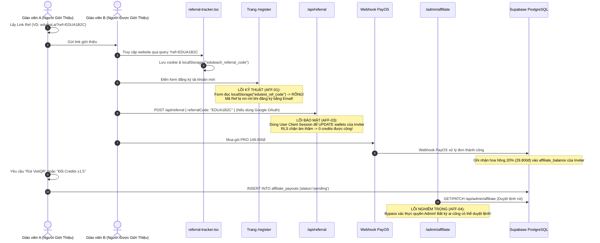

# Báo Cáo Rà Soát Bảo Mật & Kiến Trúc: /affiliate (Chương Trình Đối Tác & Hoa Hồng)

**Ngày thực hiện:** 01/11/2026  
**Chuyên viên:** Senior Full-stack Engineer & Security Reviewer  
**Môi trường:** Production/Staging (`ed-teach-rust.vercel.app`), Next.js 14 App Router, Supabase PostgreSQL, PayOS  
**Phạm vi:** Tuyến đường `/affiliate`, tracker mã ref, API đăng ký ghi nhận referral, API đổi credits, API rút tiền VietQR, và API duyệt lệnh rút tiền của Quản trị viên (`/api/admin/affiliate`).

---

## 1. Sơ Đồ Luồng Hoạt Động (Referral, Commission & Payout Flow)

### 1.1. Biểu Đồ Trình Tự (Sequence Diagram)



### 1.2. Bảng Đối Chiếu File & Dòng Mã Nguồn

| Chức Năng | Tệp Tin & Dòng Mã | Đánh Giá Kỹ Thuật |
| :--- | :--- | :--- |
| **Giao diện Đối tác** | [`frontend/src/app/(dashboard)/affiliate/page.tsx#L1-L150`](file:///d:/Go-Live/Web/EdTeach/frontend/src/app/(dashboard)/affiliate/page.tsx#L1-L150) | Hiển thị link ref, QR modal, modal đổi credits (x1.5), modal rút VietQR, bảng thống kê |
| **Lưu trữ Cookie / Ref** | [`frontend/src/components/referral-tracker.tsx#L12-L28`](file:///d:/Go-Live/Web/EdTeach/frontend/src/components/referral-tracker.tsx#L12-L28) | Đọc `?ref=` từ URL, ghi cookie `eduteach_referral_code` (Hạn 30 ngày) và localStorage |
| **Đọc Ref khi Đăng Ký** | [`frontend/src/app/(auth)/register/page.tsx#L40-L48`](file:///d:/Go-Live/Web/EdTeach/frontend/src/app/(auth)/register/page.tsx#L40-L48) | **Lệch key**: Đọc `localStorage.getItem("edutest_ref_code")` -> Luôn trả về null |
| **API Thông Tin Ref** | [`frontend/src/app/api/affiliate/route.ts#L1-L50`](file:///d:/Go-Live/Web/EdTeach/frontend/src/app/api/affiliate/route.ts#L1-L50) | Hardcode origin `https://edutest.ai`, fallback `demo-teacher-id` khi chưa đăng nhập |
| **Kho Lưu Trữ Affiliate** | [`frontend/src/lib/affiliate/affiliate-store.ts#L1-L390`](file:///d:/Go-Live/Web/EdTeach/frontend/src/lib/affiliate/affiliate-store.ts#L1-L390) | Bộ điều khiển logic hoa hồng; chứa công thức nhân x1.5 và sinh mã ref động |
| **API Duyệt Lệnh Rút** | [`frontend/src/app/api/admin/affiliate/route.ts#L25-L42`](file:///d:/Go-Live/Web/EdTeach/frontend/src/app/api/admin/affiliate/route.ts#L25-L42) | Xác thực lỏng lẻo: `!user || user.email?.includes('admin')` -> Mở toang cho hacker |

---

## 2. Chi Tiết Các Lỗ Hổng Bảo Mật & Lỗi Vận Hành

### 🔴 AFF-01 (HIGH): Lệch Key LocalStorage Khiến Mã Giới Thiệu Bị Rơi Rớt Khi Đăng Ký Bằng Email
- **Vị trí mã nguồn:**
  - File ghi: [`frontend/src/components/referral-tracker.tsx#L14`](file:///d:/Go-Live/Web/EdTeach/frontend/src/components/referral-tracker.tsx#L14)
    ```typescript
    localStorage.setItem("eduteach_referral_code", refCode);
    ```
  - File đọc: [`frontend/src/app/(auth)/register/page.tsx#L44`](file:///d:/Go-Live/Web/EdTeach/frontend/src/app/(auth)/register/page.tsx#L44)
    ```typescript
    const savedRef = localStorage.getItem("edutest_ref_code");
    if (savedRef) setReferralCode(savedRef);
    ```
- **Hệ quả thực tế:**
  1. Người được giới thiệu nhấp vào link `https://ed-teach-rust.vercel.app?ref=EDU12345`.
  2. Tracker lưu vào localStorage với khóa `eduteach_referral_code`.
  3. Người dùng nhấp sang `/register` để tạo tài khoản bằng Email/Mật khẩu.
  4. Form đăng ký tìm khóa `edutest_ref_code` $\to$ Trả về `null`. Ô nhập mã giới thiệu bị bỏ trống!
  5. Đăng ký thành công: Người giới thiệu hoàn toàn **không nhận được hoa hồng hay lượt mời nào**. Tính năng Affiliate tê liệt hoàn toàn đối với mọi lượt đăng ký qua form thông thường.

---

### 🔴 AFF-02 (HIGH): Mã Giới Thiệu Bị Đổi Liên Tục & Hardcode Tên Miền Không Thuộc Quyền Sở Hữu
- **Vị trí mã nguồn:**
  - [`frontend/src/app/api/affiliate/route.ts#L7-L10`](file:///d:/Go-Live/Web/EdTeach/frontend/src/app/api/affiliate/route.ts#L7-L10):
    ```typescript
    const origin = req.headers.get("origin") || "https://edutest.ai";
    const userId = user?.id || "demo-teacher-id";
    ```
  - [`frontend/src/lib/affiliate/affiliate-store.ts#L114-L121`](file:///d:/Go-Live/Web/EdTeach/frontend/src/lib/affiliate/affiliate-store.ts#L114-L121):
    ```typescript
    let code = userCodes.get(userId);
    if (!code) {
      code = "EDU" + Math.random().toString(36).substring(2, 7).toUpperCase();
      userCodes.set(userId, code);
    }
    ```
- **Hiện tượng thực tế:**
  1. Khi người dùng chưa đăng nhập hoặc cookie session hết hạn, API gán `userId = "demo-teacher-id"` và sinh ngẫu nhiên một mã trong RAM.
  2. Do chạy trên Vercel Serverless, biến `userCodes` (Map trong RAM) bị xóa sạch mỗi khi container lambda tái khởi động. Mỗi lần người dùng F5 tải lại trang `/affiliate`, họ nhận được một mã giới thiệu hoàn toàn khác nhau (ví dụ: vừa gửi mã `EDU93684` cho bạn bè, F5 xong trang hiển thị mã `EDUU20NA`).
  3. Link chia sẻ bị gắn cứng domain `"https://edutest.ai"`, trong khi domain triển khai thực tế là `"ed-teach-rust.vercel.app"`. Người dùng nhấp vào link sẽ bị dẫn sang một website lạ (hoặc không truy cập được) thay vì hệ thống EduTest AI đang chạy.

---

### 🔴 AFF-03 (HIGH): RLS Ngăn Chặn Âm Thầm (Silent Failure) Khi Cộng Thưởng Giới Thiệu
- **Vị trí mã nguồn:** [`frontend/src/app/api/referral/route.ts#L110-L128`](file:///d:/Go-Live/Web/EdTeach/frontend/src/app/api/referral/route.ts#L110-L128)
- **Thực tế trong code:**
  ```typescript
  // Tuyến API này khởi tạo Supabase Client bằng session cookie của User mới đăng ký
  const supabase = createClient(cookieStore); 
  ...
  // Cố gắng cập nhật số dư ví của NGƯỜI GIỚI THIỆU (referrer.id)
  const { error: updateError } = await supabase
    .from('wallets')
    .update({ balance: newBalance })
    .eq('user_id', referrer.id);
  ```
- **Cơ chế lỗi:**
  - Chính sách RLS trên bảng `wallets` ([`00001_initial_schema.sql#L105`](file:///d:/Go-Live/Web/EdTeach/supabase/migrations/00001_initial_schema.sql#L105)) chỉ cho phép:
    ```sql
    CREATE POLICY "Users can update own wallet" ON public.wallets FOR UPDATE USING (auth.uid() = user_id);
    ```
  - Khi User mới đăng ký gửi request, `auth.uid()` là ID của người mới, trong khi câu lệnh UPDATE nhắm vào `referrer.id`.
  - Supabase RLS **từ chối câu lệnh UPDATE một cách âm thầm** (`rows_affected = 0`).
  - API trả về HTTP 200 "Referral applied successfully", nhưng thực tế ví người giới thiệu **không được cộng một credit nào**!

---

### 🔴 AFF-04 (CRITICAL): Lỗ Hổng Bypass Quyền Quản Trị Duyệt Rút Tiền Hoa Hồng (TRÙNG SEC-02)
- **Vị trí mã nguồn:** [`frontend/src/app/api/admin/affiliate/route.ts#L25-L42`](file:///d:/Go-Live/Web/EdTeach/frontend/src/app/api/admin/affiliate/route.ts#L25-L42)
- **Đoạn mã vi phạm:**
  ```typescript
  // KIỂM TRA QUYỀN ADMIN:
  const user = await getCurrentUser();
  if (!user || user.email?.includes('admin')) {
    // CHO PHÉP TRUY CẬP VÀ DUYỆT LỆNH RÚT TIỀN!
  } else {
    return NextResponse.json({ error: "Unauthorized" }, { status: 403 });
  }
  ```
- **Hậu quả tàn khốc:**
  1. Biểu thức `!user || user.email?.includes('admin')`: Nếu một request **hoàn toàn không đăng nhập** (`!user` là `true`), điều kiện if được thỏa mãn!
  2. Bất kỳ ai trên Internet gửi một HTTP PATCH request đơn giản:
     ```http
     PATCH /api/admin/affiliate
     Content-Type: application/json

     {
       "payoutId": "payout-uuid-123",
       "action": "approve"
     }
     ```
     Hệ thống sẽ **duyệt ngay lập tức** yêu cầu rút tiền mà không cần bất kỳ thông tin đăng nhập quản trị viên nào!

---

### 🟡 AFF-05 (MEDIUM): Sai Lệch Mức Thưởng Giới Thiệu (Quảng Cáo 10.000 cr vs Code 2.000 cr)
- **Vị trí:**
  - Banner `/affiliate#L66`: "Nhận ngay **+10.000 Credits** mỗi lượt mời đồng nghiệp thành công".
  - Code thực thi [`api/referral/route.ts#L20`](file:///d:/Go-Live/Web/EdTeach/frontend/src/app/api/referral/route.ts#L20):
    ```typescript
    const REFERRAL_BONUS_CREDITS = 2000;
    ```
- **Hệ quả:** Người dùng mời được đồng nghiệp nhưng chỉ nhận 2.000 credits thay vì 10.000 credits như cam kết trên banner tiếp thị, dẫn đến nghi ngờ về tính minh bạch của nền tảng.

---

### 🟡 AFF-06 (MEDIUM): Không Có Cơ Chế Thu Hồi Hoa Hồng Khi Đơn Hàng Bị Hoàn Tiền (Refund/Chargeback)
- **Hiện tượng:**
  - Khi Webhook PayOS xử lý đơn hàng thành công, 20% hoa hồng được cộng ngay lập tức vào số dư `affiliate_balance`.
  - Nền tảng hoàn toàn chưa xây dựng Webhook tiếp nhận sự kiện hoàn tiền (Refund / Chargeback / Khiếu nại giao dịch) từ PayOS hoặc ngân hàng.
  - Người dùng có thể mua gói, nhận hoa hồng 20% vào tài khoản giới thiệu, sau đó yêu cầu hủy/hoàn tiền qua cổng thanh toán trong khi tài khoản giới thiệu đã rút sạch tiền mặt.

---

## 3. Tổng Hợp Lỗ Hổng Tuyến /affiliate

| Mã ID | Tên Lỗ Hổng / Bất Thường | Mức Độ | Trạng Thái Gốc | Tác Động Kinh Doanh / Vận Hành |
| :--- | :--- | :--- | :--- | :--- |
| **AFF-04** | Bypass xác thực API duyệt rút tiền (`!user \|\| includes('admin')`) | **CRITICAL** | TRÙNG SEC-02 | Hacker không cần đăng nhập vẫn duyệt được mọi lệnh rút tiền mặt. |
| **AFF-01** | Lệch key localStorage (`eduteach_` vs `edutest_`) làm mất ref | **HIGH** | LỖI MỚI | Toàn bộ lượt đăng ký qua form email bị mất mã ref; đối tác không nhận được ghi nhận. |
| **AFF-02** | Mã Ref đổi liên tục do in-memory & hardcode domain `edutest.ai` | **HIGH** | LỖI MỚI | Link ref dẫn sang domain lạ; mã ref của user bị nhảy ngẫu nhiên khi F5 trang. |
| **AFF-03** | RLS chặn âm thầm update ví người giới thiệu | **HIGH** | TRÙNG SEC-07 | Không ai nhận được bonus credits giới thiệu do vi phạm phân quyền RLS. |
| **AFF-05** | Bất nhất thưởng giới thiệu (Banner 10.000 cr vs Code 2.000 cr) | **MEDIUM** | LỖI MỚI | Tranh chấp người dùng, khiếu nại sai lệch thông điệp tiếp thị. |
| **AFF-06** | Thiếu cơ chế clawback hoa hồng khi có Refund/Chargeback | **MEDIUM** | LỖI MỚI | Rủi ro bị trục lợi hoàn tiền mua gói để chiếm đoạt 20% hoa hồng. |
