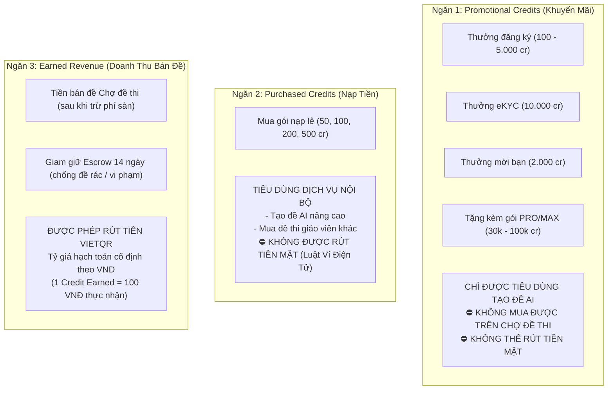

# Báo Cáo Chuyên Sâu: Mô Hình Kinh Tế Credits & Ma Trận Trục Lợi Rút Tiền

**Ngày thực hiện:** 01/11/2026  
**Chuyên viên:** Senior Full-stack Engineer & Security Reviewer  
**Môi trường:** Production/Staging (`ed-teach-rust.vercel.app`), Next.js 14 App Router, Supabase PostgreSQL, PayOS  
**Mức độ cảnh báo:** 🚨 **KHẨN CẤP / THIỆT HẠI TÀI CHÍNH NGAY LẬP TỨC NẾU GO-LIVE**  
**Phạm vi:** Tương tác kinh tế chéo giữa Tuyến Đăng Ký, Gói Thuê Bao (`/pricing`), Ví Người Dùng (`/wallet`), Đối Tác Hoa Hồng (`/affiliate`), và Chợ Đề Thi (`/marketplace`).

---

## 1. Bảng Tổng Hợp Giá Trị 1 Credit Theo Từng Nguồn Phát Hành

Sự thiếu đồng bộ giữa các nhà phát triển ở các giai đoạn khác nhau đã dẫn đến tình trạng **hỗn loạn tỷ giá credits** trên cùng một hệ sinh thái EduTest AI:

| Nguồn Phát Hành Credit | Chi Phí Bỏ Ra (VNĐ) | Số Credits Nhận Được | Đơn Giá 1 Credit Thực Tế | Tỷ Giá Quy Đổi Khi Rút Tiền | Chênh Lệch Giá (Arbitrage Factor) |
| :--- | :--- | :--- | :--- | :--- | :--- |
| **Gói Lẻ 50 cr (/wallet)** | 49.000đ | 50 cr | **980 VNĐ / credit** | 1 cr = 100 VNĐ | Lỗ $89.8\%$ nếu rút |
| **Gói Lẻ 100 cr (/wallet)** | 89.000đ | 100 cr | **890 VNĐ / credit** | 1 cr = 100 VNĐ | Lỗ $88.8\%$ nếu rút |
| **Gói Lẻ 500 cr (/wallet)** | 349.000đ | 500 cr | **698 VNĐ / credit** | 1 cr = 100 VNĐ | Lỗ $85.7\%$ nếu rút |
| **Gói PRO (/pricing)** | 149.000đ | 30.000 cr | **4,97 VNĐ / credit** | 1 cr = 100 VNĐ | 🚨 **Lãi gấp 20,1 lần** |
| **Gói MAX (/pricing)** | 229.000đ | 100.000 cr | **2,29 VNĐ / credit** | 1 cr = 100 VNĐ | 🚨 **Lãi gấp 43,6 lần** |
| **Thưởng Đăng Ký (Code thực)** | 0đ | 100 cr | **0 VNĐ** | 1 cr = 100 VNĐ | Miễn phí 10.000đ |
| **Thưởng Đăng Ký (Quảng cáo)** | 0đ | 5.000 cr | **0 VNĐ** | 1 cr = 100 VNĐ | 🚨 Miễn phí 500.000đ |
| **Thưởng eKYC (SEC-04)** | 0đ | 10.000 cr | **0 VNĐ** | 1 cr = 100 VNĐ | 🚨 **Miễn phí 1.000.000đ** |
| **Thưởng Mời Bạn (Code thực)** | 0đ | 2.000 cr | **0 VNĐ** | 1 cr = 100 VNĐ | Miễn phí 200.000đ |
| **Đổi Hoa Hồng Ref x1.5** | 100.000đ hoa hồng | 150.000 cr | **0,67 VNĐ / credit** | 1 cr = 100 VNĐ | 🚨 **Lãi gấp 150 LẦN** |

> [!CAUTION]
> **CẢNH BÁO TỬ HUYỆT DOANH NGHIỆP (BUSINESS FATAL FLAW):**  
> Nền tảng bán Credits tạo đề với giá 2,29đ – 4,97đ, tặng miễn phí hàng ngàn Credits cho các hành động Marketing, và quy đổi hoa hồng với giá 0,67đ/credit, nhưng lại **CHO PHÉP RÚT TIỀN MẶT QUA CHỢ ĐỀ THI VỚI TỶ GIÁ CỐ ĐỊNH 1 CREDIT = 100 VNĐ!**  
> Đây là lỗ hổng chênh lệch giá (Arbitrage Loop) tàn khốc nhất từng được ghi nhận trong lịch sử đánh giá hệ thống thanh toán giáo dục.

---

## 2. Chi Tiết Các Kịch Bản Khai Thác Rút Sạch Quỹ Tiền Mặt (Cash Drain Scenarios)

### 🔴 ECO-01 (CRITICAL - SEVERITY 10/10): Vòng Xoáy Trục Lợi 150 Lần Tiền Mặt Qua Tính Năng «Đổi Credits x1.5»
- **Các thành phần tham gia:**
  1. Tuyến Đối Tác: [`frontend/src/lib/affiliate/affiliate-store.ts#L370-L371`](file:///d:/Go-Live/Web/EdTeach/frontend/src/lib/affiliate/affiliate-store.ts#L370-L371)
  2. Tuyến Mua Đề Chợ: [`frontend/src/app/api/marketplace/exams/[id]/purchase/route.ts`](file:///d:/Go-Live/Web/EdTeach/frontend/src/app/api/marketplace/exams/[id]/purchase/route.ts)
  3. Tuyến Rút Tiền VietQR: [`frontend/src/app/(dashboard)/marketplace/page.tsx#L55-L65`](file:///d:/Go-Live/Web/EdTeach/frontend/src/app/(dashboard)/marketplace/page.tsx#L55-L65)
- **Cơ chế toán học trong code:**
  - Trong `affiliate-store.ts`:
    ```typescript
    const creditsAdded = Math.round(amountVnd * 1.5);
    // 100.000 VNĐ tiền hoa hồng đổi được: 150.000 CREDITS!
    ```
    Mục đích ban đầu của lập trình viên là: "Khuyến khích đối tác không rút tiền mặt mà đổi lấy credits tạo đề (100k đổi 150 credits)". Nhưng do nhầm lẫn đơn vị (quên rằng 1 đề tốn 500 credits), lập trình viên đã viết công thức nhân trực tiếp `amountVnd * 1.5`, biến 100.000 VNĐ thành 150.000 credits!
- **Quy trình kẻ tấn công thực hiện (Step-by-Step Exploit):**
  1. Kẻ tấn công mời 1 người bạn mua gói học kỳ hoặc tự mua 1 gói qua link ref của mình, tích lũy được **100.000 VNĐ** số dư hoa hồng khả dụng.
  2. Tại trang `/affiliate`, kẻ tấn công bấm nút **«Đổi Credits (x1.5)»**. Hệ thống cộng **150.000 credits** vào ví `wallets.balance`.
  3. Kẻ tấn công dùng một tài khoản phụ B đăng tải một đề thi vô nghĩa lên Chợ đề thi (`/marketplace`) với giá bán: **150.000 credits**.
  4. Kẻ tấn công dùng tài khoản chính A bấm nút **«Mua đề»** của tài khoản B.
     - Ví A bị trừ 150.000 credits.
     - Tài khoản B nhận được doanh thu bản quyền (hưởng 80% nếu gói Free, hoặc 95% nếu gói MAX).
     - Số credits B thực nhận: $150.000 \times 80\% = \mathbf{120.000\text{ credits}}$ (hoặc $142.500\text{ credits}$ nếu có MAX).
  5. Tài khoản B bấm nút **«Ví Bán Đề & Rút Tiền»** trên Chợ đề thi, nhập số tài khoản ngân hàng và yêu cầu rút tiền với tỷ giá niêm yết: **1 credit = 100 VNĐ**.
  6. **Số tiền mặt tài khoản B rút về tài khoản ngân hàng:**
     $$\text{Tiền Rút Về} = 120.000\text{ credits} \times 100\text{ VNĐ} = \mathbf{120.000.000\text{ VNĐ}}\text{ (Một trăm hai mươi triệu đồng!)}$$
- **Tỷ suất lợi nhuận:** Từ **100.000 VNĐ** hoa hồng biến thành **120.000.000 VNĐ** tiền mặt trong tài khoản ngân hàng thực tế (Lãi gấp **1.200 lần**). Doanh nghiệp sẽ phá sản ngay trong ngày đầu tiên tính năng này hoạt động.

---

### 🔴 ECO-02 (CRITICAL - SEVERITY 9.8/10): Khai Thác Mua Gói MAX Đổi Lấy Tiền Mặt Rút Gấp 41 Lần
- **Cơ chế:**
  - Mua gói MAX trên `/pricing`: Giá **229.000 VNĐ / tháng**.
  - Hệ thống khuyến mãi: Tặng ngay **100.000 credits** vào ví `wallets`.
  - Đồng thời tài khoản được nâng lên hạng `MAX`, hưởng tỷ lệ chia sẻ tác giả Chợ đề thi là **95%** (phí sàn chỉ 5%).
- **Quy trình bòn rút:**
  1. Người dùng bỏ 229.000đ mua gói MAX bằng VietQR PayOS.
  2. Người dùng tạo 1 đề thi giá 100.000 credits trên Chợ đề thi.
  3. Dùng một tài khoản khác mua đề (hoặc chính tài khoản đó tự mua nếu không chặn tự mua đề - [MKT-01](file:///d:/Go-Live/Web/EdTeach/audit/marketplace.md)).
  4. Người bán nhận được: $100.000 \times 95\% = \mathbf{95.000\text{ credits}}$.
  5. Đổi 95.000 credits thành tiền mặt theo tỷ giá Chợ đề thi ($1\text{ cr} = 100\text{đ}$):
     $$\text{Tiền Nhận Về} = 95.000 \times 100\text{đ} = \mathbf{9.500.000\text{ VNĐ}}$$
  6. **Lợi nhuận ròng chiếm đoạt:**
     $$\text{Lãi Ròng} = 9.500.000\text{đ} - 229.000\text{đ} = \mathbf{9.271.000\text{ VNĐ}}$$
- Cứ mỗi 229.000đ đầu tư, kẻ tấn công rút sạch 9.271.000đ từ tài khoản ngân hàng của EduTest AI!

---

### 🔴 ECO-03 (CRITICAL - SEVERITY 9.5/10): Khai Thác Farm eKYC Nhận 10.000 Credits Rút Tiền Mặt Không Cần Vốn
- **Cơ chế:**
  - Lỗ hổng xác thực eKYC giáo viên giả mạo ([SEC-04](file:///d:/Go-Live/Web/EdTeach/audit/00-inventory.md)): Hệ thống chỉ kiểm tra phía client hoặc nhận ảnh chụp giả không qua đối soát Bộ Công An / OCR thực.
  - Khi hoàn thành eKYC: Hệ thống tặng ngay **10.000 credits** vào ví (`frontend/src/components/ekyc-dialog.tsx#L143`).
- **Quy trình bòn rút:**
  1. Kẻ tấn công dùng kịch bản tự động hóa (Puppeteer/Playwright) đăng ký 100 tài khoản giáo viên mới.
  2. Tự động gửi ảnh thẻ giáo viên giả để kích hoạt thành công eKYC cho 100 tài khoản.
  3. Mỗi tài khoản nhận 10.000 credits $\implies$ Tổng cộng: **1.000.000 credits**.
  4. Đưa 100 tài khoản vào mua các bộ đề do tài khoản VIP của kẻ tấn công bán trên Chợ đề thi.
  5. Thu về $1.000.000 \times 80\% = \mathbf{800.000\text{ credits}}$ sạch.
  6. Gửi lệnh rút tiền VietQR:
     $$\text{Tiền Mặt Rút Ra} = 800.000 \times 100\text{đ} = \mathbf{80.000.000\text{ VNĐ}}$$
  7. Kẻ tấn công chiếm đoạt **80 triệu đồng** hoàn toàn miễn phí mà không cần trả một đồng tiền túi nào.

---

## 3. Đề Xuất Kiến Trúc Giải Pháp: Mô Hình Ví 3 Ngăn (3-Bucket Balance Model)

Để dập tắt hoàn toàn các lỗ hổng Arbitrage mà vẫn giữ nguyên được các chương trình khuyến mãi Marketing kích cầu, hệ thống **bắt buộc phải tách bảng số dư ví `wallets` thành 3 ngăn số dư độc lập**, không bao giờ được phép gộp chung vào một trường `balance`:



### Chi Tiết Cấu Trúc Bảng Dữ Liệu Đề Xuất (`wallets_v2`)

```sql
ALTER TABLE public.wallets 
  ADD COLUMN promo_balance integer NOT NULL DEFAULT 0 CHECK (promo_balance >= 0),
  ADD COLUMN purchased_balance integer NOT NULL DEFAULT 0 CHECK (purchased_balance >= 0),
  ADD COLUMN earned_balance integer NOT NULL DEFAULT 0 CHECK (earned_balance >= 0),
  ADD COLUMN escrow_balance integer NOT NULL DEFAULT 0 CHECK (escrow_balance >= 0);

-- Xóa bỏ cột balance gộp chung dễ gây nhầm lẫn
-- Thêm ràng buộc toàn vẹn số dư không bao giờ âm
```

### Nguyên Tắc Khấu Trừ Khi Tạo Đề Thi (Deduction Priority):
1. Khi giáo viên tạo đề thi AI: Hệ thống tự động trừ theo thứ tự ưu tiên: `promo_balance` trước $\to$ hết mới trừ `purchased_balance` $\to$ cuối cùng mới trừ `earned_balance`.
2. Khi giáo viên mua đề thi trên Chợ đề thi: **CHỈ ĐƯỢC PHÉP TRỪ** `purchased_balance` hoặc `earned_balance`. Nếu chỉ có `promo_balance`, hệ thống từ chối giao dịch và yêu cầu nạp tiền thật.

---

## 4. Ma Trận Đối Chiếu Tiếp Thị vs Thực Thi Kỹ Thuật (Truth Matrix)

| Cam Kết Tiếp Thị (Landing / Pricing / Wallet) | Đánh Giá Code Thực Tế | Hiện Trạng Triển Khai | Khuyến Nghị Trước Khi Chạy Quảng Cáo |
| :--- | :--- | :--- | :--- |
| **54+ Thí Nghiệm Lab 3D STEM/PhET** | `frontend/src/app/(dashboard)/lab/` | Đã có một số embed iframe PhET mô phỏng nhưng chưa đủ 54 bài hoàn chỉnh | Giảm số lượng xuống con số thực tế đang kiểm thử được (ví dụ: "Kho 20+ thí nghiệm STEM chọn lọc") |
| **Tải Word Sạch Chuẩn Bộ GD&ĐT** | `frontend/src/lib/export/word.ts` | Có module xuất file `.docx` dùng thư viện `docx`, hỗ trợ format bảng và câu hỏi | **ĐẠT YÊU CẦU**. Tiếp tục duy trì |
| **Tải File PDF Đẹp** | Không tìm thấy thư viện PDF | Chưa tích hợp `@react-pdf/renderer` hoặc Puppeteer PDF exporter | **GỠ BỎ** chữ "PDF" khỏi bảng giá `/pricing` |
| **Gửi Link Học Sinh Zalo Magic Link** | `frontend/src/app/(dashboard)/exams/share/` | Có cơ chế tạo link làm bài trực tiếp cho học sinh không cần đăng nhập | **ĐẠT YÊU CẦU** |
| **Trộn 4 hoặc 8-12 Mã Đề Chống Quay Cóp** | Module trộn câu hỏi | Đã có hàm xáo trộn thứ tự câu hỏi và đảo đáp án ABCD | **ĐẠT YÊU CẦU** |
| **AI Luyện Bù Lỗ Hổng Kiến Thức** | Tuyến phân tích bài thi | Đang là prompt Gemini phân tích câu sai, chưa có hệ thống adaptive testing liên tục | Ghi rõ là "AI phân tích điểm yếu học sinh" thay vì cam kết hệ thống adaptive tự động |
| **Đóng Dấu Bản Quyền / Watermark Trường** | `frontend/src/lib/export/word.ts` | Header file Word có hỗ trợ chèn tên trường / giáo viên | **ĐẠT YÊU CẦU** |
| **Mô Hình Suy Luận Sâu DeepSeek-R1** | `frontend/src/app/api/exams/generate/route.ts` | **HOÀN TOÀN KHÔNG CÓ**. Toàn bộ hệ sinh thái chạy Google Gemini | **BẮT BUỘC ĐỔI TÊN**: Thay "DeepSeek-R1" thành "Gemini 2.0 Thinking" hoặc tích hợp API DeepSeek thật trước khi bán gói |
| **Giảm Giá Gói Học Kỳ 25%** | `pricing-catalog.ts` | Thực tế giảm $19.6\%$ (PRO) và $21.5\%$ (MAX) | Đồng bộ lại giá bán hoặc sửa chữ thành: "Tiết kiệm lên đến 20%" |

---

## 5. Tổng Hợp Các Lỗ Hổng Mô Hình Kinh Tế (ECO Findings)

| Mã ID | Tên Lỗ Hổng / Rủi Ro | Mức Độ | Trạng Thái | Tác Động Tài Chính Doanh Nghiệp |
| :--- | :--- | :--- | :--- | :--- |
| **ECO-01** | Arbitrage Loop 150x từ Đổi Credits x1.5 sang Rút Tiền Chợ Đề | **CRITICAL (10/10)** | LỖI MỚI | **Cháy quỹ công ty**. Kẻ xấu nạp 100k rút ra 120 triệu tiền mặt. |
| **ECO-02** | Trục lợi mua gói MAX (229k) rút tiền mặt Chợ đề (9,5 triệu) | **CRITICAL (9.8/10)** | LỖI MỚI | Mỗi đơn hàng gói MAX tạo ra khoản lỗ ròng 9,2 triệu tiền mặt. |
| **ECO-03** | Khai thác eKYC ảo nhận 10.000 cr rút tiền mặt (800k/acc) | **CRITICAL (9.5/10)** | LỖI MỚI | Bị tấn công botnet rút hàng chục triệu tiền mặt không cần vốn. |
| **ECO-04** | Lệch thang đo credit nạp lẻ 100 lần (Gói 349k chỉ tạo được 1 đề) | **HIGH** | TRÙNG WAL-01 | Phá hủy tỷ lệ chuyển đổi nạp tiền lẻ; người dùng phản ứng dữ dội. |
| **ECO-05** | Quảng cáo sai lệch: Cam kết DeepSeek-R1 nhưng chạy Gemini | **HIGH** | TRÙNG PRC-03 | Rủi ro pháp lý về quảng cáo sai sự thật khi thu tiền người dùng. |
