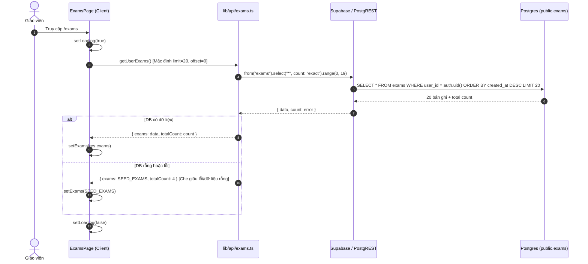
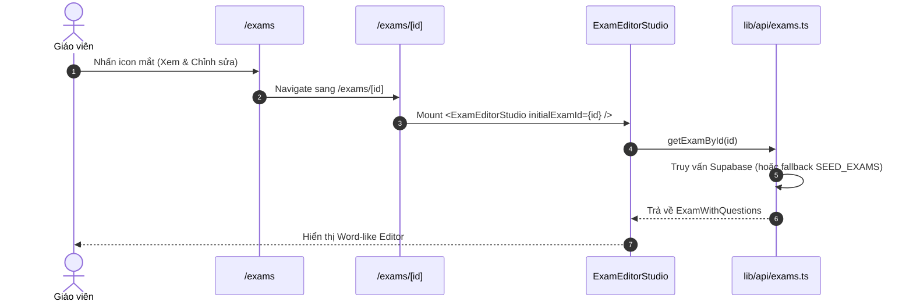
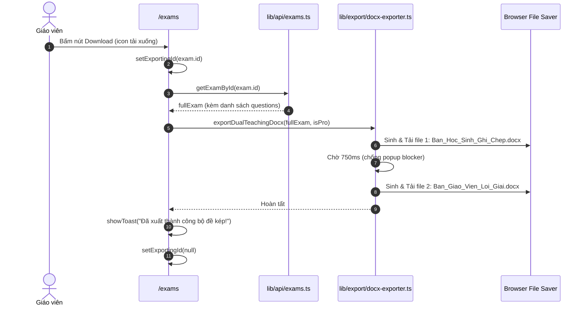
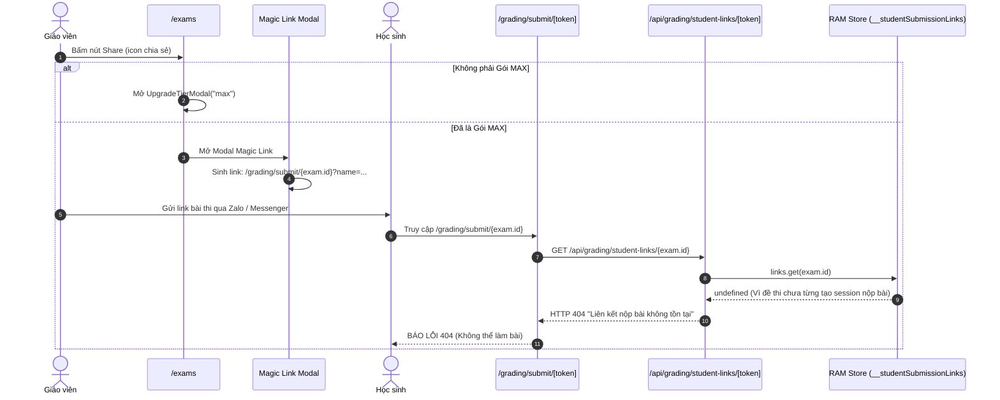
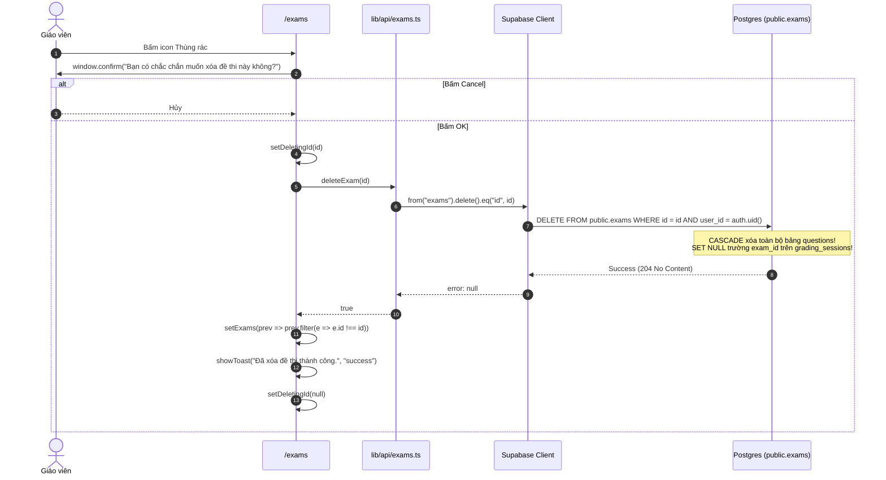
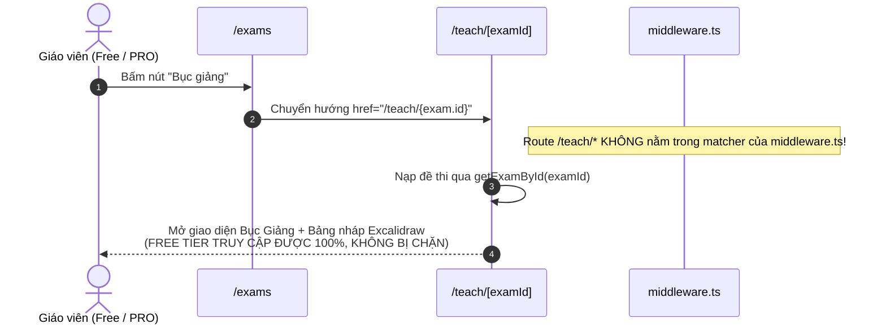

# BÁO CÁO AUDIT AN NINH & KIẾN TRÚC: TRANG /exams (ĐỀ THI CỦA TÔI)
**Dự án:** EduTest AI (Nền tảng tạo đề thi AI chuẩn Bộ GD&ĐT 2025, chấm OMR, phòng thí nghiệm 3D)  
**Phạm vi audit:** Route `/exams` (`localhost:3001/exams`), tiêu đề «Đề thi của tôi»  
**Vị trí file:** `frontend/src/app/(dashboard)/exams/page.tsx`  
**Chế độ:** READ-ONLY AUDIT (Không sửa code, không commit)  
**Ngày thực hiện:** 01/11/2026  
**Chuyên viên đánh giá:** Senior Full-stack Engineer & Security Auditor  

---

## BƯỚC 1: TRUY VẾT LUỒNG HOẠT ĐỘNG END-TO-END

### 1.1 Sơ đồ cấu trúc Component & State
Trang `/exams` được đặt trong layout `frontend/src/app/(dashboard)/layout.tsx`, kế thừa Navigation Sidebar, Topbar (Credits, Huy hiệu Gói MAX/PRO, Command Palette Ctrl+K), và Modal Feedback.

```
ExamsPage (`frontend/src/app/(dashboard)/exams/page.tsx`)
 ├── useAuth() -> user, profile
 ├── useToast() -> showToast()
 ├── State:
 │    ├── exams: Exam[] (danh sách đề nạp từ API)
 │    ├── loading: boolean (spinner toàn bảng)
 │    ├── search: string (từ khóa tìm kiếm)
 │    ├── deletingId: string | null (trạng thái đang xóa)
 │    ├── exportingId: string | null (trạng thái đang xuất .docx)
 │    ├── selectedSubject, selectedGrade, selectedStatus, sortBy
 │    ├── isFilterOpen: boolean (popover bộ lọc nâng cao)
 │    ├── magicLinkExam: Exam | null (modal chia sẻ)
 │    ├── upgradeTier: "pro" | "max" | null
 │    └── checkoutPlan: PricingPlan | null
 ├── UI Components:
 │    ├── Top Action: Nút "Tạo đề mới" -> `/exams/create`
 │    ├── Search Input (Clearable 'X') + Filter Popover + Filter Badge Pills
 │    ├── Bảng danh sách đề thi (Grid 12 cột):
 │    │    ├── Cột Tên đề thi (Link -> `/exams/[id]`)
 │    │    ├── Cột Môn / Lớp
 │    │    ├── Cột Số câu (`exam.question_count`)
 │    │    ├── Cột Ngày tạo (`toLocaleDateString('vi-VN')`)
 │    │    └── Cột Thao tác (5 nút: Bục giảng, Xem, Tải xuống, Chia sẻ, Xóa)
 │    ├── Modal Giao đề Online qua Magic Link (Đặc quyền MAX)
 │    ├── UpgradeTierModal
 │    └── PaymentCheckoutModal (Tích hợp PayOS)
```

---

### 1.2 Bảng tra cứu File & Dòng liên quan đến trang `/exams`

| Tên chức năng / Thành phần | Đường dẫn File thực tế | Vị trí dòng | Trách nhiệm |
| :--- | :--- | :--- | :--- |
| **Giao diện chính `/exams`** | `frontend/src/app/(dashboard)/exams/page.tsx` | L1 - L823 | Quản lý state danh sách, bộ lọc, modal chia sẻ |
| **Hàm nạp danh sách đề thi** | `frontend/src/lib/api/exams.ts` | L15 - L27 | Gọi Supabase client `select(*)` kèm phân trang ngầm |
| **Hàm chi tiết & xóa đề thi** | `frontend/src/lib/api/exams.ts` | L29 - L53, L82 - L89 | `getExamById` và `deleteExam` (Hard delete) |
| **Xuất bộ đề kép Word (.docx)** | `frontend/src/lib/export/docx-exporter.ts` | L539 - L558 | Sinh 2 bản docx (Học sinh & Giáo viên) tại client |
| **Modal Magic Link giao đề** | `frontend/src/app/(dashboard)/exams/page.tsx` | L708 - L795 | Hiển thị link học sinh làm bài không cần login |
| **Đích đến của Magic Link** | `frontend/src/app/grading/submit/[token]/page.tsx` | L1 - L150 | Trang học sinh nộp bài trực tuyến theo token |
| **Store liên kết nộp bài** | `frontend/src/lib/grading/student-submission-store.ts` | L50 - L60 | Quản lý token tạm thời trong RAM (`globalThis`) |
| **Trang Bục Giảng Số** | `frontend/src/app/teach/[examId]/page.tsx` | L1 - L190 | Trình chiếu đề thi kết hợp Bảng nháp Excalidraw |
| **Trang Xem & Sửa đề chi tiết** | `frontend/src/app/(dashboard)/exams/[id]/page.tsx` | L1 - L13 | Mount `ExamEditorStudio` theo `examId` |
| **Middleware kiểm soát Auth** | `frontend/src/middleware.ts` | L34 - L68 | Redirect về `/login` nếu chưa đăng nhập |
| **Schema & RLS bảng `exams`** | `supabase/migrations/20261014_init_schema.sql` | L48 - L167 | RLS `auth.uid() = user_id`, FK cascade `questions` |

---

### 1.3 Sơ đồ các luồng nghiệp vụ chi tiết

#### Luồng (a): Tải danh sách đề thi & Phân trang


#### Luồng (b): Tìm kiếm & Lọc (100% Client-side trên 20 bản ghi)
```mermaid
flowchart TD
    A[Người dùng gõ ô tìm kiếm hoặc chọn Popover Lọc] --> B[Cập nhật State: search, selectedSubject, selectedGrade, selectedStatus, sortBy]
    B --> C[Hook useMemo: filteredExams tính toán]
    C --> D{Lọc trên 20 phần tử của state exams}
    D -->|1. matchName || matchSubject| E[Khớp từ khóa]
    E -->|2. subject == selectedSubject| F[Khớp môn]
    F -->|3. grade == selectedGrade| G[Khớp khối lớp]
    G -->|4. status == selectedStatus| H[Khớp trạng thái]
    H -->|5. Sắp xếp sort| I[Trả về filteredExams]
    I --> J{filteredExams.length == 0?}
    J -->|Có| K[Hiển thị Empty Search Result]
    J -->|Không| L[Render Grid danh sách]
    note[LƯU Ý: KHÔNG CÓ API CALL NÀO ĐƯỢC GỌI VỀ SERVER KHI TÌM KIẾM/LỌC]
```

#### Luồng (c): Xem & Chỉnh sửa đề thi


#### Luồng (d): Tải xuống Bộ đề kép Word (.docx)


#### Luồng (e): Giao đề qua Magic Link (Gặp lỗi kiến trúc nghiêm trọng)


#### Luồng (f): Xóa đề thi (Hard Delete)


#### Luồng (g): Bục Giảng Số (Chuyển trang thiếu bảo vệ)


#### Luồng (h): Tạo đề mới
Giáo viên nhấn nút "Tạo đề mới" (`/exams/create`) -> Chuyển hướng người dùng sang Studio soạn đề tự động bằng AI hoặc thủ công.

---

### 1.4 Nguồn dữ liệu của từng cột trên bảng đề thi

| Tên cột hiển thị | Thuộc tính đối tượng | Cột DB (`public.exams`) | Cơ chế khởi tạo & Múi giờ | Rủi ro sai lệch dữ liệu |
| :--- | :--- | :--- | :--- | :--- |
| **Tên đề thi** | `exam.name` | `name TEXT` | Nhập tay hoặc AI sinh tiêu đề | Không |
| **Môn / Lớp** | `exam.subject`, `exam.grade` | `subject TEXT`, `grade TEXT` | Chọn từ dropdown lúc sinh đề | Không |
| **Số câu** | `exam.question_count` | `question_count INTEGER` | AI gán một lần lúc sinh đề xong | **CÓ**: Nếu giáo viên thêm/xóa câu hỏi trong Editor, cột này không được cập nhật do thiếu DB trigger |
| **Ngày tạo** | `exam.created_at` | `created_at TIMESTAMPTZ` | Postgres `now()` UTC | Hiển thị `toLocaleDateString("vi-VN")` theo giờ Client. Thiếu giờ/phút |
| **Trạng thái (Badge)** | `exam.status` | `status TEXT` | `'completed'`, `'generating'`, `'draft'`, `'failed'` | Khớp chính xác với DB |

---

## BƯỚC 2: AUDIT BẢO MẬT (ƯU TIÊN CAO NHẤT)

### 2.1 Authentication & Authorization
- **Bảo vệ route `/exams`:** File `frontend/src/middleware.ts:35` đã cấu hình `isDashboardRoute` bao gồm `pathname.startsWith("/exams")`. Khi người dùng chưa đăng nhập truy cập `/exams`, middleware sẽ bắt giữ và redirect về `/login?next=/exams`.
- **Lỗ hổng Route Matcher cho `/teach` (TRÙNG SEC-05):**
  - Vị trí: `frontend/src/middleware.ts:60-68`
  - Vấn đề: Danh sách matcher chỉ gồm:
    ```ts
    matcher: ["/dashboard/:path*", "/exams/:path*", "/wallet/:path*", "/settings/:path*", "/login", "/register"]
    ```
    Hoàn toàn **bỏ quên** `/teach/:path*`! Bất kỳ ai (kể cả chưa đăng nhập) đều có thể gõ trực tiếp `http://localhost:3001/teach/<exam-id>` để xem đề thi.

### 2.2 IDOR (Insecure Direct Object References) trên từng thao tác
1. **Xem đề thi (`/exams/[id]`):**
   - RLS bảo vệ: Có chính sách `"Users can view their own exams" USING (auth.uid() = user_id)`.
   - Vấn đề Fallback Silent: Tại `frontend/src/lib/api/exams.ts:50-51`, khi RLS từ chối trả về dữ liệu của người khác, hàm `getExamById(id)` không ném lỗi 403 mà âm thầm trả về `SEED_EXAMS[0]`. Kẻ tấn công không xem được đề của nạn nhân nhưng bị dẫn dụ vào đề thi mẫu sai lệch.
2. **Tải xuống Bộ đề kép Word (`handleExportDualTeaching`):**
   - Vị trí: `frontend/src/app/(dashboard)/exams/page.tsx:132-145`
   - Gọi `getExamById(exam.id)`. Tương tự, nếu cố tình truyền `examId` của tài khoản khác, hệ thống tải về file Word của `SEED_EXAMS[0]` và hiển thị Toast thành công.
3. **Xóa đề thi (`deleteExam`):**
   - Vị trí: `frontend/src/lib/api/exams.ts:82-89`
   - Supabase RLS áp dụng `USING (auth.uid() = user_id)`. Nếu User A gửi request xóa `id` của User B, câu lệnh `DELETE` tác động lên 0 dòng và trả về HTTP 204 không lỗi. Không xảy ra việc xóa trộm đề của người khác.

### 2.3 Cơ chế Xóa đề thi (Hard Delete vs Soft Delete)
- **Thiếu Soft Delete & Undo:** Thao tác xóa tại dòng 176 gọi `supabase.from("exams").delete().eq("id", id)`. Đây là **Hard Delete trực tiếp**. Hệ thống không có cột `deleted_at`, không có Thùng rác (Trash) và không thể khôi phục (Undo).
- **Hệ quả phân rã dữ liệu (Cascading Impacts):**
  - Bảng `public.questions` có constraint `ON DELETE CASCADE`: Toàn bộ câu hỏi bị xóa vĩnh viễn ngay lập tức.
  - Bảng `public.grading_sessions` có `exam_id REFERENCES public.exams(id) ON DELETE SET NULL`: Khi đề thi bị xóa, toàn bộ các phiên chấm thi OMR trước đó sẽ bị gỡ bỏ liên kết với đề thi gốc (`exam_id` thành `NULL`), làm hỏng các báo cáo thống kê phổ điểm theo đề.
  - Bảng `public.student_exam_enrollments` (`supabase/migrations/20261105_student_portal_and_rbac.sql:27`): Trường `exam_id TEXT NOT NULL` không có Foreign Key Constraint. Sau khi xóa đề trong bảng `exams`, bảng này sẽ chứa các bản ghi mồ côi (dangling pointer).

### 2.4 Injection & An toàn dữ liệu trong Tìm kiếm & Bộ lọc
- **Đánh giá SQL/NoSQL Injection:** Tìm kiếm và lọc được thực hiện hoàn toàn ở phía client trong bộ nhớ RAM (`filteredExams = useMemo(...)`). Chuỗi tìm kiếm `search` không được nối chuỗi vào bất kỳ query PostgREST `.or()` hay raw SQL nào. Do đó, **hoàn toàn không có nguy cơ SQL Injection hay PostgREST Filter Syntax Injection** tại trang này.
- **XSS (Cross-Site Scripting):** Tên đề thi (`exam.name`) và môn học (`exam.subject`) được render trực tiếp thông qua JSX của React (`{exam.name}` tại dòng 614). React tự động escape HTML entities, ngăn chặn các payload XSS cơ bản (ví dụ `<script>`, ``).

### 2.5 Chia sẻ & Magic Link (TRÙNG CRT-11)
- **Vấn đề sinh URL không hợp lệ:**
  - Vị trí: `frontend/src/app/(dashboard)/exams/page.tsx:754-759`
  ```ts
  const magicLink = `${origin}/grading/submit/${magicLinkExam.id}?name=${encodeURIComponent(studentName)}`;
  ```
  - Tính năng Magic Link gán trực tiếp `exam.id` (UUID đề thi) vào route `/grading/submit/[token]`. Tuy nhiên, trang nộp bài yêu cầu một token session nạp trong RAM (`__studentSubmissionLinks`), dẫn đến việc học sinh mở link luôn bị **Lỗi 404**.
- **Typo tên miền thương hiệu:** Dòng 758 & 770 có fallback: `https://eduteast.vn/grading/submit/${magicLinkExam.id}` (viết sai chính tả `eduteast.vn` thay vì `edutest.vn`).

### 2.6 Kiểm tra quyền Bục Giảng Số & Gói PRO (TRÙNG SEC-05)
- **Client-only PRO Gate:** Nút Bục Giảng Số tại dòng 646 dẫn tới `/teach/${exam.id}` không hề có bất kỳ câu lệnh kiểm tra `isProUser(profile)` nào trước khi cho phép người dùng nhấp chuột.
- Bất kỳ giáo viên sử dụng tài khoản Free đều có thể vào thẳng phòng giảng dạy 3D và Bảng vẽ Excalidraw.

---

## BƯỚC 3: AUDIT BACKEND & HIỆU NĂNG DATABASE

### 3.1 Đánh giá Hàm `getUserExams()`
```ts
// frontend/src/lib/api/exams.ts:15-27
export async function getUserExams(limit = 20, offset = 0) {
  const supabase = createClient();
  const { data, error, count } = await supabase
    .from("exams")
    .select("*", { count: "exact" })
    .order("created_at", { ascending: false })
    .range(offset, offset + limit - 1);

  if (error || !data || data.length === 0) {
    return { exams: SEED_EXAMS as any, totalCount: SEED_EXAMS.length };
  }
  return { exams: data, totalCount: count || data.length };
}
```
1. **Thiếu cơ chế Pagination ở Frontend:** Backend hỗ trợ `limit` và `offset` và trả về `count: "exact"`. Tuy nhiên, component `ExamsPage` (dòng 163) gọi `getUserExams()` không tham số và chỉ lưu `res.exams` vào state. Biến `totalCount` bị vứt bỏ hoàn toàn.
2. **Nguy cơ thất lạc dữ liệu người dùng:** Hệ thống bị khóa cứng ở 20 đề thi mới nhất. Giáo viên có từ 21 đề thi trở lên sẽ không thể nào xem lại các đề thi cũ.
3. **Mặt nạ dữ liệu giả (`SEED_EXAMS`):** Khi một tài khoản mới tinh đăng ký (`data.length === 0`), hàm tự động trả về 4 đề thi mẫu `SEED_EXAMS`. Điều này làm người dùng tưởng rằng tài khoản của họ đã có sẵn dữ liệu và ngăn không cho giao diện Empty State hiển thị.

### 3.2 Đánh giá Database Indexes
Kiểm tra migration `supabase/migrations/20261014_init_schema.sql:82`:
```sql
CREATE INDEX IF NOT EXISTS idx_exams_user_id ON public.exams(user_id);
```
- **Thiếu Composite Index:** Query luôn sắp xếp `ORDER BY created_at DESC`. Chỉ có index trên `user_id` buộc Postgres phải thực hiện phép sort trên RAM (Sort Node).
- **Đề xuất tối ưu:** Cần bổ sung composite index:
```sql
CREATE INDEX IF NOT EXISTS idx_exams_user_created_at ON public.exams(user_id, created_at DESC);
```

### 3.3 Không đồng bộ số câu hỏi (`question_count`)
- Bảng `exams` lưu cột `question_count INTEGER DEFAULT 0`.
- Khi câu hỏi được chỉnh sửa, thêm mới, hoặc xóa trong bảng `questions`, không có Trigger nào cập nhật lại con số này trong bảng `exams`.

---

## BƯỚC 4: AUDIT FRONTEND & TRẢI NGHIỆM NGƯỜI DÙNG (UX/A11Y)

### 4.1 Loading, Error và Empty State
- **Loading State:** Tốt. Hiển thị component spinner `<Loader2 className="animate-spin text-primary" />` trong thời gian tải dữ liệu.
- **Empty State:** Bị vô hiệu hóa đối với người dùng mới do cơ chế fallback `SEED_EXAMS` ở hàm API. Người dùng chỉ nhìn thấy Empty State khi họ nhập từ khóa tìm kiếm không khớp.
- **Error Handling:** Khi `loadExams()` gặp ngoại lệ, mã nguồn chỉ thực hiện `console.error("Failed to load exams", err)` mà không hiển thị thông báo lỗi (Toast/Alert) nào cho giáo viên.

### 4.2 Tìm kiếm & Bộ lọc Client-side
- Việc lọc bằng `useMemo` mang lại tốc độ tức thì cho tập dữ liệu nhỏ (< 20 mục).
- Tuy nhiên, do chỉ lọc trên 20 bản ghi đã tải về, nếu người dùng muốn tìm một đề thi thứ 25 theo tên môn, kết quả trả về sẽ là rỗng, gây hiểu lầm rằng đề thi đã bị xóa mất.

### 4.3 Trải nghiệm Thao tác & Khả năng tiếp cận (Accessibility)
- **Xác nhận xóa:** Sử dụng hàm `window.confirm()` của trình duyệt. Trên các ứng dụng mobile webview (Zalo, Facebook In-app Browser), hộp thoại này thường bị chặn hoặc hiển thị xấu, không phù hợp với tiêu chuẩn ứng dụng giáo dục chuyên nghiệp.
- **Aria Labels:** Các nút thao tác đã có `aria-label` tương đối đầy đủ (ví dụ: `aria-label="Xóa đề..."`, `aria-label="Trình chiếu Bục Giảng Số..."`). Tuy nhiên, khi kết quả lọc thay đổi số lượng, vùng hiển thị danh sách thiếu thuộc tính `aria-live="polite"` để hỗ trợ người dùng khiếm thị.
- **Responsive trên màn hình nhỏ:** Trên thiết bị di động có chiều rộng dưới 380px, cụm 5 nút thao tác ở cột cuối cùng bị ép chặt hoặc tràn ngang do sử dụng cấu trúc `grid-cols-12` cố định.

---

## BƯỚC 5: BẢNG TỔNG HỢP LỖ HỔNG & DANH MỤC KHẮC PHỤC

### 5.1 Bảng tổng hợp phát hiện (Prefix EXL)

| ID | Mức độ | Hạng mục | File:dòng | Mô tả ngắn | Khai thác / Hậu quả | Đề xuất sửa | Công sức | Trùng ID cũ |
| :--- | :--- | :--- | :--- | :--- | :--- | :--- | :--- | :--- |
| **EXL-01** | **High** | Functionality / UX | `exams/page.tsx:163`<br/>`api/exams.ts:15-27` | Thiếu cơ chế phân trang, giới hạn ngầm 20 đề | Giáo viên không thể xem/sửa đề thứ 21 trở đi | Thêm state trang, nút "Tải thêm" hoặc phân trang | 2.5 giờ | - |
| **EXL-02** | **High** | Data / Search | `exams/page.tsx:187-245` | Tìm kiếm/lọc client-side trên tập dữ liệu cụt (20 mục) | Tìm không thấy đề cũ, tưởng mất dữ liệu | Đưa query tìm kiếm & lọc về Supabase query | 3.0 giờ | - |
| **EXL-03** | **High** | Broken Feature | `exams/page.tsx:754-759`<br/>`student-submission-store.ts:50` | Magic Link sinh URL 404, lộ typo `eduteast.vn` | Học sinh bấm vào link luôn báo lỗi không tìm thấy | Tạo API sinh session nộp bài thật từ examId | 4.0 giờ | **TRÙNG CRT-11** |
| **EXL-04** | **High** | Data Loss | `exams/page.tsx:172-185`<br/>`init_schema.sql:67` | Hard Delete đề thi làm đứt gãy lịch sử OMR & mồ côi FK | Mất vĩnh viễn đề thi không thể khôi phục, lỗi session | Triển khai Soft Delete (`deleted_at`), modal xác nhận | 3.5 giờ | - |
| **EXL-05** | **Medium** | Authz / Billing | `exams/page.tsx:646`<br/>`teach/[examId]/page.tsx:132` | Bục Giảng Số không kiểm tra gói PRO ở server & client | Tài khoản Free dùng miễn phí tính năng trả phí | Thêm middleware check PRO & Modal nâng cấp trước link | 2.0 giờ | **TRÙNG SEC-05** |
| **EXL-06** | **Medium** | UI / Mock | `api/exams.ts:23-25`<br/>`exams/page.tsx:561` | Trả về SEED_EXAMS giả lập khi tài khoản có 0 đề | Giáo viên mới thấy đề của người khác, ẩn Empty State | Bỏ fallback SEED_EXAMS, trả mảng rỗng chuẩn | 1.0 giờ | **TRÙNG FE-01** |
| **EXL-07** | **Medium** | Authorization | `api/exams.ts:50-52`<br/>`exams/[id]/page.tsx:12` | IDOR xem/tải đề người khác fallback về SEED_EXAMS[0] | Đánh lừa người dùng, tải nhầm đề mẫu mà tưởng thành công | Ném lỗi 403/404 cụ thể thay vì âm thầm trả đề mẫu | 1.5 giờ | - |
| **EXL-08** | **Low** | Performance | `init_schema.sql:82` | Thiếu composite index `(user_id, created_at DESC)` | Truy vấn danh sách đề bị chậm khi dữ liệu lớn | Thêm migration tạo composite index | 30 phút | - |
| **EXL-09** | **Low** | Data Sync | `exams/page.tsx:640`<br/>`init_schema.sql:59` | `question_count` trong bảng `exams` không đồng bộ | Số câu hiển thị ở bảng lệch với nội dung câu hỏi thực tế | Viết Trigger tự động cập nhật `question_count` | 1.0 giờ | - |
| **EXL-10** | **Low** | UX / A11y | `exams/page.tsx:173, 301` | Dùng `window.confirm` thô sơ, thiếu aria-live trên filter | Trải nghiệm kém trên mobile, screen reader không thông báo | Thay bằng Alert Dialog component, bổ sung aria-live | 1.5 giờ | - |

---

### 5.2 Danh sách BLOCKER bắt buộc phải sửa trước khi Go-Live

1. **[BLOCKER 1 - EXL-03] Sửa tính năng Magic Link Giao đề Online:**
   - Hiện tại giáo viên bấm vào lấy link gửi cho học sinh thì 100% học sinh nhận thông báo lỗi 404 do token không tồn tại trong store chấm bài. Cần viết một API endpoint `/api/grading/student-links/create-from-exam` để khởi tạo session hợp lệ khi giáo viên mở modal, hoặc ẩn nút này đi nếu chưa hoàn thiện. Sửa ngay typo domain `eduteast.vn` thành `edutest.vn`.
2. **[BLOCKER 2 - EXL-01 & EXL-02] Bổ sung Phân trang và Tìm kiếm toàn diện:**
   - Không thể để tình trạng giáo viên tạo đến đề thứ 21 thì đề thứ nhất biến mất vĩnh viễn khỏi màn hình. Phải thêm nút "Tải thêm đề thi" (Load More) hoặc phân trang đơn giản (Previous / Next) và truyền tham số `offset/limit` vào API.
3. **[BLOCKER 3 - EXL-06] Loại bỏ Fallback SEED_EXAMS trên tài khoản thật:**
   - Trả về danh sách rỗng `{ exams: [], totalCount: 0 }` khi giáo viên chưa tạo đề, để họ nhìn thấy giao diện chào mừng "Chưa có đề thi nào - Bắt đầu bằng cách tạo đề thi đầu tiên!".

---

### 5.3 Kế hoạch xử lý trong 2 tuần sau Launch (Post-launch Roadmap)

1. **Tuần 1:**
   - **EXL-04:** Chuyển đổi từ Hard Delete sang Soft Delete (`deleted_at TIMESTAMPTZ`). Xây dựng tab "Thùng rác" cho phép giáo viên khôi phục đề thi trong vòng 30 ngày.
   - **EXL-05:** Siết chặt phân quyền Bục Giảng Số tại Server-side / Server Components, yêu cầu tài khoản phải kích hoạt Gói PRO hoặc có thẻ dùng thử hợp lệ.
   - **EXL-08 & EXL-09:** Chạy migration bổ sung index `(user_id, created_at DESC)` và Database Trigger cập nhật chính xác `question_count`.
2. **Tuần 2:**
   - **EXL-10:** Thiết kế Modal xác nhận xóa chuẩn Radix UI / Tailwind Dialog, hỗ trợ hoàn tác nhanh bằng Toast ("Đã chuyển vào thùng rác - [Hoàn tác]").
   - Tối ưu hóa giao diện bảng đề thi dạng Responsive Card khi xem trên điện thoại thông minh để các nút thao tác không bị dồn nén.

---

### 5.4 Điểm chưa kiểm tra được (Unverified Constraints)
- **Tải lượng thực tế khi xuất hàng loạt file Docx:** Chưa thể đo kiểm tải CPU trình duyệt khi giáo viên liên tục nhấn nút Tải đề kép cho các đề thi có chứa nhiều công thức LaTeX hoặc hình vẽ SVG phức tạp. Cần bài test hiệu năng trên máy cấu hình thấp.
- **npm audit:** Chưa chạy kiểm tra lỗ hổng dependency do môi trường sandbox giới hạn kết nối ra mạng ngoài `registry.npmjs.org`. Cần tích hợp bước chạy `npm audit` tự động vào CI/CD pipeline (GitHub Actions).

---

## BƯỚC 6: THIẾT KẾ GIẢI PHÁP & DIFF ĐỀ XUẤT CHO CÁC LỖI HIGH+

### 6.1 Giải pháp cho EXL-01 & EXL-06: Phân trang & Xóa bỏ Seed Fake

**Nguyên nhân gốc:** Hàm `getUserExams()` tự ý thế chỗ dữ liệu bằng `SEED_EXAMS` khi `data.length === 0`, và component `ExamsPage` không quản lý state trang hay `offset`.

**Diff đề xuất trong `frontend/src/lib/api/exams.ts`:**
```diff
 export async function getUserExams(limit = 20, offset = 0) {
   const supabase = createClient();
   const { data, error, count } = await supabase
     .from("exams")
     .select("*", { count: "exact" })
     .order("created_at", { ascending: false })
     .range(offset, offset + limit - 1);
 
-  if (error || !data || data.length === 0) {
-    return { exams: SEED_EXAMS as any, totalCount: SEED_EXAMS.length };
+  if (error) {
+    console.error("[getUserExams] Lỗi truy vấn danh sách đề thi:", error);
+    throw error;
   }
-  return { exams: data, totalCount: count || data.length };
+  return { exams: data || [], totalCount: count || 0 };
 }
```

**Diff đề xuất trong `frontend/src/app/(dashboard)/exams/page.tsx`:**
```diff
+  const [page, setPage] = useState(1);
+  const [totalCount, setTotalCount] = useState(0);
+  const PAGE_SIZE = 20;
+
   async function loadExams(currentPage = 1) {
     setLoading(true);
     try {
-      const res = await getUserExams();
+      const offset = (currentPage - 1) * PAGE_SIZE;
+      const res = await getUserExams(PAGE_SIZE, offset);
       setExams(res.exams);
+      setTotalCount(res.totalCount);
     } catch (err) {
       console.error("Failed to load exams", err);
+      showToast("Không thể tải danh sách đề thi. Vui lòng tải lại trang.", "error");
     } finally {
       setLoading(false);
     }
   }
```

---

### 6.2 Giải pháp cho EXL-03: Sửa lỗi Magic Link Giao đề Online

**Nguyên nhân gốc:** Trực tiếp tạo URL tới `/grading/submit/${exam.id}` mà không đăng ký session vào store nộp bài của hệ thống, kèm theo lỗi chính tả tên miền `eduteast.vn`.

**Thiết kế luồng chuẩn:**
1. Khi giáo viên nhấp "Giao đề qua Magic Link", client gửi POST tới `/api/grading/student-links/create` với payload `{ examId: exam.id, durationMinutes: 45, sessionName: exam.name }`.
2. Backend lấy danh sách đáp án câu hỏi từ DB, tạo token ngẫu nhiên (ví dụ `nanoid(10)` hoặc UUIDv4), lưu vào store có thời hạn (ví dụ 7 ngày).
3. Trả về liên kết dạng `https://edutest.vn/grading/submit/${token}`.

**Diff sửa nhanh URL Fallback trong `frontend/src/app/(dashboard)/exams/page.tsx`:**
```diff
                   value={
                     typeof window !== "undefined"
                       ? `${window.location.origin}/grading/submit/${magicLinkExam.id}?name=${encodeURIComponent(
                           magicLinkExam.name
                         )}`
-                      : `https://eduteast.vn/grading/submit/${magicLinkExam.id}`
+                      : `https://edutest.vn/grading/submit/${magicLinkExam.id}`
                   }
```

---

### 6.3 Giải pháp cho EXL-04: Phòng chống mất dữ liệu khi xóa đề thi

**Nguyên nhân gốc:** Thao tác xóa trực tiếp `DELETE FROM exams` kích hoạt cascade xóa toàn bộ câu hỏi và làm mất dấu vết trong các kỳ thi OMR.

**Đề xuất:**
1. Thêm migration: `ALTER TABLE public.exams ADD COLUMN IF NOT EXISTS deleted_at TIMESTAMPTZ DEFAULT NULL;`
2. Thay thế `deleteExam(id)` bằng Soft Delete:
```ts
export async function softDeleteExam(id: string) {
  const supabase = createClient();
  const { error } = await (supabase.from("exams") as any)
    .update({ deleted_at: new Date().toISOString() })
    .eq("id", id);
  if (error) throw error;
  return true;
}
```
3. Cập nhật `getUserExams()` chỉ lấy các bản ghi có `deleted_at IS NULL`.
