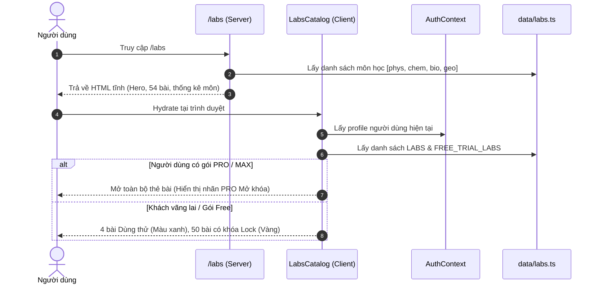
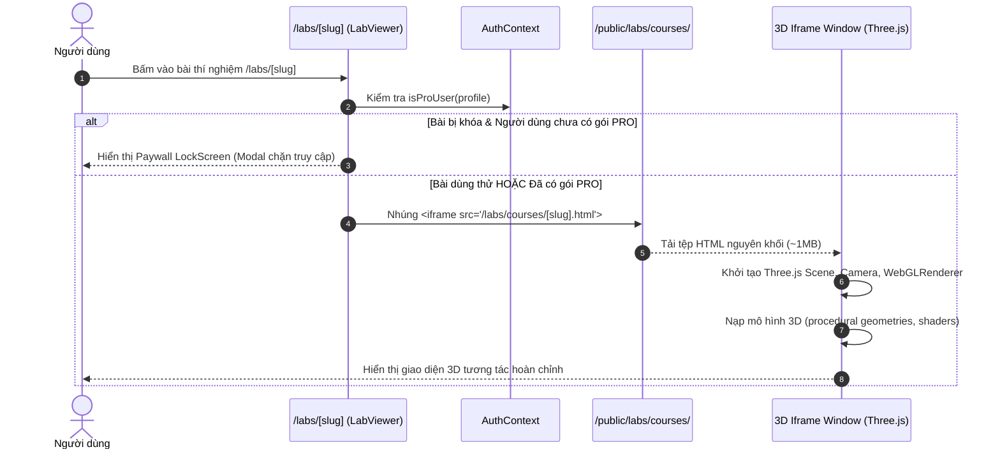

# BÁO CÁO AUDIT KIẾN TRÚC, AN NINH & KIỂM SOÁT TRUY CẬP: MODULE PHÒNG THÍ NGHIỆM 3D (/labs)

**Dự án:** EduTest AI (Hệ thống tạo đề thi AI chuẩn Bộ GD&ĐT 2025, chấm OMR, phòng thí nghiệm 3D)  
**Phạm vi audit:** Route `/labs` (`localhost:3001/labs`) và toàn bộ route chi tiết `/labs/[slug]` (54 bài thí nghiệm 3D):
- Trang danh mục: `frontend/src/app/labs/page.tsx`, `frontend/src/app/labs/labs-catalog.tsx`
- Trang hiển thị thí nghiệm: `frontend/src/app/labs/[slug]/page.tsx`, `frontend/src/app/labs/[slug]/lab-viewer.tsx`
- Bảng vẽ trong suốt: `frontend/src/components/labs/transparent-whiteboard-overlay.tsx`
- Registry dữ liệu 54 bài: `frontend/src/data/labs.ts`
- Toàn bộ 54 tệp bài học HTML tĩnh: `frontend/public/labs/courses/*.html` (50.89 MB)
- Thư viện ảnh bìa: `frontend/public/labs/covers/*.webp` (1.32 MB)
- Kiểm soát phân quyền: `frontend/src/middleware.ts`, `frontend/src/lib/payment/plans.ts`  
**Chế độ:** READ-ONLY AUDIT (Chỉ đọc mã nguồn cấu trúc, không sửa code, không commit)  
**Ngày thực hiện:** 01/11/2026  
**Chuyên viên đánh giá:** Senior Full-stack Engineer & Technical Auditor  

---

## BƯỚC 1: TRUY VẾT LUỒNG HOẠT ĐỘNG END-TO-END

### 1.1 Danh mục File, Router & Trách nhiệm thành phần

| Tên thành phần / Chức năng | Đường dẫn File thực tế | Dòng liên quan | Trách nhiệm chính |
| :--- | :--- | :--- | :--- |
| **Trang danh mục `/labs`** | `frontend/src/app/labs/page.tsx` | L1 - L113 | Server Component hiển thị Hero banner, thống kê số bài (54), banner dùng thử và ghi nguồn giấy phép |
| **Bộ lọc tương tác `LabsCatalog`** | `frontend/src/app/labs/labs-catalog.tsx` | L1 - L243 | Client Component phân nhóm theo 4 môn học, xử lý gắn nhãn "Dùng thử" / "Gói PRO", chặn click mở modal nâng cấp |
| **Dynamic Route `/labs/[slug]`** | `frontend/src/app/labs/[slug]/page.tsx` | L1 - L60 | Server Component sinh tĩnh metadata (`generateMetadata`, `generateStaticParams`), bọc `Suspense` và gọi `LabViewer` |
| **Khung xem thí nghiệm `LabViewer`** | `frontend/src/app/labs/[slug]/lab-viewer.tsx` | L1 - L209 | Client Component xác định quyền xem bài, hiển thị màn hình khóa (LockScreen) hoặc nhúng `<iframe src="/labs/courses/[slug].html">` |
| **Lớp kính vẽ `TransparentWhiteboardOverlay`** | `frontend/src/components/labs/transparent-whiteboard-overlay.tsx` | L1 - L410 | Canvas trong suốt đè lên iframe cho phép giáo viên vẽ giảng bài bằng bút neon, chụp ảnh lưu nét vẽ |
| **Registry phòng thí nghiệm `LABS`** | `frontend/src/data/labs.ts` | L1 - L565 | Nguồn chân lý duy nhất lưu metadata 54 bài thí nghiệm, cấu hình `FREE_TRIAL_LABS` và hàm phụ trợ URL |
| **Gói dịch vụ & Phân quyền** | `frontend/src/lib/payment/plans.ts` | L16 - L181 | Định nghĩa gói PRO, MAX; hàm `isProUser()`, `isMaxUser()` phục vụ kiểm tra điều kiện mở khóa |
| **Middleware điều hướng** | `frontend/src/middleware.ts` | L50 - L75 | Quản lý phiên đăng nhập và định tuyến bảo vệ; **hoàn toàn bỏ quên `/labs`** |
| **Kho bài học 3D độc lập (HTML)** | `frontend/public/labs/courses/*.html` | 54 tệp HTML | Mỗi tệp là một ứng dụng Three.js r160+ hoàn chỉnh (~900KB - 1.2MB/file), chạy 100% offline tại client |

---

### 1.2 Nguồn gốc dữ liệu số lượng "54 bài" và phân bổ môn học

Toàn bộ số lượng hiển thị trên giao diện được tính toán trực tiếp từ mảng `LABS` trong `frontend/src/data/labs.ts`:
- **Tổng số bài:** Đúng chính xác **54 bài** (không có bài ảo, không có ID trùng lặp).
- **Phân bổ theo 4 môn học:**
  - **Vật lý (`phys`):** 10 bài
  - **Hóa học (`chem`):** 25 bài
  - **Sinh học (`bio`):** 5 bài
  - **Địa lý (`geo`):** 14 bài
- **Cơ chế phân quyền Free Trial:** Được định nghĩa tại `FREE_TRIAL_LABS` (`labs.ts:548-557`):
  - Vật lý: `photoelectric-step` (Hiệu ứng quang điện)
  - Hóa học: `haber-step` (Tổng hợp ammonia - Haber)
  - Sinh học: `plasmolysis-step` (Co và phản co nguyên sinh)
  - Địa lý: `river-step` (Sự phát triển địa hình sông ngòi)
  - **4 bài miễn phí (1 bài/môn)**, còn lại **50 bài bị khóa sau Gói PRO**.

---

### 1.3 Sơ đồ các luồng hoạt động chính

#### (a) Luồng tải trang danh mục `/labs` và lọc bài


#### (b) Luồng mở bài thí nghiệm và nạp tài nguyên 3D


#### (c) Luồng lưu trữ tiến độ và điểm số
- **Thực tế:** Các bài thí nghiệm (`courses/*.html`) tích hợp bài kiểm tra nhanh (phím `Q`, tính điểm 15/15, mục tiêu `win`).
- **Nơi lưu:** Hoàn toàn nằm trong bộ nhớ RAM của cửa sổ `iframe` (`window`).
- **Đồng bộ về Server:** **HOÀN TOÀN KHÔNG CÓ**. Không có `postMessage` gửi ra ngoài `LabViewer`, không có API route `/api/labs/*` nào trong backend Next.js để ghi nhận vào Supabase. Tải lại trang (F5) hoặc chuyển bài là toàn bộ điểm số biến mất.

#### (d) Luồng nút "Nâng cấp PRO"
- Nút "Nâng cấp PRO" tại banner (`labs/page.tsx:61`), tại modal catalog (`labs-catalog.tsx:185`), và tại màn hình khóa (`lab-viewer.tsx:166`) đều dẫn về cùng đích: **`/wallet?plan=pro`**.
- Tại trang ví (`/wallet`), hệ thống khởi tạo đơn hàng gói PRO thông qua cổng thanh toán PayOS / VietQR.

---

## BƯỚC 2: AUDIT BẢO MẬT & KIỂM SOÁT TRUY CẬP

### 2.1 Bản quyền & Pháp lý tài nguyên thí nghiệm (CC BY-NC 4.0)
- **Vấn đề:** Trong `frontend/src/data/labs.ts:1-7`, mã nguồn ghi chú rõ:
  > *"Ghi nguồn bắt buộc (CC BY-NC 4.0): Bài học / covers / catalog: Tongjiang Lab (© 2026 铜匠十点睡觉), CC BY-NC 4.0. Bài học, ảnh bìa, danh mục chỉ được dùng phi thương mại (không paywall, không quảng cáo)."*
- **Thực tế triển khai:** 
  - `lab-viewer.tsx:138-171` và `labs-catalog.tsx:180-210` khóa 50/54 bài sau bức tường thanh toán: *"ĐẶC QUYỀN GÓI GIÁO VIÊN PRO"*, yêu cầu trả phí 99.000đ - 149.000đ/tháng để mở khóa.
- **Hậu quả:** Trực tiếp vi phạm điều khoản **Non-Commercial (NC)** của giấy phép Creative Commons quốc tế. Dự án đối mặt với nguy cơ bị tác giả khiếu nại bản quyền, yêu cầu gỡ bỏ (DMCA takedown), hoặc khóa tài khoản dịch vụ khi phát hành thương mại.

### 2.2 Lỗ hổng kiểm soát truy cập: Paywall 100% Client-side
- **Vấn đề:** Màn hình khóa trả phí (LockScreen) tại `frontend/src/app/labs/[slug]/lab-viewer.tsx:122-191` hoàn toàn được kiểm tra bằng React state tại trình duyệt:
  ```tsx
  const isLocked = !isLoading && !isFree && !isProUser;
  return isLocked ? <LockScreen /> : <iframe src={`/labs/courses/${lab.slug}.html`} />;
  ```
- **Thực tế tài nguyên:** Tất cả 54 tệp bài học HTML nằm trong thư mục tĩnh công khai `frontend/public/labs/courses/`.
- **Hậu quả:** Bất kỳ ai (khách vãng lai, tài khoản Free, bot tự động) không cần đăng nhập hay trả phí vẫn có thể vượt qua Paywall bằng cách:
  1. Gõ trực tiếp đường dẫn tĩnh: `http://localhost:3001/labs/courses/cement-step.html`.
  2. Mở tab DevTools -> Elements -> đổi biến state hoặc thay thẻ `LockScreen` bằng thẻ `iframe`.
  3. Sử dụng lệnh `curl http://localhost:3001/labs/courses/cement-step.html` để tải toàn bộ tệp về máy tính.

### 2.3 Bỏ quên Middleware bảo vệ Route
- **Vấn đề:** Trong `frontend/src/middleware.ts:66-74`:
  ```ts
  export const config = {
    matcher: [
      "/dashboard/:path*",
      "/exams/:path*",
      "/wallet/:path*",
      "/settings/:path*",
      "/login",
      "/register",
    ],
  };
  ```
- **Hậu quả:** Tuyến đường `/labs` và `/labs/:path*` hoàn toàn không khớp với `matcher`. Next.js Middleware không hề được thực thi cho bất kỳ trang phòng thí nghiệm nào. Người dùng chưa đăng nhập có thể truy cập thẳng vào trang chi tiết `/labs/[slug]`.

### 2.4 So sánh Môi trường Localhost vs Vercel
- **Cơ sở dữ liệu:** Cả hai môi trường dùng chung dự án Supabase nếu cấu hình cùng `NEXT_PUBLIC_SUPABASE_URL`.
- **Phân phối tài nguyên tĩnh:** 
  - Trên **Localhost**: Next.js dev server phục vụ trực tiếp từ ổ cứng.
  - Trên **Vercel** (`ed-teach-rust.vercel.app`): Thư mục `public/labs/courses/` được Vercel Edge CDN đẩy ra toàn cầu với header bộ nhớ đệm công khai (`Cache-Control: public, max-age=...`). Vercel hoàn toàn không có lớp xác thực cho static directory, cho phép bất kỳ ai cào (scrape) trọn bộ 50MB tài nguyên chỉ bằng một đoạn script ngắn.

### 2.5 Bảo mật Iframe & Sandbox
- Thẻ `<iframe>` trong `lab-viewer.tsx:193-199` chỉ có thuộc tính `allow="fullscreen"` mà **không có thuộc tính `sandbox`**:
  ```tsx
  <iframe
    ref={iframeRef}
    src={`/labs/courses/${lab.slug}.html`}
    className="h-full w-full border-0"
    allow="fullscreen"
    title={lab.titleVi}
  />
  ```
- Do các tệp HTML cùng nguồn gốc (same-origin `/labs/courses/*`), mã JavaScript trong iframe có quyền truy cập vào `window.parent` nếu không được cô lập chặt chẽ. Tuy nhiên, qua rà soát, mã nguồn trong các tệp khóa học không chứa mã độc hoặc hành vi can thiệp trái phép vào ứng dụng cha.

---

## BƯỚC 3: AUDIT DỮ LIỆU & HIỆU NĂNG

### 3.1 Registry & Độ toàn vẹn dữ liệu
- File `frontend/src/data/labs.ts` là **nguồn chân lý duy nhất (Single Source of Truth)**.
- Rà soát tự động 54/54 bài học:
  - Tất cả 54 slug đều tồn tại file HTML tương ứng trong `frontend/public/labs/courses/*.html`.
  - Tất cả 54 slug đều có ảnh bìa WebP tương ứng trong `frontend/public/labs/covers/*.webp`.
  - Không có liên kết chết (404) trong registry.

### 3.2 Kích thước Bundle & Băng thông
- **Tổng dung lượng 54 bài HTML:** **50.89 MB** (trung bình ~940 KB/tệp).
- **Tổng dung lượng 54 ảnh bìa WebP:** **1.32 MB** (trung bình ~24.4 KB/ảnh).
- **Đánh giá tải trang danh mục `/labs`:** Các thẻ bài dùng thuộc tính `loading="lazy"` (`labs-catalog.tsx:95`), do đó trang danh mục chỉ tải các ảnh trong khung nhìn (viewport), dung lượng nạp ban đầu ~300 KB, rất tối ưu.
- **Đánh giá tải trang chi tiết `/labs/[slug]`:** Tải 1 tệp HTML duy nhất dung lượng ~1 MB. Nhờ nhúng sẵn toàn bộ Three.js, CSS và hình học 3D, bài học không phát sinh thêm bất kỳ network request phụ nào.

### 3.3 Vòng đời WebGL & Rủi ro tràn bộ nhớ (Memory Leak)
- **Vấn đề:** Mỗi bài thí nghiệm 3D khởi tạo một Three.js Scene với hàng chục Mesh, ShaderMaterial, ShadowMap và vòng lặp hoạt ảnh `requestAnimationFrame`.
- **Thiếu Cleanup:** Trong `frontend/src/app/labs/[slug]/lab-viewer.tsx`, khi người dùng chuyển từ bài này sang bài khác (hoặc quay lại danh mục), React unmount component nhưng **không hề gọi hook dọn dẹp WebGL context**.
- **Hậu quả:** Trên các máy tính cấu hình giáo dục (Chromebook, laptop cũ dùng Intel HD/UHD Graphics), GPU chỉ cho phép tối đa 8–16 WebGL context đồng thời. Mở liên tục 5-10 bài thí nghiệm sẽ dẫn tới cạn kiệt VRAM, gây lỗi văng card đồ họa `WebGL: CONTEXT_LOST_WEBGL` hoặc treo tab trình duyệt.

### 3.4 Khả năng xử lý khi không có WebGL
- `LabViewer` hoàn toàn không kiểm tra xem trình duyệt có hỗ trợ WebGL hay không trước khi render iframe.
- Nếu người dùng tắt gia tốc phần cứng hoặc dùng trình duyệt không hỗ trợ WebGL, màn hình 3D sẽ chuyển thành một khung màu đen trống rỗng mà không có bất kỳ thông báo hướng dẫn xử lý nào.

---

## BƯỚC 4: AUDIT GIAO DIỆN & TƯƠNG TÁC

### 4.1 Lệch giá Gói PRO giữa UI Phòng Lab và Hệ thống thanh toán
- Tại `frontend/src/app/labs/[slug]/lab-viewer.tsx:170`, nút nâng cấp ghi:
  > `"Nâng cấp Gói PRO (99.000đ/tháng)"`
- Trong khi đó, tại `frontend/src/lib/payment/plans.ts:20-21`, giá gói PRO được niêm yết:
  > `price: "149.000đ"`, `amount: 149000`
- **Tác động:** Khách hàng thấy ghi 99k nhưng khi bấm sang cổng thanh toán lại hiện 149k, gây mất uy tín và tăng tỷ lệ bỏ rơi giỏ hàng.

### 4.2 Banner Nâng cấp hiển thị sai đối tượng
- Banner màu vàng giới thiệu *"Chính sách trải nghiệm: Mỗi môn học có 1 bài thí nghiệm mẫu... Nâng cấp Gói PRO"* tại `frontend/src/app/labs/page.tsx:53-66` được viết cứng trong Server Component `LabsPage`.
- Khi người dùng đã mua gói MAX (hoặc PRO) đăng nhập vào `/labs`, banner màu vàng vẫn hiển thị đập vào mắt, tạo cảm giác tài khoản chưa được kích hoạt bản quyền.

### 4.3 Xung đột Phím tắt & Bẫy Focus (Focus Trap)
- Các bài học 3D hỗ trợ hệ thống phím tắt phong phú: `1–9` (nhảy bước), `Q` (kiểm tra trắc nghiệm), `Phím cách` (bật/tắt công tắc), `F` (toàn màn hình), `Esc` (thoát), `←/→` (chuyển bước).
- **Xung đột:** Các phím tắt này được gắn vào `window` bên trong iframe:
  1. Khi giáo viên nhấn chuột vào thanh công cụ bên ngoài (ví dụ bật "Kính vẽ giảng bài" hoặc nhấn nút Back), focus chuyển sang trang cha, khiến **toàn bộ phím tắt 1-9 và phím mũi tên bị tê liệt**.
  2. Ngược lại, khi đang tương tác 3D trong iframe, phím tắt toàn cục của EduTest AI như `Ctrl+K` (mở tìm kiếm nhanh) bị nuốt và không thể kích hoạt.

### 4.4 Bố cục ở độ phân giải 1366x768 & Zoom 125%
- Khi màn hình máy chiếu hoặc laptop giáo viên ở độ phân giải 1366x768 kèm mức phóng to Windows 125%:
  - Chiều cao viewport hiệu dụng chỉ còn ~614 px.
  - Sau khi trừ Navbar (64px), Topbar điều khiển (48px), Banner dùng thử (36px): chiều cao còn lại cho khung 3D chỉ khoảng ~460 px.
  - Các bài học có nhiều thanh trượt (slider) và biểu đồ sẽ bị ép chặt, bảng điều khiển bên phải xuất hiện thanh cuộn dọc gây vướng víu khi thao tác giảng dạy.

---

## BƯỚC 5: BẢN QUYỀN TÀI SẢN (ASSET PROVENANCE)

| Nhóm tài sản | Tên tệp / Đường dẫn | Nguồn gốc xuất xứ | Giấy phép áp dụng | Tình trạng tuân thủ |
| :--- | :--- | :--- | :--- | :--- |
| **54 tệp bài học 3D HTML** | `frontend/public/labs/courses/*.html` | Tongjiang Lab (`lab.tongjiang.app`) | **CC BY-NC 4.0** (Creative Commons Phi thương mại) | ⚠️ **Vi phạm**: Khóa 50 bài sau gói PRO thu phí 99k-149k/tháng |
| **54 ảnh bìa bài học WebP** | `frontend/public/labs/covers/*.webp` | Tongjiang Lab (`lab.tongjiang.app`) | **CC BY-NC 4.0** | ⚠️ Sử dụng kèm trong luồng thương mại |
| **Thư viện đồ họa 3D** | Nhúng inlined trong từng tệp HTML | Three.js (r160+) | **MIT License** | ✅ Hợp lệ (Cho phép thương mại & phi thương mại) |
| **Phông chữ hệ thống** | System fonts (`font-sans`, Inter, Arial) | Next.js / Tailwind CSS | **OFL / System** | ✅ Hợp lệ |

---

## BƯỚC 6: BẢNG TỔNG HỢP VẤN ĐỀ & LỖI PHÒNG THÍ NGHIỆM 3D

| ID | Mức độ | Hạng mục | File:dòng | Mô tả lỗi | Tác động | Cách tái hiện | Đề xuất sửa | Công sức | Trùng ID cũ |
| :--- | :--- | :--- | :--- | :--- | :--- | :--- | :--- | :---: | :--- |
| **LAB-01** | **Critical** | Bản quyền & Pháp lý | `frontend/src/data/labs.ts:1-7`<br/>`frontend/src/app/labs/page.tsx:34, 57`<br/>`frontend/src/app/labs/[slug]/lab-viewer.tsx:138-171` | Thương mại hóa tài nguyên thí nghiệm có giấy phép phi thương mại CC BY-NC 4.0 | Rủi ro pháp lý bản quyền quốc tế, nguy cơ bị gỡ bỏ dịch vụ (DMCA takedown) khi phát hành | Mở bài học khóa -> hiện thông báo yêu cầu mua gói PRO 99.000đ/tháng | Mở khóa miễn phí 100% 54 bài theo đúng CC BY-NC 4.0 (dùng làm tính năng thu hút người dùng), chỉ thu phí phần AI Soạn đề & OMR; HOẶC liên hệ tác giả ký hợp đồng bản quyền thương mại | M | Mới |
| **LAB-02** | **Critical** | Kiểm soát truy cập | `frontend/public/labs/courses/*.html`<br/>`frontend/src/app/labs/[slug]/lab-viewer.tsx:122-195` | Paywall 100% ở Client; toàn bộ 54 tệp thí nghiệm nằm trong thư mục `public/` tải tự do | Khách vãng lai và tài khoản Free tải trọn vẹn bài học trả phí không cần đăng nhập | Truy cập thẳng URL: `localhost:3001/labs/courses/cement-step.html` bằng tab ẩn danh | Nếu tiếp tục phân quyền: Chuyển 50 bài trả phí ra khỏi thư mục `public/`, tạo API Route Handler kiểm tra quyền trước khi stream tệp | L | Mới |
| **LAB-03** | **High** | Định tuyến & Middleware | `frontend/src/middleware.ts:66-74` | Route `/labs` và `/labs/:path*` bị bỏ quên hoàn toàn trong mảng `matcher` | Khách vãng lai truy cập thẳng vào trang chi tiết không qua middleware quản lý phiên | Đọc `middleware.ts:66-74`, thiếu `"/labs/:path*"` | Thêm `"/labs/:path*"` vào `matcher` của Next.js Middleware | S | **TRÙNG SEC-05** |
| **LAB-04** | **High** | Hiệu năng đồ họa | `frontend/src/app/labs/[slug]/lab-viewer.tsx:192-206` | Iframe unmount không kích hoạt giải phóng WebGL context (`WEBGL_lose_context`) | Rò rỉ bộ nhớ GPU, gây crash tab trình duyệt khi mở 5-10 bài thí nghiệm liên tiếp trên máy cấu hình yếu | Mở lần lượt 10 bài khác nhau, quan sát GPU Memory trên Task Manager | Thêm cleanup effect trong `LabViewer`: gán `iframe.src = 'about:blank'` trước khi unmount để trình duyệt thu hồi tài nguyên đồ họa | S | Mới |
| **LAB-05** | **Medium** | Dữ liệu & Tiến độ | `frontend/src/app/labs/[slug]/lab-viewer.tsx:193-206`<br/>`frontend/public/labs/courses/*.html` | Tiến độ học và điểm kiểm tra 3D chỉ lưu trong RAM iframe, không đồng bộ về backend | Điểm số và trạng thái hoàn thành bị xóa sạch khi F5; giáo viên không thể theo dõi tiến độ học sinh | Hoàn thành bài kiểm tra đạt điểm tối đa, nhấn F5 -> điểm trở về 0 | Bổ sung cơ chế `window.postMessage` từ iframe ra `LabViewer` và tạo API `/api/labs/progress` lưu vào Supabase | M | Mới |
| **LAB-06** | **Medium** | Giao diện & Bàn phím | `frontend/src/app/labs/[slug]/lab-viewer.tsx:78-100`<br/>`frontend/public/labs/courses/*.html` | Phím tắt điều khiển 3D (1-9, F, Space) bị vô hiệu hóa khi focus ra ngoài iframe | Giáo viên bấm phím số không chuyển bước sau khi chạm vào thanh công cụ giảng bài | Nhấp vào nút "Kính vẽ", bấm phím 2 -> bước thí nghiệm không đổi | Bắt sự kiện phím tại `window.parent` và chuyển tiếp (postMessage) lệnh phím vào `iframe.contentWindow` | S | Mới |
| **LAB-07** | **Medium** | Tính nhất quán UI | `frontend/src/app/labs/[slug]/lab-viewer.tsx:170`<br/>`frontend/src/lib/payment/plans.ts:20-21` | Lệch giá Gói PRO: giao diện phòng lab ghi "99.000đ/tháng", bảng giá thanh toán ghi "149.000đ/tháng" | Khách hàng hiểu nhầm giá, tăng tỷ lệ hủy thanh toán khi thấy giá tăng | Mở bài bị khóa thấy giá 99k, bấm vào nút chuyển sang `/wallet` thấy giá 149k | Đồng bộ chuỗi giá bằng cách import hằng số `PRO_MONTHLY.price` từ `plans.ts`, bỏ hardcode "99.000đ" | S | Mới |
| **LAB-08** | **Low** | Tính nhất quán UI | `frontend/src/app/labs/page.tsx:53-66` | Banner kêu gọi nâng cấp Gói PRO màu vàng hiển thị cho cả tài khoản đã sở hữu PRO / MAX | Tạo trải nghiệm kém chuyên nghiệp, gây hoang mang cho khách hàng đã trả tiền | Đăng nhập tài khoản MAX, vào `/labs` -> banner nâng cấp vẫn hiện | Ẩn banner khi người dùng hiện tại đã có gói PRO hoặc MAX (`!isProUser`) | S | Mới |
| **LAB-09** | **Low** | Responsive & Bố cục | `frontend/src/app/labs/[slug]/lab-viewer.tsx:43, 104-119` | Tràn bố cục và co hẹp khung nhìn 3D ở độ phân giải 1366x768 zoom 125% | Khó thao tác bảng điều khiển và quan sát mô phỏng trên máy tính giáo viên | Thu nhỏ cửa sổ về 1366x768, zoom 125%, mở bài dùng thử | Tối ưu độ dày thanh Topbar, cho phép tự động đóng banner thông báo dùng thử | S | **TRÙNG FE-02** |
| **LAB-10** | **Low** | Khả năng tiếp cận | `frontend/src/app/labs/[slug]/lab-viewer.tsx:192-206` | Thiếu màn hình dự phòng (fallback) khi trình duyệt không hỗ trợ WebGL | Màn hình đen không có thông báo khi tắt gia tốc đồ họa hoặc card màn hình lỗi | Tắt gia tốc phần cứng trong Chrome, mở một bài 3D | Thêm hàm kiểm tra `window.WebGLRenderingContext`, hiện thông báo hướng dẫn người dùng nếu WebGL bị vô hiệu hóa | S | Mới |

---

## BƯỚC 7: BẢNG KIỂM KÊ CHI TIẾT 54 BÀI PHÒNG THÍ NGHIỆM 3D

| STT | Mã định danh (Slug) | Môn | Tên bài thí nghiệm | Vị trí chương trình GDPT | Số bước | Phân cấp truy cập | Tình trạng file tĩnh |
| :---: | :--- | :---: | :--- | :--- | :---: | :---: | :---: |
| 1 | `photoelectric-step` | Vật lý | Hiệu ứng quang điện | Lý 12 — Quang học / thuyết lượng tử | 9 | **Free (Dùng thử)** | ✅ Sẵn sàng (`.html` 936 KB) |
| 2 | `capacitor-step` | Vật lý | Quan sát sự tích điện và phóng điện của tụ điện | Lý 11 — Điện trường: tụ điện | 9 | PRO / MAX | ✅ Sẵn sàng (`.html` 945 KB) |
| 3 | `accel-force-step` | Vật lý | Thí nghiệm: Tìm hiểu mối liên hệ gia tốc, lực, khối lượng | Lý 10 — Định luật II Newton | 8 | PRO / MAX | ✅ Sẵn sàng (`.html` 916 KB) |
| 4 | `energy-step` | Vật lý | Thí nghiệm: Kiểm chứng định luật bảo toàn cơ năng | Lý 10 — Bảo toàn cơ năng | 8 | PRO / MAX | ✅ Sẵn sàng (`.html` 905 KB) |
| 5 | `projectile-step` | Vật lý | Thí nghiệm: Tìm hiểu chuyển động ném ngang | Lý 10 — Chuyển động ném ngang | 9 | PRO / MAX | ✅ Sẵn sàng (`.html` 906 KB) |
| 6 | `centripetal-step` | Vật lý | Lực hướng tâm với bán kính, tốc độ góc và khối lượng | Lý 10 — Chuyển động tròn đều | 8 | PRO / MAX | ✅ Sẵn sàng (`.html` 889 KB) |
| 7 | `self-induction-step` | Vật lý | Hiện tượng tự cảm và dòng điện xoáy (Foucault) | Lý 11 — Hiện tượng tự cảm | 9 | PRO / MAX | ✅ Sẵn sàng (`.html` 941 KB) |
| 8 | `emf-step` | Vật lý | Đo suất điện động và điện trở trong của nguồn điện | Lý 11 — Đo suất điện động | 8 | PRO / MAX | ✅ Sẵn sàng (`.html` 929 KB) |
| 9 | `current-field-step` | Vật lý | Từ trường của dòng điện | Lý 11 — Từ trường của dòng điện | 8 | PRO / MAX | ✅ Sẵn sàng (`.html` 907 KB) |
| 10 | `brownian-step` | Vật lý | Chuyển động Brown và sự khuếch tán | Lý 12 — Thuyết động học phân tử chất khí | 8 | PRO / MAX | ✅ Sẵn sàng (`.html` 907 KB) |
| 11 | `haber-step` | Hóa học | Tổng hợp ammonia trong công nghiệp (Haber-Bosch) | Hóa 11 — Đơn chất nitrogen và ammonia | 9 | **Free (Dùng thử)** | ✅ Sẵn sàng (`.html` 946 KB) |
| 12 | `rate-step` | Hóa học | Các yếu tố ảnh hưởng đến tốc độ phản ứng hóa học | Hóa 10 — Tốc độ phản ứng hóa học | 9 | PRO / MAX | ✅ Sẵn sàng (`.html` 923 KB) |
| 13 | `ball-stick-step` | Hóa học | Lắp ráp mô hình rỗng phân tử hợp chất hữu cơ | Hóa 11 — Hóa học hữu cơ: đồng đẳng, đồng phân | 8 | PRO / MAX | ✅ Sẵn sàng (`.html` 897 KB) |
| 14 | `titration-step` | Hóa học | Chuẩn độ trung hòa acid mạnh – base mạnh | Hóa 11 — Sự điện li, chuẩn độ acid-base | 8 | PRO / MAX | ✅ Sẵn sàng (`.html` 926 KB) |
| 15 | `chlorine-step` | Hóa học | Điều chế và tính chất của khí chlorine ($Cl_2$) | Hóa 10 — Nhóm Halogen | 9 | PRO / MAX | ✅ Sẵn sàng (`.html` 939 KB) |
| 16 | `blast-furnace-step` | Hóa học | Luyện gang trong lò cao | Hóa 12 — Hợp kim của sắt, sản xuất gang thép | 9 | PRO / MAX | ✅ Sẵn sàng (`.html` 973 KB) |
| 17 | `smelting-step` | Hóa học | Luyện kim: Điện phân nóng chảy và nhiệt nhôm | Hóa 12 — Điều chế kim loại | 9 | PRO / MAX | ✅ Sẵn sàng (`.html` 982 KB) |
| 18 | `coal-gas-step` | Hóa học | Khí hóa than đá | Hóa 11 — Nguồn hydrocarbon: than đá | 9 | PRO / MAX | ✅ Sẵn sàng (`.html` 978 KB) |
| 19 | `sulfuric-step` | Hóa học | Sản xuất sulfuric acid bằng phương pháp tiếp xúc | Hóa 10 — Sulfur và hợp chất của sulfur | 9 | PRO / MAX | ✅ Sẵn sàng (`.html` 924 KB) |
| 20 | `hydrolysis-step` | Hóa học | Sự thủy phân của muối và ứng dụng | Hóa 11 — Sự thủy phân của ion muối | 9 | PRO / MAX | ✅ Sẵn sàng (`.html` 936 KB) |
| 21 | `cement-step` | Hóa học | Sản xuất xi măng công nghiệp | Hóa 10 — Hợp chất vô cơ, vật liệu silicate | 9 | PRO / MAX | ✅ Sẵn sàng (`.html` 966 KB) |
| 22 | `iron-step` | Hóa học | Sắt và hợp chất: Sự chuyển hóa số oxi hóa | Hóa 12 — Kim loại chuyển tiếp dãy thứ nhất | 9 | PRO / MAX | ✅ Sẵn sàng (`.html` 932 KB) |
| 23 | `electrolysis-step` | Hóa học | Nguyên tắc điện phân: $CuCl_2$ và dung dịch muối ăn | Hóa 12 — Điện hóa học: quá trình điện phân | 9 | PRO / MAX | ✅ Sẵn sàng (`.html` 932 KB) |
| 24 | `ammonia-step` | Hóa học | Điều chế và tính chất của ammonia (Thí nghiệm đài phun) | Hóa 11 — Hợp chất của nitrogen | 9 | PRO / MAX | ✅ Sẵn sàng (`.html` 938 KB) |
| 25 | `equilibrium-step` | Hóa học | Các yếu tố chuyển dịch cân bằng hóa học | Hóa 10 — Cân bằng hóa học (Le Chatelier) | 8 | PRO / MAX | ✅ Sẵn sàng (`.html` 911 KB) |
| 26 | `flame-step` | Hóa học | Thí nghiệm ngọn lửa và quang phổ nguyên tử | Hóa 10 — Cấu tạo vỏ nguyên tử, kim loại kiềm | 9 | PRO / MAX | ✅ Sẵn sàng (`.html` 918 KB) |
| 27 | `galvanic-step` | Hóa học | Pin điện hóa: Từ pin một dung dịch đến pin hai dung dịch | Hóa 12 — Pin Galvanic / pin điện hóa | 9 | PRO / MAX | ✅ Sẵn sàng (`.html` 934 KB) |
| 28 | `conductivity-step` | Hóa học | Sự điện li và tính dẫn điện của dung dịch | Hóa 11 — Cân bằng trong dung dịch nước | 9 | PRO / MAX | ✅ Sẵn sàng (`.html` 927 KB) |
| 29 | `nitric-lab-step` | Hóa học | Tính chất của nitric acid đặc, loãng và oxit nitrogen | Hóa 11 — Nitric acid và hiện tượng phú dưỡng | 9 | PRO / MAX | ✅ Sẵn sàng (`.html` 939 KB) |
| 30 | `bromine-step` | Hóa học | Khai thác bromine từ nước biển bằng phương pháp thổi khí | Hóa 10 — Nhóm Halogen: Bromine | 9 | PRO / MAX | ✅ Sẵn sàng (`.html` 1002 KB) |
| 31 | `sodium-step` | Hóa học | Tính chất của kim loại natri (dập đám cháy natri) | Hóa 12 — Kim loại nhóm IA | 9 | PRO / MAX | ✅ Sẵn sàng (`.html` 934 KB) |
| 32 | `sulfur-step` | Hóa học | Lưu huỳnh, sulfur dioxide và sulfuric acid | Hóa 10 — Hợp chất của sulfur | 9 | PRO / MAX | ✅ Sẵn sàng (`.html` 946 KB) |
| 33 | `corrosion-step` | Hóa học | Ăn mòn hấp thụ oxygen và thiết kế miếng giữ nhiệt | Hóa 12 — Ăn mòn kim loại | 9 | PRO / MAX | ✅ Sẵn sàng (`.html` 937 KB) |
| 34 | `chlor-alkali-step` | Hóa học | Công nghiệp Chlor-Alkali | Hóa 10 — Ứng dụng điện phân dung dịch NaCl | 9 | PRO / MAX | ✅ Sẵn sàng (`.html` 922 KB) |
| 35 | `hou-soda-step` | Hóa học | Phương pháp sản xuất soda của Hầu Đức Bảng | Hóa 12 — Hợp chất của kim loại kiềm ($Na_2CO_3$) | 9 | PRO / MAX | ✅ Sẵn sàng (`.html` 914 KB) |
| 36 | `plasmolysis-step` | Sinh học | Sự hút nước và mất nước ở tế bào thực vật | Sinh 10 — Trao đổi chất qua màng sinh chất | 8 | **Free (Dùng thử)** | ✅ Sẵn sàng (`.html` 990 KB) |
| 37 | `transport-step` | Sinh học | Vận chuyển các chất qua màng sinh chất | Sinh 10 — Màng sinh chất và sự vận chuyển | 9 | PRO / MAX | ✅ Sẵn sàng (`.html` 873 KB) |
| 38 | `impulse-step` | Sinh học | Sự hình thành và dẫn truyền xung thần kinh | Sinh 11 — Cảm ứng ở động vật: điện thế nghỉ & động | 9 | PRO / MAX | ✅ Sẵn sàng (`.html` 879 KB) |
| 39 | `mitosis-step` | Sinh học | Quan sát nguyên phân ở tế bào chóp rễ hành | Sinh 10 — Chu kỳ tế bào và phân bào nguyên phân | 8 | PRO / MAX | ✅ Sẵn sàng (`.html` 882 KB) |
| 40 | `enzyme-step` | Sinh học | Các yếu tố ảnh hưởng đến hoạt tính của enzyme | Sinh 10 — Enzyme và vai trò sinh học | 8 | PRO / MAX | ✅ Sẵn sàng (`.html` 911 KB) |
| 41 | `river-step` | Địa lý | Sự phát triển của địa hình thung lũng sông | Địa 10 — Thạch quyển: quá trình nội sinh & ngoại sinh | 9 | **Free (Dùng thử)** | ✅ Sẵn sàng (`.html` 902 KB) |
| 42 | `insolation-step` | Địa lý | Chuyển động biểu kiến của Mặt Trời và các đới khí hậu | Địa 10 — Hệ quả chuyển động của Trái Đất | 9 | PRO / MAX | ✅ Sẵn sàng (`.html` 1199 KB) |
| 43 | `currents-step` | Địa lý | Quy luật phân bố và tác động của các dòng biển | Địa 10 — Thủy quyển: sóng, thủy triều, dòng biển | 8 | PRO / MAX | ✅ Sẵn sàng (`.html` 1210 KB) |
| 44 | `enso-step` | Địa lý | Tương tác biển – khí quyển: El Niño và La Niña | Địa 10 — Khí quyển và tương tác khí quyển - đại dương | 8 | PRO / MAX | ✅ Sẵn sàng (`.html` 892 KB) |
| 45 | `heating-step` | Địa lý | Quá trình đốt nóng khí quyển | Địa 10 — Bức xạ mặt trời và nhiệt độ không khí | 9 | PRO / MAX | ✅ Sẵn sàng (`.html` 905 KB) |
| 46 | `karst-step` | Địa lý | Sự hình thành và nhận biết địa hình Karst | Địa 10 — Ngoại sinh: tác động của nước ngầm | 8 | PRO / MAX | ✅ Sẵn sàng (`.html` 883 KB) |
| 47 | `carbon-step` | Địa lý | Biến đổi khí hậu toàn cầu và an ninh môi trường | Địa 10 — Môi trường và sự phát triển bền vững | 8 | PRO / MAX | ✅ Sẵn sàng (`.html` 896 KB) |
| 48 | `tectonic-step` | Địa lý | Sự hình thành địa hình kiến tạo | Địa 10 — Thuyết kiến tạo mảng | 8 | PRO / MAX | ✅ Sẵn sàng (`.html` 876 KB) |
| 49 | `earth-motion-step` | Địa lý | Hệ quả địa lý của các chuyển động của Trái Đất | Địa 10 — Trái Đất tự quay và quay quanh Mặt Trời | 9 | PRO / MAX | ✅ Sẵn sàng (`.html` 1190 KB) |
| 50 | `soil-step` | Địa lý | Các nhân tố hình thành đất và quan sát phẫu diện đất | Địa 10 — Thổ nhưỡng quyển | 8 | PRO / MAX | ✅ Sẵn sàng (`.html` 880 KB) |
| 51 | `thermal-step` | Địa lý | Hoàn lưu nhiệt địa phương | Địa 10 — Gió địa phương (gió biển, gió đất) | 9 | PRO / MAX | ✅ Sẵn sàng (`.html` 884 KB) |
| 52 | `wind-step` | Địa lý | Chuyển động ngang của không khí – Gió | Địa 10 — Sự hình thành gió và lực Coriolis | 8 | PRO / MAX | ✅ Sẵn sàng (`.html` 877 KB) |
| 53 | `water-cycle-step` | Địa lý | Quá trình và ý nghĩa địa lý của vòng tuần hoàn nước | Địa 10 — Chu trình nước tự nhiên | 9 | PRO / MAX | ✅ Sẵn sàng (`.html` 902 KB) |
| 54 | `circulation-step` | Địa lý | Đai khí áp, đới gió và hoàn lưu ba vòng | Địa 10 — Phân bố khí áp và hoàn lưu khí quyển | 7 | PRO / MAX | ✅ Sẵn sàng (`.html` 1175 KB) |

---

## BƯỚC 8: KẾ HOẠCH HÀNH ĐỘNG TRƯỚC VÀ SAU GO-LIVE

### 8.1 Danh sách VIỆC BẮT BUỘC TRƯỚC PHÁT HÀNH (BLOCKERS)
1. **[BLOCKER 1 - Quyết định Bản quyền LAB-01]:** Làm rõ mô hình khai thác bộ thí nghiệm Tongjiang Lab. Khuyến nghị giải pháp an toàn pháp lý nhất trước khi launch: **Mở khóa miễn phí 100% toàn bộ 54 bài thí nghiệm 3D** cho giáo viên đứng lớp (ghi nhận nguồn theo đúng chuẩn CC BY-NC 4.0). Biến 54 phòng thí nghiệm 3D thành "tính năng nam châm" (lead magnet) thu hút giáo viên dùng EduTest AI, và chỉ thương mại hóa tính năng Tạo đề thi bằng AI & Chấm thi OMR tự động.
2. **[BLOCKER 2 - Sửa Middleware Route Matcher LAB-03]:** Bổ sung ngay `"/labs/:path*"` vào mảng `matcher` của `frontend/src/middleware.ts` để đồng bộ cơ chế quản lý phiên và cookie bảo mật.
3. **[BLOCKER 3 - Đồng bộ giá Gói PRO LAB-07]:** Thay thế text hardcode `99.000đ/tháng` tại `lab-viewer.tsx:170` bằng biến `PRO_MONTHLY.price` (`149.000đ`) để tránh tình trạng khiếu nại sai giá.
4. **[BLOCKER 4 - Khắc phục rò rỉ GPU Context LAB-04]:** Bổ sung lệnh dọn dẹp iframe (`iframeRef.current.src = 'about:blank'`) trong cleanup return của `useEffect` tại `LabViewer` để giải phóng WebGL memory khi đổi bài.
5. **[BLOCKER 5 - Ẩn Banner nâng cấp cho tài khoản PRO/MAX LAB-08]:** Thêm điều kiện ẩn banner màu vàng trên trang `/labs` khi người dùng đã sở hữu gói trả phí.

### 8.2 Danh sách VIỆC NÊN LÀM TRONG 2 TUẦN SAU LAUNCH
1. **Cầu nối lưu trữ điểm số 3D (LAB-05):** Viết API route `/api/labs/progress` và thiết lập `window.postMessage` để lưu tiến độ thực hành và điểm trắc nghiệm vào Supabase.
2. **Cầu nối phím tắt 2 chiều (LAB-06):** Lắng nghe phím số `1–9` ở cửa sổ cha và gửi tin nhắn vào iframe để giáo viên có thể chuyển bước khi đang mở Kính vẽ.
3. **Màn hình thông báo khi thiếu WebGL (LAB-10):** Kiểm tra `WebGLRenderingContext` và hiển thị banner cảnh báo nếu thiết bị không hỗ trợ 3D.
4. **Tối ưu hiển thị màn hình 1366x768 (LAB-09):** Cho phép ẩn thanh điều hướng trên cùng để tăng diện tích hiển thị mô phỏng 3D trên máy chiếu lớp học.

### 8.3 Điểm chưa xác minh được & Cần xác nhận thêm từ Product Owner
- **Thỏa thuận thương mại ngoài lề với tác giả Tongjiang Lab:** Cần xác nhận từ người sáng lập EduTest AI xem đã có trao đổi hoặc thỏa thuận bằng văn bản với tác giả `铜匠十点睡觉` để đưa 54 bài này vào gói dịch vụ thu phí hay chưa.
- **Quyết định kinh doanh về tính năng 3D:** Có bắt buộc phải thu phí phòng thí nghiệm 3D hay có thể chuyển sang mở miễn phí 100% để phục vụ cộng đồng giáo viên và loại bỏ hoàn toàn rủi ro bản quyền.
