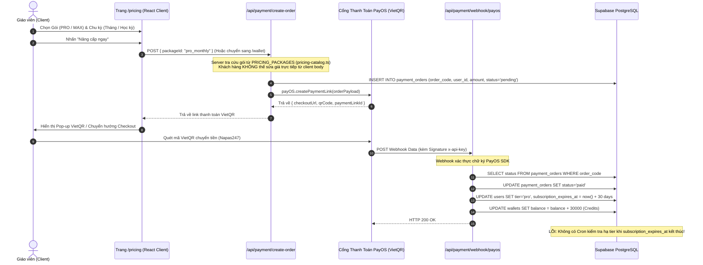

# Báo Cáo Rà Soát Bảo Mật & Kiến Trúc: /pricing (Bảng Giá & Gói Thuê Bao)

**Ngày thực hiện:** 01/11/2026  
**Chuyên viên:** Senior Full-stack Engineer & Security Reviewer  
**Môi trường:** Production/Staging (`ed-teach-rust.vercel.app`), Next.js 14 App Router, Supabase PostgreSQL, PayOS SDK  
**Phạm vi:** Tuyến đường `/pricing`, API tạo đơn hàng, Webhook PayOS/SePay, mô hình gia hạn/hết hạn gói, và tính trung thực của các thông điệp tiếp thị.

---

## 1. Sơ Đồ Luồng Hoạt Động (Upgrade / Subscription Flow)

### 1.1. Biểu Đồ Trình Tự (Sequence Diagram)



### 1.2. Bảng Đối Chiếu File & Dòng Mã Nguồn

| Bước | Thực Thể / Chức Năng | Tệp Tin & Dòng Mã | Đánh Giá Kỹ Thuật |
| :--- | :--- | :--- | :--- |
| **UI** | Giao diện bảng giá `/pricing` | [`frontend/src/app/(dashboard)/pricing/page.tsx#L1-L477`](file:///d:/Go-Live/Web/EdTeach/frontend/src/app/(dashboard)/pricing/page.tsx#L1-L477) | Client component hoàn toàn; xử lý toggle chu kỳ và nút bấm dẫn sang `/wallet` |
| **Catalog** | Bảng giá gốc phía Server | [`frontend/src/lib/payment/pricing-catalog.ts#L1-L112`](file:///d:/Go-Live/Web/EdTeach/frontend/src/lib/payment/pricing-catalog.ts#L1-L112) | Định nghĩa `PRICING_PACKAGES` tĩnh (giá, số ngày, credits tặng). Server tra cứu an toàn |
| **API Order** | Tạo mã đơn và link PayOS | [`frontend/src/app/api/payment/create-order/route.ts#L33-L121`](file:///d:/Go-Live/Web/EdTeach/frontend/src/app/api/payment/create-order/route.ts#L33-L121) | Nhận `packageId`, đối chiếu catalog, tạo đơn `pending` trong `payment_orders` |
| **Webhook** | Kích hoạt gói & cộng credits | [`frontend/src/app/api/payment/webhook/payos/route.ts#L110-L177`](file:///d:/Go-Live/Web/EdTeach/frontend/src/app/api/payment/webhook/payos/route.ts#L110-L177) | Nhận webhook PayOS, cập nhật `users.tier`, `subscription_expires_at`, cộng ví |
| **Downgrade** | Hạ hạng khi hết hạn gói | **KHÔNG TỒN TẠI TRONG TOÀN BỘ CODEBASE** | Lỗ hổng nghiêm trọng: Mua 1 tháng dùng PRO/MAX trọn đời (PRC-01) |

---

## 2. Phân Tích Logic & Lỗ Hổng Bảo Mật Tuyến Giá

### 2.1. Tính Toàn Vẹn Của Giá (Price Integrity)
- **Điểm sáng:** Khác với Chợ đề thi (nơi giá đề từng bị phụ thuộc vào client body), tuyến `/api/payment/create-order` đã dùng mẫu `packageId` và tra cứu ngược vào từ điển cứng [`PRICING_PACKAGES`](file:///d:/Go-Live/Web/EdTeach/frontend/src/lib/payment/pricing-catalog.ts#L44-L96). Client không thể truyền trực tiếp `amount = 1000` để mua gói MAX.
- **Rủi ro mã đơn hàng (Order Code Collision):**
  - Trong [`create-order/route.ts#L52`](file:///d:/Go-Live/Web/EdTeach/frontend/src/app/api/payment/create-order/route.ts#L52):
    ```typescript
    const orderCode = Number(String(Date.now()).slice(-6) + Math.floor(Math.random() * 1000).toString().padStart(3, "0"));
    ```
  - PayOS yêu cầu `orderCode` là số nguyên dương duy nhất tối đa 9 chữ số. Công thức ghép 6 số cuối của timestamp + 3 số ngẫu nhiên có nguy cơ xung đột (birthday paradox) khi có từ 100 giao dịch/ngày, dẫn đến lỗi tạo đơn trên PayOS hoặc trùng lặp ghi nhận đơn hàng. Cần dùng PostgreSQL Sequence để sinh `orderCode` đơn điệu tăng dần.
- **Xác thực Redirect URLs:**
  - Trong [`create-order/route.ts#L59-L62`](file:///d:/Go-Live/Web/EdTeach/frontend/src/app/api/payment/create-order/route.ts#L59-L62), `returnUrl` và `cancelUrl` được đọc từ `body.returnUrl` hoặc fallback về `origin`. Mặc dù client có thể gửi url tùy ý, PayOS chỉ dùng url này để redirect trình duyệt sau khi quét mã, không gây giả mạo trạng thái thanh toán vì trạng thái thực phụ thuộc vào Server-to-Server Webhook. Tuy nhiên, vẫn cần whitelist domain để chống Open Redirect.

---

### 2.2. Chi Tiết Lỗ Hổng Phát Hiện (Findings)

#### 🔴 PRC-01 (CRITICAL): Mua 1 Tháng Được PRO/MAX Trọn Đời (Thiếu Toàn Diện Cơ Chế Hết Hạn & Hạ Tier)
- **Vị trí mã nguồn:**
  - [`frontend/src/app/api/payment/webhook/payos/route.ts#L125-L135`](file:///d:/Go-Live/Web/EdTeach/frontend/src/app/api/payment/webhook/payos/route.ts#L125-L135)
  - [`frontend/src/lib/payment/plans.ts#L10-L24`](file:///d:/Go-Live/Web/EdTeach/frontend/src/lib/payment/plans.ts#L10-L24)
- **Thực tế trong code:**
  1. Khi thanh toán thành công, webhook tính:
     ```typescript
     const expiresAt = new Date();
     expiresAt.setDate(expiresAt.getDate() + (order.package_days || 30));
     await supabaseAdmin.from('users').update({
       tier: newTier,
       subscription_expires_at: expiresAt.toISOString(),
     }).eq('id', order.user_id);
     ```
  2. Trường `subscription_expires_at` được ghi vào bảng `users`. **TUY NHIÊN**:
     - Trong [`plans.ts`](file:///d:/Go-Live/Web/EdTeach/frontend/src/lib/payment/plans.ts): hàm `isProUser(user)` và `isMaxUser(user)` chỉ kiểm tra:
       ```typescript
       return user?.tier === 'pro' || user?.tier === 'max';
       ```
       Hoàn toàn **KHÔNG ĐỌC** trường `subscription_expires_at` để so sánh với `new Date()`!
     - Không có bất kỳ Cron Job (pg_cron hay Vercel Cron), Supabase Edge Function hay Middleware nào kiểm tra quét các user đã hết hạn để cập nhật `tier = 'free'`.
  3. **Hệ quả tái hiện:** Người dùng trả 149.000đ mua 1 tháng gói PRO. Sau 30 ngày, 1 năm hay 5 năm sau, `user.tier` trong DB vẫn là `'pro'`. Người dùng hưởng vĩnh viễn quyền tạo đề, quyền tải Word sạch, quyền giảm phí sàn 5%, và ưu tiên tính năng mà không bao giờ cần gia hạn.
  4. **Lỗi xóa ngày còn lại khi gia hạn trước hạn:**
     - Công thức `expiresAt = new Date(); expiresAt.setDate(expiresAt.getDate() + package_days)` luôn lấy mốc hiện tại (`new Date()`).
     - Nếu người dùng còn 15 ngày gói cũ mà bấm mua gia hạn gói mới, 15 ngày cũ sẽ bị ghi đè mất hoàn toàn thay vì được cộng dồn (`current_expires_at + package_days`).

---

#### 🔴 PRC-02 (HIGH): Leo Thang Đặc Quyền Gói MAX Qua Nội Dung Chuyển Khoản PayOS
- **Vị trí mã nguồn:** [`frontend/src/app/api/payment/webhook/payos/route.ts#L129-L134`](file:///d:/Go-Live/Web/EdTeach/frontend/src/app/api/payment/webhook/payos/route.ts#L129-L134)
- **Thực tế trong code:**
  ```typescript
  let newTier = 'free';
  if (order.package_id?.includes('pro') || data.description?.includes('PRO')) {
    newTier = 'pro';
  }
  if (order.package_id?.includes('max') || data.description?.includes('MAX')) {
    newTier = 'max';
  }
  ```
- **Kịch bản khai thác:**
  1. Kẻ tấn công tạo đơn hàng mua gói nạp Credits lẻ rẻ nhất (ví dụ gói 50 Credits giá 49.000đ, `package_id = 'credits_50'`).
  2. Khi chuyển khoản qua VietQR, kẻ tấn công sửa nội dung chuyển khoản (description) từ mã mặc định thành: `EDUTEACH MAX VIP` hoặc thêm chữ `MAX`.
  3. Khi PayOS gửi webhook về, trường `data.description` chứa chữ `"MAX"`. Điều kiện `data.description?.includes('MAX')` thỏa mãn.
  4. Hệ thống nâng tài khoản của kẻ tấn công lên `tier = 'max'` với giá chỉ 49.000đ (thay vì 229.000đ/tháng hoặc 899.000đ/kỳ).
- **Nguyên nhân gốc:** Không sử dụng khóa định danh tin cậy từ `payment_orders.package_id` đã lưu trên DB, mà lại dùng phép so khớp chuỗi lỏng lẻo (`.includes()`) trên nội dung chuyển khoản do người dùng/ngân hàng gửi về.

---

#### 🟡 PRC-03 (MEDIUM): Bất Nhất Nghiêm Trọng Giữa Quảng Cáo Tiếp Thị & Triển Khai Kỹ Thuật (Truth in Advertising)
So sánh trực tiếp giữa cam kết trên [`/pricing`](file:///d:/Go-Live/Web/EdTeach/frontend/src/app/(dashboard)/pricing/page.tsx) với code vận hành thực tế:

| Hạng Mục Tiếp Thị (/pricing) | Cam Kết Trên Giao Diện | Triển Khai Thực Tế Trong Code | Đánh Giá Rủi Ro |
| :--- | :--- | :--- | :--- |
| **Credits Khởi Tạo Miễn Phí** | "Tặng 5.000 credits khởi tạo" ([`L154`](file:///d:/Go-Live/Web/EdTeach/frontend/src/app/(dashboard)/pricing/page.tsx#L154)) | [`00001_initial_schema.sql#L143`](file:///d:/Go-Live/Web/EdTeach/supabase/migrations/00001_initial_schema.sql#L143): Trigger chỉ gán `balance = 100` credits! | **Lừa dối khách hàng**. Người dùng đăng ký kỳ vọng 5.000 credits để tạo 10 đề, nhưng vào ví chỉ thấy 100 credits, không đủ tạo nổi 1 đề (cần 500 cr). |
| **Mức Tiết Kiệm Học Kỳ** | "Theo học kỳ (5 tháng) tiết kiệm 25%" ([`L133`](file:///d:/Go-Live/Web/EdTeach/frontend/src/app/(dashboard)/pricing/page.tsx#L133)) | - PRO: $149k \times 5 = 745k$ -> Bán $599k$ (Tiết kiệm $19.6\%$)<br/>- MAX: $229k \times 5 = 1.145k$ -> Bán $899k$ (Tiết kiệm $21.5\%$)<br/>- Trang `/wallet`: lại ghi nhãn "-20%"! | **Sai lệch số học truyền thông**. Thực tế không gói nào đạt mức 25%. Mâu thuẫn thông điệp giữa `/pricing` (25%) và `/wallet` (20%). |
| **Số Lượng Thí Nghiệm Lab 3D** | "Kho 54+ thí nghiệm ảo STEM/PhET" ([`L360`](file:///d:/Go-Live/Web/EdTeach/frontend/src/app/(dashboard)/pricing/page.tsx#L360)) | Trang `/wallet#L282` ghi: "64+ thí nghiệm Lab 3D tương tác" | **Bất nhất dữ liệu truyền thông** giữa các trang cùng hệ thống. |
| **Mô Hình AI Đỉnh Cao DeepSeek-R1** | "Ưu tiên mô hình suy luận sâu DeepSeek-R1" ([`L197`](file:///d:/Go-Live/Web/EdTeach/frontend/src/app/(dashboard)/pricing/page.tsx#L197)) | Trong [`frontend/src/app/api/exams/generate/route.ts#L46-L100`](file:///d:/Go-Live/Web/EdTeach/frontend/src/app/api/exams/generate/route.ts#L46-L100): Toàn bộ code chỉ gọi Google Gemini API (`gemini-2.0-flash` hoặc `pro`), hoàn toàn **KHÔNG TỒN TẠI** API client DeepSeek nào! | **Quảng cáo tính năng ảo**. Khách hàng trả tiền mua gói MAX vì mô hình DeepSeek-R1 nhưng thực tế vẫn chạy Gemini Flash/Pro. |
| **Xuất File PDF Đẹp** | "Tải PDF/Word chuẩn Bộ GD&ĐT" ([`L371`](file:///d:/Go-Live/Web/EdTeach/frontend/src/app/(dashboard)/pricing/page.tsx#L371)) | Codebase chỉ có tính năng xuất file Word `.docx` qua `docx` package. Không có thư viện hay API render PDF. | Tính năng chưa hoàn thiện nhưng đã cam kết bán gói. |
| **Phí Sàn Chợ Đề Thi** | "Phí sàn chợ đề thi 5% thay vì 15%" ([`L199`](file:///d:/Go-Live/Web/EdTeach/frontend/src/app/(dashboard)/pricing/page.tsx#L199)) | Trong code Chợ đề thi ([`marketplace.md#MKT-07`](file:///d:/Go-Live/Web/EdTeach/audit/marketplace.md)): Phí gói Free là 20%, PRO là 10%, MAX là 5%. | Không có gói nào có mức phí 15% như bài toán so sánh quảng cáo. |

---

#### 🟡 PRC-04 (MEDIUM): Không Khóa Idempotency & Nguy Cơ Nhận Webhook Trùng (Double-Crediting)
- **Vị trí mã nguồn:** [`frontend/src/app/api/payment/webhook/payos/route.ts#L100-L160`](file:///d:/Go-Live/Web/EdTeach/frontend/src/app/api/payment/webhook/payos/route.ts#L100-L160)
- **Thực tế trong code:**
  ```typescript
  // Kiểm tra order status
  if (order.status === 'paid') {
    return NextResponse.json({ success: true, message: 'Already processed' });
  }
  // Sau đó thực hiện chuỗi await không atomic:
  await supabaseAdmin.from('payment_orders').update({ status: 'paid' }).eq('id', order.id);
  await supabaseAdmin.from('users').update({ tier: newTier, ... });
  // Đọc số dư ví hiện tại
  const { data: wallet } = await supabaseAdmin.from('wallets').select('balance').eq('user_id', order.user_id).single();
  // Cộng dồn
  await supabaseAdmin.from('wallets').update({ balance: (wallet?.balance || 0) + bonusCredits }).eq('user_id', order.user_id);
  ```
- **Rủi ro:** Khi mạng chập chờn, PayOS có thể gửi liên tiếp 2 Webhook cách nhau vài mili-giây.
  1. Request A và Request B cùng đọc được `order.status === 'pending'`.
  2. Request A đọc số dư ví $X$, cộng thêm $30.000 \to X + 30.000$.
  3. Request B đọc số dư ví $X$ (chưa kịp commit từ A), cộng thêm $30.000 \to X + 30.000$ hoặc $X + 60.000$.
  4. Người dùng nhận gấp đôi số credits khuyến mãi.
- **Biện pháp khắc phục:** Phải dùng câu lệnh UPDATE có điều kiện nguyên tử `UPDATE payment_orders SET status = 'paid' WHERE id = ... AND status = 'pending'` và kiểm tra `rows_affected`. Chỉ tiến hành cộng ví khi và chỉ khi là tiến trình đầu tiên lật được cờ từ `pending` sang `paid`. Đồng thời, cộng ví bằng RPC nguyên tử thay vì chuỗi Read-Modify-Write.

---

## 3. Tổng Hợp Lỗ Hổng Tuyến /pricing

| Mã ID | Tên Lỗ Hổng / Bất Thường | Mức Độ | Trạng Thái Gốc | Tác Động Kinh Doanh / Vận Hành |
| :--- | :--- | :--- | :--- | :--- |
| **PRC-01** | Không có cơ chế hết hạn thuê bao (Vĩnh viễn PRO/MAX) | **CRITICAL** | LỖI MỚI | Thất thoát doanh thu định kỳ, người dùng trả 1 lần hưởng trọn đời. |
| **PRC-02** | Leo thang gói MAX qua nội dung chuyển khoản PayOS | **HIGH** | LỖI MỚI | Mua gói 49k nhưng nhận quyền lợi gói 229k/tháng bằng cách gõ "MAX" vào memo. |
| **PRC-03** | Cam kết tiếp thị sai lệch (5.000 cr free, 25% sale, DeepSeek-R1) | **MEDIUM** | LỖI MỚI | Khiếu nại pháp lý tiếp thị, mất niềm tin người dùng khi số dư thực chỉ có 100 cr. |
| **PRC-04** | Race condition webhook PayOS cộng trùng credits | **MEDIUM** | TRÙNG MKT-03 | Rủi ro thất thoát tài nguyên AI khi bị webhook nhân bản credits. |
| **PRC-05** | Nguy cơ va chạm mã đơn hàng PayOS `orderCode` | **LOW** | LỖI MỚI | Gây lỗi gián đoạn thanh toán khi lượng đơn tăng đột biến. |
