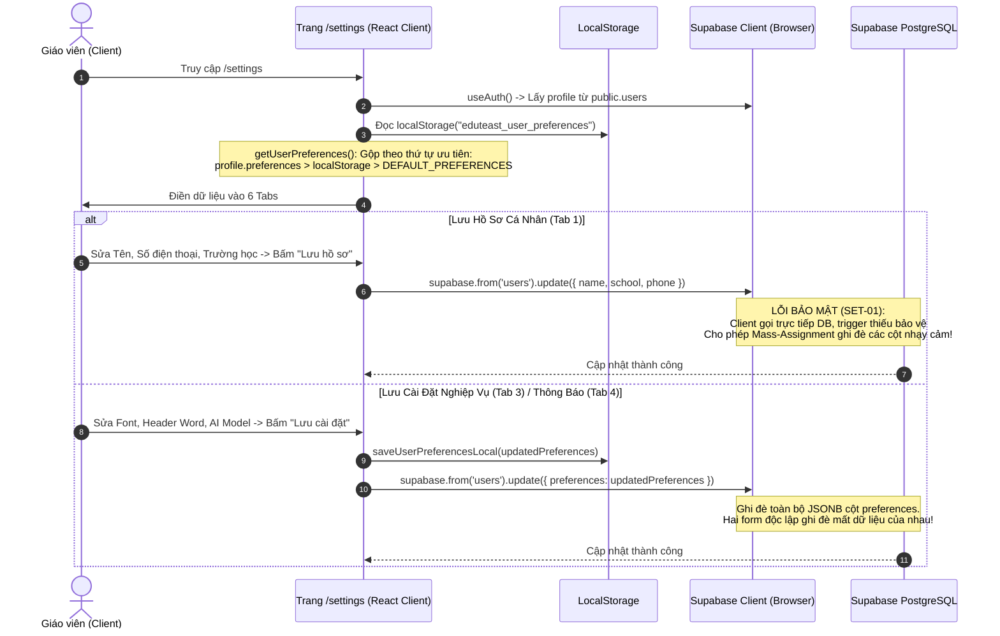
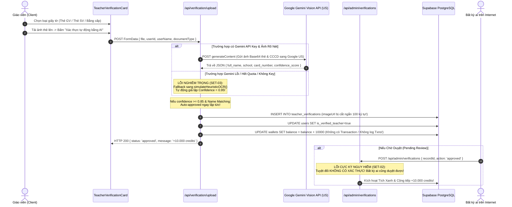

# Báo Cáo Rà Soát Bảo Mật & Kiến Trúc: /settings (Trang Cài Đặt Hệ Thống & eKYC Giáo Viên)

**Ngày thực hiện:** 01/11/2026  
**Chuyên viên:** Senior Full-stack Engineer & Security Reviewer  
**Môi trường:** Production/Staging (`ed-teach-rust.vercel.app`), Next.js 14 App Router, Supabase PostgreSQL, Gemini Vision AI  
**Phạm vi:** Tuyến đường `/settings`, 6 tab chức năng (Hồ sơ, eKYC, Nghiệp vụ, Thông báo, Bảo mật, Giao diện), các API liên quan (`/api/verification/*`, `/api/admin/verifications`), chính sách RLS bảng `users` và các nơi tiêu thụ cấu hình (`exam-editor-studio`, `docx-exporter`, `grading`).

---

## 1. Sơ Đồ Luồng Hoạt Động (Architecture & Workflows)

### 1.1. Luồng Tải & Lưu Dữ Liệu Hồ Sơ, Cài Đặt (Profile & Preferences Lifecycle)



### 1.2. Luồng Xác Thực Danh Tính eKYC & Cấp Tích Xanh (Teacher Verification Lifecycle)



### 1.3. Bảng Đối Chiếu File & Dòng Mã Nguồn

| Bước Luồng | Chức Năng | Tệp Tin & Dòng Mã | Đánh Giá Kỹ Thuật |
| :--- | :--- | :--- | :--- |
| **UI Cài Đặt** | Trang Cài đặt 6 tab | [`frontend/src/app/(dashboard)/settings/page.tsx#L1-L1414`](file:///d:/Go-Live/Web/EdTeach/frontend/src/app/(dashboard)/settings/page.tsx#L1-L1414) | Client Component; chứa logic nén ảnh avatar, đổi theme, đổi mật khẩu và form lưu |
| **Từ Điển Preferences** | Quản lý cấu hình mặc định | [`frontend/src/lib/preferences.ts#L1-L107`](file:///d:/Go-Live/Web/EdTeach/frontend/src/lib/preferences.ts#L1-L107) | Định nghĩa schema JSONB, fallback localStorage và thứ tự ưu tiên gộp dữ liệu |
| **eKYC Card** | Giao diện nộp thẻ ngành | [`frontend/src/components/verification/teacher-verification-card.tsx#L1-L361`](file:///d:/Go-Live/Web/EdTeach/frontend/src/components/verification/teacher-verification-card.tsx#L1-L361) | Form nộp ảnh thẻ ngành/thẻ sinh viên; lộ nhãn nội bộ "Sprint 3" |
| **API Upload eKYC** | Tiếp nhận & chạy Vision OCR | [`frontend/src/app/api/verification/upload/route.ts#L1-L207`](file:///d:/Go-Live/Web/EdTeach/frontend/src/app/api/verification/upload/route.ts#L1-L207) | Nhận ảnh, gọi Gemini hoặc Heuristic fallback; tự duyệt và thưởng 10k credits |
| **Động Cơ OCR** | Xử lý nhận diện & cộng thưởng | [`frontend/src/lib/verification/ocr-engine.ts#L1-L702`](file:///d:/Go-Live/Web/EdTeach/frontend/src/lib/verification/ocr-engine.ts#L1-L702) | Tích hợp Gemini Vision, lưu truncated base64, cộng ví không kiểm tra lặp lại |
| **API Duyệt eKYC** | Phê duyệt thẻ ngành Admin | [`frontend/src/app/api/admin/verifications/route.ts#L1-L62`](file:///d:/Go-Live/Web/EdTeach/frontend/src/app/api/admin/verifications/route.ts#L1-L62) | **Mở toang 100%**: Không kiểm tra xác thực JWT, không kiểm tra quyền admin |
| **Xuất File Word** | Tiêu thụ cấu hình tiêu đề | [`frontend/src/lib/export/docx-exporter.ts#L30-L70`](file:///d:/Go-Live/Web/EdTeach/frontend/src/lib/export/docx-exporter.ts#L30-L70) | Đọc `department`, `school`, `teacherTitle`, `docxFont`, watermark chân trang |
| **Chấm Bài Thi** | Tiêu thụ mẫu phiếu mặc định | [`frontend/src/app/(dashboard)/grading/page.tsx#L137-L146`](file:///d:/Go-Live/Web/EdTeach/frontend/src/app/(dashboard)/grading/page.tsx#L137-L146) | Đọc `defaultGradingSheet`, `defaultSubject`, `defaultGrade` |

---

## 2. Phân Tích Chi Tiết Các Lỗ Hổng Bảo Mật (Security Findings)

### 🔴 SET-01 (CRITICAL - SEVERITY 9.8/10): Mass-Assignment & Leo Thang Đặc Quyền Gói MAX / Số Dư Hàng Chục Triệu Qua Client DB Update
- **Vị trí mã nguồn:**
  - File frontend: [`frontend/src/app/(dashboard)/settings/page.tsx#L278-L286`](file:///d:/Go-Live/Web/EdTeach/frontend/src/app/(dashboard)/settings/page.tsx#L278-L286) & [`L331-L336`](file:///d:/Go-Live/Web/EdTeach/frontend/src/app/(dashboard)/settings/page.tsx#L331-L336)
  - File phân quyền: [`frontend/src/lib/payment/plans.ts#L133-L136`](file:///d:/Go-Live/Web/EdTeach/frontend/src/lib/payment/plans.ts#L133-L136) & [`L151-L152`](file:///d:/Go-Live/Web/EdTeach/frontend/src/lib/payment/plans.ts#L151-L152)
  - File Migration: [`supabase/migrations/20261026_harden_rls_security.sql#L18-L35`](file:///d:/Go-Live/Web/EdTeach/supabase/migrations/20261026_harden_rls_security.sql#L18-L35)
  - File Migration Preferences: [`supabase/migrations/20261030_user_preferences.sql#L10-L14`](file:///d:/Go-Live/Web/EdTeach/supabase/migrations/20261030_user_preferences.sql#L10-L14)
- **Cơ chế lỗi kỹ thuật:**
  1. Trang `/settings` cập nhật hồ sơ bằng cách gọi trực tiếp Supabase Client từ trình duyệt:
     ```typescript
     await supabase.from("users").update(payload).eq("id", user.id);
     ```
  2. Bảng `users` có chính sách RLS cho phép chính chủ sửa:
     ```sql
     CREATE POLICY "Users can update their own profile" ON public.users FOR UPDATE USING (auth.uid() = id);
     ```
  3. Trigger chặn leo thang đặc quyền `prevent_user_privilege_escalation()` ([`20261026_harden_rls_security.sql#L23-L27`](file:///d:/Go-Live/Web/EdTeach/supabase/migrations/20261026_harden_rls_security.sql#L23-L27)) chỉ bảo vệ duy nhất 3 cột: `role`, `tier`, `referral_code`:
     ```sql
     IF current_user <> 'service_role' AND (auth.jwt()->>'role') IS DISTINCT FROM 'service_role' THEN
         NEW.role := OLD.role;
         NEW.tier := OLD.tier;
         NEW.referral_code := OLD.referral_code;
     END IF;
     ```
  4. Trigger **HOÀN TOÀN BỎ QUÊN** các cột cực kỳ nhạy cảm sau:
     - `preferences`: Người dùng có thể gửi `preferences = { "subscription_tier": "max" }`. Khi hàm `isMaxUser(profile)` trong [`plans.ts#L133`](file:///d:/Go-Live/Web/EdTeach/frontend/src/lib/payment/plans.ts#L133) chạy, nó đọc `profile.preferences?.subscription_tier === 'max'` và **cấp ngay quyền MAX VIP trọn đời**, đồng thời kích hoạt `isRealPayingUser()` định tuyến sang API Key trả phí!
     - `affiliate_balance`: Cột số dư hoa hồng rút tiền mặt ([`20261104_growth_and_monetization.sql#L7`](file:///d:/Go-Live/Web/EdTeach/supabase/migrations/20261104_growth_and_monetization.sql#L7)) **không hề được bảo vệ**!
     - `is_verified_teacher`: Người dùng có thể tự set `is_verified_teacher = true` để nhận ngay Tích Xanh chính chủ mà không cần qua eKYC!
     - `subscription_expires_at`: Người dùng có thể set hạn dùng tới năm 2099!
- **Cách tái hiện (PoC):**
  Mở DevTools Console trên trình duyệt khi đang đăng nhập tài khoản miễn phí:
  ```javascript
  const supabase = window.supabase || (await import('/_next/static/chunks/...')).createClient();
  // Hoặc dùng supabase client có sẵn trong context
  await supabase.from('users').update({
    preferences: { subscription_tier: 'max' },
    is_verified_teacher: true,
    affiliate_balance: 50000000, // 50 triệu đồng
    subscription_expires_at: '2099-01-01T00:00:00Z'
  }).eq('id', (await supabase.auth.getUser()).data.user.id);
  ```
  F5 lại trang: Tài khoản lập tức biến thành MAX VIP, có Tích Xanh, và có 50 triệu trong ví hoa hồng để rút tiền mặt VietQR!

---

### 🔴 SET-02 (CRITICAL - SEVERITY 9.5/10): Tuyến API Admin Duyệt eKYC Bị Mở Toang Hoàn Toàn Cho Người Ngoài (TRÙNG SEC-02)
- **Vị trí mã nguồn:** [`frontend/src/app/api/admin/verifications/route.ts#L7-L62`](file:///d:/Go-Live/Web/EdTeach/frontend/src/app/api/admin/verifications/route.ts#L7-L62)
- **Cơ chế lỗi kỹ thuật:**
  Tuyến API này được xây dựng để Ban quản trị xem danh sách hồ sơ giáo viên và bấm nút Duyệt/Từ chối. Tuy nhiên:
  - Hàm `GET` (dòng 7-26): **Không kiểm tra bất kỳ cookie, JWT header hay session nào.** Bất kỳ ai trên Internet gửi `GET /api/admin/verifications` đều nhận về toàn bộ danh bạ giáo viên, họ tên, đơn vị công tác, mã sinh viên và số CCCD!
  - Hàm `POST` (dòng 28-62):
    ```typescript
    const body = await req.json();
    const { recordId, adminUserId = "admin_super", action, reason } = body;
    ```
    API mặc định gán `adminUserId = "admin_super"` nếu body không gửi lên! Bất kỳ kẻ tấn công nào cũng có thể gửi lệnh phê duyệt bất kỳ hồ sơ nào, hệ thống tự động kích hoạt Tích Xanh và **bơm ngay 10.000 credits vào ví người dùng**.
- **Cách tái hiện (PoC):**
  Gửi lệnh cURL từ terminal ngoài không cần đăng nhập:
  ```bash
  curl -X POST https://ed-teach-rust.vercel.app/api/admin/verifications \
    -H "Content-Type: application/json" \
    -d '{"recordId":"c5a8...","action":"approved"}'
  ```
  API trả về HTTP 200: `"Đã phê duyệt hồ sơ thành công! Tích Xanh và +10.000 credits đã được kích hoạt"`.

---

### 🔴 SET-03 (HIGH - SEVERITY 8.5/10): Heuristic Fallback Tự Động Phê Duyệt Mọi Ảnh Giả & Trục Lợi Bơm Credits Không Giới Hạn (TRÙNG SEC-04)
- **Vị trí mã nguồn:**
  - [`frontend/src/lib/verification/ocr-engine.ts#L122-L139`](file:///d:/Go-Live/Web/EdTeach/frontend/src/lib/verification/ocr-engine.ts#L122-L139) & [`L243-L248`](file:///d:/Go-Live/Web/EdTeach/frontend/src/lib/verification/ocr-engine.ts#L243-L248)
  - [`frontend/src/lib/verification/ocr-engine.ts#L588-L634`](file:///d:/Go-Live/Web/EdTeach/frontend/src/lib/verification/ocr-engine.ts#L588-L634)
- **Cơ chế lỗi kỹ thuật:**
  1. Khi gọi Gemini Vision OCR, nếu API Key chưa cấu hình hoặc mạng timeout (15s) hoặc gặp lỗi từ Google:
     ```typescript
     catch (err: any) {
       console.warn("Gemini Vision OCR error, falling back to heuristic:", err?.message);
     }
     return simulateHeuristicOCR({ userName });
     ```
  2. Hàm `simulateHeuristicOCR` trả về:
     ```typescript
     fullName: name, // Trùng khít với userName tài khoản!
     confidenceScore: 0.95, // Vượt xa ngưỡng 0.85!
     ```
     $\implies$ Kết quả: Kẻ tấn công tải lên một bức ảnh trắng tinh hoặc ảnh phong cảnh ngẫu nhiên, hệ thống rơi vào fallback và **tự động phê duyệt ngay lập tức (Auto-approved)**!
  3. **Không kiểm tra trùng lặp (No Idempotency / No Duplicate Check):**
     Hàm `rewardVerifiedTeacher` ([`ocr-engine.ts#L616-L630`](file:///d:/Go-Live/Web/EdTeach/frontend/src/lib/verification/ocr-engine.ts#L616-L630)) chỉ đơn thuần đọc số dư hiện tại và cộng thêm `+10000` credits mà **không kiểm tra xem người dùng này đã từng nhận thưởng eKYC hay chưa**:
     ```typescript
     const newBalance = (wallet.balance || 0) + 10000;
     await supabase.from("wallets").update({ balance: newBalance }).eq("id", wallet.id);
     ```
     Nếu người dùng gọi API upload 10 lần, hoặc Admin bấm nút "Duyệt" 5 lần, người dùng sẽ nhận được $10 \times 10.000 = \mathbf{100.000\text{ credits}}$!

---

### 🔴 SET-04 (HIGH - SEVERITY 8.0/10): Không Lưu Trữ Ảnh eKYC Mà Cắt Ngắn Chuỗi Base64 100 Ký Tự Gây Mất Dữ Liệu Đối Soát
- **Vị trí mã nguồn:** [`frontend/src/app/api/verification/upload/route.ts#L84`](file:///d:/Go-Live/Web/EdTeach/frontend/src/app/api/verification/upload/route.ts#L84) & [`L157`](file:///d:/Go-Live/Web/EdTeach/frontend/src/app/api/verification/upload/route.ts#L157)
- **Thực tế trong code:**
  ```typescript
  imageUrl: `data:${teacherImg.mimeType};base64,${teacherImg.base64.slice(0, 100)}...`,
  ```
  - Thay vì tải file ảnh lên một bucket bảo mật (như `storage.from('identity-verifications').upload(...)`), lập trình viên đã cắt đúng 100 ký tự đầu tiên của chuỗi base64 và lưu vào cột `image_url` của bảng `teacher_verifications`!
  - **Hệ quả vận hành:** Toàn bộ bằng chứng ảnh thẻ giáo viên và mặt trước CCCD bị phá hủy ngay khi request hoàn tất. Ban quản trị khi mở trang `/admin/verifications` hoàn toàn **không thể xem lại ảnh thẻ thật** để hậu kiểm hoặc đối soát pháp lý khi có khiếu nại!

---

### 🟡 SET-05 (MEDIUM - SEVERITY 6.5/10): Xóa Tài Khoản Chỉ Là Modal Giả Lập Bắt Gửi Email Thủ Công (Dead End UX)
- **Vị trí mã nguồn:** [`frontend/src/app/(dashboard)/settings/page.tsx#L1371-L1411`](file:///d:/Go-Live/Web/EdTeach/frontend/src/app/(dashboard)/settings/page.tsx#L1371-L1411)
- **Thực tế trong code:**
  - Nút "Xóa tài khoản vĩnh viễn" mở ra một pop-up thông báo:
    *"Quy trình xóa tài khoản an toàn: Vui lòng gửi email từ địa chỉ ... đến hòm thư hỗ trợ: `lienhe@soandethi.com`. Ban quản trị sẽ tiến hành xóa sạch tài khoản trong 24 giờ làm việc"*.
  - Nút duy nhất trong modal là: **"Đã hiểu & Đóng"**!
  - Hoàn toàn **không tồn tại API xóa tài khoản**, không có quy trình hủy dữ liệu tự phục vụ (Self-service deletion), vi phạm quyền được xóa dữ liệu của người dùng và làm người dùng thất vọng vì trải nghiệm giả tạo.

---

### 🟡 SET-06 (MEDIUM - SEVERITY 6.0/10): Đổi Mật Khẩu Không Yêu Cầu Mật Khẩu Cũ (Missing Re-authentication)
- **Vị trí mã nguồn:** [`frontend/src/app/(dashboard)/settings/page.tsx#L407-L414`](file:///d:/Go-Live/Web/EdTeach/frontend/src/app/(dashboard)/settings/page.tsx#L407-L414)
- **Thực tế trong code:**
  ```typescript
  const { error } = await supabase.auth.updateUser({
    password: newPassword,
  });
  ```
  - Form đổi mật khẩu chỉ yêu cầu nhập `newPassword` và `confirmPassword`, hoàn toàn **không yêu cầu nhập `currentPassword`**.
  - Nếu giáo viên quên khóa màn hình máy tính tại phòng hội đồng trường, bất kỳ đồng nghiệp hoặc học sinh nào đi ngang qua cũng có thể đổi mật khẩu tài khoản trong vòng 5 giây mà không cần biết mật khẩu hiện tại.

---

### 🟡 SET-07 (MEDIUM - SEVERITY 5.5/10): Lệch Key LocalStorage & 4 Tên Miền Rác Khác Nhau Trong Toàn Bộ Ứng Dụng (TRÙNG CRT-06, CRT-07)
- **Thực tế trong code:**
  - Thưởng giới thiệu trên `/settings#L708`: Ghi **+5.000 Credits**.
  - Thưởng giới thiệu trên `/affiliate#L66`: Ghi **+10.000 Credits**.
  - Thưởng giới thiệu trong code thực thi [`api/referral/route.ts#L20`](file:///d:/Go-Live/Web/EdTeach/frontend/src/app/api/referral/route.ts#L20): Chỉ cộng **2.000 Credits**.
  - Sự hỗn loạn tên miền (Hardcoded Domains):
    1. `/settings#L468`: Hardcode link fallback: `https://eduteast.vn/register?ref=...`
    2. `/settings#L1396`: Hardcode hòm thư hỗ trợ: `lienhe@soandethi.com`
    3. `/affiliate#L8`: Hardcode domain origin: `https://edutest.ai`
    4. Domain triển khai thực tế trên Vercel: `https://ed-teach-rust.vercel.app`

---

## 3. Ma Trận Đối Chiếu «Cài Đặt ↔ Nơi Sử Dụng» (Settings Consumer Matrix)

Dưới đây là kết quả rà soát từng mục cấu hình trong 6 tab của trang `/settings` đối chiếu với toàn bộ mã nguồn hệ thống:

| Tên Cài Đặt (Settings Key) | Nơi Lưu Trữ (Storage) | Nơi Tiêu Thụ Trong Code | Trạng Thái Hoạt Động Kỹ Thuật | Đánh Giá & Rủi Ro |
| :--- | :--- | :--- | :--- | :--- |
| **Ảnh đại diện (Avatar)** | `users.avatar_url` & Bucket `avatars` | Thanh Header, Profile Card, Chợ đề | **Có tác dụng** | Nén client; nếu storage lỗi thì lưu cả base64 vào DB. Thiếu server validation. |
| **Họ và tên (Name)** | `users.name` | Toàn hệ thống, Header Word | **Có tác dụng** | Hiển thị chuẩn xác. Cần escape ký tự XML khi đưa vào Word. |
| **Email** | `users.email` (read-only UI) | Auth, Hiển thị | **Có tác dụng** | UI khóa `disabled`, nhưng database trigger không khóa nếu gọi qua Supabase client. |
| **Số điện thoại / Zalo** | `users.phone` | Lưu hồ sơ | **Có tác dụng** | Chỉ lưu DB, chưa có tính năng gửi tin nhắn Zalo ZNS thật. |
| **Trường học / Đơn vị** | `users.school` | Profile, Header Word | **Có tác dụng** | Tự động điền vào tiêu đề Word khi xuất file. |
| **Sở GD&ĐT (`department`)** | `preferences.teaching.department` | [`docx-exporter.ts#L38`](file:///d:/Go-Live/Web/EdTeach/frontend/src/lib/export/docx-exporter.ts#L38) | **Có tác dụng** | Mặc định điền "SỞ GIÁO DỤC VÀ ĐÀO TẠO" chung chung không kèm tỉnh thành. |
| **Tên trường (`schoolHeader`)** | `preferences.teaching.school` | [`docx-exporter.ts#L39`](file:///d:/Go-Live/Web/EdTeach/frontend/src/lib/export/docx-exporter.ts#L39) | **Có tác dụng** | Xuất hiện góc trái tiêu đề Word chuẩn quy cách Bộ. |
| **Tổ bộ môn (`teacherTitle`)** | `preferences.teaching.teacherTitle` | [`docx-exporter.ts#L44`](file:///d:/Go-Live/Web/EdTeach/frontend/src/lib/export/docx-exporter.ts#L44) | **Có tác dụng** | Xuất hiện dưới tên trường trong file Word. |
| **Môn học mặc định** | `preferences.teaching.defaultSubject` | `exam-editor-studio.tsx`, `grading/page.tsx` | **Có tác dụng** | Tự chọn sẵn khi mở Studio hoặc Chấm thi. Tuy nhiên `/api/exams/generate` không đọc. |
| **Khối lớp mặc định** | `preferences.teaching.defaultGrade` | `exam-editor-studio.tsx`, `grading/page.tsx` | **Có tác dụng** | Tương tự môn học. |
| **Thời gian làm bài chuẩn** | `preferences.teaching.defaultDuration` | `exam-editor-studio.tsx#L754` | **Có tác dụng** | Điền sẵn 15, 45, 50, 90 phút khi tạo đề mới. |
| **Font chữ Word (`docxFont`)** | `preferences.export.docxFont` | [`docx-exporter.ts#L37`](file:///d:/Go-Live/Web/EdTeach/frontend/src/lib/export/docx-exporter.ts#L37) | **Có tác dụng** | Chuyển đổi chuẩn xác giữa Times New Roman và Arial. |
| **Cỡ chữ Word (`docxFontSize`)** | `preferences.export.docxFontSize` | **KHÔNG NƠI NÀO ĐỌC** | ⚠️ **LƯU NHƯNG KHÔNG DÙNG (Dead Code)** | `docx-exporter.ts` hardcode kích thước chữ `size: 22/24/20/18`. Đổi cỡ 12/13pt không có tác dụng! |
| **Bật Watermark bản quyền** | `preferences.export.docxEnableWatermark` | [`docx-exporter.ts#L468`](file:///d:/Go-Live/Web/EdTeach/frontend/src/lib/export/docx-exporter.ts#L468) | **Có tác dụng** | Bất kỳ ai (kể cả Free) cũng bật được custom watermark (chèn thêm bên cạnh watermark của EduTest AI). |
| **Mẫu phiếu trắc nghiệm** | `preferences.gradingAndAi.defaultGradingSheet` | [`grading/page.tsx#L141`](file:///d:/Go-Live/Web/EdTeach/frontend/src/app/(dashboard)/grading/page.tsx#L141) | ⚠️ **MỘT PHẦN LÀ ẢO** | Chỉ hỗ trợ `gdpt_2025` và `sheet_50`. Nếu chọn `sheet_40` hoặc `sheet_20`, backend OpenCV tự động ép về 50 câu! |
| **Chế độ AI ưu tiên** | `preferences.gradingAndAi.preferredAiModel` | **KHÔNG NƠI NÀO ĐỌC** | ⚠️ **HOÀN TOÀN LÀ ẢO (Dead Code)** | Không có API nào đọc key này. Quảng cáo "DeepSeek R1 / V3" và "Dual-Agent 99.8%" không tồn tại trong backend. |
| **Thông báo (4 công tắc)** | `preferences.notifications.*` | **KHÔNG NƠI NÀO ĐỌC** | ⚠️ **HOÀN TOÀN LÀ ẢO (Ghost Features)** | Không có service gửi email nào (không Resend, Sendgrid). Tùy chọn lưu vào DB nhưng không bao giờ chạy. |
| **Giao diện (Sáng/Tối/Hệ thống)** | `localStorage("app_theme")` | `layout.tsx`, inline script | **Có tác dụng** | Hoạt động tốt, đồng bộ với dark mode class trên `<html>`. |

---

## 4. Vấn Đề Tuân Thủ Quyền Riêng Tư & Nghị Định 13/2023/NĐ-CP (eKYC & Dữ Liệu Cá Nhân)

1. **Chuyển Dữ Liệu Cá Nhân Nhạy Cảm Ra Nước Ngoài:**
   - Khi thực hiện eKYC, ảnh chụp Thẻ Căn cước công dân (CCCD) và Thẻ giáo viên chứa dữ liệu cá nhân nhạy cảm (Họ tên, ngày sinh, số CCCD, hình ảnh chân dung).
   - Tuyến [`ocr-engine.ts#L189`](file:///d:/Go-Live/Web/EdTeach/frontend/src/lib/verification/ocr-engine.ts#L189) gửi trực tiếp dữ liệu Base64 sang máy chủ của Google (`generativelanguage.googleapis.com`) đặt tại Hoa Kỳ/Châu Âu.
   - **Câu hỏi tuân thủ:** Doanh nghiệp đã lập Hồ sơ đánh giá tác động chuyển dữ liệu cá nhân ra nước ngoài gửi Bộ Công An (Cục A05) theo Điều 25 Nghị định 13/2023/NĐ-CP chưa? Người dùng chưa hề có checkbox đồng ý rõ ràng đối với việc chuyển dữ liệu này ra nước ngoài.
2. **Lưu Trữ Số CCCD Dưới Dạng Văn Bản Rõ (Plaintext):**
   - Số CCCD của giáo viên/gia sư được lưu nguyên văn trong cột `cccd_number` mà không hề được mã hóa ở tầng ứng dụng (Application-level Encryption) hoặc băm (Hash/Masking).
3. **Tiêu Chí Cấp "Tích Xanh Giáo Viên Chính Chủ":**
   - Hệ thống cho phép sinh viên nộp "Thẻ sinh viên Sư phạm" hoặc "Bằng cử nhân" để nhận Tích Xanh.
   - Khi gửi báo cáo kết quả bài thi qua Zalo cho phụ huynh học sinh, Tích Xanh được ghi là "Giáo viên chính chủ bảo chứng". Điều này tạo ra rủi ro ngộ nhận cho phụ huynh rằng sinh viên gia sư là giáo viên biên chế chính thức của nhà trường.

---

## 5. Tổng Hợp Danh Sách Lỗ Hổng Tuyến /settings

| ID | Mức Độ | Hạng Mục | File:Dòng | Tóm Tắt Lỗ Hổng | Tác Động | Cách Tái Hiện | Đề Xuất Sửa | Công Sức | Trùng ID Cũ |
| :--- | :--- | :--- | :--- | :--- | :--- | :--- | :--- | :--- | :--- |
| **SET-01** | **CRITICAL** | Phân quyền DB | [`plans.ts#L133`](file:///d:/Go-Live/Web/EdTeach/frontend/src/lib/payment/plans.ts#L133)<br/>[`20261026_harden...sql#L23`](file:///d:/Go-Live/Web/EdTeach/supabase/migrations/20261026_harden_rls_security.sql#L23) | Mass-assignment qua Supabase client: tự nâng MAX VIP, tự bơm 50 triệu hoa hồng, tự cấp Tích Xanh | Thất thoát tài chính, chiếm đoạt tài nguyên AI trả phí | Gọi `supabase.from('users').update({ preferences: { subscription_tier: 'max' } })` | Sửa trigger DB chặn sửa `preferences->subscription_tier`, `affiliate_balance`, `is_verified_teacher` | **M** | TRÙNG SEC-05 |
| **SET-02** | **CRITICAL** | Xác thực API | [`admin/verifications/route.ts#L7-L62`](file:///d:/Go-Live/Web/EdTeach/frontend/src/app/api/admin/verifications/route.ts#L7-L62) | Tuyến API Admin duyệt eKYC mở toang 100% không cần xác thực | Bất kỳ ai cũng xem được CCCD và tự duyệt cấp Tích Xanh + 10k credits | Gửi cURL POST tới `/api/admin/verifications` không kèm token | Thêm kiểm tra xác thực JWT và quyền `user.role === 'admin'` từ DB | **S** | TRÙNG SEC-02 |
| **SET-03** | **HIGH** | eKYC Logic | [`ocr-engine.ts#L122-L139`](file:///d:/Go-Live/Web/EdTeach/frontend/src/lib/verification/ocr-engine.ts#L122-L139)<br/>[`ocr-engine.ts#L616`](file:///d:/Go-Live/Web/EdTeach/frontend/src/lib/verification/ocr-engine.ts#L616) | Heuristic fallback tự duyệt ảnh rác; cộng thưởng 10k credits nhiều lần không kiểm tra lặp | Bị botnet farm credits miễn phí không giới hạn | Gửi ảnh phong cảnh khi ngắt mạng hoặc khi hết quota Gemini | Xóa bỏ heuristic auto-approve; thêm cờ `rewarded_at` và kiểm tra chống nhận thưởng kép | **M** | TRÙNG SEC-04 |
| **SET-04** | **HIGH** | Lưu Trữ eKYC | [`verification/upload/route.ts#L84`](file:///d:/Go-Live/Web/EdTeach/frontend/src/app/api/verification/upload/route.ts#L84) | Không lưu ảnh giấy tờ vào Storage mà cắt ngắn 100 ký tự base64 | Mất hoàn toàn bằng chứng gốc để Admin hậu kiểm hồ sơ | Nộp thẻ và kiểm tra cột `image_url` trong bảng `teacher_verifications` | Lưu ảnh vào bucket private `identity-documents` và sinh Signed URL ngắn hạn | **M** | LỖI MỚI |
| **SET-05** | **MEDIUM** | Quyền Dữ Liệu | [`settings/page.tsx#L1371-L1411`](file:///d:/Go-Live/Web/EdTeach/frontend/src/app/(dashboard)/settings/page.tsx#L1371-L1411) | Nút xóa tài khoản là pop-up giả bắt gửi email thủ công tới `lienhe@soandethi.com` | Trải nghiệm người dùng giả tạo; không có cơ chế xóa dữ liệu tự phục vụ | Bấm nút "Xóa tài khoản vĩnh viễn" trên Tab Bảo mật | Xây dựng API xóa tài khoản an toàn (hoặc quy trình soft-delete có xác thực mật khẩu) | **L** | LỖI MỚI |
| **SET-06** | **MEDIUM** | Xác Thực Mật Khẩu | [`settings/page.tsx#L407`](file:///d:/Go-Live/Web/EdTeach/frontend/src/app/(dashboard)/settings/page.tsx#L407) | Đổi mật khẩu không đòi hỏi mật khẩu hiện tại (Old Password) | Chiếm quyền điều khiển tài khoản khi dùng chung máy tính | Nhập mật khẩu mới và bấm lưu khi phiên đang đăng nhập | Yêu cầu xác thực `signInWithPassword({ email, password: oldPassword })` trước khi đổi | **S** | LỖI MỚI |
| **SET-07** | **MEDIUM** | Tính Nhất Quán | [`settings/page.tsx#L468`](file:///d:/Go-Live/Web/EdTeach/frontend/src/app/(dashboard)/settings/page.tsx#L468)<br/>[`settings/page.tsx#L708`](file:///d:/Go-Live/Web/EdTeach/frontend/src/app/(dashboard)/settings/page.tsx#L708) | Bất nhất thưởng Ref (+5k vs +10k vs +2k) và 4 tên miền rác hardcode | Mất niềm tin người dùng, link mời dẫn sang website không hoạt động | So sánh `/settings` với `/affiliate` và link ref copy được | Chuẩn hóa 1 hằng số `REFERRAL_BONUS_CREDITS` và dùng `NEXT_PUBLIC_APP_URL` | **S** | TRÙNG CRT-07 |
| **SET-08** | **LOW** | Giao Diện / UX | [`feedback-modal.tsx#L89`](file:///d:/Go-Live/Web/EdTeach/frontend/src/components/feedback/feedback-modal.tsx#L89)<br/>[`settings/page.tsx#L1080`](file:///d:/Go-Live/Web/EdTeach/frontend/src/app/(dashboard)/settings/page.tsx#L1080) | Nút nổi "Góp ý & Báo lỗi" che khuất nút "Lưu cài đặt nghiệp vụ" ở góc dưới phải | Khó khăn khi thao tác trên màn hình nhỏ/laptop | Mở tab Nghiệp vụ trên màn hình 1366x768 và cuộn xuống cuối | Thêm padding-bottom hoặc điều chỉnh vị trí nút floating | **S** | LỖI MỚI |
| **SET-09** | **LOW** | Tiếp Thị Ảo | [`settings/page.tsx#L1037-L1075`](file:///d:/Go-Live/Web/EdTeach/frontend/src/app/(dashboard)/settings/page.tsx#L1037-L1075) | Cài đặt AI Model (DeepSeek R1/V3) và Dual-Agent 99.8% hoàn toàn không có trong code | Tính năng tiếp thị ảo, không có tác dụng thực tế | Chọn DeepSeek và tạo đề thi, kiểm tra network chỉ gọi Gemini | Gỡ bỏ card DeepSeek ảo hoặc tích hợp API thật trước khi phát hành | **S** | TRÙNG PRC-03 |

---

## 6. Khung Đề Xuất Sửa Đổi Cho Các Vấn Đề Nghiêm Trọng (Fix Framework)

### 6.1. Vá Lỗ Hổng SET-01 (Chặn Mass-Assignment Bảng Users)
- **Thiết kế sửa đổi:** Cập nhật lại trigger `prevent_user_privilege_escalation()` trong PostgreSQL để khóa toàn bộ các trường nhạy cảm:
```sql
CREATE OR REPLACE FUNCTION public.prevent_user_privilege_escalation()
RETURNS TRIGGER AS $$
BEGIN
    IF current_user <> 'service_role' AND (auth.jwt()->>'role') IS DISTINCT FROM 'service_role' THEN
        -- Khóa các trường quyền và tiền
        NEW.role := OLD.role;
        NEW.tier := OLD.tier;
        NEW.referral_code := OLD.referral_code;
        NEW.is_verified_teacher := OLD.is_verified_teacher;
        NEW.affiliate_balance := OLD.affiliate_balance;
        NEW.total_affiliate_earned := OLD.total_affiliate_earned;
        NEW.subscription_expires_at := OLD.subscription_expires_at;

        -- Khóa việc cài cắm subscription_tier vào trong JSONB preferences
        IF NEW.preferences IS NOT NULL AND NEW.preferences ? 'subscription_tier' THEN
            NEW.preferences := NEW.preferences - 'subscription_tier';
        END IF;
    END IF;
    RETURN NEW;
END;
$$ LANGUAGE plpgsql SECURITY DEFINER;
```

### 6.2. Vá Lỗ Hổng SET-02 (Khóa Chặt Tuyến API Admin Verifications)
- **Thiết kế sửa đổi:** Trong [`frontend/src/app/api/admin/verifications/route.ts`](file:///d:/Go-Live/Web/EdTeach/frontend/src/app/api/admin/verifications/route.ts):
```typescript
import { createClient } from "@/lib/supabase/server";

async function verifyAdminAuth() {
  const supabase = createClient();
  const { data: { user } } = await supabase.auth.getUser();
  if (!user) return null;

  const { data: profile } = await supabase
    .from('users')
    .select('role')
    .eq('id', user.id)
    .single();

  if (profile?.role !== 'admin') return null;
  return user;
}
// Chặn 401/403 ngay đầu handler GET và POST
```

### 6.3. Vá Lỗ Hổng SET-03 (Chống Auto-Approve Ảo & Chống Nhận Thưởng Lặp)
- **Thiết kế sửa đổi:**
  1. Xóa bỏ hoàn toàn hàm `simulateHeuristicOCR` tự duyệt với điểm 0.95. Nếu Gemini lỗi, bắt buộc đưa vào trạng thái `pending_review` để Admin duyệt tay.
  2. Bổ sung bảng ghi nhận phần thưởng hoặc kiểm tra:
     ```typescript
     const { data: userProfile } = await supabaseAdmin.from('users').select('is_verified_teacher').eq('id', userId).single();
     if (userProfile?.is_verified_teacher) {
       // Đã từng xác thực rồi, KHÔNG CỘNG THÊM 10.000 CREDITS NỮA!
       return;
     }
     ```

---

## 7. Kế Hoạch Hành Động (Action Plan)

### Việc Bắt Buộc Trước Khi Phát Hành (Go-Live Blockers):
1. [ ] Chạy Migration SQL cập nhật trigger `prevent_user_privilege_escalation()` để chặn triệt để lỗ hổng tự cấp MAX VIP và sửa số dư hoa hồng qua client (SET-01).
2. [ ] Thêm middleware xác thực quyền Admin cho tuyến [`/api/admin/verifications`](file:///d:/Go-Live/Web/EdTeach/frontend/src/app/api/admin/verifications/route.ts) (SET-02).
3. [ ] Tắt bỏ Heuristic Auto-approval trong `ocr-engine.ts`, khóa logic cộng thưởng 10.000 credits chỉ chạy duy nhất 1 lần (SET-03).
4. [ ] Ẩn nhãn nội bộ "Sprint 3" và gỡ bỏ card quảng cáo ảo "DeepSeek R1 / V3" trên giao diện `/settings`.
5. [ ] Đồng bộ hóa con số thưởng giới thiệu trên `/settings` thành một giá trị thống nhất.

### Việc Nên Làm Trong 2 Tuần Sau Phát Hành:
1. [ ] Tạo bucket riêng tư `identity-documents` với RLS chặt chẽ để lưu trữ ảnh thẻ eKYC phục vụ kiểm tra đối soát, thay thế việc lưu truncated base64 (SET-04).
2. [ ] Bổ sung trường nhập "Mật khẩu cũ" trong form Đổi mật khẩu để nâng cao bảo mật (SET-06).
3. [ ] Xây dựng quy trình Xóa tài khoản tự phục vụ (Self-service Soft Delete) với thời gian ân hạn 30 ngày theo tiêu chuẩn GDPR/Nghị định 13 (SET-05).
4. [ ] Sửa lại kích cỡ chữ Word `docxFontSize` trong `docx-exporter.ts` để tùy chọn 12pt/13pt có tác dụng thực sự.
5. [ ] Điều chỉnh z-index và vị trí của nút "Góp ý & Báo lỗi" để không che lấp nút "Lưu cài đặt nghiệp vụ" (SET-08).

### Các Điểm Chưa Xác Minh Cần Ban Quản Trị Làm Rõ:
- **Chính sách lưu trữ CCCD:** Doanh nghiệp có kế hoạch mã hóa số CCCD và xóa ảnh thẻ sau 30 ngày kể từ khi xét duyệt thành công không?
- **Nhà cung cấp AI OCR:** Doanh nghiệp có dự định chuyển sang giải pháp OCR nội địa đặt máy chủ tại Việt Nam (như FPT.AI, VNPT eKYC, Viettel AI) để tuân thủ trọn vẹn quy định chuyển dữ liệu ra nước ngoài của Nghị định 13/2023 hay tiếp tục sử dụng Google Gemini Vision?
