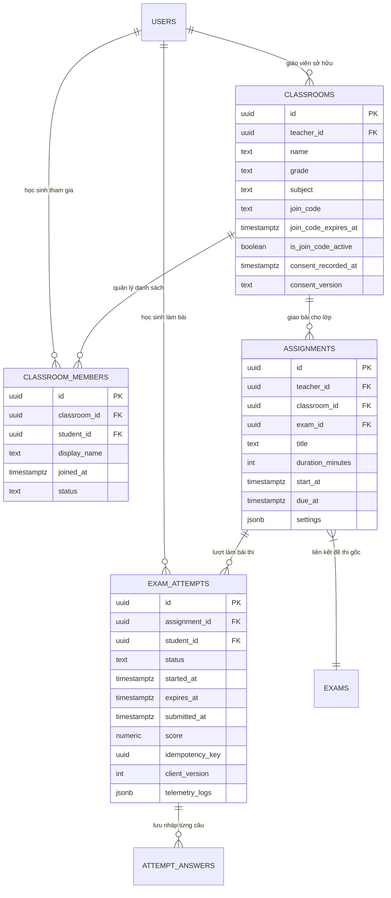
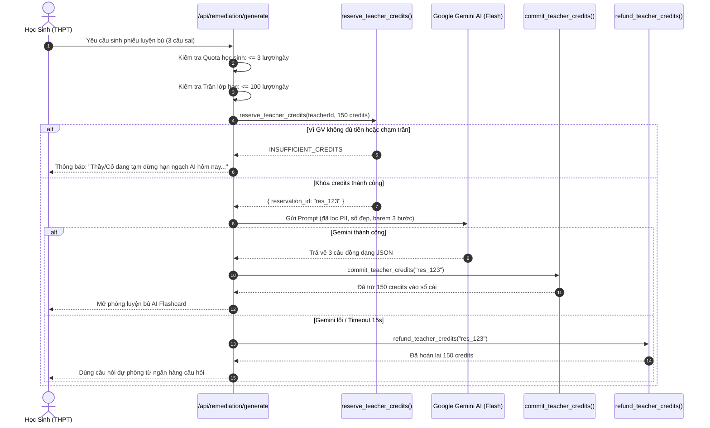
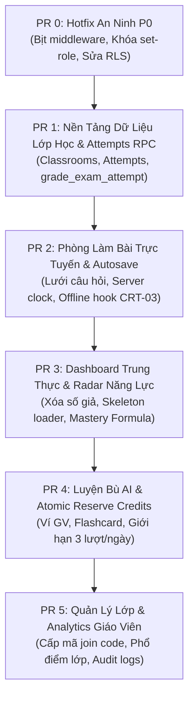

# ĐẶC TẢ TÍNH NĂNG CỔNG HỌC SINH (PHẦN B - LƯỢT 2)
## BACKEND, CSDL, RPC CHẤM ĐIỂM SERVER, ATOMIC CREDITS & KẾ HOẠCH TRIỂN KHAI PR

**Dự án:** EduTest AI — Cổng Học Sinh Cá Nhân Hóa Chuẩn GDPT 2025  
**Tài liệu:** `audit/student-portal-features-be.md`  
**Giai đoạn:** Lượt 2 / 2 (Phần B: Kiến trúc Backend & Kế hoạch Thực thi PR)  
**Tác giả:** Senior Full-stack Engineer kiêm Security Reviewer  
**Đối tượng phục vụ:** Học sinh THPT (Lớp 10, 11, 12 — 15 đến 18 tuổi)  
**Mô hình vận hành:** B2B2C (Giáo viên tạo lớp, quản lý và cấp mã tham gia; học sinh không tự do đăng ký công khai; học sinh không nạp tiền; giáo viên chi trả credits).  

---

## 1. PR 0: HOTFIX AN NINH KHẨN CẤP (BẮT BUỘC TRIỂN KHAI TRƯỚC MỌI TÍNH NĂNG)

> [!CAUTION]
> PR 0 phải được tách thành một PR độc lập duy nhất, kiểm thử nghiêm ngặt trên môi trường Staging và Deploy lên Production **TRƯỚC KHI** triển khai bất kỳ tính năng mới nào.

### 1.1 Nội dung khắc phục trong PR 0
1. **Khắc phục `STU-01` (Middleware Protection):**
   - File: `frontend/src/middleware.ts`
   - Bổ sung `"/student/:path*"` và `"/api/student/:path*"` vào mảng `matcher`.
   - Bổ sung logic kiểm tra phiên: Nếu người dùng chưa đăng nhập (`!user`), chuyển hướng ngay lập tức về `/login?next=${pathname}`.
   - Loại bỏ hoàn toàn cơ chế fallback gán `studentId = "demo-student-id"` tại các file `frontend/src/app/api/student/*/route.ts`. Trả về đúng mã lỗi `401 Unauthorized` kèm JSON `{ "error": "UNAUTHORIZED", "message": "Vui lòng đăng nhập để tiếp tục." }`.
2. **Khắc phục `STU-02` (Privilege Escalation via `set-role`):**
   - File: `frontend/src/app/api/user/set-role/route.ts`
   - Chặn đứng mọi request cập nhật vai trò từ client thông thường.
   - Bổ sung kiểm tra quyền: Chỉ cho phép tài khoản có `role === 'admin'` hoặc quy trình eKYC sư phạm được ký số bằng `service_role` mới được thay đổi trường `role` trong `public.users`. Mọi nỗ lực tự thăng cấp từ học sinh sẽ nhận mã lỗi `403 Forbidden`.
3. **Khắc phục `STU-03` (Rò rỉ CSDL qua RLS `USING (true)`):**
   - File: `supabase/migrations/20261107_hotfix_security_p0.sql`
   - Xóa bỏ triệt để các policy `SELECT USING (true)` và `UPDATE USING (true)` trên 2 bảng `public.student_reports` và `public.remediation_sheets`.
   - **Chính sách RLS mới:**
     - `student_reports`: Chỉ cho phép đọc khi người dùng sở hữu bài thi (`auth.uid() = student_id`) HOẶC là giáo viên tạo kỳ thi (`auth.uid() = teacher_id`) HOẶC gọi qua RPC bảo mật có truyền `p_claim_token` hợp lệ.
     - `remediation_sheets`: Chặn toàn bộ lệnh `UPDATE` trực tiếp từ client. Mọi thao tác nộp bài luyện bù bắt buộc đi qua API Server hoặc RPC kiểm tra `token`.
   - **Kế hoạch xử lý dữ liệu hiện có (Data Migration Plan):**
     - Quét toàn bộ các bản ghi trong `student_reports` hiện tại.
     - Với các bản ghi cũ chưa có `teacher_id`, thực hiện cập nhật mapping từ bảng `grading_sessions.user_id` sang `student_reports.teacher_id`.
     - Với các bản ghi mồ côi (không xác định được session chủ), chuyển cờ `is_archived = true` để cô lập khỏi tầm quét công khai.

### 1.2 Kế hoạch Kiểm Thử Hai Tài Khoản (2-Account Verification Testing)
* **Kịch bản 1 (Tài khoản Học sinh vs API Giáo viên):**
  - Đăng nhập bằng Tài khoản A (`student_test@edutest.vn`, vai trò `student`).
  - Gửi POST đến `/api/user/set-role` với body `{"role": "teacher"}` $\rightarrow$ **Kỳ vọng:** Nhận HTTP 403 Forbidden. CSDL giữ nguyên `role = 'student'`.
  - Mở tab ẩn danh (chưa đăng nhập), truy cập `http://localhost:3001/student` $\rightarrow$ **Kỳ vọng:** Bị chặn tại middleware, redirect ngay về `/login?next=/student`.
* **Kịch bản 2 (Chống rò rỉ CSDL bằng Anon Key):**
  - Sử dụng Anon Key của Supabase chạy script client: `supabase.from('student_reports').select('*')` $\rightarrow$ **Kỳ vọng:** Trả về mảng rỗng `[]` (RLS chặn toàn bộ), không lộ bất kỳ bản ghi học sinh nào.
  - Sử dụng Tài khoản A truy vấn bảng điểm của Tài khoản B $\rightarrow$ **Kỳ vọng:** Nhận lỗi hoặc mảng rỗng.

---

## 2. NỀN TẢNG DỮ LIỆU: MÔ HÌNH LỚP HỌC, GIAO BÀI & PHÒNG THI TRỰC TUYẾN

### 2.1 Sơ đồ Quan hệ Thực thể CSDL (Entity-Relationship Diagram)


---

### 2.2 Đặc tả Bảng & CSDL Chi Tiết

#### (a) Bảng Lớp học & Mã tham gia (`public.classrooms`)
```sql
CREATE TABLE IF NOT EXISTS public.classrooms (
    id UUID PRIMARY KEY DEFAULT gen_random_uuid(),
    teacher_id UUID NOT NULL REFERENCES public.users(id) ON DELETE CASCADE,
    name VARCHAR(128) NOT NULL,
    grade VARCHAR(10) NOT NULL CHECK (grade IN ('10', '11', '12')),
    subject VARCHAR(64) NOT NULL DEFAULT 'Toán Học',
    academic_year VARCHAR(16) NOT NULL DEFAULT '2025-2026',
    
    -- Mã tham gia lớp: Độ dài 8 ký tự alphanumeric an toàn, có thời hạn và có thể thu hồi
    join_code VARCHAR(16) UNIQUE NOT NULL,
    join_code_expires_at TIMESTAMPTZ NOT NULL,
    is_join_code_active BOOLEAN NOT NULL DEFAULT true,
    
    -- Bằng chứng ghi nhận đồng thuận phụ huynh/nhà trường theo Nghị định 13
    consent_recorded_at TIMESTAMPTZ NOT NULL DEFAULT now(),
    consent_version VARCHAR(32) NOT NULL DEFAULT 'v1.0_2025_ND13',
    consent_statement TEXT NOT NULL,
    
    created_at TIMESTAMPTZ NOT NULL DEFAULT now(),
    updated_at TIMESTAMPTZ NOT NULL DEFAULT now()
);

CREATE INDEX IF NOT EXISTS idx_classrooms_teacher ON public.classrooms(teacher_id);
CREATE INDEX IF NOT EXISTS idx_classrooms_join_code ON public.classrooms(join_code) WHERE is_join_code_active = true;
```

#### (b) Bảng Thành viên lớp (`public.classroom_members`)
```sql
CREATE TABLE IF NOT EXISTS public.classroom_members (
    id UUID PRIMARY KEY DEFAULT gen_random_uuid(),
    classroom_id UUID NOT NULL REFERENCES public.classrooms(id) ON DELETE CASCADE,
    student_id UUID NOT NULL REFERENCES public.users(id) ON DELETE CASCADE,
    display_name VARCHAR(64) NOT NULL, -- Biệt danh / tên hiển thị tối thiểu
    student_code VARCHAR(32),          -- Số báo danh trong lớp (không bắt buộc)
    status VARCHAR(20) NOT NULL DEFAULT 'active' CHECK (status IN ('active', 'suspended')),
    joined_at TIMESTAMPTZ NOT NULL DEFAULT now(),
    UNIQUE(classroom_id, student_id)
);

CREATE INDEX IF NOT EXISTS idx_classroom_members_student ON public.classroom_members(student_id);
CREATE INDEX IF NOT EXISTS idx_classroom_members_class ON public.classroom_members(classroom_id);
```

#### (c) Bảng Giao bài (`public.assignments`)
```sql
CREATE TABLE IF NOT EXISTS public.assignments (
    id UUID PRIMARY KEY DEFAULT gen_random_uuid(),
    teacher_id UUID NOT NULL REFERENCES public.users(id) ON DELETE CASCADE,
    classroom_id UUID NOT NULL REFERENCES public.classrooms(id) ON DELETE CASCADE,
    exam_id TEXT NOT NULL, -- Liên kết đề thi
    title VARCHAR(255) NOT NULL,
    duration_minutes INT NOT NULL DEFAULT 45 CHECK (duration_minutes BETWEEN 5 AND 180),
    start_at TIMESTAMPTZ NOT NULL DEFAULT now(),
    due_at TIMESTAMPTZ NOT NULL,
    
    -- Cấu hình bảo mật bài thi
    settings JSONB NOT NULL DEFAULT '{
        "allow_review_before_submit": true,
        "show_score_immediately": true,
        "show_answer_key_after": null, -- timestamptz hoặc null (do GV bấm công bố)
        "shuffle_questions": true,
        "shuffle_options": true,
        "max_attempts": 1
    }'::jsonb,
    
    created_at TIMESTAMPTZ NOT NULL DEFAULT now()
);

CREATE INDEX IF NOT EXISTS idx_assignments_classroom ON public.assignments(classroom_id);
CREATE INDEX IF NOT EXISTS idx_assignments_due_at ON public.assignments(due_at);
```

#### (d) Bảng Lượt làm bài thi (`public.exam_attempts`)
```sql
CREATE TABLE IF NOT EXISTS public.exam_attempts (
    id UUID PRIMARY KEY DEFAULT gen_random_uuid(),
    assignment_id UUID NOT NULL REFERENCES public.assignments(id) ON DELETE CASCADE,
    exam_id TEXT NOT NULL,
    student_id UUID NOT NULL REFERENCES public.users(id) ON DELETE CASCADE,
    
    status VARCHAR(20) NOT NULL DEFAULT 'in_progress' 
        CHECK (status IN ('in_progress', 'submitted', 'graded', 'timed_out')),
    
    started_at TIMESTAMPTZ NOT NULL DEFAULT now(),
    expires_at TIMESTAMPTZ NOT NULL, -- Thời điểm hết hạn do server tính toán
    submitted_at TIMESTAMPTZ,
    
    -- Câu trả lời từng câu được lưu nháp dạng JSONB kèm versioning
    -- Cấu trúc: { "1": { "selected": "B", "version": 3, "saved_at": "..." } }
    answers JSONB NOT NULL DEFAULT '{}'::jsonb,
    
    -- Thống kê thời gian dừng lại trên từng câu (đơn vị: giây)
    question_timings JSONB NOT NULL DEFAULT '{}'::jsonb,
    
    -- Điểm số và kết quả (chỉ có sau khi nộp và chấm server)
    score NUMERIC(4, 2) DEFAULT NULL,
    correct_count INT DEFAULT NULL,
    total_questions INT NOT NULL DEFAULT 40,
    
    -- Khóa Idempotency chống nộp lặp lại
    idempotency_key UUID UNIQUE,
    client_version INT NOT NULL DEFAULT 1,
    
    -- Nhật ký hành vi bất thường (tham khảo, tôn trọng quyền riêng tư)
    telemetry_logs JSONB NOT NULL DEFAULT '[]'::jsonb,
    
    created_at TIMESTAMPTZ NOT NULL DEFAULT now(),
    updated_at TIMESTAMPTZ NOT NULL DEFAULT now(),
    UNIQUE(assignment_id, student_id)
);

CREATE INDEX IF NOT EXISTS idx_exam_attempts_student ON public.exam_attempts(student_id);
CREATE INDEX IF NOT EXISTS idx_exam_attempts_status ON public.exam_attempts(status);
```

---

### 2.3 RPC Chấm Điểm Server Nguyên Tử (`grade_exam_attempt`)

> [!IMPORTANT]
> Chấm điểm được thực thi 100% bằng thủ tục lưu trữ PostgreSQL (Stored Procedure) với quyền `SECURITY DEFINER`. Học sinh không thể tự tính điểm hoặc can thiệp đáp án đúng.

```sql
CREATE OR REPLACE FUNCTION public.grade_exam_attempt(
    p_attempt_id UUID,
    p_idempotency_key UUID,
    p_final_answers JSONB
)
RETURNS JSONB AS $$
DECLARE
    v_attempt RECORD;
    v_assignment RECORD;
    v_exam RECORD;
    v_questions JSONB;
    v_total_questions INT;
    v_correct_count INT := 0;
    v_score NUMERIC(4, 2);
    v_show_answers BOOLEAN := false;
    v_result_details JSONB := '[]'::jsonb;
    v_q RECORD;
    v_q_index TEXT;
    v_student_ans TEXT;
    v_correct_ans TEXT;
    v_is_correct BOOLEAN;
BEGIN
    -- 1. Kiểm tra lượt thi và khóa hàng để chống race condition
    SELECT * INTO v_attempt
    FROM public.exam_attempts
    WHERE id = p_attempt_id
    FOR UPDATE;

    IF NOT FOUND THEN
        RETURN jsonb_build_object('success', false, 'error', 'ATTEMPT_NOT_FOUND', 'message', 'Không tìm thấy lượt làm bài.');
    END IF;

    -- Kiểm tra quyền sở hữu bài làm
    IF v_attempt.student_id IS DISTINCT FROM auth.uid() THEN
        RETURN jsonb_build_object('success', false, 'error', 'FORBIDDEN', 'message', 'Bạn không có quyền nộp bài thi này.');
    END IF;

    -- 2. Kiểm tra tính Idempotent: Nếu đã nộp trước đó bằng cùng idempotency_key -> Trả về kết quả cũ
    IF v_attempt.status IN ('submitted', 'graded') THEN
        IF v_attempt.idempotency_key = p_idempotency_key THEN
            RETURN jsonb_build_object(
                'success', true, 
                'idempotent_replay', true,
                'score', v_attempt.score, 
                'correct_count', v_attempt.correct_count,
                'status', v_attempt.status
            );
        ELSE
            RETURN jsonb_build_object('success', false, 'error', 'ALREADY_SUBMITTED', 'message', 'Bài thi đã được nộp trước đó.');
        END IF;
    END IF;

    -- 3. Kiểm tra thời gian: Cho phép độ trễ mạng tối đa 30 giây (Grace period)
    IF now() > v_attempt.expires_at + interval '30 seconds' THEN
        -- Đánh dấu hết giờ
        UPDATE public.exam_attempts SET status = 'timed_out', updated_at = now() WHERE id = p_attempt_id;
        RETURN jsonb_build_object('success', false, 'error', 'EXAM_EXPIRED', 'message', 'Đã quá thời hạn nộp bài.');
    END IF;

    -- 4. Lấy thông tin bài tập & cấu hình công bố điểm
    SELECT * INTO v_assignment FROM public.assignments WHERE id = v_attempt.assignment_id;
    
    -- Kiểm tra xem giáo viên đã cho phép xem đáp án chưa
    IF (v_assignment.settings->>'show_answer_key_after') IS NOT NULL AND 
       now() >= (v_assignment.settings->>'show_answer_key_after')::timestamptz THEN
        v_show_answers := true;
    END IF;

    -- 5. Lấy đáp án gốc từ bảng questions của đề thi
    -- (Truy vấn nội bộ trong server, client hoàn toàn không biết đáp án này)
    SELECT jsonb_agg(jsonb_build_object(
        'index', q.order_index,
        'correct_answer', q.correct_answer,
        'cognitive_level', COALESCE(q.difficulty_level, 'comprehension'),
        'topic', q.topic
    )) INTO v_questions
    FROM public.questions q
    WHERE q.exam_id = v_attempt.exam_id;

    v_total_questions := COALESCE(jsonb_array_length(v_questions), v_attempt.total_questions);

    -- 6. So khớp từng câu và tính điểm
    FOR v_q IN SELECT * FROM jsonb_array_elements(v_questions) LOOP
        v_q_index := v_q.value->>'index';
        v_correct_ans := UPPER(TRIM(v_q.value->>'correct_answer'));
        v_student_ans := UPPER(TRIM(COALESCE(p_final_answers->v_q_index->>'selected', '')));

        IF v_student_ans IS NOT NULL AND v_student_ans <> '' AND v_student_ans = v_correct_ans THEN
            v_correct_count := v_correct_count + 1;
            v_is_correct := true;
        ELSE
            v_is_correct := false;
        END IF;

        -- Tạo chi tiết kết quả (nếu chưa được xem đáp án thì giấu correct_answer)
        v_result_details := v_result_details || jsonb_build_object(
            'question_index', v_q_index::int,
            'student_answer', v_student_ans,
            'is_correct', v_is_correct,
            'cognitive_level', v_q.value->>'cognitive_level',
            'correct_answer', CASE WHEN v_show_answers THEN v_correct_ans ELSE NULL END
        );
    END LOOP;

    v_score := ROUND(((v_correct_count::numeric / GREATEST(v_total_questions, 1)) * 10.0), 2);

    -- 7. Cập nhật bản ghi lượt thi sang trạng thái đã chấm
    UPDATE public.exam_attempts
    SET status = 'graded',
        submitted_at = now(),
        score = v_score,
        correct_count = v_correct_count,
        total_questions = v_total_questions,
        answers = p_final_answers,
        idempotency_key = p_idempotency_key,
        updated_at = now()
    WHERE id = p_attempt_id;

    RETURN jsonb_build_object(
        'success', true,
        'score', v_score,
        'correct_count', v_correct_count,
        'total_questions', v_total_questions,
        'can_view_answers', v_show_answers,
        'details', v_result_details
    );
END;
$$ LANGUAGE plpgsql SECURITY DEFINER;
```

---

## 3. SỬA CHỮA CƠ SỞ DỮ LIỆU & DI TRÚ DỮ LIỆU CŨ

### 3.1 Khắc phục `STU-11`: Deduplicate & UNIQUE Constraint
* **Vấn đề:** Bảng `student_exam_enrollments` có dữ liệu trùng lặp `(student_id, exam_id)`. Nếu thêm `UNIQUE` ngay lập tức, Postgres sẽ quăng lỗi vi phạm khoá duy nhất.
* **Quy trình di trú 2 bước (`20261108_fix_stu11_enrollments_unique.sql`):**
  ```sql
  -- Bước 1: Xóa các bản ghi trùng lặp, chỉ giữ lại bản ghi có completed_at mới nhất hoặc id lớn nhất
  WITH ranked_enrollments AS (
      SELECT id,
             ROW_NUMBER() OVER (
                 PARTITION BY student_id, exam_id 
                 ORDER BY completed_at DESC NULLS LAST, assigned_at DESC NULLS LAST, id DESC
             ) AS rn
      FROM public.student_exam_enrollments
  )
  DELETE FROM public.student_exam_enrollments
  WHERE id IN (
      SELECT id FROM ranked_enrollments WHERE rn > 1
  );

  -- Bước 2: Thêm ràng buộc UNIQUE duy nhất
  ALTER TABLE public.student_exam_enrollments 
  DROP CONSTRAINT IF EXISTS unique_student_exam_enrollment;

  ALTER TABLE public.student_exam_enrollments 
  ADD CONSTRAINT unique_student_exam_enrollment 
  UNIQUE (student_id, exam_id);
  ```

### 3.2 Khắc phục `STU-07`: Chuyển đổi RAM Map sang PostgreSQL
* Tạo migration `20261109_migrate_ram_stores_to_postgres.sql`:
  1. Tạo bảng `public.student_submission_links` thay thế cho `globalThis.__studentSubmissionLinks`.
  2. Tạo bảng `public.student_submissions` thay thế cho `globalThis.__studentSubmissions`.
  3. Bật RLS và cấp quyền cho Service Role.

### 3.3 Khắc phục `STU-05`: Gắn Báo Cáo Với Chủ Sở Hữu & One-Time Claim Code
* **Kiến trúc mới:**
  - Token báo cáo qua Zalo được mã hóa bằng hàm băm SHA-256.
  - Khi giáo viên xuất link gửi phụ huynh, hệ thống sinh kèm **Mã PIN 6 số dùng 1 lần (One-Time Claim Code)** có hiệu lực trong 7 ngày.
  - Khi học sinh muốn gắn bài thi vào tài khoản: Bắt buộc nhập Token + Mã PIN 6 số.
  - **Rate-limit:** Tối đa 5 lần thử sai / 1 giờ / 1 IP hoặc Account. Sau 5 lần sai, tạm khóa tính năng claim trong 30 phút để chống brute-force.
  - Khi claim thành công: Cập nhật `student_reports.student_id = auth.uid()` và hủy mã PIN (chỉ dùng 1 lần duy nhất).

---

## 4. KIẾN TRÚC MÔ-ĐUN AI: NGUYÊN TỬ, HẠN NGẠCH & CÁCH LY PHÒNG THI



### 4.1 Cơ Chế Trừ Tiền Nguyên Tử (Atomic Reserve / Commit / Refund)
* Sử dụng bảng `public.credit_reservations` có trạng thái: `pending`, `committed`, `refunded`, `expired`.
* Thời gian giữ chỗ (hold time) tối đa: 60 giây. Nếu sau 60 giây không có commit, trigger tự động hoàn tiền lại ví giáo viên.
* **Hạn ngạch cứng:**
  - Mỗi học sinh: Tối đa **3 lượt sinh luyện bù / ngày** (reset lúc 00:00 GMT+7).
  - Mỗi lớp học: Trần tiêu thụ theo gói của giáo viên (Gói Free: 20 lượt/ngày; Gói PRO: 100 lượt/ngày; Gói MAX: 300 lượt/ngày).
  - Khi chạm trần hoặc số dư giáo viên $< 50$ credits: Dừng gọi AI, hiển thị thông điệp thân thiện: *"Hạn ngạch trợ lý AI của lớp hôm nay đã đạt giới hạn. Em hãy ôn tập lại các bài tập đã có nhé!"*

### 4.2 Cách Ly Gia Sư AI Khỏi Phòng Thi (Strict Air-Gap)
* Dịch vụ Gia sư AI chạy trên endpoint độc lập `/api/ai/tutor-chat`.
* **Quy tắc an ninh:** Gia sư AI **tuyệt đối không có quyền truy cập** vào bảng `exam_attempts` hoặc bảng `questions` của bài thi đang diễn ra. Khi học sinh đang trong trạng thái làm bài thi (`status = 'in_progress'`), mọi request đến AI Tutor đều bị chặn ở tầng API Gateway.

---

## 5. MÔ HÌNH NĂNG LỰC, CHUỖI HỌC VÀ GAMIFICATION

### 5.1 Gắn nhãn Ma trận & Công thức Năng lực Giải thích được (Deterministic Mastery)
* Không dùng số ngẫu nhiên 92/84/76/65%.
* Mỗi câu hỏi trong ngân hàng đề bắt buộc gắn:
  - `cognitive_level`: `recognition` (Nhận biết), `comprehension` (Thông hiểu), `application` (Vận dụng), `advanced_application` (Vận dụng cao).
  - `topic_id`: Mã chuyên đề (ví dụ: `TOAN_12_HAM_SO`).
* **Công thức độ thuần thục cấp độ nhận thức $C$:**
  $$M_C = \frac{\sum_{i=1}^{N} w_i \cdot \text{Correct}_{i, C}}{\sum_{i=1}^{N} w_i \cdot \text{Total}_{i, C}} \times 100\%$$
  - Trong đó $w_i = \max(0.5, 1 - 0.05 \times \Delta t_i)$ là trọng số suy giảm theo thời gian (các bài kiểm tra gần đây có giá trị phản ánh cao hơn).
* **Quy ước dữ liệu ít:** Nếu học sinh làm ít hơn 2 bài kiểm tra hoặc tổng số câu $< 15$, hệ thống hiển thị nhãn **"Chưa đủ dữ liệu phân tích"** kèm hình minh họa trung tính, thay vì vẽ biểu đồ giả.

### 5.2 Chuỗi Học (Streak) Tính ở Server theo Múi giờ Việt Nam (GMT+7)
* Định nghĩa "Một ngày học hợp lệ": Học sinh hoàn thành ít nhất **1 bài kiểm tra** HOẶC giải ít nhất **3 câu hỏi luyện bù** trong khoảng thời gian từ `00:00:00` đến `23:59:59` theo múi giờ `Asia/Ho_Chi_Minh`.
* Bảng lưu trữ: `public.student_daily_streaks(student_id, activity_date, activity_type, created_at)`.
* Tính toán chuỗi liên tục bằng Window Function Postgres `DATEDIFF` ở backend, loại bỏ hoàn toàn việc lưu biến `streak` tĩnh trong client.

### 5.3 Điểm Kinh Nghiệm (XP) & Chống Gian Lận Cày Bot
* Quy tắc cộng XP:
  - Hoàn thành 1 bài kiểm tra: $+50\text{ XP}$.
  - Hoàn thành 1 phiếu luyện bù: $+30\text{ XP}$.
  - Duy trì chuỗi ngày học: $+10\text{ XP/ngày}$.
* **Trần chống cày cuốc:** Tối đa **$200\text{ XP/ngày}$**. Mọi hành động sau khi đạt trần vẫn được ghi nhận kết quả học tập nhưng không cộng thêm XP.

---

## 6. QUYỀN RIÊNG TƯ & BẢO VỆ DỮ LIỆU TRẺ EM (NGHỊ ĐỊNH 13/2023/NĐ-CP)

1. **Thu thập dữ liệu tối thiểu (Data Minimization):**
   - Tài khoản học sinh trong lớp chỉ lưu: `id`, `display_name` (biệt danh do học sinh/giáo viên đặt, ví dụ: *"Minh Anh 12A1"*), mã số học sinh nội bộ.
   - **Tuyệt đối không lưu:** Số điện thoại cá nhân học sinh, địa chỉ nhà riêng, ảnh căn cước công dân.
2. **Thời hạn lưu trữ & Quyền được lãng quên (Right to be Forgotten):**
   - Dữ liệu bài thi được lưu trữ tối đa trong 1 năm học (365 ngày). Sau đó tự động chuyển sang trạng thái lưu trữ bảo mật (Cold Archive) và xóa vĩnh viễn sau 2 năm.
   - Xây dựng RPC `public.purge_student_data(p_student_id UUID)` cho phép xóa sạch toàn bộ lịch sử bài làm, điểm số, bài nộp OMR khi có yêu cầu bằng văn bản từ phụ huynh/nhà trường.
3. **Nhật ký truy cập dữ liệu của Giáo viên (Audit Access Log):**
   - Bảng `public.student_data_access_logs`: Ghi nhận mỗi khi giáo viên mở xem bảng điểm cá nhân của học sinh (`teacher_id`, `student_id`, `action`, `ip_address`, `timestamp`) để phòng chống rò rỉ dữ liệu nội bộ.

---

## 7. KẾ HOẠCH TRIỂN KHAI PR (PULL REQUEST ROADMAP)



---

### BẢNG CHI TIẾT 6 PULL REQUESTS

| PR | Tên phân hệ | Các thành phần & File chính | Tiêu chí chấp nhận (Acceptance Criteria) | Kế hoạch kiểm thử & Thử tải | Công sức | Rủi ro |
| :--- | :--- | :--- | :--- | :--- | :--- | :--- |
| **PR 0** | **Hotfix An Ninh P0** | `middleware.ts`<br/>`api/user/set-role/route.ts`<br/>`20261107_hotfix_security_p0.sql` | 1. Khách chưa đăng nhập vào `/student` bị redirect về `/login`.<br/>2. Học sinh gọi `set-role` bị trả 403.<br/>3. RLS chặn toàn bộ truy vấn Anon Key đọc bảng điểm. | Test 2 tài khoản (Học sinh vs Khách vãng lai). Chạy pentest quét quyền. | **S** (4h) | Thấp. Cần kiểm tra kỹ redirect URL. |
| **PR 1** | **Nền Tảng Dữ Liệu & RPC Chấm Điểm** | `migrations/classrooms_and_attempts.sql`<br/>RPC `grade_exam_attempt`<br/>`20261108_fix_stu11_unique.sql` | 1. Deduplicate enrollments cũ thành công và gán UNIQUE.<br/>2. RPC chấm điểm server chuẩn xác scale 10.<br/>3. Nộp bài Idempotent không bị nhân đôi điểm.<br/>4. Không trả đáp án đúng khi chưa đến giờ. | Unit test RPC Postgres: thử nộp bài song song 2 request cùng lúc. Chạy migration deduplicate trên dữ liệu staging. | **M** (8h) | Rủi ro race-condition nếu không khóa `FOR UPDATE`. |
| **PR 2** | **Phòng Làm Bài Trực Tuyến & Autosave** | `app/(student)/student/exams/[id]/page.tsx`<br/>Hook `useAutosaveAttempt`<br/>IndexedDB backup queue | 1. Bản đồ câu hỏi 40 ô bấm mượt mà.<br/>2. Autosave lưu từng câu kèm version dưới 100ms.<br/>3. Mất mạng vẫn làm bài bình thường, tự đồng bộ khi có mạng.<br/>4. Hết giờ server tự đóng bài thi. | **Thử tải 500 học sinh nộp bài đồng thời** qua script k6/Artillery.<br/>Test giả lập ngắt mạng (Network Offline mode trong Chrome DevTools). | **L** (16h) | Bàn phím ảo trên điện thoại Android/iOS che mất nút nộp bài. |
| **PR 3** | **Dashboard Trung Thực & Hồ Sơ GDPT** | `student/page.tsx`<br/>`student/progress/page.tsx`<br/>Công thức $M_C$ năng lực | 1. Xóa sạch số 0 giật cục (hiện Skeleton shimmer).<br/>2. Xóa các số hardcode 8.0, 92%, Casio fx-580.<br/>3. Hiện nhãn "Chưa đủ dữ liệu" khi $< 2$ bài thi.<br/>4. Streak tính theo GMT+7 chuẩn xác. | E2E test trên giả lập thiết bị di động (iPhone SE, Galaxy A52). Kiểm tra Screen Reader tương thích thẻ bảng trợ năng. | **M** (10h) | Trọng số thời gian $w_i$ cần tinh chỉnh để số liệu biến động tự nhiên. |
| **PR 4** | **Luyện Bù AI & Sổ Cái Atomic Credits** | `api/remediation/generate`<br/>RPC `reserve_teacher_credits`<br/>`remediation-store.ts` | 1. Trừ tiền giáo viên theo mô hình Reserve/Commit/Refund.<br/>2. Học sinh tối đa 3 lượt/ngày, chạm trần báo lỗi êm ái.<br/>3. AI Tutor bị cách ly hoàn toàn khỏi phòng thi đang làm.<br/>4. Ẩn danh hóa họ tên học sinh trước khi gửi prompt Gemini. | Unit test rollback ví khi Gemini API timeout 15s.<br/>Thử spam 10 request liên tục để kiểm tra rate-limit. | **M** (12h) | Gemini API quá tải vào giờ cao điểm (cần có fallback câu hỏi tĩnh). |
| **PR 5** | **Quản Lý Lớp & Báo Cáo Giáo Viên** | `dashboard/classes/page.tsx`<br/>Mã tham gia Join Code<br/>Audit log `teacher_access_logs` | 1. GV tạo lớp sinh mã 8 ký tự kèm thời hạn, có nút Thu hồi mã.<br/>2. Ghi nhận thời điểm và version đồng thuận phụ huynh.<br/>3. Bảng phân tích lớp hiển thị câu hỏi sai nhiều nhất.<br/>4. Báo cáo Zalo bảo vệ bằng mã PIN 6 số dùng 1 lần. | Test luồng học sinh nhập mã tham gia lớp học.<br/>Test nhập sai mã PIN claim báo cáo 5 lần bị khóa 30 phút. | **M** (10h) | Giáo viên quên thu hồi mã lớp cũ khiến người ngoài vào lớp. |

---

### TÍCH HỢP VỚI CÁC THÀNH PHẦN ĐÃ CÓ TRONG KẾ HOẠCH TỔNG
1. **Hook Autosave Dùng Chung:** Tái sử dụng `useAutosave` từ Studio Soạn Đề (`CRT-03`), dùng chung bộ đệm hàng đợi IndexedDB và giải quyết xung đột bằng trường `client_version`.
2. **Sổ Cái Giao Dịch Ví (Credits Ledger):** Tận dụng RPC `deduct_user_credits` và bảng `credit_transactions` đã được gia cố trong Sprint 6 (`20261106_...sql`), tích hợp thêm bảng trung gian `credit_reservations`.
3. **Cấu Hình Tập Trung:** Di chuyển toàn bộ các hằng số (`DAILY_STUDENT_AI_QUOTA = 3`, `DEFAULT_JOIN_CODE_HOURS = 72`) vào file `frontend/src/lib/config/constants.ts` để đồng bộ giữa client và server.

---

> **HOÀN TẤT ĐẶC TẢ LƯỢT 2.**  
> Bản đặc tả Backend, CSDL, RPC, An ninh AI & Kế hoạch PR (`audit/student-portal-features-be.md`) đã được thiết lập toàn diện và nhất quán.  
> DỪNG TẠI ĐÂY để Bạn xem xét và chỉ đạo bước triển khai tiếp theo.
