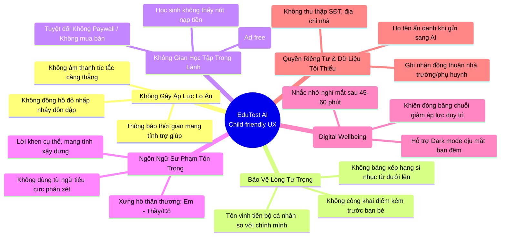

# ĐẶC TẢ TÍNH NĂNG CỔNG HỌC SINH (PHẦN B - LƯỢT 1)
## FRONTEND, HIỆU ỨNG VI TƯƠNG TÁC & NGUYÊN TẮC THIẾT KẾ CHO TRẺ EM

**Dự án:** EduTest AI — Cổng Học Sinh Cá Nhân Hóa Chuẩn GDPT 2025  
**Tài liệu:** `audit/student-portal-features-fe.md`  
**Giai đoạn:** Lượt 1 / 2 (Phần B: Thiết kế Frontend & UX Nhân Ái)  
**Tác giả:** Senior Full-stack Engineer & Educational UX Designer  
**Đối tượng phục vụ:** Học sinh THPT (Lớp 10, 11, 12 — từ 15 đến 18 tuổi)  
**Mô hình vận hành:** B2B2C (Giáo viên tạo lớp, thiết lập kỳ thi và cấp mã tham gia; học sinh không tự do đăng ký công khai ở phiên bản đầu; học sinh không nạp tiền; giáo viên chi trả credits).  

---

## 1. TỔNG QUAN ĐỊNH HƯỚNG THIẾT KẾ (DESIGN DIRECTION)

Cổng Học Sinh EduTest AI không phải là một "phần mềm khảo thí khô khan", mà là một **Không Gian Học Tập Cá Nhân Hóa (Personal Learning Space)** nơi học sinh cảm thấy:
1. **Được khích lệ và an toàn:** Sai sót không bị trừng phạt mà được biến thành bài học củng cố qua AI Tutor.
2. **Rõ ràng và minh bạch:** Không có số liệu ảo, không có bảng xếp hạng sỉ nhục, không có paywall gây phiền toái.
3. **Mượt mà và tập trung trên điện thoại:** Tối ưu 100% cho thiết bị di động (Mobile-first), bàn phím ảo không che khuất bài thi, tương tác chạm phản hồi tức thì dưới 16ms (60fps).

---

## 2. B1. ĐẶC TẢ CHI TIẾT FRONTEND THEO TỪNG MÀN HÌNH

### MÀN HÌNH 1: TRANG CHỦ HỌC SINH (`/student`)

#### 1.1 Mục tiêu & Hành vi người dùng
Khi học sinh mở ứng dụng mỗi buổi sáng hoặc tối, trang chủ cung cấp một bức tranh toàn cảnh: Hôm nay cần làm gì? Đang tiến bộ thế nào? Và tiếp tục bài học dang dở chỉ bằng 1 chạm.

#### 1.2 Các thành phần giao diện & Hiệu ứng

##### (a) Dynamic Greeting Hero Banner (Lời chào theo ngữ cảnh thời gian)
* **Logic thời gian:**
  - `05:00 - 11:59`: *"Chào buổi sáng, {studentName}! ☀️ Chúc em một ngày học tập tràn đầy năng lượng."*
  - `12:00 - 17:59`: *"Chào buổi chiều, {studentName}! 🌤️ Hãy kiểm tra bài tập hôm nay nhé."*
  - `18:00 - 22:59`: *"Chào buổi tối, {studentName}! 🌙 Cùng ôn luyện lại các câu sai để chuẩn bị cho ngày mai."*
  - `23:00 - 04:59`: *"Đã khuya rồi, {studentName}! 🌌 Nhớ đi ngủ sớm để giữ gìn sức khỏe nhé."*
* **Chuyển động (Micro-interaction):** Gradient nền (`emerald-600` qua `teal-600` đến `cyan-700`) có luồng sáng chuyển động chậm (CSS background-position pulse 8s), các hạt bụi sao vàng li ti lơ lửng nhẹ nhàng.

##### (b) Vòng tiến độ nhiệm vụ hằng ngày (Daily Goal Circular Ring)
* **Ý nghĩa:** Khích lệ thói quen học tập vi mô (Micro-learning) mà không gây quá tải.
* **Mục tiêu mặc định:** Hoàn thành 1 bài kiểm tra HOẶC sửa 3 câu sai trong phiếu luyện bù mỗi ngày.
* **Thành phần:** Vòng tròn SVG bán kính $R=32$, `strokeDasharray` và `strokeDashoffset` tính toán theo tỉ lệ phần trăm hoàn thành ($0\% \rightarrow 100\%$). Khi đạt $100\%$, vòng tròn chuyển từ màu xanh ngọc sang ánh vàng kim kèm hiệu ứng phát sáng nhẹ (glow 0.4s).

##### (c) Thẻ KPI với Hiệu ứng Count-Up & Staggered Entrance
* **Khắc phục lỗi cũ (`STU-12`):** Tuyệt đối **không bao giờ** hiển thị số 0 khi đang tải. Khi đang tải (`isLoading === true`), toàn bộ các thẻ hiển thị **Shimmer Skeleton Loader** (khối bo góc có vệt sáng quét qua).
* **Hiệu ứng Count-Up chỉ là thị giác:** Số đếm tăng dần từ 0 lên giá trị thực trong 800ms bằng hàm `easeOutExpo` để tạo cảm giác sống động.
* **Trợ năng (Screen Reader A11y):** Trình đọc màn hình (NVDA, VoiceOver) **không đọc** từng số đếm nhảy, mà đọc ngay giá trị cuối cùng thông qua thuộc tính `aria-label` và `aria-live="polite"` (ví dụ: `aria-label="Điểm trung bình hiện tại: 8.5 trên 10"`).
* **4 Thẻ số liệu trung thực:**
  1. *Bài Đã Hoàn Thành:* Số bài thi đã nộp thật sự (tính từ `student_exam_enrollments` trạng thái `completed`).
  2. *Bài Thi Cần Làm Ngay:* Số bài được giáo viên giao đang mở và chưa hết hạn.
  3. *Điểm Trung Bình:* Chỉ tính trung bình khi số bài thi $> 0$. Nếu chưa thi bài nào, hiển thị nhãn `"Chưa có điểm"` (thay vì tự bịa 8.0/10).
  4. *Lỗ Hổng Đang Củng Cố:* Số chủ đề/dạng bài có câu sai chưa hoàn thành luyện bù.

##### (d) Thẻ "Tiếp Tục Học" Thông Minh (Smart Resume Card)
* Nằm ngay bên dưới banner chính, tự động ưu tiên 1 trong 3 trạng thái quan trọng nhất:
  - *Ưu tiên 1:* Bài kiểm tra đang làm dở dở dang (còn thời gian làm bài).
  - *Ưu tiên 2:* Bài thi sắp đến hạn nộp (ví dụ: còn dưới 6 tiếng).
  - *Ưu tiên 3:* Phiếu luyện bù AI vừa được tạo sau kỳ thi gần nhất.
* Một nút bấm to bản `[Tiếp tục ngay ->]` với phản hồi rung nhẹ (Haptic feedback 15ms trên mobile).

---

### MÀN HÌNH 2: HỒ SƠ NĂNG LỰC & MA TRẬN NHẬN THỨC GDPT 2025 (`/student/progress`)

#### 2.1 Biểu đồ Radar Động 2 Lớp (Dual-layer Progressive Radar)
* **Bản chất cũ:** Hardcode 92/84/76/65% hoặc 85/75/60/45%.
* **Đặc tả mới:**
  - Biểu đồ Polar SVG 4 trục chuẩn Bộ GD&ĐT: **Nhận biết, Thông hiểu, Vận dụng, Vận dụng cao**.
  - **Lớp 1 (Nền mờ nét đứt):** Mức độ thuần thục của kỳ thi/tháng trước (để so sánh tiến bộ).
  - **Lớp 2 (Nét đậm màu tím tím Indigo):** Mức độ thuần thục hiện tại, vẽ dần từ tâm ra rìa bằng thuộc tính `stroke-dashoffset` và `transform: scale(0)` trong 600ms khi người dùng cuộn tới.
* **Tương tác chạm (Interactive Tooltip / Vertex Popover):**
  - Chạm vào đỉnh "Vận dụng cao": Hiện Popover nhỏ hiển thị: *"Đã đúng 7/12 câu (58%). Các dạng bài cần luyện thêm: Đồ thị hàm số phân thức, Con lắc lò xo thẳng đứng"*.

#### 2.2 Chế độ Bảng Dữ Liệu Dành Cho Trợ Năng (A11y Accessible Table)
* Ngay dưới biểu đồ có nút chuyển đổi `[Xem dạng Bảng]` phục vụ học sinh khiếm thị dùng Screen Reader (NVDA, TalkBack, VoiceOver):
  ```html
  <table class="sr-only sm:not-sr-only w-full text-xs">
    <caption>Bảng chi tiết độ thuần thục 4 cấp độ tư duy GDPT 2025</caption>
    <thead>
      <tr><th>Cấp độ tư duy</th><th>Tỉ lệ thành thạo</th><th>Số câu đạt</th><th>Đánh giá sư phạm</th></tr>
    </thead>
    <tbody>...</tbody>
  </table>
  ```
* **Tuân thủ Giảm chuyển động (`prefers-reduced-motion`):** Toàn bộ hoạt ảnh vẽ đa giác và xoay radar lập tức tắt hoàn toàn, hiển thị ngay kết quả tĩnh khi hệ thống phát hiện cấu hình `prefers-reduced-motion: reduce`.

#### 2.3 Sổ Tay Lỗi Sai (Error Notebook) & Thế Mạnh Thật
* Bỏ hoàn toàn câu chữ mẫu "Casio fx-580" cứng cho mọi môn.
* Thay bằng: Danh sách các chuyên đề thật sự được gắn nhãn từ ngân hàng đề thi. Nếu học sinh chưa làm bài nào, hiển thị Empty State nhân ái: *"Hệ thống đang chờ bài kiểm tra đầu tiên để vẽ biểu đồ năng lực chính xác cho em."*

---

### MÀN HÌNH 3: CHUỖI HỌC TẬP (STREAK) & GAMIFICATION NHÂN ÁI

#### 3.1 Ngọn Lửa Mềm (Gentle Pulsating Flame)
* Ngọn lửa biểu tượng học tập không dùng hình ảnh giật giật gây mất tập trung. Sử dụng SVG động với 2 lớp path màu cam và vàng nhạt, chuyển động uốn lượn chậm rãi (`transform: scale(1.05)` trong 2s chu kỳ `easeInOut`).

#### 3.2 Các Cột Mốc Vinh Danh Khích Lệ (Milestone Badges)
* Các mốc: **3 Ngày** (Khởi động vững vàng), **7 Ngày** (Thói quen kiên trì), **14 Ngày** (Bứt phá năng lực), **30 Ngày** (Chiến binh GDPT).
* Mỗi mốc đạt được mở khóa một huy hiệu đồ họa phong cách origami/khoa học tinh tế, không phô trương.

#### 3.3 Tính Năng "Đóng Băng Chuỗi" Nhân Ái (Streak Freeze)
* **Triết lý:** Cuộc sống của học sinh THPT có lúc ốm đau, thi học kỳ dồn dập hoặc việc gia đình. Không để học sinh cảm thấy tuyệt vọng hoặc bỏ cuộc khi chuỗi 20 ngày bị đứt về 0 chỉ vì lỡ 1 ngày.
* **Cơ chế:** Mỗi học sinh được tặng tự động 1 "Khiên Đóng Băng" mỗi tháng (tối đa giữ 2 khiên). Nếu một ngày không vào học, khiên tự động kích hoạt bảo lưu chuỗi kèm thông điệp: *"EduTest AI đã giữ chuỗi giúp em hôm qua! Hãy nghỉ ngơi đầy đủ và tiếp tục khi sẵn sàng nhé."*
* **Nguyên tắc không gây lo âu:** Tuyệt đối không gửi notification kiểu đe dọa (*"Bạn sắp mất chuỗi!", "Đừng để ngọn lửa vụt tắt!"*).

---

### MÀN HÌNH 4: PHÒNG LÀM BÀI TRỰC TUYẾN MỚI (`/student/exams/[attemptId]`)
> [!IMPORTANT]
> Đây là hạng mục hoàn toàn mới thay thế nút `alert()` hiện tại của hệ thống. Phải được thiết kế tỉ mỉ, chống gian lận nhẹ nhàng và tối ưu cho màn hình cảm ứng di động.

#### 4.1 Bố cục Giao diện (Layout Blueprint)
```
+-----------------------------------------------------------------------+
|  <- Thoát ra    ĐỀ THI KHẢO THÍ TOÁN GDPT 2025       Thời gian: 42:15 |
|  [Đã lưu v]    Câu 14 / 40                          [Bản đồ câu hỏi] |
+-----------------------------------------------------------------------+
|                                                                       |
|  Câu 14: [Mức độ: Vận dụng]                                           |
|  Cho hàm số y = f(x) liên tục trên R và có bảng biến thiên như sau:   |
|  [Hình ảnh đồ thị / Công thức LaTeX MathJax mượt mà]                  |
|                                                                       |
|  ( ) A. x = 2                                                         |
|  (X) B. x = -1               <- Đáp án đã chọn (Border Emerald đậm)   |
|  ( ) C. x = 0                                                         |
|  ( ) D. x = 1                                                         |
|                                                                       |
|  [ Đánh dấu xem lại (Flag) ]                  [ Xóa lựa chọn ]        |
+-----------------------------------------------------------------------+
|  [< Câu trước]             [Bản đồ lưới câu]             [Câu tiếp >] |
|                                             [Nộp Bài Thi (38/40) ->]  |
+-----------------------------------------------------------------------+
```

#### 4.2 Chi tiết Tính năng & Trải nghiệm phòng thi

##### (a) Question Matrix Grid (Bản đồ câu hỏi dạng lưới)
* Một thanh trượt hoặc Drawer bật lên hiển thị lưới 40 ô vuông câu hỏi (1 đến 40):
  - *Màu trắng viền xám:* Câu chưa làm.
  - *Màu xanh ngọc (`emerald-500`):* Câu đã chọn đáp án và đã lưu thành công lên server.
  - *Màu vàng cam có cờ nhỏ:* Câu học sinh đánh dấu "Xem lại sau" (Flagged for review).
  - *Viền xanh dương đậm:* Câu hỏi đang hiển thị trên màn hình hiện tại.
* Bấm vào bất kỳ ô số nào để nhảy ngay đến câu hỏi đó mà không bị giật trang.

##### (b) Đồng hồ đếm ngược do Server quyết định (Server-Synced Gentle Countdown)
* **Thời gian do Server quyết định:** Thời điểm hết hạn `expires_at` do server tính toán và cấp phát ngay khi tạo bản ghi lượt thi (`exam_attempts`). Client không thể kéo dài giờ thi bằng cách can thiệp giờ trên hệ điều hành.
* **Hiển thị nhẹ nhàng, không gây áp lực:** Đồng hồ hiển thị dạng số thanh mảnh (`font-mono text-sm`), không có hiệu ứng đỏ chớp giật gân, không có âm thanh đếm lùi gây hoảng sợ.
* **Chỉ nhắc nhở nhẹ ở 2 mốc 5 phút và 1 phút:**
  - *Mốc 5 phút:* Toast thông báo màu hổ phách xuất hiện 3 giây: *"Còn 5 phút nữa, em rà soát lại các câu đã đánh dấu cờ nhé!"*
  - *Mốc 1 phút:* Toast nhắc nhở nhẹ nhàng: *"Còn 1 phút cuối, hệ thống sẽ tự động lưu và gửi bài khi hết giờ."*
  - *Khi hết giờ:* Tự động kích hoạt nộp bài ngầm với các câu đã lưu, không làm học sinh mất trắng bài làm.

##### (c) Chỉ Báo Autosave & Hook Dùng Chung Với Trình Soạn Đề (CRT-03)
* **Dùng chung kiến trúc Autosave Hook (`useAutosaveAttempt`):** Tái sử dụng logic từ hook autosave của Studio Soạn Đề (`CRT-03`):
  1. *Version Sequence Number:* Mỗi lần chọn đáp án tăng `client_version` (+1) và gắn số thứ tự câu hỏi (`question_index`, `selected_option`, `timestamp`).
  2. *Conflict Resolution:* So sánh version với server; bảo đảm ghi nhận trạng thái mới nhất khi mạng chập chờn.
  3. *Lưu từng câu có số thứ tự:* Payload gọn nhẹ (`{ attemptId, questionIndex: 14, selectedOption: "B", version: 12 }`), phản hồi siêu tốc dưới 100ms.
  4. *Badge trạng thái:* `[Đang lưu...]` $\rightarrow$ `[Đã lưu an toàn v]` màu xanh ngọc.
  5. *Offline Queue:* Lưu đồng thời vào IndexedDB; tự động flush khi có mạng.

##### (d) Phòng Làm Bài Ưu Tiên Điện Thoại & Khả Năng Chống Chịu (Mobile-First Robustness)
* **Bàn phím ảo không che ô trả lời:** Áp dụng `interactive-widget=resizes-content` và tự động cuộn (scroll-into-view) ô chọn đáp án lên nửa trên màn hình khi bàn phím mở ra.
* **Xoay màn hình (Orientation Change):** Đổi từ dọc sang ngang và ngược lại không reload trang, giữ nguyên 100% vị trí câu hỏi và đáp án đã chọn.
* **Chuyển tab ngầm / Tắt màn hình tạm thời:** Sử dụng `Page Lifecycle API` (`freeze` / `resume`), khi học sinh mở lại tab, ứng dụng tự động kiểm tra tính toàn vẹn dữ liệu từ IndexedDB, không mất bài.

##### (e) Giám Sát Hành Vi Nhẹ Nhàng & Tôn Trọng Quyền Riêng Tư
* **Thông báo minh bạch trước khi vào thi:** Màn hình quy chế thi nêu rõ: *"Hệ thống có ghi nhận số lần chuyển ứng dụng hoặc dán nội dung để Thầy/Cô tham khảo. EduTest AI hoàn toàn KHÔNG bật camera và KHÔNG thu thập hình ảnh riêng tư của em."*
* **Chỉ để tham khảo, không chặn thiết bị:** Không tự ý khóa màn hình hay tước quyền thi cử của học sinh; các sự kiện (rời màn hình, paste) chỉ được ghi nhật ký (telemetry log) để giáo viên xem lại sau giờ thi.

##### (f) Bảo Mật Tuyệt Đối: Không Gửi Đáp Án Xuống Client (STU-06)
* **Payload đề thi hoàn toàn sạch:** API `/api/student/exam-attempts/[id]` chỉ trả về: nội dung câu hỏi, hình ảnh, 4 phương án A, B, C, D. **Tuyệt đối KHÔNG chứa `correct_answer`, `explanation`, `solution_steps` hay điểm từng câu.**
* **Chặn soi Network:** Dù học sinh có mở DevTools kiểm tra response, mã nguồn cũng hoàn toàn không có đáp án đúng cho đến khi giáo viên chính thức bấm "Công bố kết quả".

##### (g) Màn hình Xem lại & Hộp thoại Xác nhận Nộp bài (Double Confirmation & Idempotency)
* Khi bấm nút `[Nộp Bài Thi]`:
  - Sheet tóm tắt hiển thị: Đã làm (38/40), Chưa làm (2/40 - câu 19, 35), Đánh dấu xem lại (3 câu).
  - Nút xác nhận nộp gửi kèm `idempotency_key` (UUID v4 sinh từ client) để ngăn chặn việc gửi trùng lặp nhiều lần khi mạng lag.

---

### MÀN HÌNH 5: MÀN HÌNH KẾT QUẢ & PHÂN TÍCH SAU THI (`/student/exams/[attemptId]/result`)

#### 5.1 Hiệu ứng Mở Điểm (Score Reveal Animation)
* Điểm số không hiện ra thô kệch ngay lập tức. Sau khi nộp bài:
  - Màn hình hiển thị vòng quay phân tích trong 1.2s: *"Đang chấm bài thi theo chuẩn Bộ GD&ĐT 2025..."*
  - Điểm số nhảy từ 0.0 lên điểm thực tế (ví dụ: `8.5 / 10.0`) kèm hiệu ứng phóng to nhẹ (scale pop 1.15x -> 1.0x).

#### 5.2 Pháo giấy nhẹ nhàng khi vượt mục tiêu (Confetti Celebration)
* Thư viện `canvas-confetti` được **lazy-load** (chỉ tải về máy khi điểm thi $\ge 8.0$ hoặc cao hơn bài thi gần nhất).
* Bắn pháo giấy màu pastel nhã nhặn trong 2.5 giây, tự hủy canvas để giải phóng bộ nhớ RAM di động.

#### 5.3 Giải thích từng câu mở ra mượt mà (Accordion Explanation)
* **Quyền xem đáp án do Giáo viên thiết lập:**
  - Nếu giáo viên chọn *"Chưa công bố đáp án"*: Hiển thị thông báo: *"Thầy cô sẽ công bố lời giải chi tiết sau khi cả lớp hoàn thành bài thi."*
  - Nếu được phép xem: Mỗi câu hỏi hiển thị dưới dạng Accordion. Bấm vào câu sai sẽ trượt mở lời giải 3 bước sư phạm rõ ràng và ghi chú kiến thức trọng tâm.

#### 5.4 Nút "Luyện Bù Câu Sai 1-Chạm" (1-Click Remediation Launcher)
* Nằm nổi bật ở cuối bảng kết quả: `[Khắc Phục 4 Câu Sai Cùng AI Tutor ->]`.
* Bấm vào nút này sẽ kích hoạt quy trình sinh phiếu luyện bù cá nhân hóa mà không cần học sinh phải sao chép hay thao tác thủ công.

---

### MÀN HÌNH 6: PHÒNG GIẢI BÀI LUYỆN BÙ AI (`/student/practice/[token]`)

#### 6.1 Giao diện Thẻ Câu Hỏi Đồng Dạng (Isomorphic Flashcard)
* Mỗi câu sai từ đề thi được chuyển hóa thành thẻ câu hỏi tương đương (cùng dạng toán, số liệu số đẹp).
* Thẻ câu hỏi có thể vuốt ngang (swipe left/right) trên điện thoại để chuyển câu.

#### 6.2 Phản hồi Tức Thì & Combo Khích Lệ (Instant Positive Feedback)
* Sau khi chọn đáp án câu luyện bù:
  - Nếu **ĐÚNG**: Viền thẻ ánh xanh ngọc, icon tick xanh bật nảy (bounce), hiện dòng chữ: *"Xuất sắc! Em đã nắm vững bản chất câu này rồi."* + hiển thị mẹo Casio fx-580.
  - Nếu **CHƯA ĐÚNG**: Không hiện chữ "SAI" đỏ gắt. Hiện viền vàng cam nhẹ: *"Chưa chính xác. Đừng lo, hãy xem gợi ý tư duy 3 bước dưới đây và làm lại nhé!"*
* **Chuỗi Đúng Liên Tiếp (Streak Combo):** Nếu làm đúng 3 câu liên tiếp, hiện hiệu ứng ngọn lửa nhỏ kèm lời khen: *"Combo x3! Phong độ tuyệt vời!"*
* **Âm thanh tùy chọn:** Âm báo "ting" nhẹ nhàng tắt mặc định; học sinh có thể bật trong cài đặt nếu thích.

---

### MÀN HÌNH 7: CHẾ ĐỘ XEM THỬ CỦA GIÁO VIÊN (READ-ONLY MOCK MODE - STU-04)

#### 7.1 Bản chất kiến trúc & Chỉ báo rõ ràng
* **Chỉ báo trực quan:** Banner cố định màu hổ phách ở đỉnh trang với thông điệp minh bạch:  
  `[👨‍🏫 Chế độ Xem Thử (Preview Mode) — Dữ liệu mẫu, không ghi dữ liệu, không tốn credits] [Nút: Thoát Xem Thử ->]`
* **Nút Thoát:** Bấm vào nút `[Thoát Xem Thử]` sẽ đưa giáo viên quay trở lại ngay `/dashboard` (Bục Giảng Số), xóa sạch mọi mock state tạm thời.

#### 7.2 Mô tả hành vi trên từng màn hình trong Chế độ Xem Thử
* **Trang chủ (`/student`):**
  - Hiển thị dữ liệu học sinh mẫu mang tên *"Học sinh mẫu (Nguyễn Văn An)"*.
  - Thẻ KPI hiển thị số liệu mẫu cố định (Đã nộp: 3 bài, Cần làm: 1 bài, Điểm TB: 8.2).
* **Phòng thi (`/student/exams`):**
  - Hiển thị 2 bài thi mẫu.
  - Ô "Nhập mã PIN": Nhập mã bất kỳ sẽ hiện Toast thông báo: *"Chế độ xem thử: Thao tác nhập mã được mô phỏng thành công, không tạo bản ghi thật trong CSDL."*
  - Bấm "Làm thử": Mở phòng thi với đề thi mẫu 5 câu hỏi để giáo viên trải nghiệm giao diện làm bài của học sinh; khi bấm Nộp bài, hệ thống chấm điểm ảo và không lưu vào CSDL.
* **Hồ sơ năng lực (`/student/progress`):**
  - Hiển thị biểu đồ Radar mẫu hoàn chỉnh 4 cấp độ tư duy.
  - Ô "Đồng bộ báo cáo": Nhập link/mã báo cáo sẽ hiện thông báo: *"Chế độ xem thử: Không ghi đè hồ sơ vào tài khoản giáo viên."*
* **Luyện bù AI (`/student/practice`):**
  - Hiển thị 1 phiếu luyện bù mẫu cố định có sẵn lời giải 3 bước.
  - Không gọi API Gemini thật, không trừ bất kỳ credit nào từ ví của giáo viên.

---

## 3. B3. NGUYÊN TẮC THIẾT KẾ CHO TRẺ EM (CHILD-FRIENDLY & ETHICAL DESIGN)

Học sinh THPT (15-18 tuổi) đang trong giai đoạn chịu áp lực thi cử và tâm lý nhạy cảm. Toàn bộ thiết kế giao diện phải tuân thủ nghiêm ngặt **7 Nguyên Tắc Đạo Đức Sư Phạm**:



### 3.1 Bảng chi tiết 7 Nguyên tắc Đạo đức Sư phạm

| Nguyên tắc | Điều cấm kỵ (Anti-patterns) | Thiết kế chuẩn mực của EduTest AI |
| :--- | :--- | :--- |
| **1. Không đếm ngược gây hoảng loạn** | Chữ số to màu đỏ nhấp nháy liên tục, âm thanh đồng hồ đếm lùi dồn dập khi sắp hết giờ. | Đồng hồ chuyển màu vàng cam nhẹ nhàng, thông điệp nhắc nhở ân cần: *"Còn 5 phút nữa, em kiểm tra lại bài nhé"*, không có âm thanh báo động. |
| **2. Không bảng xếp hạng sỉ nhục (No Shame Leaderboard)** | Liệt kê danh sách cả lớp từ điểm cao đến điểm thấp, nêu tên các bạn điểm kém ở cuối bảng. | Chỉ hiển thị kết quả cá nhân của học sinh. Nếu lớp có bảng vinh danh, chỉ hiển thị Top 3 đạt điểm xuất sắc hoặc Top học sinh tiến bộ nhiều nhất tuần (với biệt danh ẩn danh). |
| **3. Không thương mại hóa / Không Paywall** | Nút "Nâng cấp VIP để xem lời giải", pop-up chào mua khoá học, quảng cáo game chèn vào giữa bài làm. | **100% không quảng cáo, không pop-up bán hàng.** Học sinh không phải nạp tiền; toàn bộ chi phí AI do tài khoản giáo viên/nhà trường bảo trợ. |
| **4. Tôn vinh tiến bộ cá nhân (Personal Mastery)** | So sánh học sinh này kém hơn học sinh khác: *"Em đang xếp dưới 80% học sinh trong lớp"*. | So sánh với chính bản thân học sinh: *"Em đã tiến bộ 0.8 điểm so với bài kiểm tra tuần trước! Độ thuần thục phần Thông hiểu đã tăng lên 84%"*. |
| **5. Ngôn ngữ phù hợp lứa tuổi & Tôn trọng** | Dùng từ ngữ lạnh lùng, phán xét: *"Kém", "Sai nghiêm trọng", "Học dốt"* hoặc các thuật ngữ kỹ thuật khó hiểu. | Sử dụng xưng hô sư phạm chuẩn mực: *"Em" - "Thầy/Cô"*. Nhận xét tích cực: *"Điểm cần lưu ý", "Cơ hội rèn luyện thêm", "Thầy cô tin em sẽ làm tốt hơn ở lần sau"*. |
| **6. Sức khỏe thị giác & Cân bằng cuộc sống (Wellbeing)** | Thao túng tâm lý (Guilt-tripping) để ép học sinh thức khuya học dồn dập; ép cày chuỗi streak thâu đêm. | Cảnh báo nghỉ ngơi sau 45 phút: *"Em đã tập trung học 45 phút rồi, hãy đứng dậy uống nước và thư giãn mắt 5 phút nhé! 🌿"*. Hỗ trợ Dark Mode chuẩn tương phản cao. |
| **7. Quyền kiểm soát & Bảo vệ dữ liệu trẻ em** | Bắt học sinh nhập số điện thoại cá nhân, địa chỉ nhà, căn cước công dân để đăng ký tài khoản. | **Thu thập dữ liệu tối thiểu:** Chỉ cần tên hiển thị/biệt danh do giáo viên cấp qua mã lớp; không thu thập số điện thoại, vị trí địa lý hay dữ liệu sinh trắc học. |

---

## 4. QUY CHUẨN KỸ THUẬT HIỆU ỨNG & HIỆU NĂNG (PERFORMANCE BUDGET)

Để đảm bảo cổng học sinh chạy mượt mà 60fps trên cả các dòng điện thoại phổ thông (Samsung Galaxy A-series, Xiaomi Redmi):

| Tiêu chí | Ngưỡng giới hạn (Budget Limit) | Giải pháp kỹ thuật thực thi |
| :--- | :--- | :--- |
| **Kích thước bundle hiệu ứng** | $\le 60\text{ KB}$ gzip bổ sung | Ưu tiên CSS Animations và Tailwind Transitions thuần túy. Chỉ sử dụng Motion One hoặc framer-motion bản rút gọn (m-component). Lazy-load `canvas-confetti`. |
| **Tốc độ khung hình (Frame rate)** | Cố định $\ge 60\text{ fps}$ | **Chỉ animate `transform` và `opacity`**. Tuyệt đối không animate các thuộc tính gây Layout Reflow như `width`, `height`, `top`, `margin`. Sử dụng `will-change: transform` thận trọng. |
| **Hỗ trợ Giảm chuyển động** | Tuân thủ 100% WCAG 2.1 | Bao bọc toàn bộ animation trong `@media (prefers-reduced-motion: reduce)`. Khi người dùng bật tính năng này trên máy, chuyển động chuyển thành fade-in tức thì hoặc tắt hẳn. |
| **Tần số chớp nháy an toàn** | $\le 3\text{ lần/giây}$ | Tuyệt đối không sử dụng hiệu ứng nhấp nháy nhanh (tránh kích phát cơn động kinh cảm quang theo chuẩn ISO 9241-391). |
| **Âm thanh vi tương tác** | Tắt mặc định (Muted by default) | Mọi hiệu ứng âm thanh (nếu có) phải do người dùng tự bật (`opt-in`), âm lượng mặc định ở mức $30\%$, âm sắc trong trẻo, không chói gắt. |
| **PWA & Offline UI Shell** | Tải trang đầu $< 1.5\text{s}$ trên 4G | Đăng ký Web App Manifest cho phép cài đặt ra màn hình chính điện thoại như ứng dụng native; Service Worker lưu cache HTML/CSS/JS shell. |

---

## 5. CÂU HỎI PHÁP LÝ & BẢO VỆ DỮ LIỆU CẦN XÁC NHẬN BỔ SUNG

> [!NOTE]
> Theo yêu cầu của dự án: Dưới đây là các câu hỏi pháp lý và vận hành cần nhóm pháp chế/nhà trường xác nhận, không mang tính kết luận pháp lý:

1. **Ghi nhận sự đồng thuận của cha mẹ qua Nhà trường / Giáo viên:**
   - Khi giáo viên tạo lớp học và cấp mã tham gia cho học sinh lớp 10 (có độ tuổi 15), giáo viên sẽ bấm xác nhận: *"Tôi đại diện nhà trường/phụ huynh xác nhận đồng ý cho các học sinh trong danh sách tham gia học tập trên nền tảng EduTest AI theo Điều 20 Nghị định 13/2023/NĐ-CP"*. Hệ thống cần lưu trường `consent_timestamp`, `consent_version` và `teacher_id` làm bằng chứng tuân thủ. Cần nhóm pháp chế phê duyệt văn bản thỏa thuận này trước khi bấm Go-live.
2. **Quy định ẩn danh dữ liệu học sinh khi chia sẻ qua Zalo:**
   - Các đường link báo cáo kết quả gửi cho phụ huynh qua Zalo có cần che bớt ký tự họ tên học sinh (ví dụ: *"Nguyễn V\*\*\* A"*) để phòng trường hợp link bị chia sẻ ngoài ý muốn vào các hội nhóm đông người hay không?

---
> **DỪNG TẠI ĐÂY (KẾT THÚC LƯỢT 1 - PHẦN B).**  
> Bản đặc tả Frontend, Hiệu ứng chuyển động & UX Trẻ em (`audit/student-portal-features-fe.md`) đã hoàn tất.  
> Xin mời Bạn xem xét và phản hồi để tôi tiếp tục tiến hành **LƯỢT 2 (`audit/student-portal-features-be.md`: Backend, Schema, RPC Chấm Điểm, RLS & Kế hoạch PR)**.
