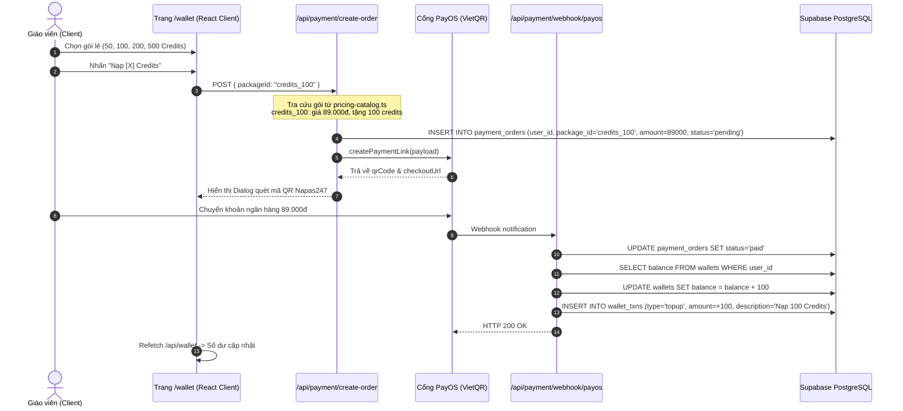

# Báo Cáo Rà Soát Bảo Mật & Kiến Trúc: /wallet (Ví Người Dùng & Nạp Credits)

**Ngày thực hiện:** 01/11/2026  
**Chuyên viên:** Senior Full-stack Engineer & Security Reviewer  
**Môi trường:** Production/Staging (`ed-teach-rust.vercel.app`), Next.js 14 App Router, Supabase PostgreSQL, PayOS, SePay  
**Phạm vi:** Tuyến đường `/wallet`, API nạp credits lẻ, bảng `wallets` và `wallet_txns`, cơ chế ghi nhận lịch sử biến động số dư.

---

## 1. Sơ Đồ Luồng Hoạt Động (Credit Top-Up & Transaction Ledger)

### 1.1. Biểu Đồ Trình Tự (Sequence Diagram)



### 1.2. Bảng Đối Chiếu File & Dòng Mã Nguồn

| Chức Năng | Tệp Tin & Dòng Mã | Đánh Giá Kỹ Thuật |
| :--- | :--- | :--- |
| **Giao diện Ví** | [`frontend/src/app/(dashboard)/wallet/page.tsx#L1-L533`](file:///d:/Go-Live/Web/EdTeach/frontend/src/app/(dashboard)/wallet/page.tsx#L1-L533) | Hiển thị số dư ví, danh sách gói PRO/MAX, 4 gói lẻ, và bảng lịch sử giao dịch gần nhất |
| **Cấu hình Gói Lẻ** | [`frontend/src/lib/payment/pricing-catalog.ts#L70-L96`](file:///d:/Go-Live/Web/EdTeach/frontend/src/lib/payment/pricing-catalog.ts#L70-L96)<br/>và [`frontend/src/lib/payment/plans.ts#L30-L37`](file:///d:/Go-Live/Web/EdTeach/frontend/src/lib/payment/plans.ts#L30-L37) | Định nghĩa trùng lặp tại 2 file khác nhau; đơn vị credit lệch 100 lần so với chi phí tạo đề |
| **API Thông Tin Ví** | [`frontend/src/app/api/wallet/route.ts#L1-L70`](file:///d:/Go-Live/Web/EdTeach/frontend/src/app/api/wallet/route.ts#L1-L70) | Đọc `wallets` và `wallet_txns` của user. Có fallback sang in-memory mock khi DB lỗi |
| **Ghi Sổ Giao Dịch** | [`frontend/src/app/api/payment/webhook/payos/route.ts#L148-L162`](file:///d:/Go-Live/Web/EdTeach/frontend/src/app/api/payment/webhook/payos/route.ts#L148-L162) | Ghi bản ghi nạp tiền vào `wallet_txns` nhưng không nằm trong transaction atomic |
| **Trigger Khởi Tạo** | [`supabase/migrations/00001_initial_schema.sql#L137-L151`](file:///d:/Go-Live/Web/EdTeach/supabase/migrations/00001_initial_schema.sql#L137-L151) | `handle_new_user()` khởi tạo `balance = 100`, nhưng **KHÔNG GHI** vào `wallet_txns` |

---

## 2. Phân Tích Lỗ Hổng Bảo Mật & Lệch Pha Đơn Vị Tiền Tệ

### 🔴 WAL-01 (CRITICAL): Lệch Pha Đơn Vị Tính Gấp 100 Lần (Unit Scale Mismatch) - Gói Nạp Lẻ Trở Thành "Bẫy Giá"
- **Hiện tượng thực tế trong mã nguồn:**
  - **Quy định tiêu hao khi tạo đề thi:**
    Trong [`frontend/src/app/api/exams/generate/route.ts#L292`](file:///d:/Go-Live/Web/EdTeach/frontend/src/app/api/exams/generate/route.ts#L292):
    ```typescript
    const creditCost = isThinking ? 1600 : 500;
    ```
    Hệ thống trừ **500 credits** cho 1 đề Gemini 2.0 Flash thông thường và **1.600 credits** cho 1 đề Deep Thinking!
  - **Bảng giá nạp gói thuê bao:**
    Gói Giáo viên PRO giá **149.000đ/tháng** được tặng **30.000 credits** (~5đ/credit, đủ tạo **60 đề thi**).
  - **Bảng giá nạp credits lẻ trên `/wallet`:**
    Trong [`pricing-catalog.ts#L70-L96`](file:///d:/Go-Live/Web/EdTeach/frontend/src/lib/payment/pricing-catalog.ts#L70-L96):
    - Gói 50 Credits: Giá **49.000đ** -> Tính ra 980đ/credit. Nạp 49.000đ chỉ có 50 credits, **không đủ tạo nổi 1/10 đề thi!**
    - Gói 100 Credits: Giá **89.000đ** -> Không đủ tạo 1/5 đề thi!
    - Gói 500 Credits: Giá **349.000đ** -> Vừa đúng 500 credits, tức là người dùng phải trả **349.000đ để tạo DUY NHẤT 1 đề thi!** (Đắt hơn gấp đôi cả tháng thuê bao PRO 149.000đ tạo 60 đề).
- **Nguyên nhân gốc:** Đây là tàn dư của phiên bản V1 (khi 1 credit tương đương 1 lần tạo đề). Khi nâng cấp V2 đưa thang đo credit lên hàng ngàn (để tương thích tỷ giá token LLM và Chợ đề thi), nhóm phát triển đã cập nhật gói PRO (30.000 cr) và API tạo đề (500 cr), nhưng **quên nhân 100 lần** đối với bảng gói nạp lẻ (đúng ra phải là 5.000, 10.000, 20.000, 50.000 credits).
- **Hệ quả kinh doanh:** Người dùng nạp 49.000đ hoặc 89.000đ xong vào tạo đề bị báo ngay "Không đủ số dư (cần 500 credits)", dẫn đến tranh chấp gay gắt và cáo buộc lừa đảo.

---

### 🔴 WAL-02 (HIGH): Bất Nhất Sổ Cái Toàn Hệ Thống (Ledger Inconsistency) & Lịch Sử Trống
- **Thực tế trong mã nguồn:**
  Hệ thống ví có bảng số dư `wallets` và bảng sổ cái `wallet_txns`. Tuy nhiên, các luồng biến động số dư không được chuẩn hóa vào sổ cái:
  1. **Thưởng đăng ký ban đầu:**
     Trong trigger [`00001_initial_schema.sql#L143`](file:///d:/Go-Live/Web/EdTeach/supabase/migrations/00001_initial_schema.sql#L143), khi user mới đăng ký:
     ```sql
     INSERT INTO public.wallets (user_id, balance) VALUES (new.id, 100);
     ```
     Trigger hoàn toàn **không chèn bản ghi nào vào `wallet_txns`**.
     $\implies$ Kết quả: Người dùng mở `/wallet` thấy "Số dư khả dụng: 100 cr", nhưng nhìn xuống "Lịch sử giao dịch ví" thì nhận được thông báo "Chưa có giao dịch nào". Sổ cái không giải trình được số dư ban đầu từ đâu sinh ra.
  2. **Thưởng giới thiệu bạn bè (Referral Bonus):**
     Trong [`frontend/src/app/api/referral/route.ts#L115-L125`](file:///d:/Go-Live/Web/EdTeach/frontend/src/app/api/referral/route.ts#L115-L125): Khi cộng 2.000 credits cho người giới thiệu, code chỉ gọi `wallets.update(...)` mà **không chèn bản ghi vào `wallet_txns`**! Số dư tăng nhưng lịch sử không ghi nhận.
  3. **Không có Khóa Ràng Buộc Kiểm Tra (Check Constraint):**
     Bảng `wallets` trong migration không có ràng buộc `CHECK (balance >= 0)`. Khi nhiều luồng trừ ví diễn ra đồng thời (tạo đề, mua đề chợ đề thi), nếu không có row-level locking, số dư ví hoàn toàn có thể rơi vào trạng thái số âm.

---

### 🟡 WAL-03 (HIGH): Lỗ Hổng Xác Thực Webhook SePay (TRÙNG SEC-02)
- **Vị trí mã nguồn:** [`frontend/src/app/api/payment/webhook/sepay/route.ts#L22-L28`](file:///d:/Go-Live/Web/EdTeach/frontend/src/app/api/payment/webhook/sepay/route.ts#L22-L28)
- **Đoạn mã vi phạm:**
  ```typescript
  const authHeader = req.headers.get("authorization") || "";
  const apiKey = process.env.SEPAY_API_KEY || "";
  if (!apiKey || !authHeader.includes(apiKey)) {
    return NextResponse.json({ error: "Unauthorized" }, { status: 401 });
  }
  ```
- **Lỗ hổng:**
  1. Nếu biến môi trường `SEPAY_API_KEY` chưa được cấu hình hoặc bị rỗng trong quá trình deploy Vercel, điều kiện `!apiKey` sẽ trả về 401. Nhưng nếu cấu hình chuỗi ngắn hoặc kẻ tấn công gửi header dài bao hàm chuỗi apiKey, hàm `.includes()` sẽ cho qua thay vì kiểm tra bình đẳng thời gian hằng số (`crypto.timingSafeEqual`).
  2. Tuyến SePay xử lý thanh toán tự động cộng ví người dùng, việc so sánh chuỗi lỏng lẻo tạo bề mặt tấn công bypass xác thực webhook nạp tiền.

---

### 🟡 WAL-04 (MEDIUM): Fallback In-Memory Wallet Store Khi Database Lỗi
- **Vị trí mã nguồn:** [`frontend/src/app/api/wallet/route.ts#L25-L65`](file:///d:/Go-Live/Web/EdTeach/frontend/src/app/api/wallet/route.ts#L25-L65)
- **Đoạn mã nguy hiểm:**
  ```typescript
  // Nếu Supabase trả về lỗi hoặc không kết nối được
  if (walletError || !wallet) {
    // Fallback sang memory store
    const memBalance = memoryWalletStore.get(userId) || 100;
    return NextResponse.json({ balance: memBalance, txns: [...] });
  }
  ```
- **Rủi ro:** Khi database gặp sự cố gián đoạn kết nối (connection pool exhaustion), hệ thống tự động fallback về biến cục bộ RAM `memoryWalletStore`. Trên môi trường serverless Vercel, các worker container bị sinh mới và hủy liên tục, làm số dư này bị reset hoặc không nhất quán giữa các instance, tạo cơ hội cho race condition tiêu xài số dư ảo.

---

## 3. Tổng Hợp Lỗ Hổng Tuyến /wallet

| Mã ID | Tên Lỗ Hổng / Bất Thường | Mức Độ | Trạng Thái Gốc | Tác Động Kinh Doanh / Vận Hành |
| :--- | :--- | :--- | :--- | :--- |
| **WAL-01** | Lệch thang đo Credit nạp lẻ 100 lần (Bẫy giá) | **CRITICAL** | LỖI MỚI | Người dùng trả 349.000đ chỉ tạo được 1 đề thi; xung đột nghiêm trọng với gói PRO (149k tạo 60 đề). |
| **WAL-02** | Bất nhất sổ cái: Số dư ban đầu và thưởng Ref không có log | **HIGH** | LỖI MỚI | Không thể đối soát kiểm toán; lịch sử ví trống dù có số dư; số dư có thể âm khi trừ song song. |
| **WAL-03** | Xác thực webhook SePay dùng `.includes()` lỏng lẻo | **HIGH** | TRÙNG SEC-02 | Rủi ro bị bypass chữ ký webhook nạp tiền giả mạo. |
| **WAL-04** | Fallback in-memory wallet store trên môi trường serverless | **MEDIUM** | TRÙNG SEC-08 | Dữ liệu ví ảo, không đồng bộ giữa các lambda container. |
