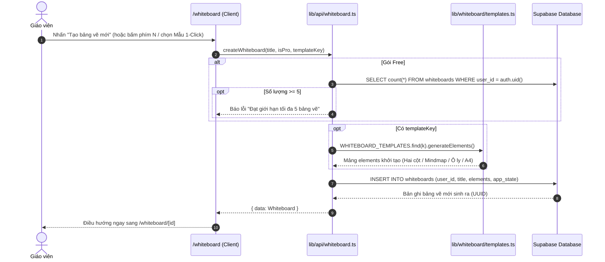
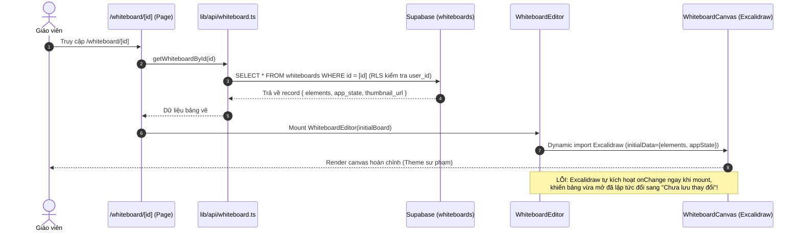
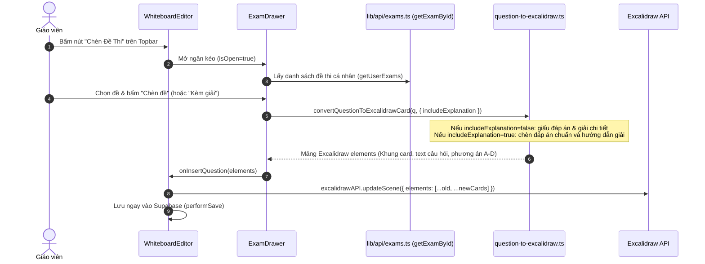

# BÁO CÁO AUDIT AN NINH, KIẾN TRÚC & CHẤT LƯỢNG: MODULE BẢNG TRẮNG SƯ PHẠM (/whiteboard)

**Dự án:** EduTest AI (Hệ thống tạo đề thi AI chuẩn Bộ GD&ĐT 2025, chấm OMR, bảng trắng tương tác Excalidraw)  
**Phạm vi audit:** Tuyến đường `/whiteboard` (`localhost:3001/whiteboard`), `/whiteboard/[id]` và phân hệ Bục Giảng Số `/teach/[examId]`:
- Trang danh mục bảng vẽ: `frontend/src/app/(dashboard)/whiteboard/page.tsx`
- Trang vẽ chi tiết: `frontend/src/app/whiteboard/[id]/page.tsx`, `frontend/src/components/whiteboard/whiteboard-editor.tsx`
- Canvas Excalidraw: `frontend/src/components/whiteboard/whiteboard-canvas.tsx`
- Kho đề thi & Chèn câu hỏi: `frontend/src/components/whiteboard/exam-drawer.tsx`, `frontend/src/lib/whiteboard/question-to-excalidraw.ts`
- Thư viện STEM & Mẫu sư phạm: `frontend/src/lib/whiteboard/stem-libraries.ts`, `frontend/src/lib/whiteboard/templates.ts`, `board-themes.ts`
- Công cụ lớp học (Timer, Laser, Zen): `frontend/src/components/whiteboard/floating-classroom-tools.tsx`
- API lưu trữ & tích hợp Bục Giảng: `frontend/src/lib/api/whiteboard.ts`, `frontend/src/app/teach/[examId]/page.tsx`
- Cơ sở dữ liệu: `supabase/migrations/20261030_whiteboards.sql`, bảng `public.whiteboards`  
**Chế độ:** READ-ONLY AUDIT (Chỉ đọc mã nguồn thực tế, không sửa code, không commit)  
**Ngày thực hiện:** 01/11/2026  
**Chuyên viên đánh giá:** Senior Full-stack Engineer & Security Reviewer  

---

## BƯỚC 1: TRUY VẾT LUỒNG HOẠT ĐỘNG END-TO-END

### 1.1 Danh mục File, Router & Trách nhiệm thành phần

| Tên thành phần / Chức năng | Đường dẫn File thực tế | Dòng liên quan | Trách nhiệm chính |
| :--- | :--- | :--- | :--- |
| **Trang danh mục `/whiteboard`** | `frontend/src/app/(dashboard)/whiteboard/page.tsx` | L1 - L676 | Danh sách bảng vẽ, 4 thẻ thống kê, 4 mẫu 1-Click, quota gói Free, tìm kiếm, lọc yêu thích, phím tắt `N` |
| **Studio bảng vẽ `/whiteboard/[id]`** | `frontend/src/app/whiteboard/[id]/page.tsx` | L1 - L138 | Khởi tạo trang, kiểm tra quyền truy cập (bị bypass bởi `?audit=true`), bọc `Suspense` và gọi `WhiteboardEditor` |
| **Bộ điều khiển trung tâm Editor** | `frontend/src/components/whiteboard/whiteboard-editor.tsx` | L1 - L742 | Quản lý auto-save debounce 2.5s, sinh thumbnail WebP base64, đổi theme sư phạm, Zen mode, chèn đề thi |
| **Canvas Excalidraw Hybrid** | `frontend/src/components/whiteboard/whiteboard-canvas.tsx` | L1 - L119 | Nhúng `@excalidraw/excalidraw` (dynamic ssr: false), nạp STEM Library cho gói PRO, bắt sự kiện `onChange` |
| **Ngăn kéo kho đề (Exam Drawer)** | `frontend/src/components/whiteboard/exam-drawer.tsx` | L1 - L394 | Duyệt đề thi cá nhân (`getUserExams`) và đề Marketplace; chèn câu hỏi đơn lẻ hoặc chèn toàn bộ đề |
| **Chuyển đổi câu hỏi sang Card** | `frontend/src/lib/whiteboard/question-to-excalidraw.ts` | L1 - L255 | Tính toán tọa độ, bao gói văn bản (`wrapText`), sinh khung câu hỏi, phương án và lời giải dạng vector |
| **Mẫu Sư Phạm 1-Click** | `frontend/src/lib/whiteboard/templates.ts` | L1 - L457 | Khởi tạo 4 cấu trúc: *Hai cột (Đề & Giải)*, *Sơ đồ tư duy (Mindmap)*, *Ô ly 5mm*, *Khổ giấy A4 (794x1123px)* |
| **Thư viện STEM (Pro)** | `frontend/src/lib/whiteboard/stem-libraries.ts` | L1 - L348 | Chứa vector mẫu: Trục toạ độ Oxy, Vector lực F, Mạch điện, Thước đo; nạp trực tiếp ở client |
| **Thanh công cụ lớp học (Classroom)** | `frontend/src/components/whiteboard/floating-classroom-tools.tsx` | L1 - L349 | Đồng hồ đếm giờ 2 phút (Web Audio chime), nút Laser (**bị rỗng logic**), nút Fullscreen Zen Mode |
| **Tích hợp Bục Giảng Số (`/teach`)** | `frontend/src/app/teach/[examId]/page.tsx`<br/>`frontend/src/lib/api/whiteboard.ts` | L180 - L297 (`api`)<br/>L370 - L420 (`teach`) | Lưu trữ nét vẽ phân tách theo từng câu hỏi của đề thi (`teach_mode:[examId]`), cơ chế LocalStorage + Supabase |
| **Migration & RLS Database** | `supabase/migrations/20261030_whiteboards.sql` | L1 - L56 | Bảng `public.whiteboards`, 4 RLS policies (`auth.uid() = user_id`), trigger cập nhật `updated_at` |

---

### 1.2 Nguồn gốc dữ liệu của các con số trên Trang danh mục

Trong `frontend/src/app/(dashboard)/whiteboard/page.tsx:169-179`:
1. **Tổng bảng vẽ (`whiteboards.length`):** Số lượng bản ghi trả về từ `getUserWhiteboards()`. Hiển thị nhãn `(Không giới hạn)` nếu là PRO/MAX, hoặc `(Tối đa 5)` nếu là Free.
2. **Tổng nét vẽ (`totalElements`):** Tính bằng `whiteboards.reduce((acc, b) => acc + (b.elements?.length || 0), 0)`. **Cực kỳ nguy hiểm về hiệu năng**: `getUserWhiteboards()` dùng `select("*")` tải toàn bộ mảng JSONB `elements` của tất cả các bảng về client chỉ để đếm độ dài mảng.
3. **Yêu thích:** Đếm số bảng có `is_favorite === true` trong mảng local.
4. **Lần vẽ gần nhất:** Lấy `updated_at` của phần tử đầu tiên `whiteboards[0]` (đã được sắp xếp `order("updated_at", { ascending: false })` từ Supabase).
5. **Số nét vẽ trên từng thẻ bảng:** Đọc trực tiếp từ `(board.elements as any[])?.length || 0`.

---

### 1.3 Sơ đồ các luồng hoạt động chính

#### (a) Tạo bảng vẽ mới (Phím N hoặc Mẫu 1-Click)


#### (b) Mở bảng vẽ & Nạp dữ liệu cảnh (Scene Loading)


#### (c) Chu kỳ Lưu tự động (Auto-save Debounce & Sinh Thumbnail)
```mermaid
sequenceDiagram
    autonumber
    actor Teacher as Giáo viên
    participant Excalidraw as Excalidraw Canvas
    participant Editor as WhiteboardEditor
    participant Storage as LocalStorage
    participant ExcalLib as @excalidraw/excalidraw (exportToBlob)
    participant Supabase as Supabase (updateWhiteboard)

    Teacher->>Excalidraw: Vẽ nét mới / Di chuyển hình
    Excalidraw->>Editor: handleCanvasChange(elements, appState)
    Editor->>Editor: setSaveStatus("unsaved")
    Editor->>Editor: Kích hoạt Debounce Timer (2.5 giây)
    Note over Editor: Người dùng dừng thao tác đủ 2.5s
    Editor->>Storage: Lưu bản sao dự phòng local: edteach_wb_[id]
    opt Số lượng nét vẽ thay đổi
        Editor->>ExcalLib: exportToBlob({ elements, mimeType: "image/webp", quality: 0.55 })
        ExcalLib-->>Editor: WebP Blob thu nhỏ
        Editor->>Editor: FileReader sinh base64 Data URL (data:image/webp;base64,...)
    end
    Editor->>Supabase: UPDATE whiteboards SET elements, app_state, thumbnail_url
    Supabase-->>Editor: Thành công
    Editor->>Editor: setSaveStatus("saved") (Hiện mây xanh "Đã lưu")
```

#### (d) Chèn câu hỏi từ Kho Đề Thi ("Chèn Đề Thi")


#### (e) Tích hợp Bục Giảng Số (`/teach/[examId]` ↔ `public.whiteboards`)
- Khi giáo viên vào Bục Giảng Số (`/teach/[examId]`):
  1. Nạp nét vẽ đã lưu từ `localStorage.getItem("edteach_teach_drawings_" + examId)`.
  2. Nếu rỗng, tải từ `public.whiteboards` với điều kiện `description = "teach_mode:" + examId`.
  3. Khi vẽ, nét vẽ được lưu vào từng câu hỏi (`drawingsMap[qId]`).
  4. Hệ thống đồng bộ ngầm bằng cách `INSERT` hoặc `UPDATE` một dòng vào bảng `public.whiteboards` với tiêu đề `"Bục giảng: ..."` và `description = "teach_mode:[examId]"`.
  5. **Xung đột kiến trúc:** Bản ghi này không bị loại trừ khỏi `/whiteboard`, làm xuất hiện các thẻ "Bục giảng" trong danh sách bảng vẽ tự do và vô tình ngốn hạn mức 5 bảng của tài khoản Free!

---

## BƯỚC 2: KIỂM TRA BẢO MẬT & PHÂN QUYỀN (SECURITY AUDIT)

### 2.1 Tuyến đường `/whiteboard` bị bỏ quên trong Middleware (TRÙNG SEC-05)
- **Vị trí:** [`frontend/src/middleware.ts:66-74`](file:///d:/Go-Live/Web/EdTeach/frontend/src/middleware.ts#L66-L74)
- **Mô tả:** Mảng `matcher` của Next.js Middleware chỉ bảo vệ `/dashboard/:path*`, `/exams/:path*`, `/wallet/:path*`, `/settings/:path*`. Cả `/whiteboard` lẫn `/whiteboard/:path*` đều không được khai báo.
- **Tác động:** Khách vãng lai chưa đăng nhập có thể truy cập thẳng vào trang `/whiteboard/[id]`. Toàn bộ bundle mã nguồn Excalidraw (~2MB JS) được tải về máy khách trước khi lệnh chuyển hướng `router.push("/login")` ở tầng React kịp chạy.

### 2.2 Lỗ hổng Bypass Auth qua tham số URL `?audit=true`
- **Vị trí:** [`frontend/src/app/whiteboard/[id]/page.tsx:26-35`](file:///d:/Go-Live/Web/EdTeach/frontend/src/app/whiteboard/[id]/page.tsx#L26-L35)
- **Mô tả:** Mã nguồn tồn tại cửa hậu (backdoor/audit bypass):
  ```tsx
  const isAuditMode =
    typeof window !== "undefined" &&
    (window.location.search.includes("audit=true") ||
      localStorage.getItem("edteach_audit") === "true" ||
      document.cookie.includes("audit=true"));

  if (!user && !isAuditMode) {
    router.push("/login");
    return;
  }
  ```
- **Khai thác / Tác động:** Bất kỳ ai không cần tài khoản chỉ cần gõ `http://localhost:3001/whiteboard/bat-ky-id-nao?audit=true` là có thể vượt qua toàn bộ cơ chế bắt buộc đăng nhập, mở ra một bảng vẽ hoạt động đầy đủ tính năng.

### 2.3 Quota Gói Free (5 Bảng) hoàn toàn được kiểm tra ở Client (Client-Enforced Quota)
- **Vị trí:** [`frontend/src/lib/api/whiteboard.ts:49-72`](file:///d:/Go-Live/Web/EdTeach/frontend/src/lib/api/whiteboard.ts#L49-L72)<br/>[`supabase/migrations/20261030_whiteboards.sql:24-42`](file:///d:/Go-Live/Web/EdTeach/supabase/migrations/20261030_whiteboards.sql#L24-L42)
- **Mô tả:** Hàm `createWhiteboard(title, isPro, templateKey)` nhận tham số `isPro` do chính client truyền lên. Trong khi đó, ở tầng Database:
  ```sql
  CREATE POLICY "Users can create their own whiteboards"
      ON public.whiteboards FOR INSERT
      WITH CHECK (auth.uid() = user_id);
  ```
  Database RLS **hoàn toàn không có hàm kiểm tra số lượng bản ghi** hay kiểm tra trạng thái thuê bao `tier = 'pro'`.
- **Khai thác / Tác động:** Người dùng gói Free có thể mở DevTools Console hoặc gửi request REST API trực tiếp vào Supabase để chèn hàng nghìn bảng vẽ vượt qua giới hạn 5 bảng mà không gặp bất kỳ trở ngại nào từ server.

### 2.4 Không giới hạn dung lượng Payload & Nguy cơ làm phình Database (Denial of Storage)
- **Vị trí:** [`frontend/src/lib/api/whiteboard.ts:120-134`](file:///d:/Go-Live/Web/EdTeach/frontend/src/lib/api/whiteboard.ts#L120-L134)<br/>[`frontend/src/components/whiteboard/whiteboard-editor.tsx:149-172`](file:///d:/Go-Live/Web/EdTeach/frontend/src/components/whiteboard/whiteboard-editor.tsx#L149-L172)
- **Mô tả:** 
  1. Cột `thumbnail_url` trong bảng `public.whiteboards` là kiểu `TEXT` và đang lưu trực tiếp **chuỗi base64 Data URL** của ảnh WebP thay vì URL ảnh trên Supabase Storage.
  2. Hàm `updateWhiteboard` ghi trực tiếp mảng JSONB `elements` vào database mà không có bất kỳ bộ lọc Zod schema hay giới hạn độ dài mảng/kích thước byte (ví dụ: giới hạn 2MB).
- **Tác động:** Một tài khoản người dùng có thể lưu các cảnh vẽ chứa hàng chục nghìn đối tượng hoặc bơm dữ liệu base64 khổng lồ, làm cạn kiệt dung lượng ổ đĩa PostgreSQL và gây nghẽn kết nối DB.

### 2.5 Mất trắng ảnh nhúng (Embedded Images) do bỏ quên tham số `files`
- **Vị trí:** [`frontend/src/components/whiteboard/whiteboard-canvas.tsx:78-83, 86-98`](file:///d:/Go-Live/Web/EdTeach/frontend/src/components/whiteboard/whiteboard-canvas.tsx#L78-L83)<br/>[`frontend/src/components/whiteboard/whiteboard-editor.tsx:121-124`](file:///d:/Go-Live/Web/EdTeach/frontend/src/components/whiteboard/whiteboard-editor.tsx#L121-L124)
- **Mô tả:** Trong Excalidraw, khi người dùng dán hoặc chèn ảnh vào bảng vẽ, dữ liệu ảnh nhị phân được lưu trữ trong đối tượng `files: BinaryFiles`. Tuy nhiên:
  - Hàm `handleExcalidrawChange` chỉ nhận `(elements, appState)` và **bỏ qua hoàn toàn đối số thứ 3 `files`**.
  - `initialData` chỉ nạp `{ elements, appState }` mà không truyền `files`.
  - Bảng `public.whiteboards` không có cột `files JSONB`.
- **Hậu quả:** Giáo viên chèn ảnh chụp đề bài, đồ thị toán hoặc hình minh họa vào bảng vẽ, sau khi F5 hoặc tải lại trang thì **toàn bộ hình ảnh biến thành ô vuông báo lỗi (broken image placeholder)**.

### 2.6 Khóa Thư viện STEM ở Client (Client-Side DRM)
- **Vị trí:** [`frontend/src/components/whiteboard/whiteboard-canvas.tsx:61-73`](file:///d:/Go-Live/Web/EdTeach/frontend/src/components/whiteboard/whiteboard-canvas.tsx#L61-L73)<br/>[`frontend/src/lib/whiteboard/stem-libraries.ts`](file:///d:/Go-Live/Web/EdTeach/frontend/src/lib/whiteboard/stem-libraries.ts)
- **Mô tả:** Thư viện STEM được quảng cáo là *"Đặc quyền gói PRO"*, nhưng toàn bộ dữ liệu vector của thư viện nằm ngay trong file JavaScript tĩnh tải về máy khách. Việc kiểm tra chỉ đơn thuần là `if (isPro) updateLibrary(...)`.
- **Tác động:** Bất kỳ ai dùng tài khoản Free đều có thể mở console và nạp toàn bộ thư viện STEM vào Excalidraw bằng một dòng lệnh JavaScript.

### 2.7 Rò rỉ CDN ngoài & Phụ thuộc unpkg.com của Excalidraw
- **Vị trí:** `@excalidraw/excalidraw` (không cấu hình `window.EXCALIDRAW_ASSET_PATH`)
- **Mô tả:** Excalidraw v0.18 mặc định tải phông chữ (Virgil, Cascadia) và web worker từ `https://unpkg.com`. Dự án hoàn toàn không thiết lập đường dẫn tài nguyên nội bộ.
- **Tác động:**
  1. Khi máy chiếu lớp học bị ngắt internet hoặc mạng trường học chặn `unpkg.com`, toàn bộ phông chữ bảng vẽ sẽ bị lỗi vỡ hạt.
  2. Trình duyệt liên tục gửi request ra máy chủ bên thứ ba (unpkg.com), làm rò rỉ địa chỉ IP người dùng.
  3. Khi thiết lập Content Security Policy (CSP), trang vẽ sẽ bị lỗi nếu không cho phép kết nối tới `unpkg.com`.

### 2.8 Lỗ hổng phụ thuộc bảo mật (npm audit)
- **Kết quả rà soát:** Phát hiện **27 lỗ hổng** trong các gói phụ thuộc frontend, trong đó có **2 lỗ hổng High**:
  - `lodash-es <= 4.17.23`: Rủi ro Code Injection và Prototype Pollution qua `_.template`.
  - `nanoid <= 3.3.17`: Vòng lặp vô hạn và tràn số nguyên trong gói phụ thuộc của `@excalidraw/excalidraw`.

---

## BƯỚC 3: KIỂM TRA BACKEND & DỮ LIỆU

### 3.1 Overfetching nghiêm trọng tại Trang danh mục
- **Vị trí:** [`frontend/src/lib/api/whiteboard.ts:15-18`](file:///d:/Go-Live/Web/EdTeach/frontend/src/lib/api/whiteboard.ts#L15-L18)
- **Mô tả:** Truy vấn `getUserWhiteboards()` sử dụng:
  ```ts
  supabase.from("whiteboards").select("*").eq("user_id", user.id).order("updated_at", { ascending: false });
  ```
- **Hậu quả:** `select("*")` kéo toàn bộ mảng `elements` (hàng nghìn nét vẽ) và toàn bộ chuỗi base64 `thumbnail_url` của **tất cả** các bảng vẽ trong tài khoản về máy. Không có phân trang (`limit`, `range`). Nếu giáo viên có 20 bảng vẽ, dung lượng JSON tải về có thể vượt quá 30–50 MB, làm treo giao diện.
- **Đề xuất:** Chỉ select metadata: `.select("id, title, description, thumbnail_url, is_favorite, created_at, updated_at")`.

### 3.2 Xung đột kiến trúc giữa Bục Giảng Số (`/teach`) và Bảng Trắng Tự Do (`/whiteboard`)
- **Vị trí:** [`frontend/src/lib/api/whiteboard.ts:283-291`](file:///d:/Go-Live/Web/EdTeach/frontend/src/lib/api/whiteboard.ts#L283-L291)
- **Mô tả:** Khi giáo viên giảng bài trên Bục Giảng Số (`/teach/[examId]`), hệ thống tự động sinh một dòng trong bảng `public.whiteboards` với `description: "teach_mode:[examId]"`. 
- **Hậu quả:** 
  1. Trang `/whiteboard` không lọc bỏ tiền tố `teach_mode:`, khiến các bản ghi phụ trợ này hiển thị lẫn lộn như các bảng vẽ thông thường.
  2. Các bản ghi này ngốn luôn hạn mức 5 bảng vẽ của người dùng Free, khiến họ không thể tạo bảng vẽ mới.

### 3.3 Thiếu cơ chế Khóa lạc quan (Optimistic Concurrency Control)
- Khi một giáo viên mở cùng một bảng vẽ trên 2 tab trình duyệt hoặc trên máy tính và iPad:
  - Cả 2 thiết bị đều tự động auto-save độc lập sau mỗi 2.5 giây.
  - Tab nào gửi request sau cùng sẽ đè bẹp toàn bộ nội dung của tab trước đó (`last-write-wins`).
  - Bảng `public.whiteboards` không có cột `version INT` để phát hiện và ngăn chặn ghi đè mất dữ liệu.

---

## BƯỚC 4: KIỂM TRA FRONTEND & TRẢI NGHIỆM SƯ PHẠM

### 4.1 Bảng vừa mở đã báo "Chưa lưu thay đổi" (Lỗi cờ trạng thái)
- **Vị trí:** [`frontend/src/components/whiteboard/whiteboard-editor.tsx:208-222`](file:///d:/Go-Live/Web/EdTeach/frontend/src/components/whiteboard/whiteboard-editor.tsx#L208-L222)
- **Nguyên nhân gốc:** Excalidraw tự động kích hoạt callback `onChange` ngay trong lần render đầu tiên khi khởi tạo viewport (`scrollX`, `scrollY`, `zoom`). Hàm `handleCanvasChange` không phân biệt được thao tác thật của người dùng với sự kiện mount ban đầu, dẫn đến việc lập tức gán `setSaveStatus("unsaved")` và lên lịch auto-save sau 2.5 giây.
- **Hậu quả:** Người dùng chỉ vừa mở bảng lên xem, chưa chạm vào bút vẽ, giao diện đã nhấp nháy chuyển sang màu cam "Chưa lưu thay đổi" và âm thầm gửi request ghi đè database.

### 4.2 Nút "Bút Laser" là tính năng giả mạo (Placebo / Dead UI)
- **Vị trí:** [`frontend/src/components/whiteboard/whiteboard-editor.tsx:117, 725-726`](file:///d:/Go-Live/Web/EdTeach/frontend/src/components/whiteboard/whiteboard-editor.tsx#L117)
- **Mô tả:** Biến `isLaserActive` được định nghĩa trong `whiteboard-editor.tsx` và truyền vào `FloatingClassroomTools`. Khi bấm nút, icon chuyển sang màu đỏ nhấp nháy, nhưng biến này **không hề được truyền vào `WhiteboardCanvas` hay Excalidraw**.
- **Hậu quả:** Giáo viên bấm nút Laser nhưng con trỏ chuột không có bất kỳ vệt laser hay chấm đỏ nào trên bảng vẽ.

### 4.3 Menu Excalidraw chưa Việt hóa & Chứa liên kết mạng xã hội ngoài
- **Vị trí:** [`frontend/src/components/whiteboard/whiteboard-canvas.tsx:102-116`](file:///d:/Go-Live/Web/EdTeach/frontend/src/components/whiteboard/whiteboard-canvas.tsx#L102-L116)
- **Mô tả:** Excalidraw không được cấu hình `langCode: "vi-VN"`. Toàn bộ menu hệ thống hiển thị tiếng Anh (*Open, Save to, Reset the canvas, Live collaboration...*). Ngoài ra, menu hamburger chứa các liên kết mặc định dẫn ra *GitHub, Discord, Twitter/X*, không phù hợp với môi trường lớp học chuẩn mực.

### 4.4 Mẫu A4 không có tính năng Xuất PDF chuẩn khổ
- **Vị trí:** [`frontend/src/lib/whiteboard/templates.ts:395-456`](file:///d:/Go-Live/Web/EdTeach/frontend/src/lib/whiteboard/templates.ts#L395-L456)
- **Mô tả:** Mẫu "Khổ giấy A4 chuẩn in ấn" vẽ một hình chữ nhật tỷ lệ $794 \times 1123$ px. Tuy nhiên, tính năng Export của Excalidraw chỉ hỗ trợ xuất PNG/SVG theo bounding box của tất cả phần tử trong cảnh vẽ, không có nút "Xuất trang PDF A4" thực sự như quảng cáo.

---

## BƯỚC 5: BẢNG TỔNG HỢP VẤN ĐỀ & LỖI BẢNG TRẮNG (/whiteboard)

| ID | Mức độ | Hạng mục | File : Dòng | Mô tả lỗi | Tác động | Cách tái hiện | Đề xuất sửa | Công sức | Trùng ID cũ |
| :--- | :--- | :--- | :--- | :--- | :--- | :--- | :--- | :---: | :--- |
| **WBD-01** | **Critical** | Phân quyền DB | [`lib/api/whiteboard.ts:49-72`](file:///d:/Go-Live/Web/EdTeach/frontend/src/lib/api/whiteboard.ts#L49-L72)<br/>[`20261030_whiteboards.sql`](file:///d:/Go-Live/Web/EdTeach/supabase/migrations/20261030_whiteboards.sql) | Giới hạn 5 bảng gói Free chỉ kiểm tra ở Client; RLS cho phép INSERT vô hạn | Người dùng Free tạo hàng chục nghìn bảng vẽ miễn phí bằng script | Mở console gọi `supabase.from('whiteboards').insert(...)` | Tạo trigger hoặc hàm PostgreSQL RLS kiểm tra quota dựa trên `tier` của user | M | Mới |
| **WBD-02** | **Critical** | Thất thoát dữ liệu | [`whiteboard-canvas.tsx:78-83`](file:///d:/Go-Live/Web/EdTeach/frontend/src/components/whiteboard/whiteboard-canvas.tsx#L78-L83)<br/>[`whiteboard-editor.tsx:121-124`](file:///d:/Go-Live/Web/EdTeach/frontend/src/components/whiteboard/whiteboard-editor.tsx#L121-L124) | Bỏ quên đối số `files` của Excalidraw; không lưu trữ file ảnh nhúng | Toàn bộ hình ảnh giáo viên chèn vào bảng vẽ bị biến mất sau khi F5 | Dán 1 ảnh chụp vào bảng, nhấn F5 -> ảnh thành ô vuông lỗi | Bổ sung cột `files JSONB` trong DB, lưu trữ và nạp `files` qua `onChange` & `initialData` | M | Mới |
| **WBD-03** | **High** | Định tuyến & Auth | [`middleware.ts:66-74`](file:///d:/Go-Live/Web/EdTeach/frontend/src/middleware.ts#L66-L74) | Tuyến đường `/whiteboard` và `/whiteboard/:path*` bị bỏ sót trong `matcher` | Khách vãng lai truy cập thẳng studio bảng vẽ không qua kiểm soát phiên | Mở `/whiteboard/any-uuid` khi chưa đăng nhập -> tải toàn bộ JS Excalidraw | Thêm `"/whiteboard/:path*"` vào mảng `matcher` trong `middleware.ts` | S | **TRÙNG SEC-05** |
| **WBD-04** | **High** | Cửa hậu Auth | [`whiteboard/[id]/page.tsx:26-35`](file:///d:/Go-Live/Web/EdTeach/frontend/src/app/whiteboard/[id]/page.tsx#L26-L35) | Tham số URL `?audit=true` cho phép bất kỳ ai bypass màn hình đăng nhập | Khách chưa có tài khoản tự do sử dụng studio bảng vẽ không cần đăng ký | Truy cập `/whiteboard/demo-uuid?audit=true` trên tab ẩn danh | Xóa bỏ hoàn toàn nhánh kiểm tra `isAuditMode` trên môi trường Production | S | Mới |
| **WBD-05** | **High** | Hiệu năng DB | [`lib/api/whiteboard.ts:15-18`](file:///d:/Go-Live/Web/EdTeach/frontend/src/lib/api/whiteboard.ts#L15-L18)<br/>[`whiteboard/page.tsx:174-177`](file:///d:/Go-Live/Web/EdTeach/frontend/src/app/(dashboard)/whiteboard/page.tsx#L174-L177) | `getUserWhiteboards()` dùng `select("*")` kéo toàn bộ mảng vectors & base64 về danh mục | Overfetching nghiêm trọng (vài chục MB JSON), gây lag trình duyệt khi mở trang danh mục | Mở tab Network khi vào `/whiteboard`, xem kích thước payload | Chỉ select các cột metadata, thêm cột `elements_count INT` để đếm nét vẽ | M | Mới |
| **WBD-06** | **High** | Kiến trúc dữ liệu | [`lib/api/whiteboard.ts:283-291`](file:///d:/Go-Live/Web/EdTeach/frontend/src/lib/api/whiteboard.ts#L283-L291) | Nét vẽ Bục Giảng Số (`teach_mode:`) lưu chung bảng và ngốn quota 5 bảng của tài khoản Free | Dùng Bục Giảng trên 5 đề thi khiến giáo viên bị khóa không thể tạo bảng vẽ mới | Dùng bục giảng 5 lần với tài khoản Free, sau đó vào `/whiteboard` bấm tạo mới -> bị chặn | Tách bảng riêng `exam_teach_drawings` hoặc lọc điều kiện `NOT LIKE 'teach_mode:%'` | M | Mới |
| **WBD-07** | **Medium** | Lỗi cờ trạng thái | [`whiteboard-editor.tsx:208-222`](file:///d:/Go-Live/Web/EdTeach/frontend/src/components/whiteboard/whiteboard-editor.tsx#L208-L222) | Excalidraw bắn `onChange` ngay khi mount, khiến bảng vừa mở đã báo "Chưa lưu thay đổi" | Gây hoang mang cho người dùng và phát sinh một lượt ghi DB thừa sau mỗi lần xem | Mở bất kỳ bảng vẽ nào, không chạm vào màn hình -> thấy nhãn cam "Chưa lưu thay đổi" | Đặt cờ `isMountedRef` bỏ qua sự kiện `onChange` đầu tiên lúc khởi tạo | S | Mới |
| **WBD-08** | **Medium** | Phân quyền Client | [`whiteboard-canvas.tsx:61-73`](file:///d:/Go-Live/Web/EdTeach/frontend/src/components/whiteboard/whiteboard-canvas.tsx#L61-L73)<br/>[`stem-libraries.ts`](file:///d:/Go-Live/Web/EdTeach/frontend/src/lib/whiteboard/stem-libraries.ts) | Toàn bộ Thư viện STEM nhúng thẳng trong bundle JS client, kiểm tra `isPro` ở giao diện | Người dùng Free dễ dàng mở khóa thư viện trả phí qua console | Mở console chạy lệnh nạp thư viện `STEM_LIBRARY_ITEMS` | Lưu thư viện trên private API và chỉ trả về vector khi user có token xác thực PRO | M | Mới |
| **WBD-09** | **Medium** | Tính năng rỗng | [`whiteboard-editor.tsx:117, 725-726`](file:///d:/Go-Live/Web/EdTeach/frontend/src/components/whiteboard/whiteboard-editor.tsx#L117) | Nút "Bút Laser" là nút bấm giả, không kết nối tới Excalidraw hay Canvas overlay | Giáo viên bấm nút Laser nhưng không có hiệu ứng chỉ điểm laser trên bảng | Bấm nút Laser ở thanh dưới, di chuột trên bảng -> con trỏ chuột bình thường | Kết nối `onToggleLaser` với Excalidraw API: `excalidrawAPI.setActiveTool({ type: 'laser' })` | S | Mới |
| **WBD-10** | **Medium** | Phụ thuộc CDN | `@excalidraw/excalidraw` (không có `EXCALIDRAW_ASSET_PATH`) | Excalidraw tải phông chữ và worker từ máy chủ ngoài `unpkg.com` | Lỗi vỡ giao diện bảng vẽ khi mạng trường học chặn unpkg hoặc không có internet | Ngắt kết nối internet khi đang mở bảng -> phông chữ và công cụ bị lỗi | Tải assets về thư mục `public/excalidraw/` và cấu hình `window.EXCALIDRAW_ASSET_PATH` | M | Mới |
| **WBD-11** | **Low** | Ngôn ngữ & UX | [`whiteboard-canvas.tsx:102-116`](file:///d:/Go-Live/Web/EdTeach/frontend/src/components/whiteboard/whiteboard-canvas.tsx#L102-L116) | Menu Excalidraw hiển thị tiếng Anh và chứa liên kết ngoài (GitHub, Discord, Twitter) | Trải nghiệm lớp học chưa bản địa hóa, gây phân tâm cho học sinh và giáo viên | Bấm vào menu 3 gạch Excalidraw -> toàn bộ mục bằng tiếng Anh | Thêm `langCode: "vi-VN"` và ẩn các liên kết mạng xã hội qua cấu hình `UIOptions` | S | Mới |
| **WBD-12** | **Low** | Lỗ hổng phụ thuộc | `package.json` (`lodash-es`, `nanoid`) | `npm audit` phát hiện 2 lỗ hổng High trong các thư viện phụ thuộc | Rủi ro Code Injection và Prototype Pollution qua template imports | Chạy lệnh `npm audit` trong thư mục `frontend` | Cập nhật phiên bản các gói phụ thuộc tương thích | S | Mới |

---

## BƯỚC 6: KẾ HOẠCH HÀNH ĐỘNG TRƯỚC VÀ SAU GO-LIVE

### 6.1 Top 5 Việc Bắt Buộc Trước Go-Live (Blockers)
1. **[BLOCKER 1 - Khắc phục Mất ảnh nhúng WBD-02]:** Thêm cột `files JSONB DEFAULT '{}'::jsonb` vào bảng `public.whiteboards`; cập nhật `WhiteboardCanvas` để nhận và lưu trữ `files` song song với `elements`.
2. **[BLOCKER 2 - Bảo vệ Tuyến đường Middleware WBD-03]:** Bổ sung `"/whiteboard/:path*"` vào mảng `matcher` của `frontend/src/middleware.ts` và gỡ bỏ hoàn toàn cửa hậu `?audit=true` tại `page.tsx` (**WBD-04**).
3. **[BLOCKER 3 - Khắc phục Overfetching Danh mục WBD-05]:** Sửa `getUserWhiteboards()` chỉ truy vấn các cột thông tin chung (bỏ `elements` và `app_state`), đồng thời lưu `thumbnail_url` là URL ảnh hoặc thumbnail WebP nhẹ dưới 10KB.
4. **[BLOCKER 4 - Sửa Lỗi Cờ Trạng thái Lưu WBD-07]:** Dùng `isInitialMountRef` để bỏ qua sự kiện `onChange` tự phát sinh của Excalidraw lúc khởi tạo, giữ nguyên trạng thái "Đã lưu" màu xanh khi người dùng vừa mở bảng.
5. **[BLOCKER 5 - Tách biệt Bục Giảng Số và Bảng Trắng WBD-06]:** Lọc bỏ các bảng vẽ có tiền tố `teach_mode:` khỏi màn hình danh sách `/whiteboard` để không làm cạn kiệt hạn mức 5 bảng của tài khoản Free.

### 6.2 Việc nên làm trong 2 tuần đầu sau Launch
1. **Chuyển Assets Excalidraw về Localhost (WBD-10):** Tải font và worker của Excalidraw về `public/excalidraw-assets/` để ứng dụng hoạt động 100% offline không phụ thuộc `unpkg.com`.
2. **Kích hoạt Bút Laser thật (WBD-09):** Nối lệnh bấm Laser với `excalidrawAPI.setActiveTool({ type: "laser" })`.
3. **Cấu hình Ngôn ngữ Tiếng Việt & Dọn dẹp Menu (WBD-11):** Thêm `langCode: "vi-VN"` và ẩn các nút mạng xã hội trong `UIOptions`.
4. **Kiểm tra Quota Server-side bằng PostgreSQL Trigger (WBD-01):** Viết trigger chặn `INSERT` nếu người dùng gói Free đã có đủ 5 bảng vẽ.
5. **Cơ chế Khóa Lạc quan (Optimistic Locking):** Bổ sung cột `version INT` để cảnh báo khi bảng vẽ bị ghi đè từ tab khác.

### 6.3 Điểm chưa xác minh được & Cần trao đổi thêm
- **Định dạng Export PDF A4:** Hệ thống hiện chưa có backend renderer (ví dụ Puppeteer hoặc thư viện PDF) để xuất chính xác khung A4 ra file `.pdf`. Cần thống nhất xem có bổ sung nút "In / Tải PDF A4" bằng trình duyệt (`window.print`) hay không.
- **Dung lượng lưu trữ tối đa cho mỗi bảng vẽ:** Cần quy định ngưỡng kích thước tối đa cho một cảnh vẽ (ví dụ: cảnh báo khi số nét vẽ vượt quá 2.000 phần tử hoặc dung lượng JSON vượt quá 5MB).
