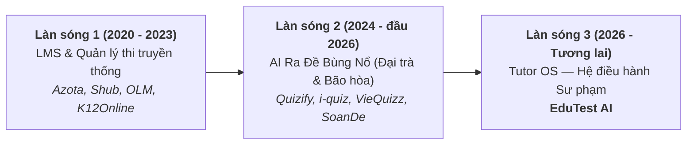
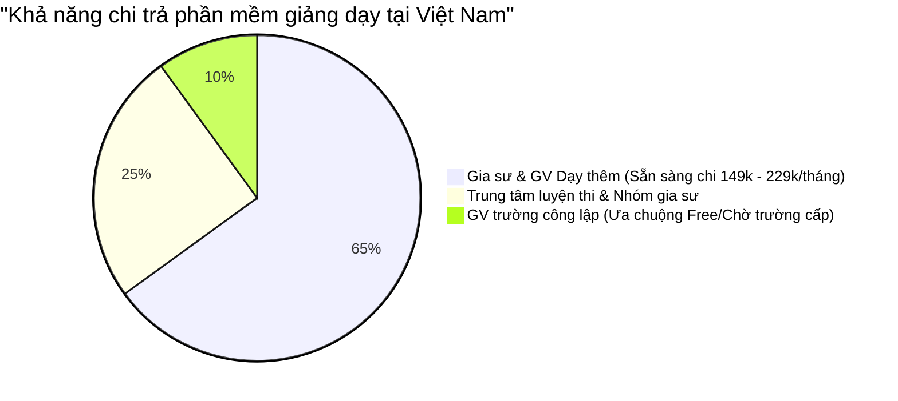
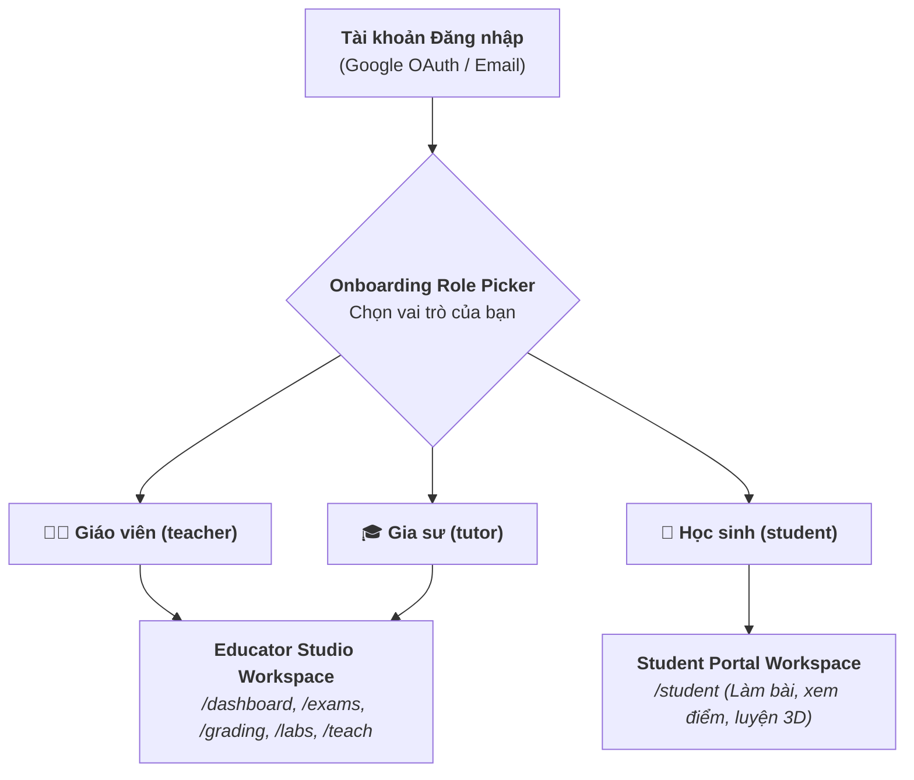
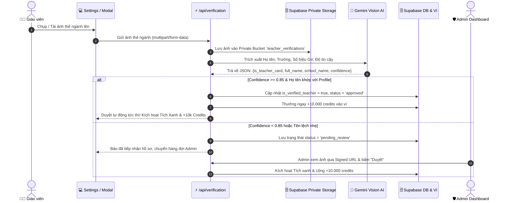
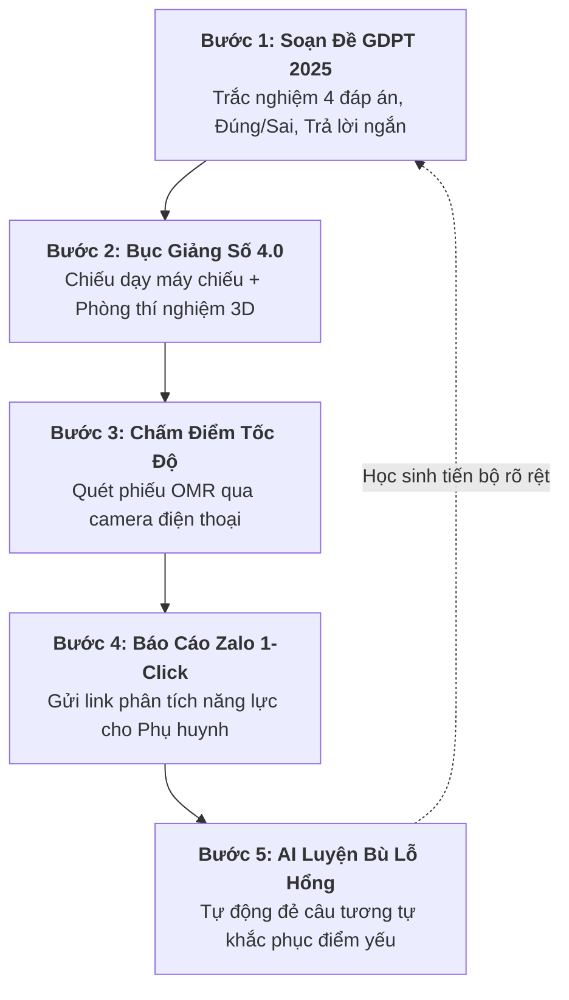
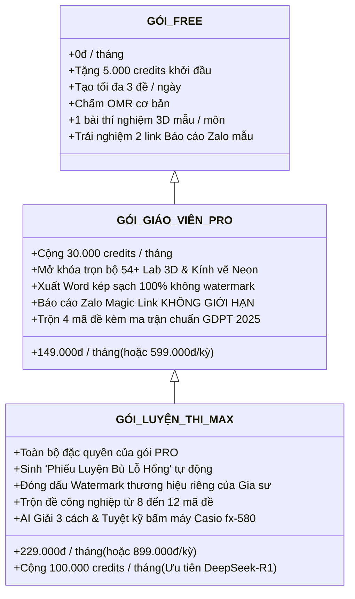
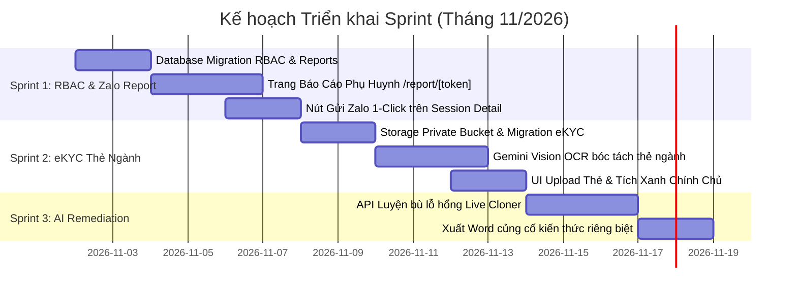

# EDUTEST AI — MASTER STRATEGIC & TECHNICAL BLUEPRINT V2.0
## HỢP NHẤT CHIẾN LƯỢC: TUTOR OS — PHÂN QUYỀN RBAC — XÁC THỰC eKYC THẺ NGÀNH

> **Mã văn kiện:** `docs/EduTest_AI_Master_Blueprint_V2.md`  
> **Phiên bản:** v2.0 Consolidated Master Architecture  
> **Hợp nhất từ 3 tài liệu:**
> 1. `docs/Tutor_OS_Strategic_Plan.md` (Chiến lược Tutor OS & Vòng lặp Sư phạm khép kín)
> 2. `docs/RBAC_User_Roles_Specification.md` (Đặc tả phân quyền Giáo viên - Gia sư - Học sinh)
> 3. `docs/Teacher_Verification_System_Plan.md` (Hệ thống eKYC xác thực thẻ ngành bằng AI Vision)  
> **Trạng thái:** Bản phê duyệt chính thức — Chuẩn bị sẵn sàng triển khai Code Sprint 1.

---

## MỤC LỤC TỔNG THỂ

1. [Chương 1: Bối Cảnh Thị Trường & Định Vị Chiến Lược Tutor OS](#chương-1-bối-cảnh-thị-trường--định-vị-chiến-lược-tutor-os)
2. [Chương 2: Ma Trận Phân Quyền Người Dùng (RBAC Architecture)](#chương-2-ma-trận-phân-quyền-người-dùng-rbac-architecture)
3. [Chương 3: Cơ Chế eKYC Xác Thực Thẻ Ngành Giáo Viên & Gói Đặc Quyền](#chương-3-cơ-chế-ekyc-xác-thực-thẻ-ngành-giáo-viên--gói-đặc-quyền)
4. [Chương 4: Vòng Lặp Sư Phạm Khép Kín & Báo Cáo Zalo Phụ Huynh 1-Click](#chương-4-vòng-lặp-sư-phạm-khép-kín--báo-cáo-zalo-phụ-huynh-1-click)
5. [Chương 5: Thiết Kế Kiến Trúc Kỹ Thuật, Cơ Sở Dữ Liệu & API Contracts](#chương-5-thiết-kế-kiến-trúc-kỹ-thuật-cơ-sở-dữ-liệu--api-contracts)
6. [Chương 6: Mô Hình Thương Mại Hóa & Lộ Trình Triển Khai Sprint](#chương-6-mô-hình-thương-mại-hóa--lộ-trình-triển-khai-sprint)

---

## CHƯƠNG 1: BỐI CẢNH THỊ TRƯỜNG & ĐỊNH VỊ CHIẾN LƯỢC TUTOR OS

### 1.1. Ba làn sóng phát triển của EdTech Việt Nam



* **Làn sóng 1 (LMS quản lý bài tập tĩnh):** Các công cụ như Azota, Shub Classroom thành công thời kỳ COVID để học sinh nộp bài tập về nhà. Tuy nhiên, giao diện đã cũ kỹ, thiếu tính sư phạm tương tác trực tiếp trên lớp và hoàn toàn không giải quyết được bài toán dạy học chương trình mới GDPT 2018/2025.
* **Làn sóng 2 (Bẫy bão hòa "AI tạo đề đại trà"):** Hơn 10+ nền tảng ra mắt tính năng AI gõ prompt ra đề. **Thực tế thị trường:** AI tạo đề hiện chỉ là **điều kiện gia nhập tối thiểu (table stakes)** chứ không còn là lợi thế cạnh tranh độc quyền. Đề AI tự sinh thường xuyên gặp lỗi ảo giác (hallucination), sai công thức Toán/Lý/Hóa. Quan trọng nhất, quy trình bị đứt gãy: Giáo viên soạn ở web A $\rightarrow$ sửa Word $\rightarrow$ in giấy $\rightarrow$ chấm bút đỏ $\rightarrow$ gõ Excel $\rightarrow$ nhắn Zalo phụ huynh.
* **Làn sóng 3 (EduTest AI — Tutor OS):** Giải quyết triệt để sự đứt gãy bằng cách cung cấp một **Hệ điều hành dạy học toàn diện** từ bảng chiếu lớp học, máy chấm bài camera cho đến tin nhắn báo cáo Zalo cho phụ huynh và bài tập bù lỗ hổng kiến thức.

### 1.2. Chân dung khách hàng mục tiêu & Khả năng chi trả (Willingness to Pay)



1. **Gia sư, Giáo viên dạy thêm, Trung tâm luyện thi:**
   * Thu học phí: **500.000đ – 2.000.000đ / học sinh / tháng**.
   * Quy mô lớp: 15 – 30 học sinh $\rightarrow$ Doanh thu từ **10.000.000đ – 40.000.000đ / tháng**.
   * Chi phí sử dụng EduTest AI (149.000đ – 229.000đ/tháng) chỉ chiếm **< 1% doanh thu**.
   * **Nỗi sợ lớn nhất:** Học sinh nghỉ học, phụ huynh nghi ngờ chất lượng giảng dạy.
   * **Đòn bẩy bán hàng:** Sản phẩm giúp gia sư gửi báo cáo Zalo chuyên nghiệp có biểu đồ năng lực $\rightarrow$ Phụ huynh tin tưởng tuyệt đối $\rightarrow$ Giữ chân học sinh lâu dài $\rightarrow$ **ROI gấp 10 lần phí dịch vụ**.

### 1.3. Bốn Hào bảo vệ công nghệ (Moat) của EduTest AI
1. **Bục Giảng Số 4.0:** Chiếu Split-Screen trên máy chiếu (Đề thi phông lớn + Bảng nháp Excalidraw tự lưu nét vẽ + Đồng hồ đếm ngược).
2. **54+ Phòng Thí Nghiệm 3D & Kính Neon:** Mô phỏng chuyển động Vật lý, Hóa học, Sinh học, Địa lý kèm lớp kính vẽ ghi chú đè trực tiếp lên 3D.
3. **Chấm OMR Tự Động Hybrid:** Quét phiếu trắc nghiệm A4 qua camera điện thoại bằng thuật toán OpenCV (tốc độ 0.5s/bài, chi phí 0 đồng token AI).
4. **Vòng lặp Báo Cáo Zalo & Luyện Bù Lỗ Hổng:** Tự động sinh báo cáo gửi phụ huynh và sinh bài tập tương đương củng cố phần kiến thức yếu.

---

## CHƯƠNG 2: MA TRẬN PHÂN QUYỀN NGƯỜI DÙNG (RBAC ARCHITECTURE)

### 2.1. Cấu trúc 4 Vai trò (Roles)
Hệ thống chuẩn hóa trường `role` trong cơ sở dữ liệu gồm 4 nhóm:
1. 👨‍🏫 **Giáo viên (`role = 'teacher'`):** Đứng lớp trường học phổ thông (THCS/THPT), quản lý sĩ số đông (35 - 45 học sinh).
2. 🎓 **Gia sư (`role = 'tutor'`):** Dạy kèm cá nhân, nhóm nhỏ (1 - 15 học sinh), trung tâm luyện thi tư thục.
3. 🎒 **Học sinh (`role = 'student'`):** Học viên tham gia làm bài thi, nộp bài, xem báo cáo năng lực và tự học.
4. 🛡️ **Quản trị viên (`role = 'admin'`):** Vận hành hệ thống, kiểm duyệt hồ sơ thẻ ngành, đối soát thanh toán.



### 2.2. Ma trận phân quyền tính năng chi tiết (Feature Matrix)

| Phân hệ tính năng | 👨‍🏫 Giáo viên (Teacher) | 🎓 Gia sư (Tutor) | 🎒 Học sinh (Student) |
|---|:---:|:---:|:---:|
| **Soạn đề AI ma trận GDPT 2025** | ✅ Chuẩn Bộ GD&ĐT | ✅ Tùy biến nhóm | ❌ Không có |
| **Bục Giảng Số 4.0 Split-Screen** | ⭐ Trọng tâm đứng lớp | ✅ Hỗ trợ dạy kèm | ❌ Không có |
| **54+ Phòng Thí Nghiệm 3D** | ✅ Trình chiếu + Kính vẽ | ✅ Dạy minh họa | ⭐ Góc tự học & thực hành |
| **Trộn 4 - 12 mã đề chuẩn Bộ** | ⭐ Chống quay cóp lớp đông | ✅ Hỗ trợ kiểm tra | ❌ Không có |
| **Chấm trắc nghiệm OMR camera** | ⭐ Quét 45 bài / 3 phút | ✅ Quét nhóm nhỏ | ❌ Không có |
| **Báo cáo Zalo Phụ Huynh 1-Click** | ✅ Gửi phụ huynh | ⭐ Trọng tâm giữ học sinh | ❌ Không có (Phụ huynh xem) |
| **AI Luyện Bù Lỗ Hổng (Remediation)** | ✅ Giao ôn tập | ⭐ Cá nhân hóa từng em | ⭐ Nhận & làm bài bù |
| **Watermark thương hiệu riêng** | ✅ Tên trường / Bộ môn | ⭐ Tên Gia sư / Trung tâm | ❌ Không có |
| **Làm bài thi online / Nộp bài** | ❌ (Chỉ giao bài) | ❌ (Chỉ giao bài) | ⭐ Làm qua link/QR code |
| **Hồ sơ năng lực & Radar chart** | ❌ (Xem của lớp) | ❌ (Xem của lớp) | ⭐ Theo dõi tiến bộ cá nhân |

### 2.3. Hai không gian làm việc chuyên biệt (Portals)
1. **Educator Studio Workspace (`/dashboard`, `/exams`, `/grading`, `/labs`, `/whiteboard`, `/teach`):**
   * Dùng chung cho Giáo viên và Gia sư để tái sử dụng tối đa hạ tầng mã nguồn.
   * **Tự động cấu hình UI theo Role:**
     * `role === 'tutor'`: Dashboard ưu tiên widget *Báo cáo Zalo đã gửi*, *Học sinh cần luyện bù lỗ hổng*, phím tắt Zalo 1-chạm, Quản lý nhóm dạy thêm.
     * `role === 'teacher'`: Dashboard ưu tiên widget *Kho đề thi chuẩn GDPT 2025*, *Bục giảng số*, *Chấm OMR hàng loạt*, *Xuất file Word kép*.
2. **Student Portal Workspace (`/student`):**
   * Giao diện tối giản mobile-first, loại bỏ mọi bảng điều khiển phức tạp của giáo viên:
     * `/student/exams`: Danh sách bài thi được giao, làm bài trắc nghiệm trực tuyến hoặc chụp ảnh bài tự luận.
     * `/student/progress`: Biểu đồ Radar 4 mức độ GDPT, lịch sử điểm số, xem lại câu sai kèm đáp án chuẩn.
     * `/student/practice`: Góc làm các bài toán tương tự do AI sinh bù lỗ hổng.
     * `/student/labs`: Trải nghiệm 54+ mô phỏng 3D để tự học trực quan.

### 2.4. Cơ chế Hybrid Zero-Friction cho Học sinh
* Học sinh tham gia kiểm tra hoặc nộp bài qua **Magic Link / QR code** mà **không bắt buộc phải tạo tài khoản**.
* Khi học sinh bấm *"Lưu kết quả học tập"* $\rightarrow$ Đăng ký nhanh 1 chạm bằng Google, tài khoản học sinh (`role: 'student'`) tự động gắn toàn bộ điểm số vào hồ sơ cá nhân để tích lũy biểu đồ tiến bộ dài hạn.

---

## CHƯƠNG 3: CƠ CHẾ eKYC XÁC THỰC THẺ NGÀNH GIÁO VIÊN & GÓI ĐẶC QUYỀN

### 3.1. Luồng vận hành eKYC tự động (AI Vision + Admin Queue)



### 3.2. Bộ 3 Đặc Quyền Giáo Viên Chính Chủ (Verified Perks)
1. 🛡️ **Huy hiệu Tích Xanh "Giáo Viên Chính Chủ":** Hiển thị bên cạnh tên trên trang cá nhân, đề thi chia sẻ và báo cáo gửi phụ huynh.
2. 🎁 **Thưởng ngay +10.000 Credits vào ví:** Tương đương ~20 đề thi AI miễn phí, được ghi nhận qua giao dịch ledger minh bạch.
3. 💼 **Mở quyền Verified Seller:** Bán tài liệu trên Chợ Đề Thi (Marketplace) mà không cần kiểm duyệt thủ công từng tài liệu.

### 3.3. Tiêu chuẩn Bảo mật & Riêng tư (PII Compliance)
* **Lưu trữ Private:** Ảnh thẻ được lưu trong Supabase Storage Bucket riêng tư (`teacher_verifications` với `public: false`).
* **Bảo vệ bằng Signed URL:** Chỉ giáo viên chủ sở hữu và Admin mới xem được ảnh thẻ qua liên kết tạm thời (thời hạn 15 phút), không ai bên ngoài có thể truy cập trực tiếp.
* Tuân thủ Nghị định 13/2023/NĐ-CP về bảo vệ dữ liệu cá nhân tại Việt Nam.

---

## CHƯƠNG 4: VÒNG LẶP SƯ PHẠM KHÉP KÍN & BÁO CÁO ZALO PHỤ HUYNH 1-CLICK

### 4.1. Vòng lặp 5 bước khép kín (The 5-Step Pedagogical Loop)



### 4.2. Báo Cáo Học Tập Zalo Magic Link 1-Click (`/report/[token]`)
* **Trải nghiệm gửi 1 chạm:** Sau khi chấm OMR xong, giáo viên bấm nút *"Gửi Zalo"*, hệ thống tự động copy tin nhắn mẫu và mở ứng dụng Zalo:
  > *"Kính gửi Phụ huynh em Nguyễn Văn An, Thầy gửi kết quả bài kiểm tra Chuyên đề Dao Động Cơ ngày 01/11: Điểm 8.5/10 (Top 3 của lớp). Xem bảng phân tích năng lực và lời nhận xét chi tiết của Thầy tại: https://edutest.ai/report/x9k2m1a. Trân trọng!"*
* **Giao diện Webview tối ưu cho Mobile:**
  * **Hero Scorecard:** Điểm số, Xếp hạng trong lớp, Thời gian hoàn thành, Tỷ lệ đúng/sai.
  * **Radar Chart Năng Lực GDPT:** Biểu đồ mạng nhện 4 mức độ: *Nhận biết - Thông hiểu - Vận dụng - Vận dụng cao*.
  * **Nhận Xét Sư Phạm AI:** Phân tích điểm mạnh và điểm cần cải thiện (giáo viên có thể sửa trước khi gửi).
  * **Chi tiết bài làm từng câu:** Màu xanh (Đúng), Màu đỏ (Sai) kèm đáp án chuẩn và lời giải chi tiết.
  * **Dấu ấn thương hiệu Gia sư (MAX Tier):** Tên lớp học, số điện thoại gia sư, slogan trung tâm.

### 4.3. AI Remediation — Sinh "Phiếu Luyện Bù Lỗ Hổng" Tự Động
* Bắt đúng điểm yếu của từng học sinh từ dữ liệu câu sai trong bài thi (`details.filter(d => !d.isCorrect)`).
* Gọi endpoint `/api/ai/live-clone` yêu cầu AI sinh từ 3 – 5 câu hỏi đồng dạng: giữ nguyên bản chất kiến thức và phương pháp giải, nhưng đổi số liệu thành số đẹp.
* Xuất file in Word/PDF có tiêu đề *"Phiếu Củng Cố Kiến Thức — Dành riêng cho em [Tên Học Sinh]"* hoặc tạo Magic Link làm trực tuyến tự chấm.

---

## CHƯƠNG 5: THIẾT KẾ KIẾN TRÚC KỸ THUẬT, CƠ SỞ DỮ LIỆU & API CONTRACTS

### 5.1. Database Schema DDL (Supabase PostgreSQL)

```sql
-- ==============================================================================
-- MIGRATION: RBAC ROLES + TEACHER eKYC + STUDENT REPORTS
-- ==============================================================================

-- 1. CẬP NHẬT CHECK CONSTRAINT ROLE TRÊN BẢNG USERS
ALTER TABLE public.users DROP CONSTRAINT IF EXISTS users_role_check;

ALTER TABLE public.users 
ADD CONSTRAINT users_role_check 
CHECK (role IN ('teacher', 'tutor', 'student', 'admin'));

-- 2. BỔ SUNG CÁC CỘT METADATA VÀ XÁC THỰC GIÁO VIÊN
ALTER TABLE public.users 
ADD COLUMN IF NOT EXISTS teaching_subject TEXT DEFAULT 'Toán',
ADD COLUMN IF NOT EXISTS target_grade TEXT DEFAULT '12',
ADD COLUMN IF NOT EXISTS organization_name TEXT,
ADD COLUMN IF NOT EXISTS is_verified_teacher BOOLEAN NOT NULL DEFAULT false,
ADD COLUMN IF NOT EXISTS verified_at TIMESTAMPTZ,
ADD COLUMN IF NOT EXISTS verified_school TEXT,
ADD COLUMN IF NOT EXISTS verified_teacher_code TEXT;

-- 3. BẢNG TEACHER_VERIFICATIONS (HỒ SƠ eKYC THẺ NGÀNH)
CREATE TABLE IF NOT EXISTS public.teacher_verifications (
    id UUID PRIMARY KEY DEFAULT gen_random_uuid(),
    user_id UUID NOT NULL REFERENCES public.users(id) ON DELETE CASCADE,
    card_image_url TEXT NOT NULL,
    extracted_name TEXT,
    extracted_school TEXT,
    extracted_code TEXT,
    extracted_subject TEXT,
    ocr_confidence NUMERIC(3, 2) DEFAULT 0.0,
    status TEXT NOT NULL DEFAULT 'pending' CHECK (status IN ('pending', 'approved', 'rejected')),
    auto_approved BOOLEAN DEFAULT false,
    rejection_reason TEXT,
    reward_granted BOOLEAN DEFAULT false,
    reviewed_by UUID REFERENCES public.users(id),
    created_at TIMESTAMPTZ NOT NULL DEFAULT timezone('utc'::text, now()),
    updated_at TIMESTAMPTZ NOT NULL DEFAULT timezone('utc'::text, now())
);

CREATE INDEX IF NOT EXISTS idx_teacher_verifications_user ON public.teacher_verifications(user_id);
CREATE INDEX IF NOT EXISTS idx_teacher_verifications_status ON public.teacher_verifications(status);

-- 4. BẢNG STUDENT_REPORTS (LƯU BÁO CÁO PHỤ HUYNH QUA ZALO)
CREATE TABLE IF NOT EXISTS public.student_reports (
    id UUID PRIMARY KEY DEFAULT gen_random_uuid(),
    token VARCHAR(32) UNIQUE NOT NULL,
    session_id TEXT NOT NULL REFERENCES public.grading_sessions(id) ON DELETE CASCADE,
    student_id TEXT NOT NULL,
    student_name TEXT NOT NULL,
    student_code TEXT,
    score NUMERIC(4, 2) NOT NULL,
    rank INTEGER,
    total_students INTEGER,
    correct_count INTEGER NOT NULL,
    incorrect_count INTEGER NOT NULL,
    empty_count INTEGER DEFAULT 0,
    metrics JSONB NOT NULL DEFAULT '{}'::jsonb,
    ai_comment TEXT,
    teacher_note TEXT,
    created_at TIMESTAMPTZ NOT NULL DEFAULT timezone('utc'::text, now()),
    updated_at TIMESTAMPTZ NOT NULL DEFAULT timezone('utc'::text, now())
);

CREATE INDEX IF NOT EXISTS idx_student_reports_token ON public.student_reports(token);
CREATE INDEX IF NOT EXISTS idx_student_reports_session ON public.student_reports(session_id);

-- 5. ROW LEVEL SECURITY (RLS) POLICIES
ALTER TABLE public.teacher_verifications ENABLE ROW LEVEL SECURITY;
ALTER TABLE public.student_reports ENABLE ROW LEVEL SECURITY;

-- Verifications RLS
CREATE POLICY "Users view own verifications" ON public.teacher_verifications FOR SELECT USING (auth.uid() = user_id);
CREATE POLICY "Users insert own verifications" ON public.teacher_verifications FOR INSERT WITH CHECK (auth.uid() = user_id);
CREATE POLICY "Admins update verifications" ON public.teacher_verifications FOR UPDATE USING (
    EXISTS (SELECT 1 FROM public.users WHERE users.id = auth.uid() AND users.role = 'admin')
);

-- Student Reports RLS (Phụ huynh xem qua Token hợp lệ không cần login)
CREATE POLICY "Public read student reports with token" ON public.student_reports FOR SELECT USING (true);
CREATE POLICY "Teachers manage student reports" ON public.student_reports FOR ALL USING (
    EXISTS (
        SELECT 1 FROM public.grading_sessions gs
        WHERE gs.id = student_reports.session_id AND gs.user_id = auth.uid()
    )
);
```

### 5.2. Đặc tả API Contracts

#### Endpoint 1: `POST /api/verification/upload-card`
* **Input:** `multipart/form-data` chứa file ảnh `card_image`.
* **Xử lý:**
  1. Upload ảnh vào private storage bucket `teacher_verifications`.
  2. Gọi Gemini Vision OCR trích xuất `{is_teacher_card, full_name, school_name, teacher_code, confidence}`.
  3. So khớp họ tên thẻ với `profile.name` (Fuzzy Levenshtein similarity $\ge 0.85$).
  4. Nếu hợp lệ: Cập nhật `is_verified_teacher = true`, status = `approved`, gọi RPC cộng +10.000 credits thưởng.
  5. Nếu không chắc chắn: Đưa vào hàng đợi status = `pending`.
* **Output:**
  ```json
  {
    "success": true,
    "status": "approved",
    "autoApproved": true,
    "extracted": {
      "name": "NGUYỄN VĂN AN",
      "school": "THPT CHUYÊN HÀ NỘI - AMSTERDAM",
      "code": "GV-2024-089"
    },
    "rewardGranted": true,
    "creditsAdded": 10000
  }
  ```

#### Endpoint 2: `POST /api/reports/generate`
* **Input:**
  ```json
  {
    "sessionId": "session_abc123",
    "studentId": "student_01"
  }
  ```
* **Xử lý:**
  1. Đọc dữ liệu chấm bài từ `grading_sessions`.
  2. Tạo token ngẫu nhiên NanoID 12 ký tự (ví dụ: `x9k2m1a7b8c0`).
  3. Tính toán phân phối điểm và gọi AI tạo nhận xét sư phạm.
  4. Lưu vào bảng `student_reports`.
* **Output:**
  ```json
  {
    "success": true,
    "token": "x9k2m1a7b8c0",
    "reportUrl": "https://edutest.ai/report/x9k2m1a7b8c0",
    "zaloShareText": "Kính gửi Phụ huynh em Nguyễn Văn An, Thầy gửi kết quả kiểm tra..."
  }
  ```

#### Endpoint 3: `POST /api/grading/remediation`
* **Input:**
  ```json
  {
    "sessionId": "session_abc123",
    "studentId": "student_01",
    "targetQuestionCount": 5
  }
  ```
* **Xử lý:** Lọc danh sách câu sai, gọi `/api/ai/live-clone` đổi số liệu, đóng gói đề bài bù lỗ hổng.

---

## CHƯƠNG 6: MÔ HÌNH THƯƠNG MẠI HÓA & LỘ TRÌNH TRIỂN KHAI SPRINT

### 6.1. Ma trận Gói cước Thương mại hóa (Packaging & Pricing)



### 6.2. Kế hoạch Triển khai Thực tế (Sprint Execution Roadmap)



---

## 7. KẾT LUẬN & CHỈ ĐẠO THỰC THI (EXECUTIVE DIRECTIVE)

Bản Master Blueprint này định hình bước chuyển dịch chiến lược mang tính sống còn cho EduTest AI:
* Không lãng phí tài nguyên vào cuộc đua "tạo đề AI giá rẻ".
* Tập trung 100% nguồn lực vào **Tutor OS — Hệ điều hành sư phạm khép kín** phục vụ giáo viên dạy thêm và gia sư.
* Bộ ba vũ khí: **Phân quyền RBAC chuẩn xác**, **Báo cáo Zalo giữ chân học sinh**, và **Xác thực Thẻ ngành tạo uy tín tuyệt đối** sẽ đưa EduTest AI trở thành nền tảng Top 1 trong phân khúc giảng dạy tương tác tại Việt Nam.
