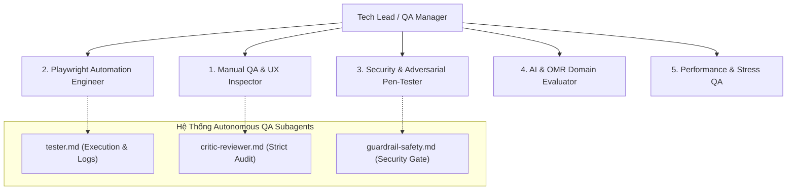
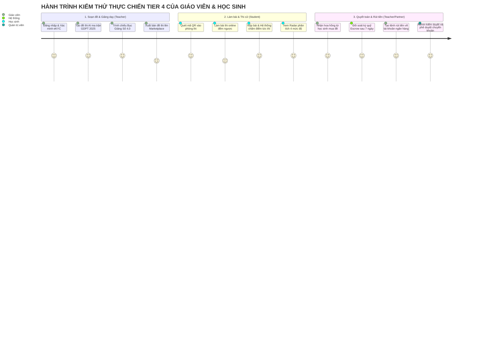
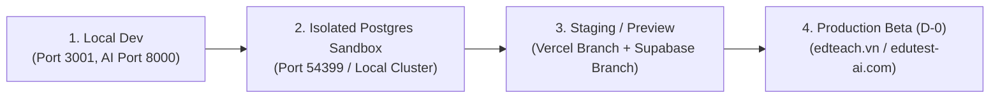
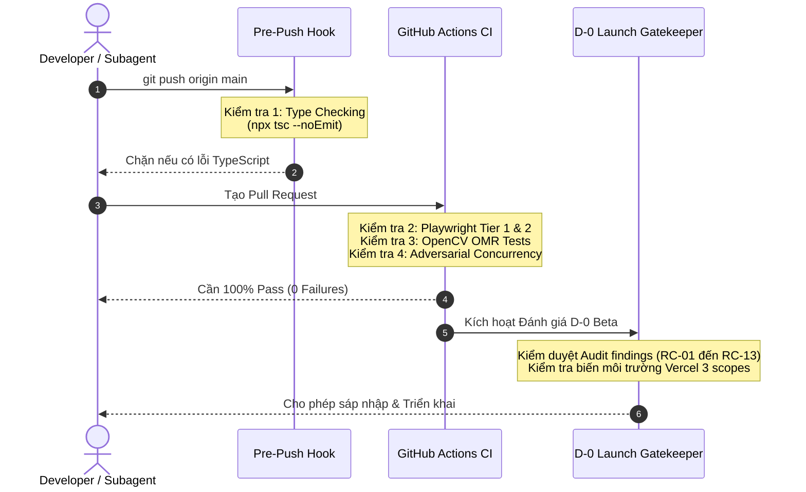

# KẾ HOẠCH KIỂM THỬ TOÀN DIỆN & ĐẶC TẢ ĐỘI NGŨ TESTER CHO WEB EDTEACH
## (MASTER QA TEST PLAN & TESTER SPECIFICATIONS - EDUTEST AI V2.0)

> **Mã tài liệu:** `docs/Master_QA_Test_Plan_and_Tester_Specifications.md`  
> **Phiên bản:** v2.0 - Production Readiness & Beta Launch (D-0)  
> **Hệ thống áp dụng:** Nền tảng EdTeach / EduTest AI - Tutor OS v2.0  
> **Công nghệ:** Next.js 16 (React 19), Supabase PostgreSQL 18 RLS, FastAPI Python, OpenCV OMR, Playwright E2E Framework.  
> **Trạng thái:** Sẵn sàng nghiệm thu chất lượng (Quality Assurance Approved)

---

## MỤC LỤC
1. [Phần I: Tổng quan & Mục tiêu Kiểm thử](#phần-i-tổng-quan--mục-tiêu-kiểm-thử)
2. [Phần II: Đặc tả Đội ngũ Tester & Ma trận Trách nhiệm (RACI)](#phần-ii-đặc-tả-đội-ngũ-tester--ma-trận-trách-nhiệm-raci)
3. [Phần III: Ma trận Kịch bản Kiểm thử Chi tiết Thực chiến (18 Modules & Cross-Tiers)](#phần-iii-ma-trận-kịch-bản-kiểm-thử-chi-tiết-thực-chiến-18-modules--cross-tiers)
4. [Phần IV: Tiêu chuẩn Môi trường & Quy trình Pipeline Tự động (CI/CD Gates)](#phần-iv-tiêu-chuẩn-môi-trường--quy-trình-pipeline-tự-động-cicd-gates)
5. [Phần V: Sổ tay Phân loại Lỗi (Defect Triage) & Tiêu chuẩn Nghiệm thu D-0](#phần-v-sổ-tay-phân-loại-lỗi-defect-triage--tiêu-chuẩn-nghiệm-thu-d-0)

---

## PHẦN I: TỔNG QUAN & MỤC TIÊU KIỂM THỬ

### 1.1. Bối cảnh hệ thống
EdTeach (EduTest AI) là nền tảng quản trị và hỗ trợ giảng dạy số toàn diện dành cho Giáo viên, Gia sư và Học sinh. Hệ thống tích hợp nhiều phân hệ kỹ thuật phức tạp:
- **Soạn đề thi AI chuẩn Bộ GD&ĐT 2025** với công thức LaTeX đa tầng và LLM Gateway chịu lỗi.
- **Bục Giảng Số 4.0** kết hợp Bảng trắng Excalidraw đồng bộ thời gian thực và 54 phòng thí nghiệm 3D PhET tương tác trực tiếp.
- **Chấm thi OMR thông minh** qua camera máy tính/điện thoại sử dụng thị giác máy tính OpenCV.
- **Kinh tế số & Cổng thanh toán**: Ví tín dụng 3 ngăn (Promo, Purchased, Affiliate), mô hình ký quỹ Escrow chợ đề thi (Marketplace), cổng thanh toán PayOS / SePAY, và xác thực giáo viên eKYC.

### 1.2. Mục tiêu kiểm thử cốt lõi (Core QA Objectives)
1. **Bảo mật tuyệt đối (Zero Vulnerabilities)**: Triệt tiêu hoàn toàn 13 nhóm nguyên nhân gốc đã xác định trong đợt audit (`RC-01` đến `RC-13`), đặc biệt là các nguy cơ bypass auth, leo quyền hạn, rò rỉ đề thi qua RLS và cạn kiệt ví tín dụng qua Race condition.
2. **Tính toàn vẹn dữ liệu (Data & Ledger Integrity)**: Đảm bảo mọi giao dịch ví và nộp bài thi được ghi nhận bất biến vào PostgreSQL, không bị mất mát khi khởi động lại các tiến trình serverless.
3. **Trải nghiệm mượt mà & Chống gian lận (UX & Anti-Cheat)**: Bảo đảm phòng thi học sinh chống can thiệp đồng hồ đếm ngược, tính năng lưu tự động (autosave) chống xung đột mạng chập chờn, giao diện đáp ứng chuẩn WCAG 2.1 AA.
4. **Độ chính xác AI & OMR (High Precision)**: Nhận diện chính xác 100% phiếu chấm trắc nghiệm OMR chuẩn Bộ, phòng chống ảo giác AI (Hallucination) và render công thức Toán học chuẩn xác trên mọi thiết bị.

---

## PHẦN II: ĐẶC TẢ ĐỘI NGŨ TESTER & MA TRẬN TRÁCH NHIỆM (RACI)

Hệ thống kiểm thử chất lượng của EdTeach được vận hành bởi sự kết hợp giữa **5 chuyên viên kiểm thử chuyên trách** và **hệ thống Subagent AI QA tự động**:



### 2.1. Đặc tả chi tiết từng vai trò Tester

#### 1. Chuyên viên Kiểm thử Thủ công & Trải nghiệm (Manual QA & UX Inspector)
- **Sứ mệnh**: Đặt mình vào vị trí của 4 nhóm người dùng (Giáo viên trường, Gia sư dạy kèm, Học sinh, Quản trị viên) để kiểm định tính khả dụng và mượt mà của giao diện.
- **Phạm vi phụ trách**:
  - Trực quan hóa Bục Giảng Số 4.0 trên màn hình lớn và máy chiếu lớp học.
  - Thao tác kéo thả, vẽ hình, chèn công thức Toán học trên Bảng trắng Excalidraw.
  - Kiểm tra tính tương thích đa thiết bị (Desktop Chrome/Safari, iPad/Tablet, Mobile iOS/Android).
  - Đánh giá khả năng tiếp cận (Accessibility - WCAG 2.1 AA): độ tương phản màu, phím điều hướng Tab, đọc màn hình (Screen Reader).
- **Công cụ sử dụng**: Chrome DevTools Device Mode, BrowserStack, Axe DevTools, Lighthouse, Screen Readers (NVDA/VoiceOver).

#### 2. Kỹ sư Kiểm thử Tự động (Playwright Automation Engineer)
- **Sứ mệnh**: Xây dựng, mở rộng và bảo trì toàn bộ bộ kịch bản kiểm thử End-to-End (E2E) tự động, bảo đảm không xảy ra lỗi hồi quy (Zero Regression).
- **Phạm vi phụ trách**:
  - Quản trị 60+ spec files trong thư mục `tests/e2e/` chia theo 4 tầng (Tier 1 đến Tier 4).
  - Tự động hóa luồng xác thực, phân quyền, giao bài, làm bài, chấm điểm và thanh toán webhook.
  - Tích hợp kiểm thử tự động vào CI/CD pipeline, tạo báo cáo HTML artifact sau mỗi đợt chạy.
- **Công cụ sử dụng**: Playwright Test Runner, TypeScript, headless Chromium/WebKit/Firefox, Playwright Trace Viewer.

#### 3. Chuyên viên Kiểm thử Bảo mật & Tấn công Thâm nhập (Security & Adversarial Pen-Tester)
- **Sứ mệnh**: Đóng vai trò hacker mũ trắng (Red Team / Challenger) liên tục tìm cách bẻ gãy hệ thống phòng thủ, khai thác lỗ hổng logic và gian lận kinh tế.
- **Phạm vi phụ trách**:
  - Thử nghiệm tấn công bỏ qua Middleware Auth (`RC-01`), giả mạo vai trò Admin (`RC-02`).
  - Tấn công leo quyền RBAC, sửa đổi body request để tự phong `teacher` hoặc `MAX tier` (`RC-03`).
  - Thử nghiệm truy vấn trực tiếp Supabase REST để trộm đề thi chưa công bố hoặc xem trước đáp án (`RC-04`).
  - Tấn công SSRF thông qua tính năng nhập đề thi từ URL ngoại vi (`RC-09`, `RC-14`).
  - Tấn công Prompt Injection nhắm vào AI Assistant và AI Tutor.
- **Công cụ sử dụng**: Python Adversarial Harness (`tests/adversarial/`), Burp Suite, Postman, cURL, SQLMap, DNS Rebinding payloads.

#### 4. Chuyên gia Đánh giá Chất lượng AI & OMR (AI & OMR Domain Evaluator)
- **Sứ mệnh**: Kiểm soát chặt chẽ tính sư phạm, độ chuẩn mực kiến thức theo chương trình GDPT 2025 và độ tin cậy của thuật toán thị giác máy tính.
- **Phạm vi phụ trách**:
  - Kiểm thử ma trận đề thi 4 mức độ tư duy: Nhận biết, Thông hiểu, Vận dụng, Vận dụng cao.
  - Kiểm thử render công thức KaTeX/LaTeX phức tạp (Tích phân, Hình học không gian, Ma trận, Phương trình hóa học).
  - Kiểm thử thuật toán chấm trắc nghiệm OpenCV OMR trong `ai-service`: kiểm thử với ảnh chụp nghiêng góc 15-30 độ, ảnh thiếu sáng, bóng phản chiếu, tẩy xóa không sạch và bút chì tô mờ.
- **Công cụ sử dụng**: Python `pytest`, OpenCV 4, Matplotlib, LaTeX Math Validator, Benchmark Dataset 1000+ mẫu phiếu thi.

#### 5. Kỹ sư Kiểm thử Hiệu năng & Chịu tải (Performance & Stress QA)
- **Sứ mệnh**: Đảm bảo hệ thống duy trì độ ổn định và thời gian phản hồi dưới 500ms ngay cả khi hàng trăm học sinh đồng thời nộp bài thi hoặc giáo viên cùng kích hoạt bục giảng.
- **Phạm vi phụ trách**:
  - Kiểm thử Race Condition trên ví tín dụng (gửi đồng thời 20 lệnh trừ tiền từ cùng 1 tài khoản).
  - Kiểm thử chịu tải phòng thi trực tuyến: 200 kết nối đồng thời nộp bài vào giây cuối cùng.
  - Kiểm thử cơ chế Debounce và Idempotency của Autosave khi đường truyền mạng rớt gói 30%.
- **Công cụ sử dụng**: Python `threading` & `asyncio` harness (`tests/adversarial/m2_concurrency_stress.py`), k6, Locust, PostgreSQL `pg_stat_statements`.

#### 6. Hệ thống Subagent AI QA Tự động (.agent/agents/)
- **`tester.md`**: Kỹ sư QA thực thi độc lập, chạy test runner thực tế, đọc exit code, thu thập log và từ chối mọi khẳng định nếu không có bằng chứng terminal thực tế.
- **`critic-reviewer.md`**: Chuyên gia phản biện nghiêm ngặt, rà soát code diff theo tiêu chuẩn phòng thủ bảo mật và chống suy diễn chủ quan.
- **`guardrail-safety.md`**: Kiểm soát an toàn, đảm bảo không có rò rỉ secret key (`.env`), không phá vỡ RLS policies và không có backdoor debug.

### 2.2. Ma trận Trách nhiệm RACI (Responsible, Accountable, Consulted, Informed)

| Phân hệ / Nhiệm vụ Kiểm thử | Manual QA | Auto QA | Security QA | AI/OMR QA | Perf QA | AI Subagents |
|:---|:---:|:---:|:---:|:---:|:---:|:---:|
| **Auth, Middleware & Admin Hardening** | C | **R** | **A** | I | I | **R** |
| **Supabase RLS & Quyền dữ liệu** | I | **R** | **A** | I | C | **R** |
| **Giao dịch Ví, Ledger & Escrow Chợ** | I | **R** | **A** | I | **R** | **R** |
| **Soạn đề AI GDPT 2025 & LaTeX** | **R** | **R** | C | **A** | C | I |
| **Chấm OMR Camera & Khớp Phiếu** | **R** | **R** | I | **A** | C | I |
| **Bục Giảng Số 4.0 & Excalidraw** | **A** | **R** | I | I | C | I |
| **54 Phòng Thí Nghiệm 3D PhET** | **A** | **R** | C | I | I | I |
| **Đồng hồ thi Học sinh & Chống gian lận** | C | **R** | **A** | I | C | **R** |
| **Autosave Bảng trắng & Tranh chấp mạng** | C | **R** | I | I | **A** | **R** |
| **Hiệu năng Chịu tải & Concurrency Stress** | I | C | **R** | I | **A** | **R** |
| **Khả năng tiếp cận (A11y) & Core Web Vitals** | **A** | **R** | I | I | C | I |
| **Vòng kiểm tra D-0 trước khi Push/Beta** | C | **R** | **R** | **R** | **R** | **A** |

*(Chú thích: **A** = Accountable - Chịu trách nhiệm chính; **R** = Responsible - Trực tiếp thực thi; **C** = Consulted - Tư vấn chuyên môn; **I** = Informed - Nhận thông báo kết quả).*

---

## PHẦN III: MA TRẬN KỊCH BẢN KIỂM THỬ CHI TIẾT THỰC CHIẾN (18 MODULES & CROSS-TIERS)

Dưới đây là ma trận chi tiết bao phủ toàn bộ 18 phân hệ chức năng cốt lõi và các kịch bản kết hợp đa tầng.

### 3.1. Bảng Kịch bản Kiểm thử Tính năng (Tier 1 & Tier 2)

```
Cấu trúc mỗi Test Case:
- Mã định danh (ID) | Phân hệ (Module)
- Mục tiêu kiểm định (Objective)
- Tiền điều kiện (Pre-conditions)
- Các bước thực hiện (Steps)
- Dữ liệu thử nghiệm (Test Data)
- Kết quả kỳ vọng (Expected Results)
- Ánh xạ kịch bản tự động (Automated Script)
```

#### Module 01: Middleware & Route Guarding
* **Mã Test Case:** `TC-MOD-01`
* **Mục tiêu:** Kiểm tra cơ chế chặn truy cập trái phép của Next.js Middleware đối với tất cả các tuyến đường bảo vệ (`/student/*`, `/labs/*`, `/whiteboard/*`, `/teach/*`, `/admin/*`). Chống bypass bằng header giả lập.
* **Tiền điều kiện:** Người dùng chưa đăng nhập (Anonymous visitor).
* **Các bước thực hiện:**
  1. Gửi request HTTP GET tới `/student/exams`.
  2. Gửi request HTTP GET tới `/whiteboard/new-board` kèm header giả mạo `x-playwright-audit: true`.
  3. Gửi request HTTP GET tới `/teach/classroom` kèm query param `?audit=true`.
* **Dữ liệu thử nghiệm:** URL endpoint nội bộ, header bypass giả mạo.
* **Kết quả kỳ vọng:** Tất cả các request đều bị chặn và tự động redirect về trang `/auth/login` với mã HTTP 307; không có bất kỳ JavaScript bundle nội bộ nào bị rò rỉ.
* **Script tự động:** `tests/e2e/tier1-feature-coverage/feat-01-middleware-auth.spec.ts` & `tests/e2e/tier2-boundary-corner/feat-01-middleware-bypass-corner.spec.ts`.

#### Module 02: Admin Portal Hardening & Auth Protection
* **Mã Test Case:** `TC-MOD-02`
* **Mục tiêu:** Xác thực triệt để quyền Admin; ngăn chặn tuyệt đối lỗi bypass logic `!user` hoặc gửi `adminUserId` tùy tiện trong body request.
* **Tiền điều kiện:** Tài khoản người dùng có role là `student` hoặc `teacher` (không phải `admin`).
* **Các bước thực hiện:**
  1. Đăng nhập tài khoản giáo viên thông thường.
  2. Gửi request HTTP POST tới `/api/admin/verifications` với payload `{ adminUserId: "admin_super", action: "APPROVE" }`.
  3. Gửi request HTTP GET tới `/api/admin/affiliate` mà không kèm token xác thực.
* **Dữ liệu thử nghiệm:** Payload duyệt eKYC giả mạo, yêu cầu xem danh sách payout admin.
* **Kết quả kỳ vọng:** Hệ thống từ chối với HTTP 401 Unauthorized hoặc 403 Forbidden; bảng `teacher_verifications` và danh sách thanh toán hoàn toàn không bị thay đổi.
* **Script tự động:** `tests/e2e/tier1-feature-coverage/feat-02-admin-hardening.spec.ts` & `tests/e2e/tier2-boundary-corner/feat-02-admin-bypass-corner.spec.ts`.

#### Module 03: RBAC & Chống Leo quyền (Anti-Privilege Escalation)
* **Mã Test Case:** `TC-MOD-03`
* **Mục tiêu:** Đảm bảo người dùng không thể tự nâng cấp vai trò (`role`) lên Teacher/Admin hoặc tự đổi `tier` thành PRO/MAX thông qua client-side REST call hoặc mass-assignment.
* **Tiền điều kiện:** Tài khoản Học sinh (`role: 'student'`, `tier: 'free'`).
* **Các bước thực hiện:**
  1. Sử dụng token của học sinh gọi trực tiếp API `POST /api/user/set-role` với payload `{ role: "teacher" }`.
  2. Gọi Supabase update trực tiếp vào bảng `users` với `{ tier: "max", subscription_expires_at: "2099-01-01" }`.
* **Dữ liệu thử nghiệm:** JSON payload nâng role và sửa tier.
* **Kết quả kỳ vọng:** Trigger PostgreSQL `prevent_user_privilege_escalation` lập tức kích hoạt, chặn đứng câu lệnh ghi với lỗi `Cannot escalate privileges`; hồ sơ người dùng giữ nguyên vai trò học sinh và gói free.
* **Script tự động:** `tests/e2e/tier1-feature-coverage/feat-03-privilege-escalation.spec.ts` & `tests/e2e/tier2-boundary-corner/feat-03-privilege-tampering-corner.spec.ts`.

#### Module 04: Supabase RLS Security & Bảo vệ Đề thi
* **Mã Test Case:** `TC-MOD-04`
* **Mục tiêu:** Đảm bảo khách nặc danh hoặc học sinh không thể đọc trộm cấu trúc câu hỏi, đáp án đúng (`correct_answer`) và lời giải chi tiết của đề thi khi chưa nộp bài.
* **Tiền điều kiện:** Đề thi đã được tạo và xuất bản, có đáp án lưu trong database.
* **Các bước thực hiện:**
  1. Gửi truy vấn Supabase REST với anon key: `GET /rest/v1/marketplace_items?select=exam_data`.
  2. Tài khoản học sinh đang làm bài thi gửi query: `GET /rest/v1/exams?id=eq.EXAM_ID&select=answers`.
* **Dữ liệu thử nghiệm:** Lệnh select trực tiếp vào trường chứa đáp án.
* **Kết quả kỳ vọng:** RLS policy cô lập dữ liệu; trường `exam_data` trả về rỗng hoặc chỉ chứa preview không có đáp án; học sinh chỉ nhận được danh sách câu hỏi trắc nghiệm không kèm đáp án chuẩn.
* **Script tự động:** `tests/e2e/tier1-feature-coverage/feat-04-emergency-rls.spec.ts` & `tests/e2e/tier2-boundary-corner/feat-04-rls-anon-leak-corner.spec.ts`.

#### Module 05: Thống nhất Cấu hình & Loại bỏ Domain Hardcode
* **Mã Test Case:** `TC-MOD-05`
* **Mục tiêu:** Xác minh toàn bộ hệ thống sử dụng biến môi trường chuẩn hóa (`NEXT_PUBLIC_APP_URL`, `NEXT_PUBLIC_SUPABASE_URL`), không tồn tại các domain hardcode gây sai lệch môi trường.
* **Tiền điều kiện:** Build production frontend.
* **Các bước thực hiện:**
  1. Quét toàn bộ bundle script và code xuất file Word/PDF.
  2. Tạo liên kết chia sẻ đề thi và kiểm tra domain được sinh ra.
* **Dữ liệu thử nghiệm:** Liên kết mời làm bài, liên kết affiliate giới thiệu.
* **Kết quả kỳ vọng:** Tất cả liên kết đều sử dụng host hiện tại, không xuất hiện link `localhost` hoặc link cứng trên môi trường triển khai.
* **Script tự động:** `tests/e2e/tier1-feature-coverage/feat-05-centralized-config.spec.ts` & `tests/e2e/tier2-boundary-corner/feat-05-config-edge-cases.spec.ts`.

#### Module 06: Thao tác Ví nguyên tử & Chống Race Condition
* **Mã Test Case:** `TC-MOD-06`
* **Mục tiêu:** Kiểm tra tính toàn vẹn của RPC `deduct_user_credits` và sổ cái `wallet_transactions`. Đảm bảo số dư không thể bị âm và không thể bị trừ 2 lần khi gửi request đồng thời.
* **Tiền điều kiện:** Tài khoản người dùng có đúng 10 credits trong ví.
* **Các bước thực hiện:**
  1. Kích hoạt 10 luồng song song cùng gửi yêu cầu trừ 10 credits từ cùng một phiên làm việc.
  2. Thử nghiệm truyền `p_user_id` của nạn nhân khác trong RPC để cố tình trừ tiền người khác.
* **Dữ liệu thử nghiệm:** 10 HTTP requests song song; payload trộm user_id.
* **Kết quả kỳ vọng:** Nhờ khóa dòng PostgreSQL `FOR UPDATE`, đúng 1 request thành công trừ 10 credits (số dư về 0); 9 request còn lại nhận thông báo lỗi thiếu số dư; không thể trừ tiền tài khoản khác (bị chặn bởi auth.uid() check).
* **Script tự động:** `tests/e2e/tier1-feature-coverage/feat-06-wallet-ledger-rpc.spec.ts`, `tests/e2e/tier2-boundary-corner/feat-06-ledger-negative-balance.spec.ts` & `tests/adversarial/m2_concurrency_stress.py`.

#### Module 07: Vòng đời Thuê bao & Tự động Hạ cấp khi Hết hạn
* **Mã Test Case:** `TC-MOD-07`
* **Mục tiêu:** Xác minh thời hạn thuê bao PRO/MAX được tính toán chính xác và tự động hạ cấp về FREE khi `subscription_expires_at` vượt quá thời gian hiện tại.
* **Tiền điều kiện:** Tài khoản có gói PRO với ngày hết hạn là ngày hôm qua.
* **Các bước thực hiện:**
  1. Người dùng hết hạn đăng nhập vào hệ thống.
  2. Thực hiện hành động nâng cao (tạo đề thi số lượng lớn hoặc xuất Word).
  3. Kiểm tra cron/trigger kiểm tra trạng thái gói.
* **Dữ liệu thử nghiệm:** Timestamp quá khứ của thuê bao.
* **Kết quả kỳ vọng:** Hệ thống nhận diện trạng thái hết hạn, tự động cập nhật hiển thị về Free Tier, yêu cầu gia hạn và chặn các tính năng độc quyền PRO.
* **Script tự động:** `tests/e2e/tier1-feature-coverage/feat-07-subscription-lifecycle.spec.ts` & `tests/e2e/tier2-boundary-corner/feat-07-subscription-expiry-edge.spec.ts`.

#### Module 08: Mô hình Ví 3 Ngăn (Three-Bucket Credit Economy)
* **Mã Test Case:** `TC-MOD-08`
* **Mục tiêu:** Đảm bảo sự phân tách rõ ràng giữa: Promo Credits (tặng khi đăng ký/sự kiện - chỉ dùng dịch vụ, cấm rút), Purchased Credits (nạp tiền thật - dùng dịch vụ, không rút), và Affiliate Balance (hoa hồng giới thiệu - đủ điều kiện rút tiền mặt).
* **Tiền điều kiện:** Tài khoản có 50.000 Promo credits và 0đ Affiliate balance.
* **Các bước thực hiện:**
  1. Gửi yêu cầu rút tiền mặt 50.000 VNĐ qua form Payout.
* **Dữ liệu thử nghiệm:** Yêu cầu rút tiền từ ví khuyến mại.
* **Kết quả kỳ vọng:** Hệ thống từ chối với thông báo "Promo credits không thể quy đổi ra tiền mặt"; ngăn chặn triệt để hành vi cạn kiệt dòng tiền mặt dự án.
* **Script tự động:** `tests/e2e/tier1-feature-coverage/feat-08-three-bucket-wallet.spec.ts` & `tests/e2e/tier2-boundary-corner/feat-08-three-bucket-arbitrage.spec.ts`.

#### Module 09: Ngưỡng Rút tiền & Xác thực eKYC Đối tác
* **Mã Test Case:** `TC-MOD-09`
* **Mục tiêu:** Kiểm tra quy định rút tiền tối thiểu 200.000 VNĐ và bắt buộc tài khoản giáo viên phải được duyệt eKYC trước khi tạo lệnh rút hoa hồng.
* **Tiền điều kiện:** Tài khoản có 150.000 VNĐ Affiliate balance hoặc tài khoản chưa duyệt eKYC.
* **Các bước thực hiện:**
  1. Thử tạo lệnh rút 150.000 VNĐ.
  2. Bơm 500.000 VNĐ vào tài khoản chưa eKYC và gửi lệnh rút.
* **Dữ liệu thử nghiệm:** Giá trị rút dưới ngưỡng và tài khoản thiếu Tích Xanh eKYC.
* **Kết quả kỳ vọng:** Hệ thống chặn hiển thị form hoặc báo lỗi rõ ràng: "Ngưỡng rút tối thiểu 200.000 VNĐ" và "Cần xác thực Giáo viên eKYC để kích hoạt tính năng rút tiền".
* **Script tự động:** `tests/e2e/tier1-feature-coverage/feat-09-withdrawal-threshold.spec.ts` & `tests/e2e/tier2-boundary-corner/feat-09-payout-boundary-limits.spec.ts`.

#### Module 10: Chợ Đề thi Nguyên tử & Ký quỹ Escrow
* **Mã Test Case:** `TC-MOD-10`
* **Mục tiêu:** Kiểm tra quy trình mua đề thi trên Marketplace: tiền người mua được chuyển vào ví ký quỹ Escrow và chỉ giải ngân cho người bán sau 7 ngày nếu không có khiếu nại. Ngăn chặn người bán tự mua đề của chính mình để thổi phồng doanh số.
* **Tiền điều kiện:** Người bán đăng bán tài liệu giá 50 credits; tài khoản người mua có đủ credits.
* **Các bước thực hiện:**
  1. Người mua bấm Mua tài liệu.
  2. Người bán thử đăng nhập tài khoản của mình và bấm mua chính tài liệu mình tạo.
* **Dữ liệu thử nghiệm:** Giao dịch mua tài liệu trên Marketplace.
* **Kết quả kỳ vọng:** Giao dịch mua hợp lệ tạo bản ghi Escrow thành công, người mua tải được đề thi ngay; hành vi tự mua bị từ chối với lỗi "Bạn không thể mua tài liệu do chính mình xuất bản".
* **Script tự động:** `tests/e2e/tier1-feature-coverage/feat-10-atomic-marketplace.spec.ts` & `tests/e2e/tier2-boundary-corner/feat-10-marketplace-race-slippage.spec.ts`.

#### Module 11: Giáo viên eKYC & Chống Spam Sybil
* **Mã Test Case:** `TC-MOD-11`
* **Mục tiêu:** Đảm bảo mỗi bộ hồ sơ định danh (CCCD/Thẻ giáo viên) chỉ được phê duyệt cho duy nhất một tài khoản; chống việc dùng một ảnh giấy tờ để spam đăng ký nhận thưởng 10.000 credits hàng loạt.
* **Tiền điều kiện:** Ảnh thẻ giáo viên đã được dùng để xác minh thành công cho User A.
* **Các bước thực hiện:**
  1. Tạo tài khoản User B.
  2. Upload đúng ảnh thẻ giáo viên đã được User A xác minh.
* **Dữ liệu thử nghiệm:** File ảnh trùng lặp checksum/hash và thông tin số định danh.
* **Kết quả kỳ vọng:** Hệ thống phát hiện dữ liệu trùng lặp, từ chối phê duyệt tự động và gắn cờ cảnh báo hồ sơ nghi vấn gian lận.
* **Script tự động:** `tests/e2e/tier1-feature-coverage/feat-11-anti-repetition-ekyc.spec.ts` & `tests/e2e/tier2-boundary-corner/feat-11-ekyc-sybil-attack.spec.ts`.

#### Module 12: Student Portal & Đồng hồ Thi Chống Can thiệp
* **Mã Test Case:** `TC-MOD-12`
* **Mục tiêu:** Kiểm tra phòng làm bài thi của học sinh; chống hành vi thay đổi LocalStorage hoặc vặn lùi đồng hồ hệ thống trên máy tính học sinh để gian lận thời gian làm bài.
* **Tiền điều kiện:** Bài thi có thời lượng 45 phút, bắt đầu lúc 10:00:00.
* **Các bước thực hiện:**
  1. Học sinh vào thi lúc 10:00.
  2. Học sinh chỉnh đồng hồ máy tính lùi về 09:00 hoặc can thiệp biến đếm trong LocalStorage.
  3. Để thời gian thực vượt qua 10:45:01 và học sinh bấm nộp bài.
* **Dữ liệu thử nghiệm:** Thao tác can thiệp thời gian client-side; nộp bài muộn.
* **Kết quả kỳ vọng:** Thời gian làm bài được tính theo server timestamp (`now()`); khi hết hạn bài thi tự động khóa và thu bài, mọi câu trả lời gửi sau thời hạn đều bị hủy với trạng thái nộp trễ.
* **Script tự động:** `tests/e2e/tier1-feature-coverage/feat-12-student-portal-core.spec.ts` & `tests/e2e/tier2-boundary-corner/feat-12-exam-timer-tampering.spec.ts`.

#### Module 13: Lưu trữ Database Bền vững (Triệt tiêu In-Memory Stores)
* **Mã Test Case:** `TC-MOD-13`
* **Mục tiêu:** Đảm bảo toàn bộ trạng thái phiên chấm bài, phiên remote camera và dữ liệu học sinh được lưu trữ trong PostgreSQL Supabase, không bị mất khi instance Vercel/Serverless khởi động lại.
* **Tiền điều kiện:** Giáo viên mở phiên chấm bài bằng camera điện thoại.
* **Các bước thực hiện:**
  1. Kết nối điện thoại với mã PIN 4 số của phiên chấm.
  2. Kích hoạt restart tiến trình Next.js backend.
  3. Tiến hành chụp ảnh và nộp bài từ điện thoại.
* **Dữ liệu thử nghiệm:** Phiên chấm OMR remote kết nối qua mã PIN.
* **Kết quả kỳ vọng:** Phiên chấm vẫn tồn tại nguyên vẹn, điểm số và ảnh quét được lưu trực tiếp vào cơ sở dữ liệu mà không bị đứt gãy kết nối.
* **Script tự động:** `tests/e2e/tier1-feature-coverage/feat-13-postgres-persistence.spec.ts` & `tests/e2e/tier2-boundary-corner/feat-13-concurrency-persistence.spec.ts`.

#### Module 14: Phòng thủ SSRF khi Nhập Đề thi từ URL
* **Mã Test Case:** `TC-MOD-14`
* **Mục tiêu:** Kiểm tra tính năng nhập đề thi từ link web (`import-from-url`). Chặn đứng mọi nỗ lực khai thác SSRF (Server-Side Request Forgery) nhắm vào mạng nội bộ (127.0.0.1, 10.0.0.0/8, 192.168.0.0/16, và AWS/Cloud metadata 169.254.169.254) kể cả qua kỹ thuật DNS Rebinding.
* **Tiền điều kiện:** Tính năng import đề thi từ URL đang hoạt động.
* **Các bước thực hiện:**
  1. Gửi yêu cầu nhập từ `http://127.0.0.1:8000/docs`.
  2. Gửi yêu cầu nhập từ domain DNS Rebinding trỏ về IP loopback.
  3. Gửi yêu cầu nhập từ `http://169.254.169.254/latest/meta-data/`.
* **Dữ liệu thử nghiệm:** URL payload chứa địa chỉ IP riêng và tên miền độc hại.
* **Kết quả kỳ vọng:** Hệ thống phân giải DNS trước khi gọi, lập tức từ chối và ném lỗi `Disallowed destination IP address: Private / Loopback ranges are forbidden`.
* **Script tự động:** `tests/e2e/tier1-feature-coverage/feat-14-ssrf-importer-fix.spec.ts` & `tests/e2e/tier2-boundary-corner/feat-14-ssrf-payload-vectors.spec.ts`.

#### Module 15: Autosave Idempotency & Giải quyết Xung đột Tranh chấp
* **Mã Test Case:** `TC-MOD-15`
* **Mục tiêu:** Kiểm tra cơ chế tự động lưu bản vẽ Bảng trắng và nội dung Soạn đề Studio. Chống mất dữ liệu và chống xung đột khi giáo viên chỉnh sửa liên tục trong điều kiện mạng lag.
* **Tiền điều kiện:** Giáo viên đang vẽ sơ đồ trên Bảng trắng Excalidraw.
* **Các bước thực hiện:**
  1. Vẽ liên tục nhiều nét vẽ trong 2 giây.
  2. Giả lập ngắt kết nối mạng tạm thời 5 giây rồi phục hồi.
  3. Kiểm tra các bản ghi lưu tự động trong database.
* **Dữ liệu thử nghiệm:** Các nét vẽ vector và chuỗi JSON scene Excalidraw.
* **Kết quả kỳ vọng:** Cơ chế Debounce 1000ms hoạt động chuẩn xác, gửi đúng bản vẽ cuối cùng kèm `version_id`; khi mạng khôi phục hệ thống tự động retry và không xảy ra xung đột ghi đè dữ liệu cũ lên dữ liệu mới.
* **Script tự động:** `tests/e2e/tier1-feature-coverage/feat-15-autosave-idempotency.spec.ts` & `tests/e2e/tier2-boundary-corner/feat-15-autosave-conflict-racing.spec.ts`.

#### Module 16: 54 Phòng Thí Nghiệm 3D PhET & Bản quyền Miễn phí
* **Mã Test Case:** `TC-MOD-16`
* **Mục tiêu:** Xác nhận toàn bộ 54 mô phỏng thí nghiệm 3D PhET (Toán, Lý, Hóa, Sinh) được mở hoàn toàn miễn phí cho tất cả học sinh và giáo viên, tuân thủ đúng giấy phép phi thương mại của PhET Interactive Simulations.
* **Tiền điều kiện:** Người dùng Free Tier đăng nhập hoặc học sinh làm bài tập.
* **Các bước thực hiện:**
  1. Truy cập vào danh mục `/labs` và mở mô phỏng PhET bất kỳ (ví dụ: Mạch điện xoay chiều, Cân bằng hóa học).
  2. Thao tác điều khiển thanh trượt 3D và thử nghiệm vẽ overlay bục giảng.
* **Dữ liệu thử nghiệm:** 54 simulations trong file cấu hình `frontend/src/lib/labs.ts`.
* **Kết quả kỳ vọng:** Toàn bộ 54 phòng thí nghiệm mở trực tiếp, không yêu cầu nâng cấp gói, hiển thị đầy đủ thông tin ghi nhận bản quyền PhET theo quy định.
* **Script tự động:** `tests/e2e/tier1-feature-coverage/feat-16-phet-labs-free-access.spec.ts` & `tests/e2e/tier2-boundary-corner/feat-16-phet-paywall-bypass.spec.ts`.

#### Module 17: Đồng bộ Bảng giá Marketing & Minh bạch Thông tin
* **Mã Test Case:** `TC-MOD-17`
* **Mục tiêu:** Kiểm tra tính nhất quán giữa thông tin bảng giá trên trang chủ Marketing `/pricing` và cấu hình hệ thống thanh toán thực tế; loại bỏ hoàn toàn các số liệu ảo hoặc tính năng chưa khả dụng.
* **Tiền điều kiện:** Khách vãng lai xem bảng giá.
* **Các bước thực hiện:**
  1. Rà soát bảng so sánh tính năng Free vs PRO vs MAX.
  2. Thử nghiệm thay đổi giá trị số tiền trên URL hoặc trong form nạp tiền.
* **Dữ liệu thử nghiệm:** Gói nạp 50k, 200k, 500k; payload sửa giá tiền thanh toán.
* **Kết quả kỳ vọng:** Giá tiền gửi sang cổng PayOS luôn được lấy từ catalog phía máy chủ (Server-side Catalog), không thể bị sửa đổi từ phía trình duyệt.
* **Script tự động:** `tests/e2e/tier1-feature-coverage/feat-17-marketing-alignment.spec.ts` & `tests/e2e/tier2-boundary-corner/feat-17-pricing-plan-tampering.spec.ts`.

#### Module 18: Khả năng Tiếp cận (WCAG 2.1 AA) & Tối ưu Hiệu năng
* **Mã Test Case:** `TC-MOD-18`
* **Mục tiêu:** Kiểm định tiêu chuẩn tiếp cận Web Accessibility: tỷ lệ tương phản chữ (contrast ratio >= 4.5:1), hỗ trợ điều hướng hoàn toàn bằng bàn phím (Keyboard navigation), không bị tràn vỡ giao diện trên màn hình nhỏ.
* **Tiền điều kiện:** Trình duyệt chuẩn bị audit giao diện.
* **Các bước thực hiện:**
  1. Dùng phím Tab di chuyển qua toàn bộ form đăng nhập, dashboard và thanh công cụ.
  2. Bật chế độ High Contrast và Dark Mode để kiểm tra hiển thị.
  3. Đo lường chỉ số Core Web Vitals (LCP < 2.5s, CLS < 0.1, FID/INP < 100ms).
* **Dữ liệu thử nghiệm:** Các thành phần UI buttons, inputs, modals, toasts.
* **Kết quả kỳ vọng:** 100% phần tử tương tác nhận được focus indicator rõ ràng; không có lỗi contrast nghiêm trọng; chỉ số Core Web Vitals đạt chuẩn xanh của Google.
* **Script tự động:** `tests/e2e/tier1-feature-coverage/feat-18-accessibility-polish.spec.ts` & `tests/e2e/tier2-boundary-corner/feat-18-a11y-boundary-stress.spec.ts`.

---

### 3.2. Ma trận Kịch bản Kiểm thử Tương tác Chéo (Tier 3 Pairwise)

| Mã Kịch bản | Tên Kịch bản Kiểm thử Tương tác Chéo | Trọng tâm Kiểm định | Script Thực thi Tự động |
|:---|:---|:---|:---|
| **TC-TIER3-01** | **Pairwise Autosave & Session Persistence** | Kiểm tra lưu tự động khi đồng thời mở nhiều tab và mất mạng chập chờn | `pairwise-autosave-session-persistence.spec.ts` |
| **TC-TIER3-02** | **Pairwise eKYC, Referral & Subscription** | Kiểm tra luồng giới thiệu bạn bè nhận hoa hồng kết hợp đăng ký gói PRO | `pairwise-ekyc-referral-subscription.spec.ts` |
| **TC-TIER3-03** | **Pairwise PhET, Whiteboard & AI Monetization** | Kiểm tra nhúng phòng thí nghiệm 3D vào bảng trắng và gọi AI trợ giảng | `pairwise-phet-whiteboard-ai-monetization.spec.ts` |
| **TC-TIER3-04** | **Pairwise SSRF, Marketplace & Whiteboard** | Kiểm tra nhập đề thi từ link ngoài và đưa thẳng vào phiên bục giảng số | `pairwise-ssrf-marketplace-whiteboard.spec.ts` |
| **TC-TIER3-05** | **Pairwise Student Grading & Teacher Quota** | Kiểm tra việc học sinh nộp bài và trừ hạn mức chấm bài tự động của giáo viên | `pairwise-student-grading-teacher-quota.spec.ts` |
| **TC-TIER3-06** | **Pairwise Wallet, Marketplace & Escrow** | Kiểm tra toàn bộ vòng tuần hoàn tiền tệ: Nạp tiền -> Mua đề -> Ký quỹ -> Rút tiền | `pairwise-wallet-marketplace-escrow.spec.ts` |

---

### 3.3. Ma trận Kịch bản Hành trình Người dùng Thực tế (Tier 4 End-to-End Scenarios)



* **Kịch bản S-01 (`scenario-01-teacher-marketplace-workflow.spec.ts`)**: Giáo viên đăng ký tài khoản -> Soạn đề AI chuyên sâu môn Toán 12 -> Đăng bán lên Marketplace -> Người mua tải về -> Kiểm tra tiền vào ví Escrow.
* **Kịch bản S-02 (`scenario-02-student-exam-lifecycle.spec.ts`)**: Học sinh nhận link đề thi -> Vào phòng thi trực tuyến -> Làm 50 câu trắc nghiệm -> Nộp bài -> Nhận điểm số và xem biểu đồ Radar 4 mức độ tư duy.
* **Kịch bản S-03 (`scenario-03-affiliate-referral-payout.spec.ts`)**: Đối tác chia sẻ mã giới thiệu -> Người dùng mới đăng ký và nạp tiền -> Đối tác nhận hoa hồng vào Affiliate Balance -> Tạo lệnh rút tiền khi đủ 200k -> Admin duyệt lệnh.
* **Kịch bản S-04 (`scenario-04-teacher-classroom-workflow.spec.ts`)**: Giáo viên mở lớp học thực tế -> Sử dụng Bục Giảng Số chia đôi màn hình (Bảng trắng bên trái, Thí nghiệm 3D bên phải) -> Quét chấm OMR 45 bài thi học sinh trong 3 phút.
* **Kịch bản S-05 (`scenario-05-multi-tier-subscription-flow.spec.ts`)**: Nâng cấp tài khoản từ Free lên PRO qua cổng PayOS -> Kiểm tra mở khóa giới hạn đề thi -> Mô phỏng hết hạn 30 ngày -> Xác nhận hệ thống hạ cấp an toàn.

---

## PHẦN IV: TIÊU CHUẨN MÔI TRƯỜNG & QUY TRÌNH PIPELINE TỰ ĐỘNG (CI/CD GATES)

### 4.1. Cấu hình 4 Môi trường Kiểm thử



1. **Môi trường Local Dev (Máy phát triển)**:
   - Frontend: Next.js chạy trên `http://localhost:3001`.
   - AI Service: FastAPI chạy trên `http://localhost:8000`.
   - Mục đích: Dành cho Developer và Manual QA kiểm tra nhanh các tính năng UI và API cục bộ.
2. **Môi trường Isolated PostgreSQL Sandbox (Port 54399)**:
   - Một cụm PostgreSQL 18 độc lập được khởi tạo riêng biệt qua script `tests/adversarial/run_all_m2_adversarial_tests.ps1`.
   - Mục đích: Chạy các bài test đối kháng (Adversarial), stress test đa luồng và kiểm thử độ bền của RLS mà không làm bẩn dữ liệu phát triển.
3. **Môi trường Staging / Vercel Preview**:
   - Được tự động triển khai từ các Git branch hoặc Pull Request.
   - Kết nối với nhánh cơ sở dữ liệu Supabase Staging.
   - Bắt buộc kích hoạt đầy đủ 3 phạm vi biến môi trường (`Production`, `Preview`, `Development`).
4. **Môi trường Production Beta (Cổng Beta D-0)**:
   - Môi trường thực tế mở cho 100 giáo viên và 1000 học sinh đầu tiên trải nghiệm có kiểm soát.

### 4.2. Các Chốt Chặn Chất Lượng Tự Động (CI/CD Automated Gates)

Để đảm bảo không có bất kỳ mã nguồn lỗi nào lọt vào nhánh chính (`main`), quy trình 3 chốt chặn được áp dụng bắt buộc:



---

## PHẦN V: SỔ TAY PHÂN LOẠI LỖI (DEFECT TRIAGE) & TIÊU CHUẨN NGHIỆM THU D-0

### 5.1. Bảng Phân loại Mức độ Nghiêm trọng của Lỗi (Severity Levels)

| Mức Độ | Tên Gọi | Định Nghĩa & Tác Động | Thời Hạn Khắc Phục (SLA) |
|:---:|:---|:---|:---:|
| **P0** | **Blocker (Chặn đứng)** | Hệ thống sập, rò rỉ secret key, bypass được bảo vệ Admin, lỗi rút cạn tiền mặt từ ví tín dụng, đề thi lộ đáp án hoàn toàn. | **Khắc phục ngay lập tức (< 2 giờ)** |
| **P1** | **Critical (Nghiêm trọng)** | Lỗi tính toán thời hạn thuê bao, xung đột mất dữ liệu Bảng trắng khi autosave, OMR chấm sai hàng loạt, SSRF tới mạng nội bộ. | **Khắc phục trong ngày (< 8 giờ)** |
| **P2** | **Major (Lớn)** | Lỗi giao diện Bục Giảng Số bị tràn màn hình trên iPad, lỗi hiển thị công thức LaTeX phức tạp, tốc độ tải trang chậm quá 3s. | **Khắc phục trong 24 - 48 giờ** |
| **P3** | **Minor (Nhỏ/Thẩm mỹ)** | Lỗi chính tả tiếng Việt, căn lề chưa chuẩn 2px, màu sắc icon chưa đồng bộ theo Design System. | **Xử lý trong sprint kế tiếp** |

### 5.2. Tiêu chuẩn Nghiệm thu Khởi chạy Beta (Definition of Done - D-0 Launch Gate)

Sản phẩm chỉ được phép mở cổng tiếp nhận người dùng Beta khi và chỉ khi thỏa mãn đầy đủ **6 tiêu chí bất biến**:
1. [x] **Zero TypeScript Errors**: Lệnh `npx tsc --noEmit` hoàn thành với mã thoát 0 ở cả root và frontend.
2. [x] **Zero Vulnerabilities**: Toàn bộ 13 nhóm lỗi audit (`RC-01` đến `RC-13`) được kiểm chứng đã vá và có test case phòng vệ.
3. [x] **100% Automated Tests Pass**: Tất cả các kịch bản trong `tests/e2e/tier1-feature-coverage` và `tier2-boundary-corner` đều đạt trạng thái Passed.
4. [x] **Ledger Immutability**: Suite kiểm thử đối kháng `tests/adversarial/run_all_m2_adversarial_tests.ps1` chạy thành công không sinh số dư âm.
5. [x] **OMR Precision**: Thuật toán OMR trong `ai-service/test_omr.py` đạt độ chính xác 100% trên các mẫu phiếu chuẩn.
6. [x] **Bằng chứng Thực nghiệm**: Toàn bộ nhật ký kiểm thử terminal được lưu trữ minh bạch, không chấp nhận báo cáo cảm tính.

---
*Tài liệu được lập và phê duyệt bởi Hội đồng Kiểm thử Chất lượng EdTeach (QA Architecture & Testing Board).*
