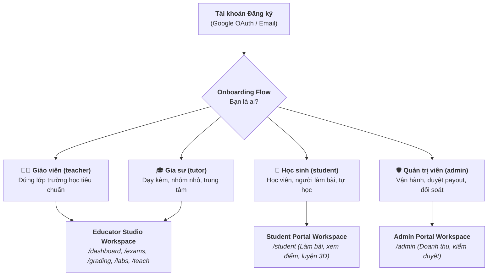

# TÀI LIỆU ĐẶC TẢ PHÂN QUYỀN NGƯỜI DÙNG (RBAC ARCHITECTURE SPECIFICATION)
## HỆ THỐNG PHÂN VAI TRÒ: GIÁO VIÊN — GIA SƯ — HỌC SINH

> **Tài liệu kỹ thuật:** `docs/RBAC_User_Roles_Specification.md`  
> **Phiên bản:** v2.0  
> **Người lập:** Tech Lead Architecture Team  
> **Áp dụng cho:** Frontend Next.js 16, Supabase PostgreSQL RLS, Auth Context, Middleware Navigation.

---

## 1. TỔNG QUAN KIẾN TRÚC PHÂN QUYỀN (RBAC OVERVIEW)

Hệ thống EduTest AI phân chia người dùng thành **4 vai trò (Roles)** độc lập với không gian làm việc tối ưu riêng biệt:



---

## 2. MA TRẬN TÍNH NĂNG CHI TIẾT THEO VAI TRÒ (FEATURE PERMISSION MATRIX)

| Phân hệ tính năng | 👨‍🏫 Giáo viên (Teacher) | 🎓 Gia sư (Tutor) | 🎒 Học sinh (Student) |
|---|:---:|:---:|:---:|
| **Soạn đề AI ma trận GDPT 2025** | ✅ Đầy đủ | ✅ Đầy đủ | ❌ Không có |
| **Bục Giảng Số 4.0 Split-Screen** | ⭐ Trọng tâm (Chiếu máy chiếu) | ✅ Hỗ trợ dạy online/kèm | ❌ Không có |
| **54+ Phòng Thí Nghiệm 3D** | ✅ Trình chiếu trên lớp + Kính vẽ | ✅ Dạy kèm minh họa | ⭐ Góc tự học & thực hành |
| **Trộn 4 - 12 mã đề chuẩn Bộ** | ⭐ Trọng tâm (Phát thi lớp đông) | ✅ Hỗ trợ kiểm tra | ❌ Không có |
| **Chấm trắc nghiệm OMR camera** | ⭐ Quét cả lớp 45 bài / 3 phút | ✅ Quét nhóm nhỏ | ❌ Không có |
| **Báo cáo Zalo Phụ Huynh 1-Click** | ✅ Hỗ trợ gửi phụ huynh | ⭐ Trọng tâm (Giữ chân học sinh) | ❌ Không có (Phụ huynh xem) |
| **AI Luyện Bù Lỗ Hổng (Remediation)** | ✅ Giao bài ôn tập | ⭐ Trọng tâm (Cá nhân hóa 1-1) | ⭐ Nhận & làm bài tập bù |
| **Watermark thương hiệu riêng** | ✅ Tên trường / Bộ môn | ⭐ Tên Gia sư / Trung tâm | ❌ Không có |
| **Quản lý học phí & Sổ điểm danh** | ➖ Theo dõi điểm số | ⭐ Trọng tâm dạy thêm | ❌ Không có |
| **Làm bài thi online / Nộp bài viết tay** | ❌ (Chỉ giao bài) | ❌ (Chỉ giao bài) | ⭐ Trọng tâm (Làm bài qua link/QR) |
| **Hồ sơ năng lực & Radar chart cá nhân** | ❌ (Xem của lớp) | ❌ (Xem của lớp) | ⭐ Theo dõi tiến bộ cá nhân |

---

## 3. THIẾT KẾ KHÔNG GIAN LÀM VIỆC (WORKSPACE & PORTAL ARCHITECTURE)

### 3.1. Educator Studio (`/dashboard`, `/exams`, `/grading`, `/labs`, `/whiteboard`, `/teach`)
Dành cho cả **Giáo viên** và **Gia sư**, nhưng Dashboard và Sidebar tự động cấu hình theo ngữ cảnh:
* **Đối với Gia sư (`role === 'tutor'`):**
  * Dashboard hiển thị ngay: *Widget "Báo cáo phụ huynh đã gửi trong tuần"*, *Widget "Học sinh cần luyện bù lỗ hổng"*, *Phím tắt nhanh gửi Zalo*.
  * Menu ưu tiên: Báo cáo Zalo, Chấm bài, Bài tập bù, Quản lý nhóm dạy thêm.
* **Đối với Giáo viên (`role === 'teacher'`):**
  * Dashboard hiển thị ngay: *Widget "Kho đề thi GDPT 2025"*, *Bục giảng số 4.0*, *Chấm OMR hàng loạt*, *Xuất file Word kép*.
  * Menu ưu tiên: Soạn đề thi, Ma trận đặc tả, Trộn đề, Bục Giảng Số, Phòng TN 3D.

### 3.2. Student Portal (`/student`)
Giao diện mobile-first tinh giản tuyệt đối cho học sinh, không gây quá tải nhận thức:
* **`/student/exams` (Phòng thi & Bài tập về nhà):**
  * Xem danh sách bài thi được giao.
  * Làm bài trắc nghiệm trực tuyến hoặc chụp ảnh bài tự luận nộp cho thầy cô.
* **`/student/progress` (Hồ sơ năng lực):**
  * Biểu đồ Radar 4 mức độ GDPT (Nhận biết, Thông hiểu, Vận dụng, Vận dụng cao).
  * Lịch sử điểm số qua từng tuần, xem lại danh sách câu sai và đáp án chuẩn.
* **`/student/practice` (Luyện bù kiến thức):**
  * Tự động nhận các câu hỏi tương tự do AI sinh ra để làm lại phần kiến thức yếu.
* **`/student/labs` (Phòng thí nghiệm 3D tự học):**
  * Truy cập mô phỏng 3D để tự khám phá hiện tượng khoa học.

### 3.3. Cơ chế Hybrid Zero-Friction (Trải nghiệm không rào cản)
* Học sinh tham gia kiểm tra hoặc nộp bài qua **Magic Link/QR code** không bắt buộc phải có tài khoản.
* Nếu học sinh bấm "Lưu tiến độ" $\rightarrow$ Đăng ký tài khoản Student (1 click qua Google), toàn bộ lịch sử điểm số sẽ được gắn tự động vào hồ sơ cá nhân.

---

## 4. BẢN THIẾT KẾ CƠ SỞ DỮ LIỆU & BẢO MẬT (DATABASE & RLS MIGRATION)

### 4.1. Migration cập nhật Check Constraint Role

```sql
-- Migration: 20261101_add_tutor_role.sql
-- 1. CẬP NHẬT CHECK CONSTRAINT ROLE TRÊN BẢNG USERS
ALTER TABLE public.users DROP CONSTRAINT IF EXISTS users_role_check;

ALTER TABLE public.users 
ADD CONSTRAINT users_role_check 
CHECK (role IN ('teacher', 'tutor', 'student', 'admin'));

-- 2. BỔ SUNG CỘT CẤU HÌNH ROLE METADATA
ALTER TABLE public.users 
ADD COLUMN IF NOT EXISTS teaching_subject TEXT DEFAULT 'Toán',
ADD COLUMN IF NOT EXISTS target_grade TEXT DEFAULT '12',
ADD COLUMN IF NOT EXISTS organization_name TEXT; -- Tên trường hoặc Tên Trung tâm / Nhóm dạy thêm

-- 3. FUNCTION ĐỔI ROLE HỢP LỆ KHI ONBOARDING
CREATE OR REPLACE FUNCTION public.set_user_role(p_role TEXT)
RETURNS VOID AS $$
BEGIN
    IF p_role NOT IN ('teacher', 'tutor', 'student') THEN
        RAISE EXCEPTION 'Vai trò không hợp lệ: %', p_role;
    END IF;

    UPDATE public.users
    SET role = p_role, updated_at = now()
    WHERE id = auth.uid();
END;
$$ LANGUAGE plpgsql SECURITY DEFINER;
```

---

## 5. THIẾT KẾ ĐIỀU HƯỚNG & ROUTE GUARD (NEXT.JS MIDDLEWARE)

Tại `frontend/src/middleware.ts` (hoặc proxy router), luồng chuyển hướng tự động áp dụng theo role:

```typescript
// Pseudocode Middleware Route Guard
export function handleRoleRouting(role: string, pathname: string) {
  // Học sinh truy cập các trang quản trị của giáo viên -> Chuyển về Student Portal
  if (role === 'student') {
    const educatorOnlyPaths = ['/exams', '/grading', '/wallet', '/teach'];
    if (educatorOnlyPaths.some(p => pathname.startsWith(p))) {
      return NextResponse.redirect(new URL('/student/exams', request.url));
    }
  }

  // Giáo viên / Gia sư truy cập trang học sinh -> Vẫn cho phép xem thử (Preview Mode)
  return NextResponse.next();
}
```

---

## 6. CHÍNH SÁCH GÓI CƯỚC THƯƠNG MẠI HÓA (TIER MAPPING)

* **Học sinh (Student):** 100% Miễn phí các tính năng làm bài, xem điểm và luyện bù bài tập do giáo viên giao.
* **Giáo viên & Gia sư (Educators):**
  * Cùng dùng chung 3 cấp gói: **Free, Pro (149k/tháng), Max (229k/tháng)**.
  * Tùy theo `role === 'tutor'` hay `role === 'teacher'`, trang `/wallet` và hóa đơn sẽ làm nổi bật các tính năng tương ứng giúp tăng tỷ lệ chuyển đổi trả phí tối đa.
