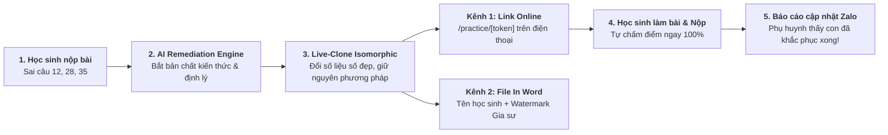

# KẾ HOẠCH TRIỂN KHAI SPRINT 2: AI REMEDIATION — PHIẾU LUYỆN BÙ LỖ HỔNG KIẾN THỨC
> **Tài liệu đặc tả kiến trúc, thuật toán và lộ trình triển khai chi tiết**  
> **Dự án:** EduTest AI — Tutor OS (Hệ điều hành Dạy thêm & Gia sư số 1 Việt Nam)  
> **Phiên bản:** v2.0-Sprint-2 | **Ngày ban hành:** 01/11/2026 | **Tác giả:** Tech Lead & Product Strategist

---

## 1. ĐỊNH VỊ CHIẾN LƯỢC & BÀI TOÁN KINH DOANH (STRATEGIC FIT)

### 1.1. Vấn đề nhức nhối của Phụ huynh & Gia sư Việt Nam
* **Phụ huynh:** Khi nhận được điểm kém (ví dụ 5/10), nỗi sợ lớn nhất là con bị hổng kiến thức nhưng không biết hổng chỗ nào và phải bắt đầu bù đắp từ đâu.
* **Gia sư & Giáo viên dạy thêm:** Muốn soạn bài tập khắc phục cho từng học sinh nhưng một lớp 20 - 30 em làm sai các câu khác nhau. Việc thủ công soạn 30 phiếu bài tập riêng cho 30 học sinh là bất khả thi về mặt thời gian.
* **Học sinh:** Cảm giác chán nản khi bị giao lại toàn bộ đề dài 40 câu; các em chỉ cần luyện đúng những câu mình đã làm sai với số liệu mới để chứng minh mình đã hiểu bài.

### 1.2. Giải pháp Đột phá của Tutor OS (The Magic Moment)
Sprint 2 hiện thực hóa **Bước 5 trong Vòng lặp Sư phạm Khép kín**:
$$\text{Lỗi sai bài kiểm tra} \xrightarrow{\text{AI Remediation Cloner}} \text{Phiếu luyện 3-5 câu tương tự số đẹp} \xrightarrow{\text{Làm online / In Word}} \text{Tự chấm \& Báo cáo tiến bộ về Zalo}$$



### 1.3. Phân tầng Thương mại hóa (Monetization Strategy)
* **Gói Free:** Trải nghiệm tạo 1 phiếu luyện bù mẫu cho 1 học sinh / kỳ thi.
* **Gói PRO (149k/tháng):** Tạo tối đa 20 phiếu luyện bù / tháng.
* **Gói MAX (229k/tháng) — "Gia Sư VIP":**
  * Không giới hạn số lượng phiếu luyện bù tạo bằng AI.
  * Xuất file Word (.docx) sạch 100%, có đóng dấu Watermark thương hiệu cá nhân của Gia sư (Tên trung tâm, SĐT, Slogan).
  * AI giải 3 bước chi tiết kèm **Tuyệt kỹ bấm máy tính Casio fx-580VNX** để học sinh xử lý nhanh câu trắc nghiệm.

---

## 2. KIẾN TRÚC KỸ THUẬT & CƠ SỞ DỮ LIỆU (DATABASE SCHEMA)

### 2.1. Thiết kế Bảng `remediation_sheets`
Bảng lưu trữ thông tin phiếu luyện bù cá nhân hóa theo từng học sinh và bài kiểm tra gốc.

```sql
-- Migration: 20261102_remediation_and_practice.sql

CREATE TABLE IF NOT EXISTS public.remediation_sheets (
    id UUID PRIMARY KEY DEFAULT gen_random_uuid(),
    token VARCHAR(32) UNIQUE NOT NULL,
    session_id TEXT NOT NULL REFERENCES public.grading_sessions(id) ON DELETE CASCADE,
    report_token VARCHAR(32) REFERENCES public.student_reports(token) ON DELETE SET NULL,
    student_id TEXT NOT NULL,
    student_name TEXT NOT NULL,
    student_code TEXT,
    class_name TEXT,
    subject TEXT NOT NULL DEFAULT 'Toán',
    grade TEXT NOT NULL DEFAULT '12',
    exam_title TEXT NOT NULL,
    
    -- Danh sách câu hỏi gốc bị làm sai
    target_questions JSONB NOT NULL DEFAULT '[]'::jsonb,
    
    -- Danh sách các câu hỏi đồng dạng được AI sinh ra
    cloned_questions JSONB NOT NULL DEFAULT '[]'::jsonb,
    
    -- Cấu hình hiển thị & Thương hiệu gia sư (MAX Tier)
    custom_branding JSONB DEFAULT '{
        "tutorName": null,
        "phone": null,
        "centerName": null,
        "slogan": null
    }'::jsonb,
    
    -- Trạng thái học sinh hoàn thành
    status VARCHAR(20) NOT NULL DEFAULT 'pending' CHECK (status IN ('pending', 'in_progress', 'completed')),
    submission_data JSONB DEFAULT NULL,
    score NUMERIC(4, 2) DEFAULT NULL,
    completed_at TIMESTAMPTZ DEFAULT NULL,
    
    created_at TIMESTAMPTZ NOT NULL DEFAULT timezone('utc'::text, now()),
    updated_at TIMESTAMPTZ NOT NULL DEFAULT timezone('utc'::text, now())
);

-- INDEXES TĂNG TỐC TRUY VẤN
CREATE INDEX IF NOT EXISTS idx_remediation_sheets_token ON public.remediation_sheets(token);
CREATE INDEX IF NOT EXISTS idx_remediation_sheets_session_student ON public.remediation_sheets(session_id, student_id);
CREATE INDEX IF NOT EXISTS idx_remediation_sheets_report_token ON public.remediation_sheets(report_token);

-- RLS POLICIES
ALTER TABLE public.remediation_sheets ENABLE ROW LEVEL SECURITY;

-- Cho phép học sinh đọc và làm bài qua token công khai
CREATE POLICY "Public can view practice sheet with valid token"
    ON public.remediation_sheets FOR SELECT
    USING (true);

-- Cho phép học sinh nộp bài và cập nhật kết quả qua token
CREATE POLICY "Public can submit practice sheet"
    ON public.remediation_sheets FOR UPDATE
    USING (true)
    WITH CHECK (true);

-- Cho phép giáo viên tạo và quản lý phiếu luyện bù
CREATE POLICY "Teachers can insert and manage remediation sheets"
    ON public.remediation_sheets FOR ALL
    USING (
        EXISTS (
            SELECT 1 FROM public.grading_sessions gs
            WHERE gs.id = remediation_sheets.session_id
            AND gs.user_id = auth.uid()
        )
    );
```

### 2.2. Cấu trúc JSON `cloned_questions`
Mỗi câu hỏi đồng dạng do AI sinh ra gồm:
```typescript
export interface ClonedQuestion {
  id: string;
  originalQuestionNumber: number; // Câu gốc trong đề (VD: Câu 12)
  cognitiveLevel: "recognition" | "comprehension" | "application" | "advancedApplication";
  content: string; // Đề bài mới (chứa công thức LaTeX inline $...$)
  options: {
    A: string;
    B: string;
    C: string;
    D: string;
  };
  correctAnswer: "A" | "B" | "C" | "D";
  explanation: string; // Lời giải chi tiết chuẩn sư phạm 3 bước
  casioTip?: string; // Mẹo bấm máy Casio fx-580VNX (đặc quyền MAX)
  conceptNote: string; // Bẫy sai lầm cần tránh
}
```

---

## 3. THUẬT TOÁN AI LIVE-CLONE & PROMPT ENGINEERING

### 3.1. Nguyên lý Isomorphic Question Cloning (Đồng dạng toán học)
Để đảm bảo đề thi đạt chất lượng khảo thí cao nhất:
1. **Bảo toàn lõi kiến thức (Core Invariant):** Không được thay đổi dạng toán. Ví dụ câu gốc hỏi về *Cực trị hàm số bậc 3 có tham số $m$*, câu mới cũng phải hỏi về cực trị hàm bậc 3 có tham số $m$.
2. **Số liệu số đẹp (Nice Numbers Guarantee):** Nghiệm của đạo hàm phải là số nguyên hoặc phân số đơn giản (như $x = 1, x = 3$, không được là căn thức phức tạp vô nghiệm hay mẫu số lẻ như $\frac{137}{99}$).
3. **Phân tích bẫy nhiễu (Plausible Distractors):** 3 đáp án sai phải phản ánh các lỗi sai kinh điển của học sinh (quên đổi dấu, quên điều kiện xác định, nhầm cực đại với giá trị cực đại).

### 3.2. Cấu trúc Prompt AI (Gemini 2.5 Flash / Flash Lite)
```text
Vai trò: Bạn là Chuyên gia Khảo thí và Giảng viên luyện thi Đại học hàng đầu Việt Nam.
Nhiệm vụ: Phân tích các câu hỏi học sinh làm sai dưới đây và sinh các câu hỏi ĐỒNG DẠNG (Isomorphic Questions) để học sinh luyện bù lỗ hổng kiến thức.

Dữ liệu đầu vào:
- Môn học: {subject} (Lớp {grade})
- Học sinh: {studentName}
- Danh sách câu làm sai:
{targetQuestionsList}

Yêu cầu kỹ thuật bắt buộc:
1. Mỗi câu làm sai sinh đúng 1 câu hỏi đồng dạng tương ứng.
2. Giữ nguyên 100% bản chất lý thuyết, dạng bài và phương pháp giải.
3. ĐỔI MỚI hoàn toàn ngữ cảnh và số liệu thành SỐ ĐẸP (nghiệm nguyên, tính toán gọn gàng).
4. Viết công thức Toán/Lý/Hóa bằng định dạng LaTeX chuẩn: $công thức inline$.
5. Đáp án A, B, C, D rõ ràng, chỉ duy nhất 1 đáp án đúng.
6. Cung cấp lời giải chi tiết 3 bước:
   - Bước 1: Nhận diện kiến thức & Điều kiện
   - Bước 2: Biến đổi & Tính toán
   - Bước 3: Kết luận & Mẹo bấm máy tính Casio fx-580VNX (nếu có)
```

---

## 4. ĐẶC TẢ API CONTRACTS & WORKFLOW

### 4.1. `POST /api/remediation/generate`
* **Mục đích:** Giáo viên bấm nút tạo phiếu cho học sinh.
* **Payload:**
```json
{
  "sessionId": "session_12a_toan",
  "studentId": "std_101",
  "studentName": "Nguyễn Hoàng Nam",
  "studentCode": "SBD12001",
  "className": "12A1",
  "subject": "Toán",
  "grade": "12",
  "examTitle": "Khảo Sát Chất Lượng Đầu Năm",
  "wrongQuestions": [
    {
      "questionNumber": 12,
      "cognitiveLevel": "comprehension",
      "studentAnswer": "B",
      "correctAnswer": "D",
      "content": "Tìm tất cả các giá trị thực của tham số m..."
    }
  ],
  "customBranding": {
    "tutorName": "Thầy Quang Toán",
    "phone": "0988.123.456",
    "centerName": "CLB Ôn Thi Đại Học Thủ Khoa"
  }
}
```
* **Response (200 OK):**
```json
{
  "success": true,
  "token": "rem_8f92aKx12M",
  "practiceUrl": "http://localhost:3001/practice/rem_8f92aKx12M",
  "totalCloned": 4,
  "sheet": { ... }
}
```

### 4.2. `GET /api/practice/[token]`
* **Mục đích:** Tải thông tin đề thi cho học sinh làm online hoặc phụ huynh xem.
* **Response (200 OK):** Trả về danh sách câu hỏi làm bài (giấu đáp án `correctAnswer` và `explanation` khi học sinh chưa nộp bài).

### 4.3. `POST /api/practice/[token]/submit`
* **Mục đích:** Học sinh nộp bài làm online.
* **Payload:** `{ studentAnswers: { "1": "A", "2": "C", ... } }`
* **Xử lý:**
  - Hệ thống tự động đối chiếu chấm điểm tức thì.
  - Cập nhật trạng thái `status = 'completed'` và lưu điểm `score`.
  - Mở khóa toàn bộ lời giải chi tiết và mẹo Casio.
  - Cập nhật đồng bộ vào trang báo cáo phụ huynh `/report/[token]`.

---

## 5. ĐẶC TẢ GIAO DIỆN NGƯỜI DÙNG (FRONTEND DESIGN)

### 5.1. Màn hình Giáo viên: Nút `[⚡ Tạo phiếu luyện bù]`
* **Vị trí:**
  1. Trong bảng danh sách học sinh tại [`session-detail-view.tsx`](file:///d:/Go-Live/Web/EdTeach/frontend/src/components/grading/session-detail-view.tsx) cạnh nút `[Gửi Zalo]`.
  2. Trong popup xem chi tiết học sinh `selectedStudentDetail`.
* **Popup tùy chọn:**
  - Hiển thị danh sách các câu làm sai (VD: "Phát hiện 6 câu làm sai: Câu 12, 18, 24, 31, 35, 38").
  - Checkbox chọn tạo phiếu cho tất cả câu sai hoặc chọn câu trọng tâm.
  - Nút bấm `[⚡ Sinh Phiếu Luyện Bù Tự Động Bằng AI]`.
  - Kết quả xuất hiện:
    - Nút `[📱 Copy Link Làm Online]` gửi cho học sinh/phụ huynh.
    - Nút `[📄 Xuất File Word In Trên Lớp]` (.docx chuẩn font Times New Roman, kèm logo lớp).

### 5.2. Màn hình Học sinh làm bài: `/practice/[token]`
* **Thiết kế:** Chuẩn Mobile-First (tối ưu cho iPhone, Android, iPad).
* **Header:** Tên học sinh, tên bài thi, đồng hồ đếm giờ làm bài, huy hiệu lớp.
* **Thân bài:** Danh sách câu hỏi kèm công thức LaTeX hiển thị sắc nét bằng KaTeX.
* **Chọn đáp án:** Các nút bấm A, B, C, D to, rõ ràng, phản hồi cảm ứng mượt mà.
* **Nút nộp bài:** Khi bấm `[Nộp bài & Xem điểm]`:
  - Hiệu ứng pháo hoa chúc mừng nếu đạt điểm cao.
  - Màn hình kết quả hiện điểm (VD: `5/5 câu đúng — 10/10 điểm!`).
  - Lời giải thích chi tiết 3 bước cho từng câu hỏi kèm mẹo bấm máy Casio.

### 5.3. Nâng cấp Trang Báo Cáo Phụ Huynh: `/report/[token]`
* Tích hợp thêm section: **"Phiếu Khắc Phục Lỗ Hổng Kiến Thức Cho Con"**:
  - Nếu học sinh chưa làm: Hiện nút kêu gọi `[👉 Mở bài luyện bù 5 câu cho con làm]` kèm lời nhắn của Thầy Cô.
  - Nếu học sinh đã làm xong: Hiện huy hiệu xanh rực rỡ **"Đã hoàn thành luyện bù: 5/5 câu đúng — Con đã làm chủ kiến thức!"**.

---

## 6. LỘ TRÌNH THỰC THI (SPRINT 2 ROADMAP & MILESTONES)

| Milestone | Nội dung công việc | Đầu ra kỹ thuật | Thời lượng |
|---|---|---|---|
| **M1: Database & Types** | Tạo migration bảng `remediation_sheets`, cập nhật `database.ts` | File `.sql` + Type definitions | 0.5 ngày |
| **M2: AI Live-Clone Engine** | Xây dựng prompt isomorphic, bộ giải thuật số đẹp và API `/api/remediation/generate` | `remediation-store.ts`, route API | 1.0 ngày |
| **M3: Student Online Webview** | Xây dựng trang `/practice/[token]` cho học sinh làm bài & tự chấm tức thì | Route `/practice/[token]` | 1.0 ngày |
| **M4: Word Export Engine** | Xuất phiếu in Word (.docx) cá nhân hóa kèm Watermark Gia sư | Generator `.docx` | 0.5 ngày |
| **M5: Teacher UI Integration** | Thêm nút `[⚡ Tạo phiếu luyện bù]` và modal tại `session-detail-view.tsx` | Component `remediation-modal.tsx` | 0.5 ngày |
| **M6: Parent Report Sync** | Cập nhật `/report/[token]` đồng bộ trạng thái bài tập của con | Nâng cấp `report-view.tsx` | 0.5 ngày |
| **M7: Verification & Testing** | Kiểm thử end-to-end qua Playwright, test tải và thẩm định UX | Test report 100% PASS | 0.5 ngày |

---

## 7. MA TRẬN RỦI RO & PHƯƠNG ÁN DỰ PHÒNG

| Rủi ro kỹ thuật | Mức độ | Phương án phòng ngừa & Xử lý |
|---|---|---|
| **Gemini AI sinh số liệu nghiệm xấu / vô nghiệm** | Trung bình | Tích hợp hệ thống kiểm tra điều kiện nghiệm (Root validation) trong Prompt và bộ fallback câu hỏi tương đương từ ngân hàng chuẩn |
| **Học sinh thoát trình duyệt khi đang làm dở** | Cao | Tự động lưu tiến độ vào `localStorage` theo từng giây, khi mở lại tự khôi phục đáp án đã chọn |
| **Học sinh xem trước đáp án qua F12 Network** | Cao | Endpoint `GET /api/practice/[token]` kiểm tra trạng thái: chỉ trả về `correctAnswer` và `explanation` sau khi học sinh đã nộp bài |
| **Độ trễ khi sinh AI cho nhiều học sinh cùng lúc** | Thấp | Sử dụng model `gemini-flash-lite-latest` với tốc độ phản hồi < 1.5s/câu, kết hợp streaming hoặc queue background |

---

## 8. TIÊU CHÍ NGHIỆM THU HOÀN THÀNH SPRINT 2 (DEFINITION OF DONE)
1. **Database:** Migration chạy thành công, hỗ trợ cả lưu trữ Supabase và in-memory fallback.
2. **AI Cloning:** Sinh được 3 - 5 câu hỏi đồng dạng chuẩn toán học từ các câu làm sai với số liệu số đẹp và barem 3 bước.
3. **Student Experience:** Học sinh mở `/practice/[token]` trên điện thoại, làm bài mượt mà, bấm nộp bài và nhận điểm số + lời giải ngay lập tức.
4. **Parent Experience:** Trang `/report/[token]` hiển thị tiến độ bài luyện bù và cập nhật theo thời gian thực.
5. **Teacher Experience:** Thầy/Cô bấm 1 nút tạo phiếu, có thể xuất cả link online lẫn bản in Word gửi học sinh.
