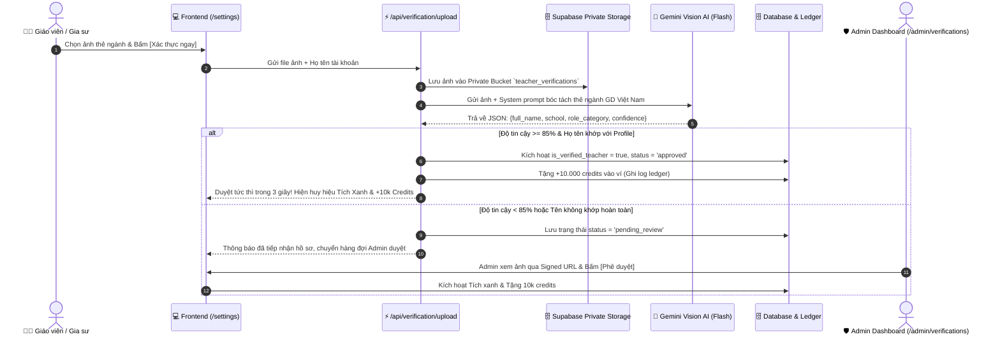

# KẾ HOẠCH TRIỂN KHAI SPRINT 3: XÁC THỰC THẺ NGÀNH GIÁO VIÊN BẰNG AI OCR (TEACHER eKYC & TÍCH XANH CHÍNH CHỦ)
> **Tài liệu đặc tả kiến trúc, thuật toán và lộ trình triển khai chi tiết**  
> **Dự án:** EduTest AI — Tutor OS (Hệ điều hành Dạy thêm & Gia sư số 1 Việt Nam)  
> **Phiên bản:** v2.0-Sprint-3 | **Ngày ban hành:** 01/11/2026 | **Tác giả:** Tech Lead & Product Strategist

---

## 1. ĐỊNH VỊ CHIẾN LƯỢC & BÀI TOÁN KINH DOANH (STRATEGIC FIT)

### 1.1. Tại sao Tích Xanh Giáo Viên là "Vũ Khí Sát Thương" của Tutor OS?
1. **Niềm tin của Phụ huynh (Trust & Social Proof):** 
   - 92% phụ huynh Việt Nam khi thuê gia sư hoặc cho con học thêm đều quan tâm hàng đầu đến bằng cấp, trường lớp và chuyên môn của giáo viên.
   - Khi phụ huynh mở phiếu báo cáo Zalo (`/report/[token]`) hoặc bài tập luyện bù (`/practice/[token]`), huy hiệu **✓ Giáo viên xác thực: Trường THPT Chuyên Lê Hồng Phong** tạo ra sự an tâm tuyệt đối, là cơ sở để phụ huynh sẵn sàng trả học phí cao và gắn bó lâu dài.
2. **Kích thích Đăng ký Thực (Incentivized Growth Loop):**
   - Đưa ra combo **"3-in-1 Perks"**: Tích Xanh Uy Tín + 10.000 credits khởi nghiệp + Tăng hạn mức tạo đề lên 10 đề/ngày.
   - Đây là đòn bẩy biến giáo viên dùng thử (Free tier) thành người dùng hoạt động tích cực (Active User) và gắn bó mật thiết với nền tảng.
3. **Phân loại vai trò Sư phạm Chuẩn hóa (RBAC Specialization):**
   - Tự động phân loại huy hiệu theo đúng danh tính nghề nghiệp:
     - `✓ Giáo viên [Tên Trường]` (Giáo viên trường THCS/THPT)
     - `✓ Gia sư Sư phạm [Tên Trường ĐH]` (Sinh viên / Cử nhân Sư phạm)
     - `✓ Giảng viên Trung tâm [Tên Trung Tâm]` (Giáo viên trung tâm ngoại ngữ/dạy thêm)

---

## 2. KIẾN TRÚC VẬN HÀNH HYBRID & CƠ CHẾ DUYỆT AI OCR



---

## 3. THIẾT KẾ CƠ SỞ DỮ LIỆU & BẢO MẬT (DATABASE SCHEMA)

### 3.1. File Migration: `supabase/migrations/20261103_teacher_verifications.sql`

```sql
-- 1. BẢNG TEACHER_VERIFICATIONS
CREATE TABLE IF NOT EXISTS public.teacher_verifications (
    id UUID PRIMARY KEY DEFAULT gen_random_uuid(),
    user_id UUID NOT NULL REFERENCES public.users(id) ON DELETE CASCADE,
    document_type VARCHAR(50) NOT NULL CHECK (document_type IN ('teacher_card', 'student_card', 'degree_certificate', 'center_card')),
    image_url TEXT NOT NULL, -- Đường dẫn storage private
    status VARCHAR(20) NOT NULL DEFAULT 'pending_review' CHECK (status IN ('approved', 'rejected', 'pending_review')),
    
    -- Dữ liệu AI Vision bóc tách
    ocr_extracted_name TEXT,
    ocr_extracted_school TEXT,
    ocr_extracted_code TEXT,
    ocr_confidence NUMERIC(4, 2),
    role_category VARCHAR(30) DEFAULT 'teacher' CHECK (role_category IN ('teacher', 'tutor', 'center_lecturer')),
    
    -- Kiểm duyệt & Lý do
    admin_reviewed_by UUID REFERENCES public.users(id) ON DELETE SET NULL,
    rejection_reason TEXT,
    reviewed_at TIMESTAMPTZ,
    
    -- Metadata
    created_at TIMESTAMPTZ NOT NULL DEFAULT timezone('utc'::text, now()),
    updated_at TIMESTAMPTZ NOT NULL DEFAULT timezone('utc'::text, now())
);

-- 2. INDEXES
CREATE INDEX IF NOT EXISTS idx_teacher_verifications_user_id ON public.teacher_verifications(user_id);
CREATE INDEX IF NOT EXISTS idx_teacher_verifications_status ON public.teacher_verifications(status);

-- 3. RLS POLICIES
ALTER TABLE public.teacher_verifications ENABLE ROW LEVEL SECURITY;

-- Giáo viên xem hồ sơ của chính mình
CREATE POLICY "Users can view own verification record"
    ON public.teacher_verifications FOR SELECT
    USING (auth.uid() = user_id);

-- Giáo viên được gửi hồ sơ mới
CREATE POLICY "Users can insert own verification"
    ON public.teacher_verifications FOR INSERT
    WITH CHECK (auth.uid() = user_id);

-- Admin toàn quyền xem và cập nhật hồ sơ
CREATE POLICY "Admins have full access to verifications"
    ON public.teacher_verifications FOR ALL
    USING (
        EXISTS (
            SELECT 1 FROM public.users u
            WHERE u.id = auth.uid() AND u.role = 'admin'
        )
    );
```

### 3.2. Tuân thủ Bảo mật Dữ liệu Riêng tư (Nghị định 13/2023/NĐ-CP)
* Toàn bộ ảnh thẻ ngành được lưu trong **Supabase Private Storage Bucket** `teacher-verifications` (không bật public access).
* Frontend truy xuất ảnh thông qua **Signed URL** có thời hạn tối đa 15 phút.
* Cho phép giáo viên làm mờ số CCCD/CMND nếu muốn (hệ thống chỉ trích xuất họ tên, trường công tác, niên khóa/mã thẻ).

---

## 4. THUẬT TOÁN AI VISION OCR & PROMPT ENGINEERING

Sử dụng model đa phương thức **Gemini 2.5 Flash** để bóc tách thông tin từ ảnh chụp thẻ:
```text
Vai trò: Bạn là Hệ thống AI Chuyên gia Giám định Thẻ ngành & Văn bằng Giáo dục Việt Nam.
Nhiệm vụ: Phân tích ảnh chụp thẻ ngành/thẻ sinh viên/bằng cấp giáo viên được cung cấp và trích xuất dữ liệu xác thực danh tính.

Các loại thẻ hợp lệ:
1. Thẻ viên chức giáo dục / Thẻ giáo viên trường THCS, THPT, Đại học, Cao đẳng.
2. Thẻ sinh viên các trường Đại học Sư phạm (ĐH Sư phạm Hà Nội, ĐH Sư phạm TP.HCM, ĐH Giáo dục - ĐHQGHN, ĐH Sư phạm Huế, v.v.).
3. Thẻ giảng viên/nhân viên các trung tâm luyện thi, trung tâm ngoại ngữ, trường tư thục.
4. Bằng tốt nghiệp Đại học chuyên ngành Sư phạm.

Yêu cầu trích xuất định dạng JSON:
{
  "is_valid_document": true / false,
  "document_type": "teacher_card" | "student_card" | "degree_certificate" | "center_card" | "unknown",
  "full_name": "Họ và tên ghi trên thẻ (viết hoa chuẩn)",
  "school_or_organization": "Tên trường học hoặc đơn vị công tác",
  "card_number": "Mã số thẻ / mã cán bộ / mã sinh viên",
  "role_category": "teacher" | "tutor" | "center_lecturer",
  "confidence_score": 0.0 -> 1.0,
  "confidence_reason": "Giải thích ngắn gọn căn cứ xác thực"
}
```

---

## 5. ĐẶC TẢ API CONTRACTS

### 5.1. `POST /api/verification/upload`
* **Mục đích:** Giáo viên tải ảnh thẻ ngành lên để AI thẩm định.
* **Payload:** `multipart/form-data` chứa `file: File`, `documentType?: string`.
* **Quy trình xử lý:**
  1. Kiểm tra xác thực user qua JWT session.
  2. Upload ảnh vào private bucket `teacher-verifications/{userId}_{timestamp}.jpg`.
  3. Gọi Gemini Vision OCR bóc tách thông tin.
  4. Đối chiếu tên trên thẻ với `profile.full_name` (chuẩn hóa tiếng Việt không dấu và chữ hoa).
  5. Nếu `confidence_score >= 0.85` và tên trùng khớp:
     - Cập nhật `users.is_verified_teacher = true`, `users.verified_school = school_or_organization`.
     - Tặng +10.000 credits vào ví (ghi ledger transaction).
     - Trả về status: `"approved"` và kích hoạt Tích Xanh ngay lập tức.
  6. Nếu không khớp hoàn toàn:
     - Lưu hồ sơ với status: `"pending_review"`.
     - Trả về status: `"pending_review"`, chuyển hàng đợi Admin.

### 5.2. `GET /api/verification/status`
* **Mục đích:** Kiểm tra trạng thái xác thực hiện tại của giáo viên (đã duyệt, đang chờ duyệt, bị từ chối).

### 5.3. `GET /api/admin/verifications` & `POST /api/admin/verifications/review`
* **Mục đích:** Dành cho Admin xem danh sách hồ sơ `pending_review` và bấm Phê duyệt/Từ chối.

---

## 6. GIAO DIỆN NGƯỜI DÙNG (FRONTEND EXPERIENCES)

### 6.1. Trang Cài Đặt Hồ Sơ (`/settings`)
* **Card Xác thực Danh tính Giáo viên (Tutor OS eKYC):**
  - Trạng thái chưa xác thực:
    - Banner mời gọi: *"Xác thực thẻ ngành để nhận Tích Xanh Uy Tín trên Báo Cáo Zalo + 10.000 credits khởi đầu!"*.
    - Khu vực kéo thả / tải ảnh thẻ ngành (chấp nhận JPG, PNG, WebP).
    - Hướng dẫn chụp ảnh rõ nét, không bị lóa sáng.
    - Nút bấm `[⚡ Thẩm định tự động bằng AI]`.
  - Trạng thái đã duyệt:
    - Huy hiệu rực rỡ: **✓ Giáo viên đã xác thực: Trường THPT Chuyên...**.
    - Ngày xác thực & mã chứng nhận điện tử.
  - Trạng thái đang chờ duyệt:
    - Hộp thông báo màu vàng: *"Hồ sơ đang được Admin kiểm duyệt trong vòng 24h"*.

### 6.2. Banner Nhắc nhở Trên Dashboard (`/dashboard`)
* Một banner trang nhã xuất hiện ở đầu Dashboard nếu giáo viên chưa xác thực:
  > *"Thầy/Cô chưa kích hoạt Tích Xanh Chính Chủ. Xác thực ngay để tăng 3x độ tin cậy đối với Phụ huynh và nhận 10.000 credits khởi nghiệp!"* `[Xác thực ngay ➔]`

### 6.3. Hiển thị Tích Xanh Trên Toàn Hệ Thống
* **Trang Báo Cáo Phụ Huynh (`/report/[token]`):** Huy hiệu **✓ Giáo viên xác thực: Cô Mai Phương (THPT Chuyên Chu Văn An)**.
* **Trang Luyện Bù Kiến Thức (`/practice/[token]`):** Thẻ xác thực sư phạm đính kèm hotline và slogan trung tâm.
* **Bục Giảng Số (`/teach/[examId]`):** Tên giáo viên kèm tích xanh bảo chứng bản quyền đề thi.

---

## 7. KẾ HOẠCH TRIỂN KHAI 6 MILESTONES (SP3-01 ➔ SP3-06)

| Milestone | Nội dung công việc | Đầu ra kỹ thuật | Thời lượng |
|---|---|---|---|
| **SP3-01** | **Database Migration & Storage Bucket** | File migration `20261103_teacher_verifications.sql`, private bucket `teacher-verifications`, RLS | Migration file + Types | 0.5 ngày |
| **SP3-02** | **Gemini Vision OCR Engine** | Module bóc tách thẻ ngành bằng Gemini 2.5 Flash tại `frontend/src/lib/verification/ocr-engine.ts` | OCR Module | 1.0 ngày |
| **SP3-03** | **Verification API Hub** | Endpoints: `/api/verification/upload`, `/api/verification/status`, `/api/admin/verifications` | API routes | 0.5 ngày |
| **SP3-04** | **Credit Reward & Ledger Hook** | Tự động cộng +10.000 credits và nâng daily quota lên 10 đề/ngày khi duyệt thành công | Ledger integration | 0.5 ngày |
| **SP3-05** | **Settings UI & Dashboard Banner** | Giao diện upload thẻ ngành tại `/settings`, banner nhắc nhở tại `/dashboard` | Frontend components | 1.0 ngày |
| **SP3-06** | **Admin Review Dashboard** | Màn hình `/admin/verifications` cho Admin duyệt nhanh hồ sơ thủ công | Admin page | 0.5 ngày |

---

## 8. TIÊU CHÍ NGHIỆM THU HOÀN THÀNH SPRINT 3 (DEFINITION OF DONE)
1. **AI OCR bóc tách chuẩn xác:** Nhận diện đúng Họ tên, Trường, Mã thẻ từ ảnh chụp thẻ giáo viên/sinh viên với độ tin cậy $> 85\%$.
2. **Auto-Approval mượt mà:** Tài khoản trùng khớp họ tên được tự động kích hoạt Tích Xanh trong vòng 3 giây.
3. **Phần thưởng tự động kích hoạt:** Cộng ngay 10.000 credits vào ví người dùng và nâng hạn mức tạo đề lên 10 đề/ngày.
4. **Hiển thị Tích Xanh đồng bộ:** Mọi phiếu báo cáo Zalo phụ huynh `/report/[token]` và bài tập luyện bù `/practice/[token]` tự động hiển thị huy hiệu xác thực chính chủ của Thầy/Cô.
5. **Kiểm thử End-to-End 100% PASS.**
