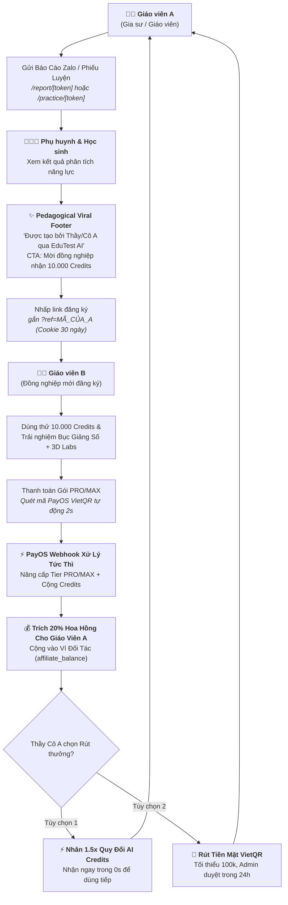

# KẾ HOẠCH TRIỂN KHAI SPRINT 4 (SPRINT 4 IMPLEMENTATION PLAN)
## ĐÒN BẨY LAN TỎA VIRAL & KÍCH HOẠT DOANH THU SỐ (GROWTH & MONETIZATION ENGINE)

> **Tài liệu tham chiếu:** `docs/Sprint_4_Plan.md`  
> **Dự án:** EduTest AI — Tutor OS (Hệ Điều Hành Dạy Thêm & Gia Sư Số 1 Việt Nam)  
> **Phiên bản:** v1.0  
> **Trạng thái:** Sẵn sàng triển khai (Approved via `/grill-me`)  
> **Tác giả:** Tech Lead & Core Engineering Team

---

## 1. BỐI CẢNH VÀ MỤC TIÊU CHIẾN LƯỢC

### 1.1. Hiện trạng sau 3 Sprints nền tảng
* **Sprint 1 (Hoàn tất):** Báo cáo học tập Zalo Magic Link 1-Click (`/report/[token]`), ma trận 4 cấp độ nhận thức GDPT 2025, nhận xét AI cá nhân hóa.
* **Sprint 2 (Hoàn tất):** AI Luyện bù lỗ hổng kiến thức (`/practice/[token]`), tự động nhân bản 3-5 câu tương tự số đẹp từ câu sai, tự chấm 100%, xuất file Word kép kèm Watermark gia sư.
* **Sprint 3 (Hoàn tất):** Hệ thống eKYC Giáo viên bằng AI Vision OCR thẻ ngành sư phạm, cấp Tích Xanh uy tín, combo perks (+10.000 credits, 10 đề/ngày), Settings & Admin verification portal.

### 1.2. Mục tiêu trọng tâm của Sprint 4
Khép kín **Vòng lặp Thương mại hóa & Tăng trưởng Tự nhiên (Viral Growth & Monetization Loop)**:
1. **Viral Touchpoint:** Tận dụng 100% lượt xem báo cáo của Phụ huynh và học sinh làm bài tập bù để biến thành kênh tuyển sinh Giáo viên/Gia sư hoàn toàn miễn phí (CAC = 0đ).
2. **Instant Revenue Activation:** Trải nghiệm nâng cấp gói PRO (149k) & MAX (229k) thanh toán qua PayOS VietQR tự động kích hoạt tính năng trong < 2 giây.
3. **Affiliate Hybrid Engine:** Trao quyền cho Giáo viên/Gia sư trở thành đối tác kinh doanh với chính sách hoa hồng 20% trọn đời — linh hoạt rút tiền mặt VietQR hoặc nhân 1.5x quy đổi sang AI Credits.

---

## 2. KIẾN TRÚC TỔNG THỂ VÒNG LẶP TĂNG TRƯỞNG (GROWTH LOOP ARCHITECTURE)



---

## 3. ĐẶC TẢ CHI TIẾT 5 PHÂN HỆ TRIỂN KHAI (TECHNICAL SPECIFICATIONS)

### 3.1. Phân hệ 1: Viral Footers & Attribution Engine trên Trang Công Khai

#### A. Điểm chạm giao diện (Touchpoints)
Tích hợp Footer Sư phạm tinh tế ở cuối 2 trang công khai:
* [`frontend/src/app/report/[token]/report-view.tsx`](file:///d:/Go-Live/Web/EdTeach/frontend/src/app/report/[token]/report-view.tsx) (Báo cáo Phụ huynh).
* [`frontend/src/app/practice/[token]/practice-view.tsx`](file:///d:/Go-Live/Web/EdTeach/frontend/src/app/practice/[token]/practice-view.tsx) (Phiếu Luyện bù Bổ trợ).

#### B. Thiết kế nội dung Footer (Pedagogical Glassmorphism Banner)
* **Badge bảo chứng:** *"✨ Báo cáo học tập & Phiếu bổ trợ số hóa được bảo chứng bởi EduTest AI — Đồng hành cùng Thầy Cô 4.0"*.
* **Tôn vinh Giáo viên biên soạn:** *"Biên soạn chuyên môn: Thầy/Cô {teacher_name} ({teacher_school_or_subject}) — Đã xác thực Thẻ ngành sư phạm 🌟"*.
* **CTA Chuyển đổi cao:** *"Thầy Cô đồng nghiệp muốn tạo bài thi chuẩn GDPT 2025, chấm OMR tốc độ và gửi báo cáo Zalo 1-click như Thầy/Cô {teacher_name}?"*
* **Nút bấm:** `[🚀 Trải Nghiệm Miễn Phí — Tặng 10.000 Credits]` dẫn đến `/register?ref={referral_code}`.

#### C. Cơ chế Attribution Tracking (30-day Cookie & LocalStorage)
* Khi khách bấm link hoặc truy cập có `?ref=CODE`:
  - Lưu mã vào Cookie `edutest_ref_code` (maxAge: 30 ngày) và `localStorage.setItem('edutest_ref_code', code)`.
* Khi hoàn tất đăng ký tài khoản (Google OAuth hoặc Email/Password):
  - Backend đọc `edutest_ref_code`, tra cứu `users.id` của người giới thiệu.
  - Tự động cập nhật `users.referred_by = inviter_id`.
  - Tự động tạo bản ghi trong `public.referrals` và thưởng ngay 10.000 Credits chào mừng cho cả 2 bên.

---

### 3.2. Phân hệ 2: Cổng Thanh Toán PayOS VietQR & Nâng Cấp Gói PRO/MAX Tức Thì

#### A. Chuẩn hóa Bảng Giá & Danh Mục Gói Cước
| Gói cước | Giá niêm yết | Chu kỳ | Credits cộng ví | Đặc quyền nổi bật | Tier gắn DB |
|---|:---:|:---:|:---:|---|:---:|
| **Giáo Viên PRO** | 149.000đ | Hàng tháng | +30.000 | Mở trọn bộ 54+ Labs 3D, Xuất Word kép sạch, Báo cáo Zalo không giới hạn, Trộn 4 mã đề | `pro` |
| **PRO Học Kỳ** | 599.000đ | 5 tháng | +150.000 | Tiết kiệm 20% (146.000đ), đồng hành trọn mùa thi | `pro` |
| **Luyện Thi MAX** | 229.000đ | Hàng tháng | +100.000 | AI Remediation Luyện bù lỗ hổng, Trộn 8-12 mã đề, Watermark gia sư riêng | `max` |
| **MAX Học Kỳ** | 899.000đ | 5 tháng | +500.000 | Tiết kiệm 246.000đ, ưu tiên DeepSeek-R1 suy luận sâu | `max` |

#### B. Màn hình Bảng Giá & Nâng Cấp (`/pricing`)
* Route mới: `frontend/src/app/(dashboard)/pricing/page.tsx`.
* Bảng so sánh 3 cột (FREE vs PRO vs MAX) có switch chuyển đổi Tháng / Học kỳ (Tiết kiệm 20-25%).
* Badge nổi bật: *"Khuyên dùng cho Gia sư dạy kèm"* (Gói MAX), *"Phổ biến nhất"* (Gói PRO).
* Nút bấm `[Nâng Cấp Ngay]` mở Modal VietQR tự động sinh đơn hàng.

#### C. Nâng cấp Modal Thanh Toán PayOS VietQR Real-time
* Sinh mã QR Napas247 động qua PayOS API kèm số tiền chính xác và nội dung chuyển khoản bảo mật duy nhất.
* Bộ đếm ngược 15 phút, hướng dẫn 3 bước: Mở app ngân hàng $\rightarrow$ Quét mã QR $\rightarrow$ Xác nhận.
* Client-side polling định kỳ 1.5s gọi `/api/payment/check-status?orderCode=...`:
  - Ngay khi nhận trạng thái `PAID` từ Webhook:
  - Hiệu ứng pháo hoa Confetti rực rỡ toàn màn hình.
  - Cập nhật Auth Context `tier = 'pro' | 'max'`, cập nhật số dư credits.
  - Toast thông báo âm thanh vui vẻ: *"Chúc mừng Thầy Cô đã nâng cấp thành công gói [Tên Gói]!"*.

---

### 3.3. Phân hệ 3: Cơ Chế Trích Hoa Hồng Tự Động Trong PayOS Webhook

#### Quy trình xử lý tại `/api/payment/webhook/payos/route.ts`:
1. Xác thực chữ ký số HMAC SHA256 với `PAYOS_CHECKSUM_KEY`.
2. Kiểm tra tính hợp lệ và chống trùng lặp đơn hàng (Idempotency).
3. Cộng Credits vào bảng `wallets` và nâng cấp `users.tier`.
4. **Logic trích hoa hồng 20%:**
   * Kiểm tra người thanh toán có `referred_by` hay không.
   * Nếu có `referred_by` (Ví dụ Thầy A giới thiệu Thầy B):
     - Kiểm tra an toàn: `referred_by !== userId` (chống tự giới thiệu).
     - Tính hoa hồng: `commission_amount = Math.round(paidAmount * 0.20)`.
     - Insert bản ghi vào bảng `affiliate_commissions`:
       `{ inviter_id: referred_by, invitee_id: userId, order_code, order_amount: paidAmount, commission_rate: 0.20, commission_amount }`.
     - Cập nhật số dư người giới thiệu trong bảng `users`:
       `affiliate_balance = affiliate_balance + commission_amount`, `total_affiliate_earned = total_affiliate_earned + commission_amount`.
     - Tạo thông báo hệ thống gửi tới Thầy A: *"🎉 Bạn vừa nhận được +{commission_amount.toLocaleString()}đ hoa hồng từ đồng nghiệp nâng cấp gói!"*.

---

### 3.4. Phân hệ 4: Mạng Lưới Đối Tác & Dashboard Quản Lý Hoa Hồng (`/affiliate`)

#### A. Vị trí Menu Navigation
Bổ sung liên kết chuyên biệt trong Sidebar [`frontend/src/app/(dashboard)/layout.tsx`](file:///d:/Go-Live/Web/EdTeach/frontend/src/app/(dashboard)/layout.tsx):
* Icon: `Gift` hoặc `Users`
* Label: *"Đối tác & Hoa hồng"*
* Route: `/affiliate`

#### B. Các khối giao diện chính của `/affiliate`
1. **Hero Box — Công cụ Lan tỏa:**
   * Hiển thị Mã giới thiệu (VD: `EDU8K92X`).
   * Link giới thiệu: `https://edutest.ai/register?ref=EDU8K92X` kèm nút `[Sao chép Link]`.
   * Nút `[Tải mã QR Giới thiệu]` (tự động render QR Code SVG để dán lên slide bài giảng hoặc in giấy).
2. **Khu vực Thống kê Tài chính (Metric Cards):**
   * **Tổng hoa hồng tích lũy:** Hiển thị tổng số tiền đã kiếm được trọn đời (VND).
   * **Số dư hoa hồng khả dụng:** Số tiền hiện có thể rút hoặc quy đổi.
   * **Đồng nghiệp đã mời:** Số lượng giáo viên đã đăng ký qua link.
   * **Tỷ lệ chuyển đổi:** Số người đã nâng cấp PRO/MAX.
3. **Cơ chế Rút thưởng Hybrid 2 Nút Bấm:**
   * **Nút 1: `[⚡ Đổi sang AI Credits (x1.5)]`:**
     - Tỷ lệ ưu đãi siêu hời: $1.000đ = 1.500 Credits$ (thưởng thêm 50% sức mạnh tính toán AI).
     - Xử lý 100% tức thì trong 0 giây: Trừ `affiliate_balance`, cộng thẳng vào `wallets.balance`.
     - Thầy Cô không mất thời gian chờ đợi đối soát.
   * **Nút 2: `[🏦 Rút Tiền Mặt VietQR]`:**
     - Điều kiện: Số dư khả dụng tối thiểu 100.000đ.
     - Modal nhập thông tin ngân hàng: Chọn Ngân hàng (Danh sách 40+ ngân hàng Việt Nam Napas), Số tài khoản, Tên chủ tài khoản.
     - Tạo yêu cầu rút tiền `status: 'pending'` lưu vào bảng `affiliate_payouts`.
4. **Bảng Lịch Sử Giao Dịch & Hoa Hồng:**
   * Bảng chi tiết: Thời gian, Đồng nghiệp (mã hóa riêng tư: `nguy***@gmail.com`), Gói cước đã mua, Số tiền hoa hồng nhận được (+VND).

---

### 3.5. Phân hệ 5: Cổng Admin Đối Soát & Phê Duyệt Rút Tiền (`/admin/affiliate`)

#### A. Giao diện Quản trị Viên
* Route: `frontend/src/app/(dashboard)/admin/affiliate/page.tsx`.
* Danh sách yêu cầu rút tiền mặt kèm bộ lọc: `Tất cả`, `Đang chờ duyệt (Pending)`, `Đã chi trả (Completed)`, `Từ chối (Rejected)`.
* Hiển thị thông tin chuyển khoản: Ngân hàng, STK, Tên chủ thẻ, Số tiền VND.

#### B. Cơ chế Phòng Chống Gian Lận (Anti-Fraud & Anti-Self-Referral)
* Hệ thống tự động gắn cờ cảnh báo rủi ro (Risk Flags):
  - **Trùng IP / Device:** Người giới thiệu và người nạp tiền thao tác trên cùng một dải IP.
  - **Tài khoản mới tạo nạp tiền bất thường:** Đăng ký và nạp tiền trong < 2 phút rồi yêu cầu rút hoa hồng ngay.
* Hành động của Admin:
  - Bấm `[Duyệt Chuyển Khoản]`: Nhập mã tham chiếu ngân hàng (FTxxxx) $\rightarrow$ Trạng thái chuyển `completed`.
  - Bấm `[Từ Chối]`: Nhập lý do (Ví dụ: "Phát hiện tự giới thiệu chính mình") $\rightarrow$ Hoàn tiền lại `affiliate_balance` cho user hoặc khóa tài khoản vi phạm.

---

## 4. BẢN THIẾT KẾ CƠ SỞ DỮ LIỆU (DATABASE SCHEMA MIGRATION)

File migration: `supabase/migrations/20261104_growth_and_monetization.sql`

```sql
-- ========================================================
-- EduTest AI - Sprint 4: Growth & Monetization Engine
-- ========================================================

-- 1. Bổ sung các trường quản lý hoa hồng trong bảng users
ALTER TABLE public.users 
ADD COLUMN IF NOT EXISTS affiliate_balance NUMERIC(12, 2) NOT NULL DEFAULT 0,
ADD COLUMN IF NOT EXISTS total_affiliate_earned NUMERIC(12, 2) NOT NULL DEFAULT 0,
ADD COLUMN IF NOT EXISTS subscription_expires_at TIMESTAMPTZ;

-- Đảm bảo index cho tra cứu referral_code
CREATE INDEX IF NOT EXISTS idx_users_referral_code ON public.users(referral_code);
CREATE INDEX IF NOT EXISTS idx_users_referred_by ON public.users(referred_by);

-- 2. Bảng Lịch sử Hoa hồng (Affiliate Commissions)
CREATE TABLE IF NOT EXISTS public.affiliate_commissions (
    id UUID PRIMARY KEY DEFAULT gen_random_uuid(),
    inviter_id UUID NOT NULL REFERENCES public.users(id) ON DELETE CASCADE,
    invitee_id UUID NOT NULL REFERENCES public.users(id) ON DELETE CASCADE,
    order_code TEXT NOT NULL,
    order_amount NUMERIC(12, 2) NOT NULL,
    commission_rate NUMERIC(4, 2) NOT NULL DEFAULT 0.20,
    commission_amount NUMERIC(12, 2) NOT NULL,
    created_at TIMESTAMPTZ NOT NULL DEFAULT timezone('utc'::text, now())
);

CREATE INDEX IF NOT EXISTS idx_affiliate_commissions_inviter ON public.affiliate_commissions(inviter_id);
CREATE INDEX IF NOT EXISTS idx_affiliate_commissions_order ON public.affiliate_commissions(order_code);

-- 3. Bảng Yêu cầu Rút tiền Hoa hồng (Affiliate Payouts)
CREATE TABLE IF NOT EXISTS public.affiliate_payouts (
    id UUID PRIMARY KEY DEFAULT gen_random_uuid(),
    user_id UUID NOT NULL REFERENCES public.users(id) ON DELETE CASCADE,
    payout_type TEXT NOT NULL CHECK (payout_type IN ('cash', 'credits')),
    amount_vnd NUMERIC(12, 2) NOT NULL,
    credits_received INTEGER DEFAULT 0,
    bank_code TEXT,
    bank_account TEXT,
    bank_account_name TEXT,
    status TEXT NOT NULL DEFAULT 'pending' CHECK (status IN ('pending', 'completed', 'rejected')),
    admin_note TEXT,
    reference_code TEXT,
    created_at TIMESTAMPTZ NOT NULL DEFAULT timezone('utc'::text, now()),
    processed_at TIMESTAMPTZ
);

CREATE INDEX IF NOT EXISTS idx_affiliate_payouts_user ON public.affiliate_payouts(user_id);
CREATE INDEX IF NOT EXISTS idx_affiliate_payouts_status ON public.affiliate_payouts(status);

-- 4. Bật Row Level Security (RLS)
ALTER TABLE public.affiliate_commissions ENABLE ROW LEVEL SECURITY;
ALTER TABLE public.affiliate_payouts ENABLE ROW LEVEL SECURITY;

-- Policy cho affiliate_commissions
CREATE POLICY "Users can view their own commissions"
    ON public.affiliate_commissions FOR SELECT
    USING (auth.uid() = inviter_id);

CREATE POLICY "Service role manages commissions"
    ON public.affiliate_commissions FOR ALL
    USING (auth.jwt()->>'role' = 'service_role' OR auth.role() = 'service_role');

-- Policy cho affiliate_payouts
CREATE POLICY "Users can view and create their own payouts"
    ON public.affiliate_payouts FOR ALL
    USING (auth.uid() = user_id)
    WITH CHECK (auth.uid() = user_id);

CREATE POLICY "Admin can review all payouts"
    ON public.affiliate_payouts FOR ALL
    USING (
        EXISTS (
            SELECT 1 FROM public.users 
            WHERE id = auth.uid() AND (email LIKE '%admin%' OR email = 'truongcri0101@gmail.com')
        )
    );
```

---

## 5. DANH SÁCH FILE & PHÂN CÔNG THI CÔNG CHI TIẾT (WORK BREAKDOWN)

| STT | File cần tạo / cập nhật | Nhiệm vụ kỹ thuật |
|:---:|---|---|
| **1** | `supabase/migrations/20261104_growth_and_monetization.sql` | Migration tạo cột hoa hồng, bảng `affiliate_commissions` và `affiliate_payouts`. |
| **2** | `frontend/src/types/database.ts` | Bổ sung TypeScript types cho các trường hoa hồng và bảng mới. |
| **3** | `frontend/src/lib/affiliate/affiliate-store.ts` | Logic xử lý đọc/ghi hoa hồng, tạo yêu cầu rút tiền mặt, hàm quy đổi credits 1.5x. |
| **4** | `frontend/src/app/api/affiliate/route.ts` & `/convert-credits/route.ts` & `/payout/route.ts` | APIs lấy số dư hoa hồng, đổi credits tức thì, gửi yêu cầu rút tiền về VietQR. |
| **5** | `frontend/src/app/api/payment/webhook/payos/route.ts` | Tích hợp trích tự động 20% hoa hồng cho `referred_by` khi đơn hàng thành công. |
| **6** | `frontend/src/components/public/pedagogical-viral-footer.tsx` | Component Footer kính mờ sư phạm, tôn vinh Thầy Cô biên soạn kèm nút CTA mời đồng nghiệp. |
| **7** | `frontend/src/app/report/[token]/report-view.tsx` & `practice-view.tsx` | Nhúng Viral Footer vào cuối trang kèm truyền mã giới thiệu `referral_code`. |
| **8** | `frontend/src/app/(dashboard)/pricing/page.tsx` | Trang bảng giá dịch vụ PRO/MAX chuẩn hóa, switch theo Tháng / Học kỳ. |
| **9** | `frontend/src/app/(dashboard)/affiliate/page.tsx` | Trang Dashboard Đối tác & Hoa hồng (Hero link/QR, 3 Cards thống kê, 2 Nút rút tiền, Bảng lịch sử). |
| **10** | `frontend/src/app/(dashboard)/admin/affiliate/page.tsx` | Giao diện Admin quản trị đối soát, duyệt chuyển khoản ngân hàng và kiểm soát gian lận. |
| **11** | `frontend/src/app/(dashboard)/layout.tsx` | Thêm liên kết "Đối tác & Hoa hồng" vào thanh Sidebar chính. |

---

## 6. KẾ HOẠCH KIỂM THỬ & TIÊU CHÍ HOÀN THÀNH (DOD - DEFINITION OF DONE)

1. **Test Case 1 (Viral Loop & Referral Tracking):**
   * Truy cập trang Báo cáo mẫu `/report/[token]` và Phiếu luyện `/practice/[token]`.
   * Kiểm tra hiển thị Footer sư phạm uy tín, tên giáo viên và liên kết giới thiệu `?ref=...`.
2. **Test Case 2 (PayOS VietQR Nâng Cấp Tức Thì):**
   * Mở trang `/pricing`, bấm chọn nâng cấp Gói Giáo Viên PRO hoặc Gói Luyện Thi MAX.
   * Sinh mã VietQR, mô phỏng thanh toán thành công $\rightarrow$ Kiểm tra nâng cấp Tier `pro` / `max` và cộng Credits đúng giá trị.
3. **Test Case 3 (Trích Hoa Hồng 20% Tự Động):**
   * Mô phỏng đơn hàng PayOS thành công từ User B (được mời bởi User A).
   * Kiểm tra bản ghi trong bảng `affiliate_commissions` và số dư `affiliate_balance` của User A tăng đúng 20%.
4. **Test Case 4 (Quy Đổi Credits 1.5x Tức Thì):**
   * User A bấm nút "⚡ Đổi sang AI Credits (x1.5)" với số dư 100.000đ.
   * Số dư hoa hồng giảm 100.000đ, số dư ví Credits tăng ngay lập tức +150.000 Credits (0 giây).
5. **Test Case 5 (Yêu Cầu Rút Tiền VietQR & Admin Duyệt):**
   * User A gửi yêu cầu rút tiền mặt 200.000đ về STK ngân hàng.
   * Yêu cầu xuất hiện trong trang `/admin/affiliate`. Admin bấm duyệt và ghi nhận thành công.
6. **Test Case 6 (Zero Regression):**
   * Toàn bộ tính năng Sprint 1 (Zalo Reports), Sprint 2 (AI Remediation), Sprint 3 (Teacher eKYC) tiếp tục vận hành trơn tru 100%.
