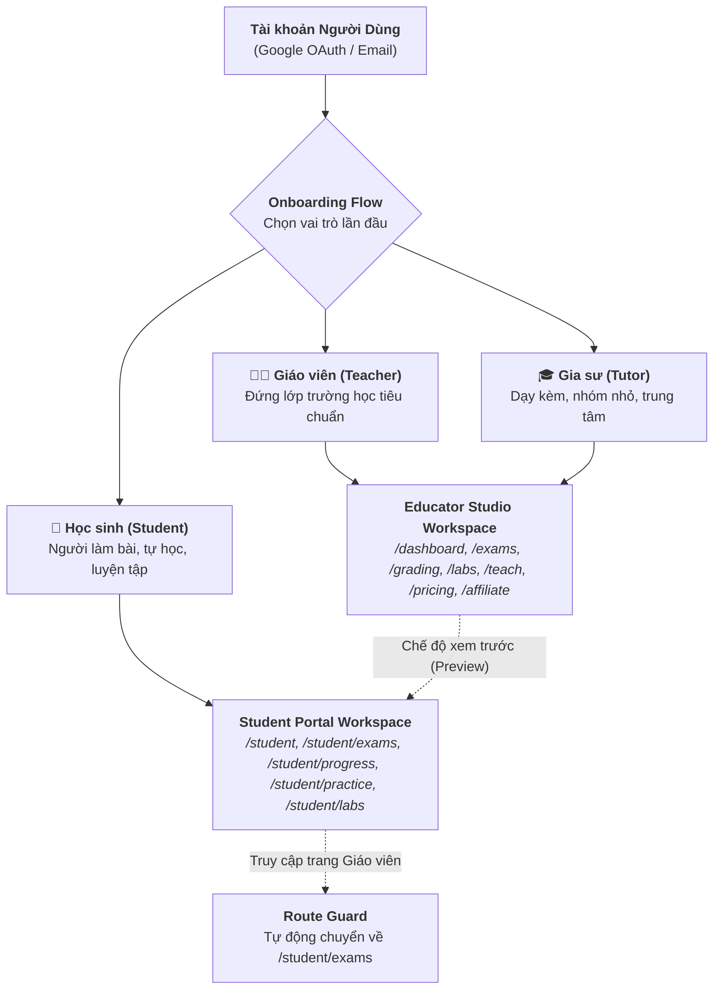

# KẾ HOẠCH TRIỂN KHAI SPRINT 5 (SPRINT 5 IMPLEMENTATION PLAN)
## CỔNG HỌC SINH CHUYÊN BIỆT & PHÂN LUỒNG RBAC WORKSPACE (STUDENT PORTAL & MULTI-ROLE SYSTEM)

> **Tài liệu tham chiếu:** `docs/Sprint_5_Plan.md`  
> **Dự án:** EduTest AI — Tutor OS (Hệ Điều Hành Dạy Thêm & Gia Sư Số 1 Việt Nam)  
> **Phiên bản:** v1.0  
> **Trạng thái:** Sẵn sàng triển khai (Approved via `/grill-me`)  
> **Tác giả:** Tech Lead & Core Engineering Team

---

## 1. BỐI CẢNH VÀ MỤC TIÊU CHIẾN LƯỢC

### 1.1. Hiện trạng sau 4 Sprints nền tảng
* **Sprint 1 (Hoàn tất):** Báo cáo học tập Zalo Magic Link 1-Click (`/report/[token]`), ma trận 4 cấp độ nhận thức GDPT 2025, nhận xét AI cá nhân hóa.
* **Sprint 2 (Hoàn tất):** AI Luyện bù lỗ hổng kiến thức (`/practice/[token]`), tự động nhân bản 3-5 câu tương tự số đẹp từ câu sai, tự chấm 100%, xuất file Word kép kèm Watermark gia sư.
* **Sprint 3 (Hoàn tất):** Hệ thống eKYC Giáo viên bằng AI Vision OCR thẻ ngành sư phạm, cấp Tích Xanh uy tín, combo perks (+10.000 credits, 10 đề/ngày).
* **Sprint 4 (Hoàn tất):** Growth & Monetization Engine: PayOS VietQR nâng cấp PRO/MAX tức thì trong < 2 giây, Mạng lưới đối tác Affiliate 20% trọn đời (mô hình Hybrid: rút VietQR hoặc nhân 1.5x Credits).

### 1.2. Mục tiêu trọng tâm của Sprint 5
Hoàn thiện mảnh ghép cuối cùng trong **Tam Giác Sư Phạm (Giáo Viên — Học Sinh — Phụ Huynh)**:
1. **Phân Luồng Đa Vai Trò (RBAC Onboarding Flow):** Người dùng đăng ký/đăng nhập lần đầu được chọn vai trò rõ ràng qua Modal 3D trực quan: **Giáo viên trường** (Teacher), **Gia sư dạy kèm** (Tutor), **Học sinh** (Student).
2. **Cổng Học Sinh Chuyên Biệt (`/student`):** Không gian học tập mobile-first, tinh giản tối đa, không chứa các công cụ quản trị phức tạp của giáo viên:
   - 🏠 **Trang chủ học tập (`/student`)**: Thống kê Streak học tập, bài tập cần làm gấp, bài kiểm tra sắp tới.
   - 📝 **Phòng thi & Bài tập (`/student/exams`)**: Danh sách bài thi thầy cô giao, nhập mã đề/mã lớp, làm bài trực tuyến với đồng hồ đếm ngược.
   - 📊 **Hồ sơ năng lực GDPT 4 cấp độ (`/student/progress`)**: Radar Chart phân tích Nhận biết, Thông hiểu, Vận dụng, Vận dụng cao; lịch sử điểm số tăng giảm theo thời gian.
   - ⚡ **Luyện bù lỗ hổng (`/student/practice`)**: Kho bài tập củng cố cá nhân hóa tự động sinh từ câu sai.
   - 🔬 **Phòng Thí Nghiệm 3D (`/student/labs`)**: Tự do thực hành 54+ mô phỏng tương tác Vật lý, Hóa học, Sinh học.
3. **Cơ Chế Auto-Claim Đồng Bộ Dữ Liệu:** Học sinh xem báo cáo trên Zalo hoặc làm bài luyện bù công khai có thể bấm *"💾 Lưu vào Hồ sơ cá nhân"* để tự động gắn dữ liệu và biểu đồ vào tài khoản học sinh.
4. **Bảo Mật Phân Quyền Route Guard:** Học sinh không bị quá tải bởi các tính năng soạn đề/chấm thi; tự động chuyển hướng về `/student` nếu truy cập nhầm vào khu vực giáo viên.

---

## 2. KIẾN TRÚC PHÂN TẦNG VAI TRÒ & WORKSPACE (RBAC ARCHITECTURE)



---

## 3. ĐẶC TẢ CHI TIẾT 5 PHÂN HỆ TRIỂN KHAI (TECHNICAL SPECIFICATIONS)

### 3.1. Phân hệ 1: Modal Onboarding Thu Thập Vai Trò (Role Selection Flow)
* **Vị trí hiển thị:** Tự động kích hoạt khi người dùng đăng nhập lần đầu hoặc khi tài khoản chưa có vai trò cụ thể.
* **Component:** `frontend/src/components/onboarding/role-onboarding-modal.tsx`
* **3 Thẻ vai trò trực quan:**
  1. **👨‍🏫 Giáo viên trường học:** Soạn đề chuẩn GDPT 2025, Bục Giảng Số 4.0, Chấm trắc nghiệm OMR cả lớp 45 bài/3 phút.
  2. **🎓 Gia sư / Trung tâm dạy kèm:** Báo cáo Zalo phụ huynh 1-click, AI Luyện bù lỗ hổng kiến thức, Đóng dấu Watermark thương hiệu riêng.
  3. **🎒 Học sinh:** Làm bài thi trực tuyến, Hồ sơ năng lực GDPT 4 cấp độ, Luyện bài tập củng cố, 54+ Labs 3D tự học.
* **Thao tác 1-Click:** Chọn vai trò $\rightarrow$ Gửi API `POST /api/user/set-role` $\rightarrow$ Cập nhật `users.role` vào database $\rightarrow$ Chuyển hướng người dùng về đúng Workspace tương ứng (`/dashboard` cho giáo viên/gia sư, `/student` cho học sinh).

---

### 3.2. Phân hệ 2: Cổng Học Sinh — Layout & Điều Hướng Mobile-First (`/student`)
* **Layout:** `frontend/src/app/(student)/layout.tsx`
* **Đặc tính giao diện:**
  - Tối giản, tập trung vào việc học, loại bỏ hoàn toàn các thanh công cụ nặng nề (ví tiền, nạp điểm, soạn đề).
  - Header: Logo *EduTest AI — Cổng Học Sinh*, Avatar học sinh, Thẻ chuỗi ngày học liên tục (Streak 🔥), Nút đăng xuất.
  - Preview Mode Banner: Nếu người đăng nhập là Giáo viên/Gia sư đang xem thử góc nhìn học sinh, hiển thị thanh bar nổi bật: *"👨‍🏫 Đang xem thử dưới góc nhìn Học sinh — [Quay lại Bục Giảng]"*.
* **Sidebar / Bottom Navigation (Mobile):**
  - 🏠 Trang chủ (`/student`)
  - 📝 Phòng thi & Bài tập (`/student/exams`)
  - 📊 Hồ sơ năng lực (`/student/progress`)
  - ⚡ Luyện bù lỗ hổng (`/student/practice`)
  - 🔬 Phòng TN 3D (`/student/labs`)

---

### 3.3. Phân hệ 3: Các Trang Chức Năng Cốt Lõi Của Học Sinh

#### A. Trang Chủ Học Sinh (`/student`)
* **Hero Greeting:** *"Chào em, [Tên Học Sinh]! Hôm nay em đã sẵn sàng bứt phá điểm số chưa?"* kèm Streak số ngày học liên tục.
* **Widget 1 — Bài tập cần làm gấp:** Hiển thị bài kiểm tra hoặc phiếu luyện bù có hạn nộp gần nhất kèm nút `[Làm bài ngay]`.
* **Widget 2 — Điểm số gần đây:** Thẻ điểm tổng kết các bài kiểm tra gần nhất kèm biểu đồ mini tăng/giảm phong độ.
* **Widget 3 — Lối tắt Phòng thí nghiệm 3D:** Gợi ý các bài mô phỏng Vật lý / Hóa học liên quan đến nội dung đang học.

#### B. Phòng Thi & Bài Tập (`/student/exams`)
* **Tabs:** *Chưa hoàn thành* vs *Đã nộp bài*.
* **Hộp công cụ gia nhập phòng thi:** Nút `[🔑 Nhập Mã Đề / Mã Lớp]` $\rightarrow$ Modal nhập mã 6 ký tự để nhận đề thi trực tuyến từ thầy cô.
* **Thẻ bài thi:** Tên đề thi, Giáo viên giao bài, Môn học, Thời gian làm bài (phút), Số lượng câu hỏi, Hạn chót.

#### C. Hồ Sơ Năng Lực GDPT 4 Cấp Độ (`/student/progress`)
* **Radar Chart Ma Trận Năng Lực:** Biểu đồ mạng nhện trực quan phân tích 4 mức độ:
  - Nhận biết (% chính xác)
  - Thông hiểu (% chính xác)
  - Vận dụng (% chính xác)
  - Vận dụng cao (% chính xác)
* **Biểu Đồ Phong Độ Điểm Số:** Đồ thị đường thể hiện sự tiến bộ qua từng tuần/tháng.
* **Điểm Mạnh & Lỗ Hổng Cần Khắc Phục:** Danh sách các chủ đề kiến thức hay làm sai nhiều nhất kèm gợi ý luyện tập.
* **Công Cụ Đồng Bộ Báo Cáo:** Hộp nhập mã Magic Link (từ Zalo phụ huynh hoặc phiếu in) để kéo toàn bộ kết quả bài kiểm tra vào tài khoản cá nhân.

#### D. Luyện Bù Lỗ Hổng Kiến Thức (`/student/practice`)
* Danh sách các phiếu luyện bù kiến thức do AI tạo ra từ các câu sai.
* Nút `[⚡ Luyện ngay]` mở giao diện giải đề thông minh online có chấm điểm tức thì.

#### E. Phòng Thí Nghiệm 3D Tự Học (`/student/labs`)
* Danh mục 54+ mô phỏng 3D Vật lý, Hóa học, Sinh học được thiết kế dành riêng cho học sinh tự khám phá hiện tượng khoa học.

---

### 3.4. Phân hệ 4: Cơ Chế Auto-Claim & Đồng Bộ Dữ Liệu Sư Phạm

#### A. Tích hợp nút "Lưu vào Hồ sơ cá nhân" trên Báo cáo Zalo (`/report/[token]`)
* Khi học sinh hoặc phụ huynh đang xem trang báo cáo công khai:
* Hiển thị nút bấm nổi bật: `[💾 Lưu Kết Quả Vào Hồ Sơ Học Sinh]`.
* Nếu học sinh đã đăng nhập: Tự động gọi API `POST /api/student/claim` để gán `student_reports.student_id = user.id`.
* Nếu học sinh chưa đăng nhập: Lưu token vào `localStorage.setItem('edutest_pending_claim_report', token)` và chuyển hướng đến trang Đăng ký/Đăng nhập 1-click qua Google. Sau khi đăng nhập thành công, hệ thống tự động claim và hiển thị thông báo chúc mừng!

#### B. Đồng bộ Phiếu Luyện Bù Kiến Thức (`/practice/[token]`)
* Tương tự báo cáo kết quả, học sinh làm bài tập luyện bù online xong có thể lưu tiến trình và điểm số vào mục `/student/practice`.

---

### 3.5. Phân hệ 5: Cơ Chế Bảo Mật & Điều Hướng Route Guard

* **Quy tắc chuyển hướng thông minh:**
  - Nếu `user.role === 'student'`: Khi truy cập các đường dẫn quản trị của Giáo viên (`/exams/create`, `/grading`, `/whiteboard`, `/pricing`, `/affiliate`, `/admin/*`), hệ thống tự động chuyển hướng về `/student/exams` kèm Toast: *"Trang này dành riêng cho Thầy Cô và Gia sư. Bạn đã được chuyển về Không gian Học sinh."*
  - Nếu `user.role === 'teacher' | 'tutor'`: Có toàn quyền truy cập Educator Studio, đồng thời khi vào các trang `/student/*` sẽ được mở ở **Chế độ xem trước (Preview Mode)** kèm nút bấm quay về Bục Giảng Số.
  - Nếu `user.role === 'admin'`: Có toàn quyền truy cập tất cả các trang bao gồm cả Cổng Quản Trị `/admin/*`.

---

## 4. BẢN THIẾT KẾ CƠ SỞ DỮ LIỆU (DATABASE SCHEMA MIGRATION)

File migration: `supabase/migrations/20261105_student_portal_and_rbac.sql`

```sql
-- ========================================================
-- EduTest AI - Sprint 5: Student Portal & RBAC Migration
-- ========================================================

-- 1. Đảm bảo Check Constraint Role hỗ trợ đủ 4 vai trò
ALTER TABLE public.users DROP CONSTRAINT IF EXISTS users_role_check;
ALTER TABLE public.users 
ADD CONSTRAINT users_role_check 
CHECK (role IN ('teacher', 'tutor', 'student', 'admin'));

-- 2. Bảng Lưu Trữ Báo Cáo Được Học Sinh Liên Kết (Claimed Reports)
CREATE TABLE IF NOT EXISTS public.student_claimed_reports (
    id UUID PRIMARY KEY DEFAULT gen_random_uuid(),
    student_id UUID NOT NULL REFERENCES public.users(id) ON DELETE CASCADE,
    report_token TEXT NOT NULL REFERENCES public.student_reports(token) ON DELETE CASCADE,
    claimed_at TIMESTAMPTZ NOT NULL DEFAULT timezone('utc'::text, now()),
    UNIQUE(student_id, report_token)
);

CREATE INDEX IF NOT EXISTS idx_student_claimed_student ON public.student_claimed_reports(student_id);
CREATE INDEX IF NOT EXISTS idx_student_claimed_token ON public.student_claimed_reports(report_token);

-- 3. Bảng Giao Bài & Ghi Danh Bài Thi Của Học Sinh (Student Exam Enrollments)
CREATE TABLE IF NOT EXISTS public.student_exam_enrollments (
    id UUID PRIMARY KEY DEFAULT gen_random_uuid(),
    student_id UUID NOT NULL REFERENCES public.users(id) ON DELETE CASCADE,
    exam_id TEXT NOT NULL,
    session_id TEXT REFERENCES public.grading_sessions(id) ON DELETE SET NULL,
    exam_title TEXT NOT NULL,
    subject TEXT NOT NULL,
    grade TEXT NOT NULL,
    teacher_name TEXT,
    status TEXT NOT NULL DEFAULT 'assigned' CHECK (status IN ('assigned', 'in_progress', 'completed')),
    score NUMERIC(4, 2),
    submitted_answers JSONB DEFAULT '{}'::jsonb,
    assigned_at TIMESTAMPTZ NOT NULL DEFAULT timezone('utc'::text, now()),
    completed_at TIMESTAMPTZ
);

CREATE INDEX IF NOT EXISTS idx_student_enrollments_student ON public.student_exam_enrollments(student_id);
CREATE INDEX IF NOT EXISTS idx_student_enrollments_status ON public.student_exam_enrollments(status);

-- 4. Bảng Theo Dõi Phiếu Luyện Bù Của Học Sinh (Student Practice Enrollments)
CREATE TABLE IF NOT EXISTS public.student_practice_enrollments (
    id UUID PRIMARY KEY DEFAULT gen_random_uuid(),
    student_id UUID NOT NULL REFERENCES public.users(id) ON DELETE CASCADE,
    sheet_token TEXT NOT NULL REFERENCES public.remediation_sheets(token) ON DELETE CASCADE,
    exam_title TEXT NOT NULL,
    subject TEXT NOT NULL,
    status TEXT NOT NULL DEFAULT 'in_progress' CHECK (status IN ('in_progress', 'completed')),
    score NUMERIC(4, 2),
    enrolled_at TIMESTAMPTZ NOT NULL DEFAULT timezone('utc'::text, now()),
    completed_at TIMESTAMPTZ,
    UNIQUE(student_id, sheet_token)
);

CREATE INDEX IF NOT EXISTS idx_student_practice_student ON public.student_practice_enrollments(student_id);

-- 5. Bật Row Level Security (RLS)
ALTER TABLE public.student_claimed_reports ENABLE ROW LEVEL SECURITY;
ALTER TABLE public.student_exam_enrollments ENABLE ROW LEVEL SECURITY;
ALTER TABLE public.student_practice_enrollments ENABLE ROW LEVEL SECURITY;

-- Policies cho student_claimed_reports
CREATE POLICY "Students can view and manage their claimed reports"
    ON public.student_claimed_reports FOR ALL
    USING (auth.uid() = student_id)
    WITH CHECK (auth.uid() = student_id);

-- Policies cho student_exam_enrollments
CREATE POLICY "Students can manage their exam enrollments"
    ON public.student_exam_enrollments FOR ALL
    USING (auth.uid() = student_id)
    WITH CHECK (auth.uid() = student_id);

-- Policies cho student_practice_enrollments
CREATE POLICY "Students can manage their practice enrollments"
    ON public.student_practice_enrollments FOR ALL
    USING (auth.uid() = student_id)
    WITH CHECK (auth.uid() = student_id);
```

---

## 5. DANH SÁCH FILE & PHÂN CÔNG THI CÔNG CHI TIẾT (WORK BREAKDOWN)

| STT | File cần tạo / cập nhật | Nhiệm vụ kỹ thuật |
|:---:|---|---|
| **1** | `supabase/migrations/20261105_student_portal_and_rbac.sql` | Migration tạo bảng `student_claimed_reports`, `student_exam_enrollments`, `student_practice_enrollments`. |
| **2** | `frontend/src/types/database.ts` | Bổ sung TypeScript types cho các bảng và quan hệ mới của Học sinh. |
| **3** | `frontend/src/lib/student/student-store.ts` | Logic xử lý đọc/ghi tiến độ học tập, tính toán Radar 4 cấp độ, Streak, gán bài tập. |
| **4** | `frontend/src/app/api/user/set-role/route.ts` | API cập nhật vai trò người dùng trong onboarding flow. |
| **5** | `frontend/src/app/api/student/dashboard/route.ts` & `progress/route.ts` & `exams/route.ts` & `claim/route.ts` | Các endpoints backend cho Cổng Học Sinh. |
| **6** | `frontend/src/components/onboarding/role-onboarding-modal.tsx` | Component Modal Onboarding 3D lựa chọn vai trò lần đầu cho tài khoản mới. |
| **7** | `frontend/src/app/(student)/layout.tsx` | Layout Cổng Học Sinh mobile-first, tinh giản, hỗ trợ Preview Mode cho Thầy Cô. |
| **8** | `frontend/src/app/(student)/student/page.tsx` | Trang chủ Dashboard Học Sinh (Streak, bài cần làm gấp, điểm số gần đây). |
| **9** | `frontend/src/app/(student)/student/exams/page.tsx` | Màn hình danh sách bài thi, nộp bài, modal nhập mã đề/mã lớp gia nhập phòng thi. |
| **10** | `frontend/src/app/(student)/student/progress/page.tsx` | Hồ sơ năng lực GDPT 4 cấp độ (Radar Chart, Timeline điểm, gợi ý điểm yếu). |
| **11** | `frontend/src/app/(student)/student/practice/page.tsx` | Kho bài tập luyện bù củng cố lỗ hổng kiến thức cá nhân hóa. |
| **12** | `frontend/src/app/(student)/student/labs/page.tsx` | Danh mục 54+ Labs 3D tương tác dành riêng cho học sinh tự học. |
| **13** | `frontend/src/app/report/[token]/report-view.tsx` | Tích hợp nút "💾 Lưu vào Hồ sơ cá nhân" kích hoạt Auto-Claim. |
| **14** | `frontend/src/context/auth-context.tsx` | Hỗ trợ quản lý trạng thái role, chuyển đổi Preview Mode và kích hoạt Onboarding modal. |

---

## 6. KẾ HOẠCH KIỂM THỬ & TIÊU CHÍ HOÀN THÀNH (DEFINITION OF DONE)

1. **Test Case 1 (Onboarding Role Selection):**
   * Người dùng mới đăng nhập $\rightarrow$ Modal Onboarding hiển thị 3 thẻ vai trò.
   * Chọn vai trò `student` $\rightarrow$ Lưu DB thành công và chuyển hướng về `/student`.
2. **Test Case 2 (Student Dashboard & Streak):**
   * Mở `/student` $\rightarrow$ Hiển thị lời chào cá nhân, Streak học tập, thẻ bài tập cần làm gấp.
3. **Test Case 3 (Student Exam Enrollment & Join Code):**
   * Học sinh bấm "Nhập mã đề" $\rightarrow$ Nhập mã bài thi $\rightarrow$ Ghi danh thành công vào danh sách bài thi.
4. **Test Case 4 (Hồ Sơ Năng Lực GDPT 4 Cấp Độ):**
   * Mở `/student/progress` $\rightarrow$ Radar Chart hiển thị đầy đủ 4 trục: Nhận biết, Thông hiểu, Vận dụng, Vận dụng cao.
5. **Test Case 5 (Auto-Claim Report từ Zalo):**
   * Học sinh bấm "Lưu vào Hồ sơ cá nhân" từ `/report/[token]` $\rightarrow$ Kết quả được gắn tức thì vào `/student/progress`.
6. **Test Case 6 (RBAC Route Guarding):**
   * Tài khoản học sinh truy cập `/exams/create` hoặc `/grading` $\rightarrow$ Tự động chuyển hướng về `/student/exams` kèm Toast nhắc nhở.
   * Tài khoản giáo viên truy cập `/student` $\rightarrow$ Hiển thị banner Preview Mode kèm nút quay lại `/dashboard`.
7. **Test Case 7 (Zero Build Error & Zero Regression):**
   * Lệnh `npm run build` vượt qua 100% với 0 lỗi TypeScript và 0 lỗi prerendering.
