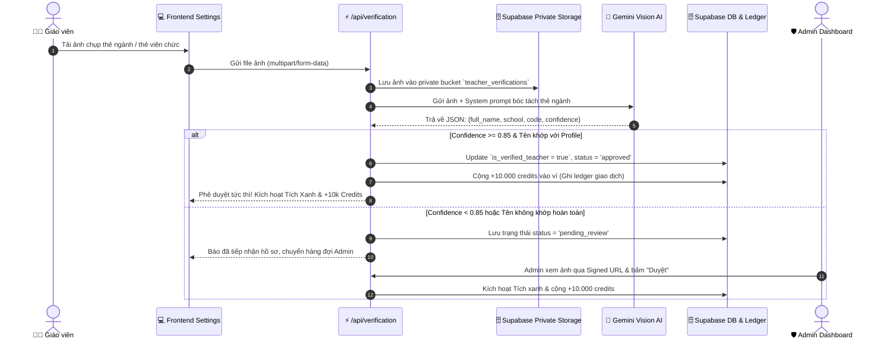
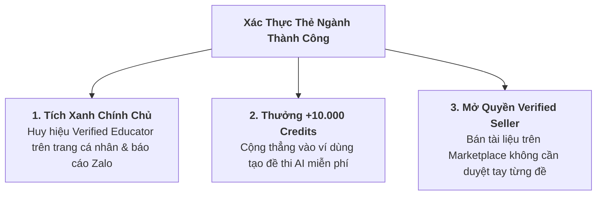

# TÀI LIỆU THIẾT KẾ KỸ THUẬT: HỆ THỐNG XÁC THỰC THẺ NGÀNH GIÁO VIÊN (eKYC)
## AUTOMATED TEACHER CREDENTIAL VERIFICATION SYSTEM

> **Tài liệu kỹ thuật:** `docs/Teacher_Verification_System_Plan.md`  
> **Phiên bản:** v1.0  
> **Phạm vi:** Frontend Next.js 16, Gemini Vision OCR Engine, Supabase Private Storage, RLS Security, Transactional Credit Rewards.  
> **Mục tiêu:** Định danh giáo viên chính chủ, tạo lập cộng đồng sư phạm uy tín, kích hoạt gói quyền lợi VIP.

---

## 1. TỔNG QUAN KIẾN TRÚC VẬN HÀNH (SYSTEM ARCHITECTURE)

Hệ thống kết hợp cơ chế **AI Vision OCR tự động 1-chạm** với **Hàng đợi kiểm duyệt Admin (Human-in-the-loop)**:



---

## 2. QUY TRÌNH TRẢI NGHIỆM NGƯỜI DÙNG (UX JOURNEY)

### 2.1. Tiếp cận không rào cản (Zero Drop-off Onboarding)
* Giáo viên **không bị chặn** lúc đăng ký. Họ có thể tạo đề thi và dùng các tính năng bình thường ngay lập tức.
* Một banner tinh tế hiển thị trên Dashboard:
  > *"🛡️ **Nâng tầm uy tín:** Xác thực thẻ ngành giáo viên để nhận Tích Xanh chính chủ, nhận ngay **+10.000 credits** và mở quyền bán đề thi trên Marketplace. [Xác thực ngay ➔]"*

### 2.2. Giao diện tải thẻ ngành (Tại Settings hoặc Modal)
1. **Vùng Upload ảnh:** Hỗ trợ kéo thả ảnh hoặc chụp trực tiếp bằng camera điện thoại/laptop.
2. **Xem trước (Preview) & Phân tích thời gian thực:**
   * Sau khi chọn ảnh, thanh tiến trình hiển thị: *"Đang phân tích thẻ ngành bằng AI Vision..."* (thời gian xử lý ~1.5 - 2 giây).
3. **Hiển thị thông tin bóc tách:**
   * Hệ thống hiển thị các trường trích xuất được để giáo viên kiểm tra:
     * Họ và tên: `NGUYỄN THỊ THU HÀ`
     * Đơn vị công tác: `THPT CHU VĂN AN - HÀ NỘI`
     * Mã số viên chức/Thẻ: `GV-2024-092`
     * Chuyên môn: `Toán học`
4. **Trạng thái phê duyệt:**
   * Tự động duyệt ngay nếu đạt độ tin cậy $\ge 85\%$ và tên trùng khớp với tài khoản.
   * Nếu ảnh mờ hoặc thẻ mẫu lạ: Hiển thị thông báo *"Hồ sơ đã gửi thành công, Ban Quản Trị sẽ duyệt trong vòng 2 - 4 giờ làm việc"*.

---

## 3. GÓI ĐẶC QUYỀN GIÁO VIÊN CHÍNH CHỦ (VERIFIED PERKS)

Khi được xác thực thẻ ngành thành công, tài khoản giáo viên lập tức được mở khóa **Bộ 3 Đặc Quyền VIP**:



---

## 4. THIẾT KẾ CƠ SỞ DỮ LIỆU & BẢO MẬT (DATABASE & SECURITY)

### 4.1. Migration bảng `teacher_verifications`

```sql
-- Migration: 20261101_teacher_verifications.sql

-- 1. BỔ SUNG CỘT XÁC THỰC TRÊN BẢNG USERS
ALTER TABLE public.users 
ADD COLUMN IF NOT EXISTS is_verified_teacher BOOLEAN NOT NULL DEFAULT false,
ADD COLUMN IF NOT EXISTS verified_at TIMESTAMPTZ,
ADD COLUMN IF NOT EXISTS verified_school TEXT,
ADD COLUMN IF NOT EXISTS verified_teacher_code TEXT;

-- 2. TẠO BẢNG QUẢN LÝ YÊU CẦU XÁC THỰC
CREATE TABLE IF NOT EXISTS public.teacher_verifications (
    id UUID PRIMARY KEY DEFAULT gen_random_uuid(),
    user_id UUID NOT NULL REFERENCES public.users(id) ON DELETE CASCADE,
    card_image_url TEXT NOT NULL,
    extracted_name TEXT,
    extracted_school TEXT,
    extracted_code TEXT,
    extracted_subject TEXT,
    ocr_confidence NUMERIC(3, 2) DEFAULT 0.0,
    status TEXT NOT NULL DEFAULT 'pending' CHECK (status IN ('pending', 'approved', 'rejected')),
    auto_approved BOOLEAN DEFAULT false,
    rejection_reason TEXT,
    reward_granted BOOLEAN DEFAULT false,
    reviewed_by UUID REFERENCES public.users(id),
    created_at TIMESTAMPTZ NOT NULL DEFAULT timezone('utc'::text, now()),
    updated_at TIMESTAMPTZ NOT NULL DEFAULT timezone('utc'::text, now())
);

CREATE INDEX IF NOT EXISTS idx_teacher_verifications_user_id ON public.teacher_verifications(user_id);
CREATE INDEX IF NOT EXISTS idx_teacher_verifications_status ON public.teacher_verifications(status);

-- 3. ROW LEVEL SECURITY (RLS)
ALTER TABLE public.teacher_verifications ENABLE ROW LEVEL SECURITY;

-- Người dùng chỉ được xem yêu cầu xác thực của chính mình
CREATE POLICY "Users can view own verifications"
    ON public.teacher_verifications FOR SELECT
    USING (auth.uid() = user_id);

-- Người dùng gửi yêu cầu xác thực mới
CREATE POLICY "Users can insert own verifications"
    ON public.teacher_verifications FOR INSERT
    WITH CHECK (auth.uid() = user_id);

-- Chỉ Admin và Service Role mới có quyền Update duyệt hồ sơ
CREATE POLICY "Admins can update verifications"
    ON public.teacher_verifications FOR UPDATE
    USING (
        EXISTS (
            SELECT 1 FROM public.users
            WHERE users.id = auth.uid() AND users.role = 'admin'
        )
    );
```

### 4.2. Bảo mật dữ liệu nhạy cảm (PII Privacy Protection)
* **Private Storage Bucket:** Bucket `teacher_verifications` đặt chế độ `public: false`. 
* Không ai có thể xem ảnh bằng URL tĩnh. Mọi lượt xem ảnh của Admin đều phải tạo `createSignedUrl` có thời hạn tối đa 15 phút.
* Tuân thủ Nghị định 13/2023/NĐ-CP: Chỉ lưu ảnh phục vụ mục đích xác minh quyền sư phạm, không chia sẻ cho bên thứ ba.

---

## 5. PROMPT GEMINI VISION BÓC TÁCH THẺ NGÀNH (AI OCR ENGINE)

Prompt cấu hình cho Gemini 1.5 Flash / Pro Vision:

```typescript
export const TEACHER_CARD_OCR_PROMPT = `
Bạn là chuyên gia phân tích và xác thực giấy tờ ngành giáo dục Việt Nam.
Hãy đọc kỹ hình ảnh được cung cấp (thẻ giáo viên, thẻ viên chức ngành giáo dục, giấy chứng nhận công tác hoặc thẻ cán bộ quản lý giáo dục).

Yêu cầu trích xuất dữ liệu trả về ĐÚNG định dạng JSON sau (không kèm markdown thừa):
{
  "is_teacher_card": boolean,       // true nếu là thẻ giáo viên/viên chức giáo dục hợp lệ, false nếu là ảnh rác/ảnh khác
  "full_name": string | null,       // Họ và tên giáo viên in trên thẻ (chữ in hoa)
  "school_name": string | null,     // Tên trường học, cơ sở giáo dục hoặc Phòng/Sở GD&ĐT
  "teacher_code": string | null,    // Số hiệu viên chức, số thẻ hoặc mã định danh giáo viên
  "subject_or_dept": string | null, // Tổ bộ môn hoặc khoa (nếu có)
  "valid_year": string | null,      // Thời hạn hoặc niên khóa (nếu có)
  "confidence": number              // Độ sắc nét và tin cậy của thông tin (từ 0.0 đến 1.0)
}
`;
```

---

## 6. LOGIC XỬ LÝ PHÊ DUYỆT & CỘNG THƯỞNG CREDITS

```typescript
// Pseudocode Logic trong API /api/verification/upload-card
export async function processVerification(userId: string, profileName: string, ocrData: any) {
  const isMatch = checkNameFuzzyMatch(profileName, ocrData.full_name);
  const isHighConfidence = ocrData.is_teacher_card && ocrData.confidence >= 0.85;

  if (isHighConfidence && isMatch) {
    // 1. Phê duyệt tự động
    await supabase.from('users').update({
      is_verified_teacher: true,
      verified_at: new Date().toISOString(),
      verified_school: ocrData.school_name,
      verified_teacher_code: ocrData.teacher_code
    }).eq('id', userId);

    // 2. Thưởng +10.000 credits vào ví
    await addCredits(userId, 10000, "Thưởng xác thực thẻ ngành giáo viên chính chủ");

    return { status: "approved", autoApproved: true };
  } else {
    // Chuyển sang hàng đợi chờ Admin kiểm duyệt bằng tay
    return { status: "pending", autoApproved: false };
  }
}
```
