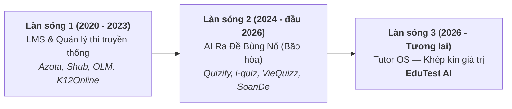
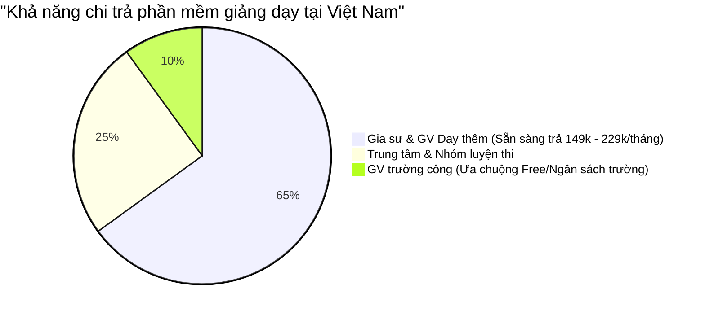
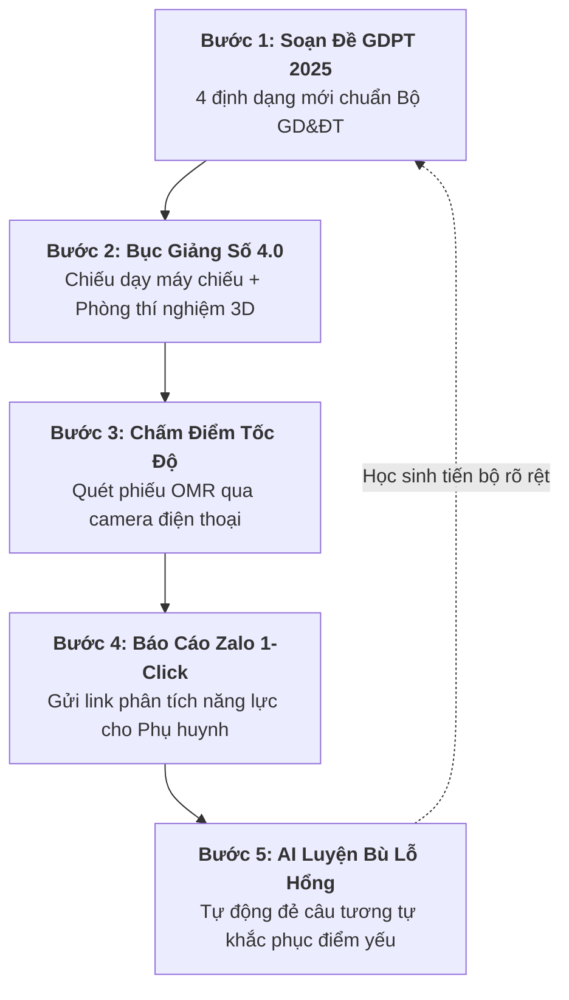
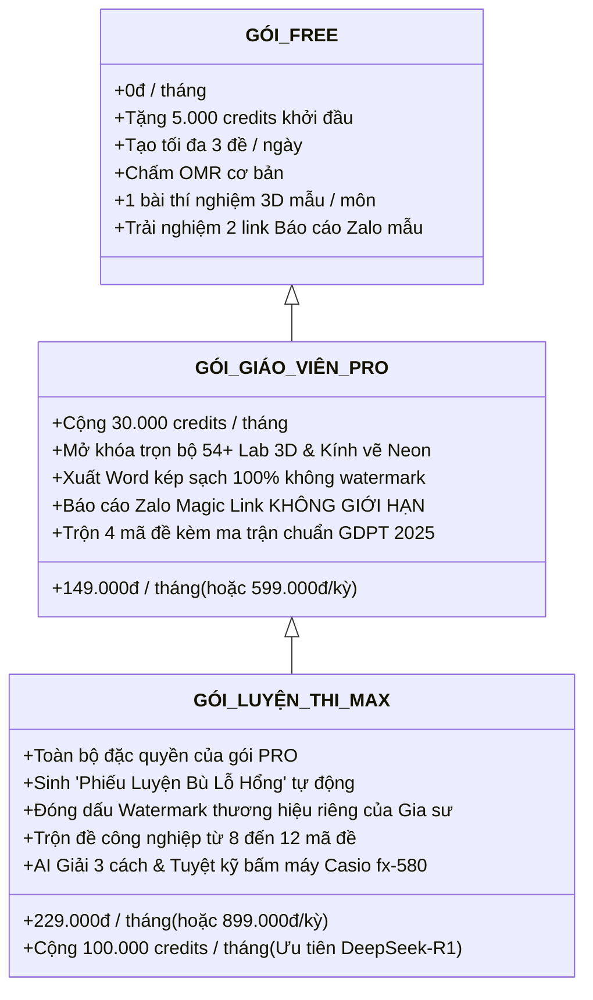

# ĐỊNH VỊ CHIẾN LƯỢC: TUTOR OS — HỆ ĐIỀU HÀNH DẠY THÊM & GIA SƯ SỐ 1 VIỆT NAM
## BẢN KẾ HOẠCH PHÁT TRIỂN SẢN PHẨM & KIẾN TRÚC KỸ THUẬT V2.0

> **Tài liệu chiến lược:** `docs/Tutor_OS_Strategic_Plan.md`  
> **Ngày phê duyệt:** 01/11/2026  
> **Trạng thái:** Sẵn sàng triển khai Sprint 1  
> **Mục tiêu tối thượng:** Thoát khỏi thị trường đỏ "AI tạo đề đại trà", chiếm lĩnh thị trường xanh "Hệ điều hành cho giáo viên dạy thêm & gia sư" với vòng lặp sư phạm khép kín.

---

## 1. BỐI CẢNH THỊ TRƯỜNG EDTECH VIỆT NAM HIỆN NAY

### 1.1. Ba làn sóng phát triển của EdTech Việt Nam



1. **Làn sóng 1 (LMS tĩnh & kho lưu trữ):**
   * Các nền tảng như Azota, Shub Classroom, OLM chiếm thị phần lớn thời dịch COVID nhờ nhu cầu nộp bài tập về nhà.
   * **Điểm yếu lớn:** Giao diện cũ kỹ, không có AI thực chất trong giảng dạy trực tiếp, không hỗ trợ giáo viên đứng lớp tương tác trên máy chiếu.
2. **Làn sóng 2 (AI tạo đề đơn thuần — Đang rơi vào bẫy bão hòa):**
   * Sự bùng nổ của các mô hình ngôn ngữ lớn (Gemini, ChatGPT, DeepSeek) dẫn đến sự xuất hiện của hàng loạt website "gõ 1 câu ra 1 đề" (Quizify, i-quiz, VieQuizz, TeacherVN, Dethi.io,...).
   * **Sự thật tàn nhẫn:** Tính năng *tạo đề bằng AI* hiện chỉ là **điều kiện gia nhập (table stakes)**, hoàn toàn không đủ để tạo ra rào cản phòng thủ (Moat). Các website này chỉ dừng lại ở bước xuất file Word rời rạc.
   * **Nỗi đau đứt gãy quy trình (Workflow Fragmentation):**
     * Soạn đề ở web A $\rightarrow$ Chỉnh sửa Word thủ công $\rightarrow$ In giấy $\rightarrow$ Chấm bài bằng app B hoặc chấm bút đỏ $\rightarrow$ Gõ điểm vào Excel $\rightarrow$ Nhắn tin báo cáo từng phụ huynh qua Zalo $\rightarrow$ **Mất 15 - 20 giờ/tuần của người thầy**.
3. **Làn sóng 3 (Thời cơ của EduTest AI — Tutor OS):**
   * Không bán công cụ tạo đề rời rạc.
   * Xây dựng **Tutor OS — Hệ điều hành dạy thêm & gia sư toàn diện** kết nối từ bàn soạn giáo án, bảng chiếu lớp học, máy chấm bài camera cho đến tin nhắn báo cáo Zalo của phụ huynh.

---

### 1.2. Phân tích Khách hàng Mục tiêu & Khả năng chi trả (Willingness to Pay)



* **Giáo viên trường công lập:** Lương nhà nước cố định, quy trình mua phần mềm qua trường kéo dài hàng quý. Tệp này dùng bản Free là chính, khó chuyển đổi trả phí trực tiếp.
* **Gia sư & Giáo viên dạy thêm:**
  * Thu học phí: **500.000đ – 2.000.000đ / học sinh / tháng**.
  * Quy mô lớp: 15 – 30 học sinh $\rightarrow$ Doanh thu từ **10.000.000đ – 40.000.000đ / tháng**.
  * Chi phí gói EduTest AI (149.000đ – 229.000đ/tháng) chỉ chiếm **< 1% doanh thu**.
  * **Nỗi sợ lớn nhất:** Học sinh chán học, bỏ lớp, phụ huynh nghi ngờ hiệu quả dạy học.
  * **Đòn bẩy quyết định mua:** Nếu phần mềm giúp giữ được **dù chỉ 1 học sinh** hoặc giúp phụ huynh khen ngợi giới thiệu thêm bạn bè, giáo viên sẵn sàng trả tiền đều đặn cả năm.

---

## 2. HÀO BẢO VỆ CÔNG NGHỆ (MOAT) CỦA EDUTEST AI

EduTest AI sở hữu 4 vũ khí công nghệ liên hoàn không đối thủ nào tại Việt Nam có đủ:

| Thứ tự | Vũ khí công nghệ | Mô tả giá trị sư phạm | Trạng thái hiện tại |
|---|---|---|---|
| **1** | **Bục Giảng Số 4.0** | Trình chiếu Split-Screen (Đề thi bên trái + Bảng nháp Excalidraw bên phải + Đồng hồ đếm ngược) | Đã hoàn thiện |
| **2** | **54+ Phòng TN 3D & Kính Neon** | Mô phỏng 3D Vật lý, Hóa học, Sinh học, Địa lý kèm lớp kính vẽ chú thích đè lên chuyển động 3D | Đã hoàn thiện |
| **3** | **Chấm OMR Tự Động Hybrid** | Quét phiếu trắc nghiệm A4 qua camera điện thoại bằng OpenCV (tốc độ 0.5s/bài, chi phí 0đ API) | Đã hoàn thiện |
| **4** | **Báo Cáo Zalo Magic Link 1-Click** | Sinh link báo cáo học tập `/report/[token]` có radar chart, câu sai & lời nhận xét AI gửi Zalo | **Triển khai Sprint 1** |
| **5** | **AI Luyện Bù Lỗ Hổng (Remediation)** | Đọc lỗi sai của từng học sinh $\rightarrow$ Tự đẻ 3-5 bài tương tự đổi số liệu số đẹp | **Triển khai Sprint 2** |

---

## 3. VÒNG LẶP SƯ PHẠM KHÉP KÍN (THE 5-STEP PEDAGOGICAL LOOP)



---

## 4. BẢN THIẾT KẾ KỸ THUẬT CHI TIẾT (TECHNICAL SPECIFICATION)

### 4.1. Tính năng 1: Báo Cáo Học Tập Zalo Magic Link (`/report/[token]`)

#### A. Trải nghiệm người dùng (UX Flow)
1. Sau khi giáo viên bấm "Hoàn thành chấm bài" tại màn hình [`session-detail-view.tsx`](file:///d:/Go-Live\Web\EdTeach\frontend\src\components\grading\session-detail-view.tsx):
   * Danh sách học sinh xuất hiện cột hành động: **[Gửi Zalo Phụ Huynh]**.
   * Giáo viên bấm nút: Hệ thống tự động sao chép tin nhắn mẫu và mở ứng dụng Zalo (hoặc Zalo Web):
     > *"Kính gửi Phụ huynh em [Tên Học Sinh], Thầy Cô gửi phiếu kết quả bài kiểm tra [Tên Đề Thi] ngày [Ngày]: Điểm số [Điểm]/10 (Xếp hạng [Hạng]/[Sĩ số]). Xem bảng phân tích năng lực và lời nhận xét chi tiết của Thầy Cô tại: https://edutest.ai/report/[token]. Trân trọng!"*
2. Phụ huynh nhấp vào link trong Zalo: Mở ngay trang webview chuẩn mobile tuyệt đẹp (tốc độ tải < 800ms, không yêu cầu đăng nhập hay cài ứng dụng).

#### B. Cấu trúc nội dung trang Báo Cáo Phụ Huynh
* **Hero Scorecard:** Điểm số, thứ hạng trong lớp, thời gian làm bài, tỷ lệ số câu đúng/sai/bỏ trống.
* **Radar Chart Năng Lực GDPT:** Biểu đồ mạng nhện thể hiện 4 cấp độ nhận thức:
  * Nhận biết
  * Thông hiểu
  * Vận dụng
  * Vận dụng cao
* **Nhận Xét Sư Phạm AI (AI Pedagogical Insight):**
  * Tự động sinh nhận xét tinh tế: *"Em An có tư duy rất tốt ở các bài toán thực tế và đồ thị, tuy nhiên cần chú ý cẩn thận hơn ở bước đổi đơn vị đo lường..."*
  * Thầy Cô có quyền chỉnh sửa nhanh trước khi gửi.
* **Chi tiết bài làm từng câu:** Màu xanh (Đúng), Màu đỏ (Sai) kèm đáp án chuẩn và lời giải chi tiết.
* **Thương hiệu Gia sư (MAX Tier):** Tên lớp học, hotline, logo trung tâm đóng dấu bảo chứng uy tín.

#### C. Database Schema Migration
Tạo bảng `public.student_reports` với token bảo mật ngẫu nhiên (chống IDOR / đoán thứ tự ID):

```sql
-- Migration: 20261101_student_reports.sql
CREATE TABLE IF NOT EXISTS public.student_reports (
    id UUID PRIMARY KEY DEFAULT gen_random_uuid(),
    token VARCHAR(32) UNIQUE NOT NULL,
    session_id TEXT NOT NULL REFERENCES public.grading_sessions(id) ON DELETE CASCADE,
    student_id TEXT NOT NULL,
    student_name TEXT NOT NULL,
    student_code TEXT,
    score NUMERIC(4, 2) NOT NULL,
    rank INTEGER,
    total_students INTEGER,
    correct_count INTEGER NOT NULL,
    incorrect_count INTEGER NOT NULL,
    empty_count INTEGER DEFAULT 0,
    metrics JSONB NOT NULL DEFAULT '{}'::jsonb,
    ai_comment TEXT,
    teacher_note TEXT,
    created_at TIMESTAMPTZ NOT NULL DEFAULT timezone('utc'::text, now()),
    updated_at TIMESTAMPTZ NOT NULL DEFAULT timezone('utc'::text, now())
);

CREATE INDEX IF NOT EXISTS idx_student_reports_token ON public.student_reports(token);
CREATE INDEX IF NOT EXISTS idx_student_reports_session_id ON public.student_reports(session_id);

-- RLS: Phụ huynh đọc công khai qua token chính xác
ALTER TABLE public.student_reports ENABLE ROW LEVEL SECURITY;

CREATE POLICY "Public can view report with valid token"
    ON public.student_reports FOR SELECT
    USING (true);

CREATE POLICY "Teachers can manage their student reports"
    ON public.student_reports FOR ALL
    USING (
        EXISTS (
            SELECT 1 FROM public.grading_sessions gs
            WHERE gs.id = student_reports.session_id
            AND gs.user_id = auth.uid()
        )
    );
```

---

### 4.2. Tính năng 2: Sinh "Phiếu Luyện Bù Lỗ Hổng" (AI Remediation Cloner)

#### A. Nguyên lý sư phạm
Bắt đúng điểm yếu của từng học sinh từ dữ liệu câu sai trong bài thi $\rightarrow$ Tạo bài tập chữa đúng "chỗ ngứa", giúp học sinh tiến bộ thần tốc chỉ sau 1 tuần.

#### B. Quy trình kỹ thuật
1. Khi giáo viên bấm nút **"⚡ Tạo phiếu luyện bù lỗ hổng"** cạnh tên học sinh:
   * Hệ thống lọc ra danh sách các câu làm sai (`details.filter(d => !d.isCorrect)`).
   * Lấy câu hỏi gốc từ bảng `questions` thông qua `exam_id`.
2. Gọi endpoint `/api/ai/live-clone`:
   * Yêu cầu AI sinh từ 3 – 5 câu hỏi đồng dạng: giữ nguyên bản chất kiến thức và phương pháp giải, nhưng đổi ngữ cảnh và số liệu thành số đẹp.
3. Xuất kết quả:
   * **Bản in Word/PDF:** Tiêu đề *"Phiếu Củng Cố Kiến Thức — Dành riêng cho em [Tên Học Sinh]"* kèm dòng kẻ làm bài và barem giải chi tiết.
   * **Magic Link làm online:** Học sinh làm bài trực tiếp trên điện thoại, tự chấm ngay lập tức.

---

## 5. CẤU TRÚC PHÂN TẦNG THƯƠNG MẠI HÓA (PACKAGING & PRICING)



---

## 6. LỘ TRÌNH THỰC THI (SPRINT IMPLEMENTATION ROADMAP)

### 📌 Sprint 1 (Tuần 1): Báo Cáo Học Tập Zalo Magic Link 1-Click
* [ ] Viết migration tạo bảng `student_reports` và hàm gen token bảo mật.
* [ ] Xây dựng route frontend public `/report/[token]` chuẩn mobile-first (Tailwind CSS, biểu đồ phân phối điểm, danh sách câu đúng/sai).
* [ ] Tích hợp nút *"Gửi Zalo Phụ Huynh"* và modal xem trước tin nhắn mẫu tại [`session-detail-view.tsx`](file:///d:/Go-Live\Web\EdTeach\frontend\src\components\grading\session-detail-view.tsx).
* [ ] Tích hợp AI sinh lời nhận xét cá nhân hóa ngắn gọn.

### 📌 Sprint 2 (Tuần 2): AI Remediation (Phiếu Luyện Bù Lỗ Hổng)
* [ ] Xây dựng API `/api/grading/remediation` liên kết với Live Cloner engine.
* [ ] Thêm nút *"⚡ Luyện bù lỗ hổng"* trong danh sách học sinh có câu sai.
* [ ] Tạo template xuất file Word/PDF cá nhân hóa cho từng học sinh.
* [ ] Áp dụng tier gate: Tính năng này chỉ mở cho **Gói Luyện Thi MAX**.

### 📌 Sprint 3 (Tuần 3): Đòn Bẩy Lan Tỏa Tự Nhiên (Growth Engine)
* [ ] Đặt footer tinh tế trên trang Báo cáo phụ huynh: *"Báo cáo học tập số được bảo chứng bởi EduTest AI — Đồng hành cùng Thầy Cô 4.0"*.
* [ ] Khuyến khích phụ huynh chia sẻ kết quả vào nhóm phụ huynh lớp $\rightarrow$ Tạo kênh thu hút giáo viên mới hoàn toàn miễn phí.
* [ ] Tối ưu hóa tính năng nạp gói PayOS VietQR tự động kích hoạt ngay sau thanh toán.
